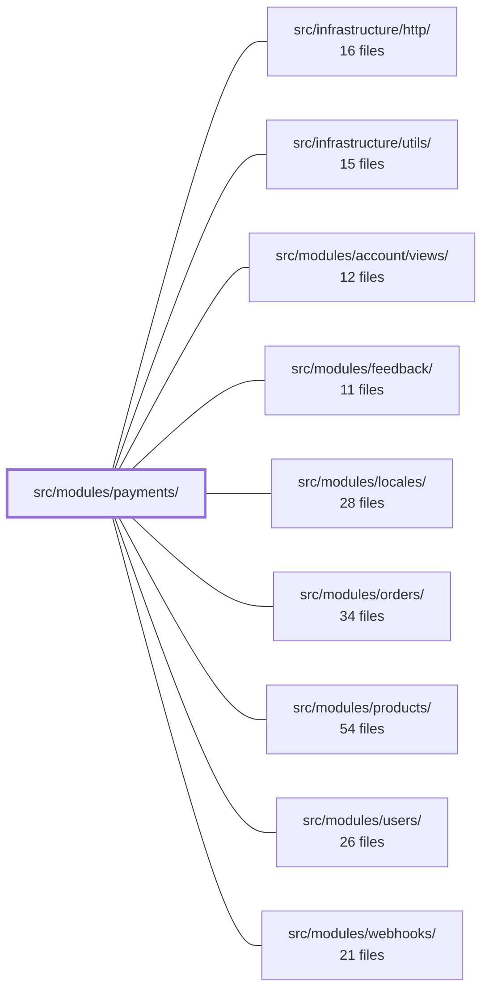

---
tags:
  - 2brain
  - 2brain/module
  - project/boilerplate-vue-frontend
type: module
module: src/modules/payments/
files: 33
updated: 2026-10-17T02:54:51.239048+00:00
---

# src/modules/payments/

## Purpose

The payments module is the client-side authority for everything payment-related: the card checkout flow (PSP intent → confirm → sync), bank-transfer instructions and offline recording, refunds, and the staff-facing payments list with its All / Awaiting transfer / Refunds / Attention tabs. It owns the Pinia store that mirrors payment records and encapsulates the payment-provider sequence, so that no component outside this module handles PSP state directly.

## Key parts

- **State & service layer** — `store.ts` (Pinia store wrapping the API, PSP sequence, and the "404 = no payment yet" convention), `composables/use-order-refund.ts` and `composables/use-record-offline-payment.ts` (thin wrappers that let host pages call store actions without importing the store directly).
- **Customer checkout surface** — `components/PaymentPanel.vue` (the order-page panel that drives intent → confirm → sync, antibot challenge, and status display), `components/PaymentMethodSelector.vue`, `components/TransferInstructionsPanel.vue`, `components/TestCardPicker.vue` (dev-only card simulator, tree-shaken in production).
- **Staff list & detail** — `views/PaymentsList.vue` (the single staff page, four tabs), `components/PaymentsTable.vue`, `components/RefundsTable.vue`, `components/AttentionList.vue` (tab bodies), `components/PaymentDrawer.vue` (per-row detail + refund action), `components/OrderReferenceSearch.vue` (RF-reference lookup), `components/RecordOfflinePaymentForm.vue` (cash/transfer entry).
- **Shared presentation** — `components/PaymentStatusChip.vue` (single source of truth for status colour/label).
- **Module plumbing** — `index.ts` (public barrel; keeps the store internal), `module.ts` (app-registry manifest: route, nav entry, locales, response schemas), `routes.ts`, `response-schemas.ts`.
- **Tests** — `tests/` covers unit, integration, and e2e levels: store sequence (`store.spec.ts`), component contracts (`payment-panel.spec.ts`, `payment-drawer.spec.ts`, `payments-tables.spec.ts`, etc.), route permissions (`routes.spec.ts`), and Cypress page flows (`payments-page.cy.ts`, `order-reference-search.cy.ts`, `a11y.cy.ts`).

## How it connects

- **`src/infrastructure/http/`** — The store delegates all REST calls through `useStructureRestApi`'s `fetchAny`; the generated Orval client is the transport, and the store is the only place that interprets 404-vs-error semantics.
- **`src/modules/orders/`** — The payments module intentionally declares no route edges into orders. Instead, `OrderReferenceSearch` emits the resolved `Order` to its host (typically the orders list view), `PaymentDrawer` renders a conditional link to the order-edit page, and `PaymentPanel` is mounted *on* the order page by the orders module. The boundary is event/link, not navigation.
- **`src/modules/locales/`** — `module.ts` registers the payments English and Italian locale dictionaries so every i18n key used in chips, tabs, and forms is resolved through the shared locale system.
- **`src/modules/feedback/`** — Error surfaces (e.g. a 409 when recording an offline payment while a card charge is in flight) are surfaced as toasts through the app's feedback mechanism rather than being handled locally in the composable.
- **`src/modules/users/`** — Every actionable surface is gated by ability strings (`create:Payment`, `payment.actions.refund`, `display`) that resolve against the authenticated user's role; the route spec pins these to prevent silent permission regressions.

## Where to start

1. **`store.ts`** — Read first to understand the single source of truth for payment state, the intent → confirm → sync sequence, and the 404 convention. Nearly every component and composable ultimately calls into this store.
2. **`components/PaymentPanel.vue`** — The customer-facing checkout panel shows how the store's sequence is orchestrated from the UI, including the antibot challenge, status transitions, and the test-card seam. It gives the best "happy path" view of the module's core job.

## Connected modules

[[boilerplate-vue-frontend_ROOT|/ (repository root)]] · [[boilerplate-vue-frontend_src_infrastructure_http|src/infrastructure/http/]] · [[boilerplate-vue-frontend_src_infrastructure_utils|src/infrastructure/utils/]] · [[boilerplate-vue-frontend_src_modules_account_views|src/modules/account/views/]] · [[boilerplate-vue-frontend_src_modules_feedback|src/modules/feedback/]] · [[boilerplate-vue-frontend_src_modules_locales|src/modules/locales/]] · [[boilerplate-vue-frontend_src_modules_orders|src/modules/orders/]] · [[boilerplate-vue-frontend_src_modules_products|src/modules/products/]] · [[boilerplate-vue-frontend_src_modules_users|src/modules/users/]] · [[boilerplate-vue-frontend_src_modules_webhooks|src/modules/webhooks/]]

## Files
- `src/modules/payments/components/AttentionList.vue` — Renders the "Needs attention" tab inside the payments list view. It is a strictly read-only table of problems *currently* recorded on payment documents (a fixed problem disappears on the next read). It shows the problem kind, since-date, amount, and a link to the order page where existing remediation actions live. It performs no mutations of its own.
- `src/modules/payments/components/OrderReferenceSearch.vue` — A self-contained search card that lets an operator paste an RF (creditor) reference from a bank statement and resolve it to the order it settles. It emits the found `Order` to its host rather than navigating, so it can be mounted in any context without requiring an `orders` module or route. Gated behind the `create:Payment` permission.
- `src/modules/payments/components/PaymentDrawer.vue` — A right-side navigation drawer that expands on a single payment row selected in the payments list. It surfaces details that don't fit in a table cell — provider references, card last-4, individual refund entries with failure reasons — and exposes the **Refund** action (gated by `payment.actions.refund`) and a conditional link to the order-edit page.
- `src/modules/payments/components/PaymentMethodSelector.vue` — A presentational radio-group widget that lets the user pick a payment method during checkout. It is intentionally blank (renders nothing) when the backend offers only one method, since a single option is not a meaningful choice. Selection is surfaced to the parent via `v-model`; the server defaults to `card` when nothing is sent.
- `src/modules/payments/components/PaymentPanel.vue` — The order-page payment panel: renders the card-payment form while the order is still payable, shows the payment's current state (in-flight, succeeded, refund-pending) afterwards, and delegates the intent → confirm → sync sequence to the payments Pinia store. It also surfaces the antibot human-challenge flow and the generic stock-hold deadline.
- `src/modules/payments/components/PaymentStatusChip.vue` — A small presentational component that renders a payment's `displayStatus` as a coloured, i18n-labelled `v-chip`. It exists so every surface that shows a payment status (drawer, panel, table) renders it identically without duplicating the colour/label mapping.
- `src/modules/payments/components/PaymentsTable.vue` — The "All" tab of the payments list: renders every payment in a sortable, filterable, paginated table. All filtering and sorting happen server-side via `POST /payments/search`; the component owns its filter form state locally (deliberately *not* in the shared store) so a second payment list on the same screen can operate independently.
- `src/modules/payments/components/RecordOfflinePaymentForm.vue` — Operator-facing form for recording a payment that arrived outside the card checkout (cash, transfer, etc.). It owns the field state, client-side validation, and submit flow; the actual API write is delegated to a composable. On success it emits `recorded` so the parent can reload the order, since the server-side status change (`pending → paid`) is invisible to this component.
- `src/modules/payments/components/RefundsTable.vue` — Read-only refunds table for the "Refunds" tab of the payments list. Displays one row per refund across all payments (newest first) with filterable status, reason, order ID, and creation date range. Refunds are never mutated here—they are settled on their parent payment.
- `src/modules/payments/components/TestCardPicker.vue` — A development and e2e seam that simulates a payment provider's card-selection widget. It lets a developer or test click a test card (e.g. "Card the issuer declines") instead of knowing a magic `pm_card_*` string. It is loaded only behind `import.meta.env.DEV || VITE_TEST_CARDS` via a dynamic import in `PaymentPanel`, so the production build tree-shakes it out entirely.
- `src/modules/payments/components/TransferInstructionsPanel.vue` — Presentational panel that displays bank-transfer instructions (beneficiary, IBAN, optional BIC, and a reference) for a single payment. It contains no data-fetching logic; all content arrives via the `instructions` prop and is scoped by the API to the payment's buyer or staff. It exists to give customers a clear, copy-ready view of where to send their transfer and the deadline.
- `src/modules/payments/composables/use-order-refund.ts` — A Vue composable that exposes a single-order refund control—whether a refund is possible and how to perform it—reactive to an order-id ref. It exists so that a refund button and its gating logic can live outside the payments panel without importing the store directly; it is the one deliberate exception to the barrel's policy of keeping `usePaymentsStore` internal.
- `src/modules/payments/composables/use-record-offline-payment.ts` — Thin composable that exposes a single `recordOfflinePayment` call for one order, delegating the actual API request and state mutation to the payments store. It exists so view components (e.g. the offline-payment form) can invoke the store action without importing the store directly, and so the `orderId` can be kept reactive across route changes.
- `src/modules/payments/index.ts` — Public barrel for the payments module. It is the single entry point through which other parts of the app access payments-related components and the one composable (`useOrderRefund`) that is intentionally exposed across module boundaries. The store and `useRecordOfflinePayment` are deliberately kept internal.
- `src/modules/payments/module.ts` — Declares the payments `AppModule` manifest for the app registry: it wires in the staff payments route, a single admin navigation entry, lazy-loaded response schemas, and English/Italian locale dictionaries so the panel can be mounted by the rest of the application.
- `src/modules/payments/response-schemas.ts` — Declares the response-envelope schema rows for every `payments`-tagged REST endpoint (as stamped via `x-module` in `openapi.yaml`). Registering these rows through the module manifest activates contract validation for the payments domain; removing the folder disables it.
- `src/modules/payments/routes.ts` — Declares the Vue Router route table for the payments domain. The payments module exposes exactly one staff-facing page (the payments list); there is no dedicated "pay" route because paying is a panel on the order view, not a standalone page.
- `src/modules/payments/store.ts` — Pinia store (`usePaymentsStore`) that is the single client-side authority for payment state in the payments module. It wraps `useStructureRestApi`'s `fetchAny` for a shared loading flag, mirrors the API's payment record locally, and encapsulates the PSP intent → confirm → sync sequence plus the "404 means no payment yet" convention so that components never handle those concerns themselves.
- `src/modules/payments/tests/e2e/a11y.cy.ts` — Declares the list of payments-page routes that the shared a11y sweep must audit. It is co-located inside the payments module so that removing the module also removes its accessibility coverage. The file contains no test logic of its own; it is purely a route/configuration manifest passed to `sweepA11y`.
- `src/modules/payments/tests/e2e/order-reference-search.cy.ts` — End-to-end test for the admin's RF-reference lookup. It verifies the full happy-path (customer buys with bank transfer → admin pastes the displayed RF reference into the orders search → lands on the order's edit page) and the negative path (a non-matching reference produces an inline error without navigating away).
- `src/modules/payments/tests/e2e/payments-page.cy.ts` — Cypress end-to-end test for the staff payments page (`/en/sales/payments`). It verifies the page-level concerns—tab layout, row/drawer interaction, status filtering, URL persistence, and role-based access—against the real backend. Numeric correctness of payment data is intentionally left to backend tests.
- `src/modules/payments/tests/order-reference-search.spec.ts` — Vitest component test for `OrderReferenceSearch`. Verifies the component's contract: it emits a `found` event with the matched order (or renders an inline error) and nothing more. It explicitly does **not** navigate — the payments module declares no `MODULE_EDGES` into `orders`, so routing to `OrderEdit` is the host's responsibility (covered in `orders-list-view.spec.ts`).
- `src/modules/payments/tests/payment-drawer.spec.ts` — Vitest spec for the `PaymentDrawer` component. Verifies that the drawer correctly renders payment details a table row cannot (provider reference, masked card, refund list with failure reasons), that the refund action appears only when the server advertises it, and that the full refund flow (confirm → store call → emit `changed` → close) and its error paths behave as expected.
- `src/modules/payments/tests/payment-panel.spec.ts` — Vitest spec for the `PaymentPanel` Vue component. Verifies what the panel renders (or hides) based on deployment capabilities, order payability, payment status, and order transitions. Scoped to panel-level rendering only — the PSP sequence is covered at the store level elsewhere.
- `src/modules/payments/tests/payments-list-view.spec.ts` — Unit spec for the staff payments page (`PaymentsList.vue`). It verifies which tabs appear based on module slot contributions, how the active tab is read from and written to the URL, that a row selection opens the drawer with the correct payment, and that the order-reference lookup is gated by ability and navigates to the order edit page. Tab *bodies* are stubbed to markers; their logic lives in separate specs.
- `src/modules/payments/tests/payments-tables.spec.ts` — Integration-level unit tests for the three tab bodies of the staff payments page (`PaymentsTable`, `RefundsTable`, `AttentionList`). The store's read methods are stubbed, so each test verifies what query the component sends and how it renders the response — without hitting the network.
- `src/modules/payments/tests/record-offline-payment-form.spec.ts` — Unit test suite for the `RecordOfflinePaymentForm` component. It mounts the real form (with a native-`<select>` stub for Vuetify's `v-select`) and verifies field defaults, submission payload shape, and error placement, while spying on the store's `recordOfflinePayment` to confirm the component delegates the write correctly. The store's own write logic is covered separately in `store.spec.ts`.
- `src/modules/payments/tests/routes.spec.ts` — Test suite that pins the access-control metadata declared on every payments route. It exists to prevent a silent permission regression where a route's `can` check could be satisfied by a less-privileged action (e.g. `read:Payment` instead of `display`) and to catch any route added to the module without a corresponding entry in this spec.
- `src/modules/payments/tests/store.spec.ts` — Vitest unit tests for the payments Pinia store. The HTTP transport (`orvalMutator`) is mocked as a method/URL-keyed router so the generated client and the store itself remain real. The tests pin the PSP sequence (intent → confirm with provider method ref → sync for challenge resolution) and the critical distinction that a 404 on read resolves to `undefined` ("no payment yet") while every other failure still rejects to the caller.
- `src/modules/payments/tests/transfer-instructions-panel.spec.ts` — Vitest spec that pins the one behavior most likely to silently break a customer's real bank transfer: the reference string displayed on screen (grouped in 4-char blocks) and the string the copy button puts on the clipboard (raw, ungrouped) must be derived from the same source value. Also verifies basic rendering of beneficiary, IBAN, BIC-omission, and deadline.
- `src/modules/payments/tests/use-order-refund.spec.ts` — Vitest spec for the `useOrderRefund` composable. It pins the single behavioral contract of the payments refund control: `canRefund` is a pure read-back of the server's `actions.refund` field, so the button state is always driven by the API response rather than any client-side status logic.
- `src/modules/payments/tests/use-record-offline-payment.spec.ts` — Unit tests for the `useRecordOfflinePayment` composable. They pin down a deliberate design contract: the composable performs the API call and mirrors the response, but makes **no** client-side decision about whether recording is allowed. Business-rule rejections (e.g. a card charge already in flight) are the server's 409, surfaced to the caller as a toast.
- `src/modules/payments/views/PaymentsList.vue` — The staff-facing payments page. It presents four tabs (All, Awaiting transfer, Refunds, Attention) over the same backend records so a payment can be inspected from any tab. It owns tab state, the shared `PaymentDrawer`, and the optional order-reference lookup; each tab's body is delegated to a dedicated component.

---
[[boilerplate-vue-frontend_INDEX|← boilerplate-vue-frontend index]]
