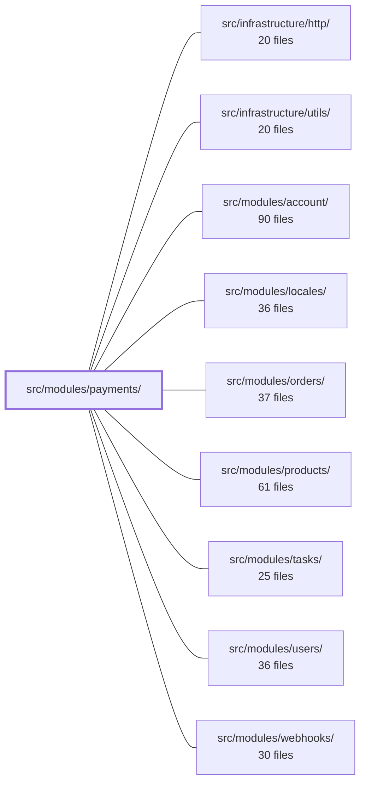

---
tags:
  - 2brain
  - 2brain/module
  - project/boilerplate-vue-frontend
type: module
module: src/modules/payments/
files: 46
updated: 2026-11-10T08:39:58.752783+00:00
---

# src/modules/payments/

## Purpose

The payments module owns every staff-facing and customer-facing payment interaction in the application: browsing and filtering payment lists, inspecting and acting on individual payments (refunds, offline settlement, dispute tracking), and rendering the checkout payment panel that appears on the order page. It is the single place where the PSP intent → confirm → sync sequence is orchestrated, and the only module that registers the `/en/sales/payments` staff route.

## Key parts

- **Store & domain logic** — `store.ts` is the Pinia setup-store that holds the active payment record, wraps every API call through `fetchAny`, and encodes the PSP payment lifecycle. `refund-notice.ts` centralises the operator toast copy for every refund outcome. `schemas.ts` re-exports Zod validators so components never reach into the API layer.
- **Module wiring** — `module.ts` (manifest: route, schemas, locale loaders), `routes.ts` (single staff route), `response-schemas.ts` (contract-validation registration), and `index.ts` (public barrel exporting six UI elements; the store and `useRecordOfflinePayment` stay private).
- **Payments list tabs** — `PaymentsTable.vue` (all payments), `AwaitingTransfersTable.vue` (bank-transfer debts), `RefundsTable.vue` (read-only refund log), and `AttentionList.vue` (failed refunds, open disputes, overdue pay-backs). All share `use-paged-table.ts` for paging and `use-row-select.ts` for one-shot row clicks.
- **Payment detail & checkout** — `PaymentDrawer.vue` renders the side-drawer with provider details and server-authorised action buttons. `PaymentPanel.vue` is the order-page panel that drives the PSP sequence via the store. `PaymentMethodSelector.vue` and `TestCardPicker.vue` (dev-only) round out the input side. `PaymentStatusChip.vue` gives a uniform status label.
- **Disputes** — `DisputeBanner.vue` renders per-payment dispute alerts; `OrderDisputes.vue` is the thin order-scoped wrapper that filters disputes by order ID.
- **Offline & transfer payments** — `RecordOfflinePaymentForm.vue` (operator entry form) backed by `use-record-offline-payment.ts`; `TransferInstructionsPanel.vue` displays bank-transfer details.
- **Refund flow** — `RefundCancelForm.vue` (void-a-refund note) and `composables/use-order-refund.ts` (narrow order-scoped refund action for the orders module).
- **Cross-module lookup** — `OrderReferenceSearch.vue` resolves an RF creditor reference to an order ID and emits it; the host decides navigation.
- **Tests** — Colocated Vitest component/integration specs under `tests/`, plus Cypress e2e suites (`payments-page`, `actions`, `order-reference-search`, `roles`, `a11y`) that co-locate with the module so deletion is atomic.

## How it connects

- **`src/modules/orders/`** — The `PaymentPanel`, `RecordOfflinePaymentForm`, and `OrderDisputes` are mounted *on* the order page. `OrderReferenceSearch` resolves to an order ID and leaves navigation to the orders host. `use-order-refund` and `use-record-offline-payment` are deliberately narrow composables that accept an `orderId` ref so the orders module never imports the payments store directly. The payments barrel does not reach into orders.
- **`src/infrastructure/http/`** — The store calls every backend endpoint through the shared `fetchAny` helper, inheriting auth, error handling, and the loading-flag pattern.
- **`src/modules/locales/`** — `module.ts` registers locale loaders so the admin kernel picks up payment-specific translation strings.
- **`src/modules/users/` / `src/modules/account/`** — Permission keys (e.g. `display:Payment`, `refund:Payment`) gate which views, tabs, and action buttons are visible; the module reads the resolved role but never manages accounts itself.
- **`src/infrastructure/utils/`** — Shared utilities (toast API, formatting helpers) consumed by components and the store.

## Where to start

Read **`store.ts`** first — it is the single source of truth for payment state, the PSP sequence, and the "empty list means no payment yet" convention that every component relies on. Then skim **`index.ts`** to see exactly what the module exposes to the rest of the app (five components + one composable) and what stays internal. From there, `PaymentPanel.vue` walks you through the customer checkout path and `PaymentsTable.vue` through the staff list path.

## Connected modules

[[boilerplate-vue-frontend_ROOT|/ (repository root)]] · [[boilerplate-vue-frontend_src_infrastructure_http|src/infrastructure/http/]] · [[boilerplate-vue-frontend_src_infrastructure_utils|src/infrastructure/utils/]] · [[boilerplate-vue-frontend_src_modules_account|src/modules/account/]] · [[boilerplate-vue-frontend_src_modules_locales|src/modules/locales/]] · [[boilerplate-vue-frontend_src_modules_orders|src/modules/orders/]] · [[boilerplate-vue-frontend_src_modules_products|src/modules/products/]] · [[boilerplate-vue-frontend_src_modules_tasks|src/modules/tasks/]] · [[boilerplate-vue-frontend_src_modules_users|src/modules/users/]] · [[boilerplate-vue-frontend_src_modules_webhooks|src/modules/webhooks/]]

## Files
- `src/modules/payments/components/AttentionList.vue` — The "Needs attention" tab in the payments module. It displays payment problems (failed refunds, open disputes, overdue pay-backs) that are still recorded on a document, so a fixed one disappears on the next read. It is deliberately read-only for most problem types: it surfaces the issue and links to the order page where the real actions live. For manual refunds it opens the `PaymentDrawer`; for amount mismatches it points to the audit log instead.
- `src/modules/payments/components/AwaitingTransfersTable.vue` — Renders the "Awaiting transfer" tab of the payments list: bank-transfer payments still owed to the merchant, ordered by `payBy` deadline (server-sorted). Selecting a row emits the payment upward so the parent can open its detail drawer.
- `src/modules/payments/components/DisputeBanner.vue` — Renders one or more `v-alert` banners for the disputes attached to a single payment. Each alert surfaces the dispute kind, current status, amount, reason, evidence deadline (with days-remaining or overdue count), and a link to the provider's dashboard. The component is display-only and staff-gated: the API only sends `disputes` to callers holding `display:Payment`, so this file trusts the prop it receives.
- `src/modules/payments/components/OrderDisputes.vue` — A thin presentational wrapper that displays the dispute banner for a specific order. It reads the already-fetched `payment` from the shared payments store and passes that payment's disputes down to `DisputeBanner`, filtering out disputes that belong to a different order (stale response guard). It performs no fetching of its own.
- `src/modules/payments/components/OrderReferenceSearch.vue` — A single-field lookup widget that lets an admin paste an RF creditor reference (as seen on a bank statement) and resolve it to the order that pays it. The component does **not** navigate itself; it emits the found order's ID so the hosting view decides what "found" means. It is published for any host to mount, because the `payments` module has no `dependsOn` reach into `orders`.
- `src/modules/payments/components/PaymentDrawer.vue` — A temporary Vuetify side-drawer that surfaces the detail a list row cannot fit—refunds with their provider references, card digits, failure reasons—and renders the action buttons the server has authorised via the payment's `actions` object (refund, mark-returned, cancel-refund). It is a pure renderer of permissions: it never decides *who* may act, only *whether* to show a button.
- `src/modules/payments/components/PaymentMethodSelector.vue` — Renders a radio-group selector for choosing a payment method during checkout. It is hidden entirely when the store exposes only one method (a single option is not a "choice"), and it lazily fetches the method list on mount if the store is still empty.
- `src/modules/payments/components/PaymentPanel.vue` — The order-page payment panel. While the order is payable it renders the payment form (card widget or test-card picker); once a payment record exists it renders the payment's current fate (in-flight, refund-pending, settled). All intent/confirm/sync HTTP calls are delegated to the payments store — this component only orchestrates UI state, error surfacing, and the parent's `paid` event.
- `src/modules/payments/components/PaymentStatusChip.vue` — A small, purely presentational chip that renders a payment's `displayStatus` as a coloured, translatable label. It exists to give the larger payment views (drawer, panel, table) a single consistent visual affordance for status without each re-implementing the colour/label mapping.
- `src/modules/payments/components/PaymentsTable.vue` — Renders the "All payments" tab: a filterable, sortable, server-paginated table of payments. Filters are intentionally local component state (not store state) so a second payment list on the same screen (e.g. the refunds tab) can maintain its own query independently. Emits `select` to let the parent open a payment drawer.
- `src/modules/payments/components/RecordOfflinePaymentForm.vue` — A Vue form component that lets an operator record an offline payment (cash, transfer, etc.) against a specific order. It owns only field state and client-side validation; the actual settlement call is delegated to `useRecordOfflinePayment`. On success it clears its fields and emits `'recorded'` so the parent page can reload the order.
- `src/modules/payments/components/RefundCancelForm.vue` — A small form that collects a single required free-text note explaining why a staff member is voiding a refund. It validates the note locally and emits it upward; it deliberately owns no network request or error handling—that responsibility lives in the host drawer so that rejection messages appear next to the refund list.
- `src/modules/payments/components/RefundsTable.vue` — The "Refunds" tab of the payments list. Renders a read-only, paginated table of every refund (across all payments) with status, reason, amount, and provider reference. Supports filtering by status, reason, order ID, and creation date range. Refunds are never mutated here—settlement lives on the parent payment.
- `src/modules/payments/components/TestCardPicker.vue` — A dev/e2e-only `<v-select>` that lets a user (or test script) pick one of the fake payment provider's well-known test-card references (`pm_card_visa`, `pm_card_declined`, etc.) instead of integrating a real PSP widget. It is dynamically imported by `PaymentPanel` behind a dev/test environment guard that the production build folds to `false`, so this chunk and its `pm_card_*` literals are never emitted to clients.
- `src/modules/payments/components/TransferInstructionsPanel.vue` — Presentational panel that renders a bank-transfer payment's instructions (beneficiary, IBAN, BIC, reference, deadline). It exists so a customer or staff member can read and copy the exact values needed to execute a bank transfer. All data arrives via a single prop from the payment's `nextAction`; the component performs no data fetching itself.
- `src/modules/payments/composables/use-order-refund.ts` — A Vue composable that wraps the payments store's refund flow for a single order, making the refund state and actions reactive to a caller-supplied `Ref<string | undefined>` order id. It exists so that an order-detail or edit view can show a refund control and call it without importing the payments store directly — a deliberate narrow exception to the module barrel, scoped by shape (one question, one action) so no caller can grow a full payment flow from it.
- `src/modules/payments/composables/use-paged-table.ts` — Shared paging composable for all staff payments tabs. It centralises the fixed page size, 1-based page tracking, page-count derivation, and the single `load` call (on mount + on page change) so that individual tab components don't each reimplement the same fetch-and-toast-on-error loop.
- `src/modules/payments/composables/use-record-offline-payment.ts` — Order-scoped composable that exposes a single "record payment by hand" action by delegating to the payments store. It exists to give the UI a clean, reactive API tied to a specific `orderId` (mirroring the `useOrderRefund` pattern) while keeping the store as the sole writer.
- `src/modules/payments/composables/use-row-select.ts` — Provides a one-shot row-selection model for payments tables. Instead of persisting a selection state, it captures a click, resolves the row, fires a callback, and immediately clears itself—so the same row can be "opened" repeatedly without a lingering highlight.
- `src/modules/payments/index.ts` — Public barrel for the payments module. It defines the module's external API by re-exporting six UI elements (five Vue components and one composable) that other modules mount or call. The module's internal store and the `useRecordOfflinePayment` helper are deliberately kept private.
- `src/modules/payments/module.ts` — Module manifest for the payments subdomain. It registers the staff payments page with the app registry, supplying the navigation entry, route table, response schemas, and locale loaders that the kernel needs to wire the panel into the admin UI.
- `src/modules/payments/refund-notice.ts` — Single source of truth for the operator-facing toast shown after a refund request. Centralizes the "what does this refund outcome mean" logic so the payment drawer, order page, and return page all render the same wording and severity without each re-deriving it.
- `src/modules/payments/response-schemas.ts` — Declares the response-envelope schemas for every backend `payments` endpoint so the module manifest can register (or unregister) contract validation for the payments domain. The rows are derived from `openapi.yaml` `x-module` stamps and surfaced through the generated table in `contracts/rest/routes.ts`.
- `src/modules/payments/routes.ts` — Defines the Vue Router route table for the payments domain. It exists to declare the single staff-facing page (the payments list) so that `module.ts` can register it in the application's routing tree. Paying for an order is intentionally **not** a route here — it is a panel on the order page.
- `src/modules/payments/schemas.ts` — Provides Zod validation schemas and re-exported length-limit constants for the payments UI forms. It exists so that Vue components can import constraints and validators directly from this module rather than reaching into `@api/schemas` (which is an API-layer module components are not expected to import).
- `src/modules/payments/store.ts` — Pinia setup-store for the payments module. It owns the local `payment` record, wraps every API call through the toolkit's `fetchAny` (loading flag included), centralises the PSP intent → confirm → sync sequence, and encodes the "empty list means no payment yet" convention so that components never re-implement it.
- `src/modules/payments/tests/dispute-banner.spec.ts` — Vitest spec that verifies the staff-facing dispute display: `DisputeBanner` (the alert shown above an order) and `OrderDisputes` (the order-scoped wrapper). It locks in the rendered copy, the deadline countdown logic, the refund-pause indicator, the dashboard-link security guard, and the per-order filtering that `OrderDisputes` applies.
- `src/modules/payments/tests/e2e/a11y.cy.ts` — Declares the accessibility (a11y) sweep routes for the payments module's staff-facing page, its tab variants, and the payment drawer. It is co-located inside the module so that deleting the module automatically removes this a11y coverage.
- `src/modules/payments/tests/e2e/actions.cy.ts` — Declarative Cypress e2e tests that verify each payments list tab (All, Awaiting, Refunds, Attention) renders its empty-state UI when the corresponding API call returns an empty page. Each case intercepts the network request, stubs a schema-validated empty response, and asserts the screen shows the empty-state copy with zero rows.
- `src/modules/payments/tests/e2e/order-reference-search.cy.ts` — Cypress e2e test for the admin RF-reference lookup. It verifies the full loop: a customer checks out by bank transfer (the only payment method that mints a frozen RF reference onto the order), then an admin pastes that reference into the orders-list search and lands directly on the order's edit page where `RecordOfflinePaymentForm` is already available.
- `src/modules/payments/tests/e2e/payments-page.cy.ts` — Cypress E2E suite for the staff payments page (`/en/sales/payments`). It verifies the UI layer—tab rendering, row listing, drawer open/close, status filtering, URL persistence, attention/awaiting tabs, and role-based access—against a live backend. Explicitly does **not** assert payment amounts; those are covered by backend tests.
- `src/modules/payments/tests/e2e/roles.cy.ts` — Declares the role-sweep case list for the payments module. It tells the shared `sweepRoles` helper which routes, page landmarks, and buttons each persona must be able to reach, and which permission keys gate each. Co-located under the payments module so that deleting the module automatically removes its sweep.
- `src/modules/payments/tests/order-reference-search.spec.ts` — Unit-test spec for the `OrderReferenceSearch` component. It mounts the real component (with Vuetify and i18n), spies on the payments store's `findOrderIdByReference`, and verifies the component's narrow contract: emit `found` with an order id on success, render an inline message on no-match or failure, and never navigate. Navigation to `OrderEdit` is the host's responsibility, proven separately in `orders-list-view.spec.ts`.
- `src/modules/payments/tests/payment-drawer.spec.ts` — Vitest spec for `PaymentDrawer.vue` that verifies the information a table row cannot display (provider reference, card last-4, per-refund detail, dispute banners) and the actions the server authorises (issue refund, settle a hand-paid refund, cancel refund). It also locks down the component's open/close and event-emission contract after each action.
- `src/modules/payments/tests/payment-panel.spec.ts` — Vitest spec that mounts the real `PaymentPanel` component and asserts what it renders for a given store state. Scoped to panel-level rendering only — the PSP sequence is covered at the store level elsewhere. Follows the same spy-on-the-store-write pattern as `record-offline-payment-form.spec.ts`.
- `src/modules/payments/tests/payments-list-refused-refund.spec.ts` — Integration test verifying that when a provider refuses a refund, the payment drawer remains open and displays the **re-read** payment state (including the refused refund's failure reason) rather than the stale row data the drawer was originally opened on. Only the table and navigation-drawer chrome are stubbed; the drawer body under test is the real component.
- `src/modules/payments/tests/payments-list-view.spec.ts` — Integration-level spec for the `PaymentsList` page shell. It verifies tab wiring (which tabs exist, how the URL `?tab=` param drives and reflects the active tab, and how unknown values fall back), the row-to-drawer handoff, and the permission-gated `OrderReferenceSearch` flow. The tab bodies and the drawer itself are stubbed to marker divs; their internal behaviour is covered by their own specs.
- `src/modules/payments/tests/payments-tables.spec.ts` — Unit-test suite for the three tab bodies of the staff payments page (all payments, awaiting transfers, refunds/attention). It mounts each table component with the Pinia store's read methods stubbed, then asserts what query parameters the component sends to the API and what it renders from the returned data. It also covers edge cases: empty results, failed reads, filter validation (non-numeric amounts dropped, `disputed` omitted when unchecked), sorting, and row-selection events.
- `src/modules/payments/tests/record-offline-payment-form.spec.ts` — Component-level Vitest suite for `RecordOfflinePaymentForm.vue`. It mounts the real form, stubs Vuetify's `VSelect`, spies on the store's `recordOfflinePayment` write, and verifies that the form correctly composes user input into the store call, maps API refusals to the right UI surface (field-level vs. banner), and emits `recorded` only on success.
- `src/modules/payments/tests/refund-notice.spec.ts` — Vitest spec that verifies the operator-facing toast message (`text` + `EToastType`) produced by `refundNotice` for each refund outcome: succeeded, pending (hand-paid), failed-with-reason, and failed-without-reason. It pins down which next-action hint ("Mark returned" vs. "retried automatically") appears based on whether the server listed the record as settleable.
- `src/modules/payments/tests/routes.spec.ts` — Vitest spec that pins the access-control metadata declared on every payments route, preventing accidental permission broadening. It also asserts the exhaustive set of route names so that a newly added route cannot slip in without a corresponding assertion.
- `src/modules/payments/tests/store.spec.ts` — Unit tests for the payments Pinia store. The transport layer (`orvalMutator`) is mocked as a `METHOD /url`-keyed router while the store and generated client remain real. The suite pins the PSP sequence (intent → confirm → sync), the contract that only a 404/empty response means "no payment yet" (any other failure must propagate), and header/contract details such as idempotency keys and the confirm body shape.
- `src/modules/payments/tests/transfer-instructions-panel.spec.ts` — Vitest spec for the presentational `TransferInstructionsPanel` component. Its central concern is that the reference string shown on screen (grouped into 4-character blocks) is the same characters the copy button writes to the clipboard (ungrouped), preventing a silent mismatch that would cause a failed bank transfer. Secondary coverage: copy-failure notification, optional BIC omission, and static field rendering.
- `src/modules/payments/tests/use-order-refund.spec.ts` — Vitest spec for the `useOrderRefund` composable. It pins the behavioral contract that the composable **decides nothing**: refund availability is always read back from the server's `actions.refund` field, amount formatting follows a fixed two-decimal shape, and failure paths produce operator-facing warnings rather than unhandled rejections.
- `src/modules/payments/tests/use-record-offline-payment.spec.ts` — Unit test for the `useRecordOfflinePayment` composable. It pins two behavioural contracts: (1) the composable is a thin pass-through that calls the API and mirrors the result into the payments store, and (2) any server-side refusal (e.g. 409 "payment in flight") propagates as a rejection so the *caller* can render a toast. A third case guards that no HTTP call is made when the order id is absent.
- `src/modules/payments/views/PaymentsList.vue` — The staff-facing payments page. It presents four tabbed views over the same payment data — all payments, bank transfers still owed, refunds, and items needing attention — as saved views rather than separate pages, so a record opened in any tab is the same record the drawer shows in another. It also hosts the order-reference lookup and the shared `PaymentDrawer`.

---
[[boilerplate-vue-frontend_INDEX|← boilerplate-vue-frontend index]]
