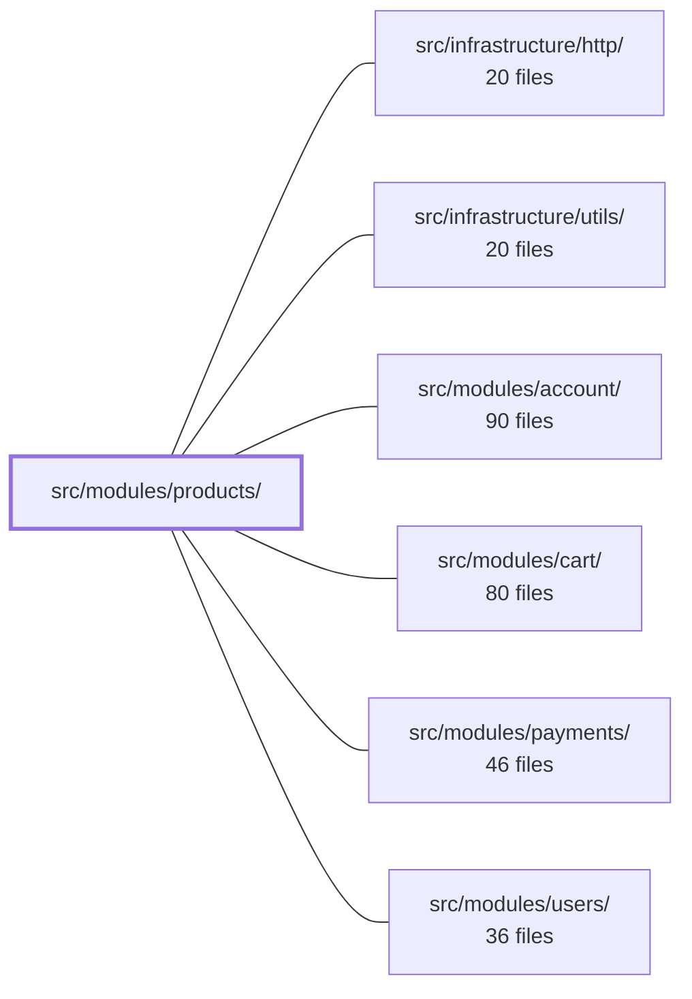

---
tags:
  - 2brain
  - 2brain/module
  - project/boilerplate-vue-frontend
type: module
module: src/modules/products/
files: 61
updated: 2026-11-10T08:40:14.160407+00:00
---

# src/modules/products/

## Purpose

The products module owns the shop's catalogue: the storefront list and detail views, the admin create/edit/delete forms, and the shared business rules (shelf-state resolution, release-date handling, translation model) that keep every surface consistent. It registers its routes and module manifest with the app, exposes a narrow public API for sibling modules, and carries a deep test suite covering unit, e2e, a11y, visual, and Lighthouse concerns.

## Key parts

- **Domain layer (`domain/`)** — Pure, framework-free business rules. `shelf-state.ts` collapses a product's availability flags into a single `ShelfState` enum; `index.ts` re-exports the public domain API.
- **Store (`store.ts`)** — Pinia store built on `useStructureCrudApi` for dictionary, pagination, and caching, plus product-specific extras: hard-delete, facets, multipart image upload, and locale-keyed translation fallback.
- **Public API & wiring (`index.ts`, `module.ts`, `routes.ts`)** — `index.ts` is the only sanctioned entry point for external modules; `module.ts` registers routes, nav, schemas, and locales into the app; `routes.ts` declares the four route records (list, create, detail, edit).
- **Composables (`composables/`)** — `useProductLines` bridges id-only cart/wishlist lines to full product records; `useTranslatedEntityForm` unifies the create/edit form scaffolding (tabs, error badges, failure tail); `useReleaseDateConfirm` surfaces the order-impact count before a date change is saved.
- **Schemas (`schemas.ts`, `response-schemas.ts`)** — Zod form schemas derived from the API contract, and response-envelope schemas that plug into the app's central contract-validation map.
- **Component (`components/ProductCard.vue`)** — The presentational catalogue tile (image, title link, price, availability badge, `product-actions` slot) that the list view composes into a grid.
- **Release-date helper (`release-date.ts`)** — Single implementation of the "did the day move?" and "what goes in the PATCH?" logic, using bare `YYYY-MM-DD` strings.
- **Tests (`tests/`)** — Unit specs for card rendering, form contracts, and edge cases; e2e specs for CRUD flows, a11y, keyboard, roles, uploads, locale, resilience, visual regression, and Lighthouse; all co-located so deleting the module removes its suite.

## How it connects

- **`src/modules/cart/`** — `useProductLines` resolves cart (and wishlist) line IDs against the products store so the cart always reads product title, price, and availability from one source.
- **`src/modules/account/`** — The `ProductCard` slot and list view render a guest login prompt sourced from the account module when a shopper has no session.
- **`src/modules/payments/`** — `useReleaseDateConfirm` queries the payments/fulfillment side for the count of orders that would be emailed about a date move, giving staff context before they save.
- **`src/modules/users/`** — Role and permission checks gate the admin routes and action buttons exercised in `roles.cy.ts`; the module's `module.ts` registers nav entries visible only to authorised personas.
- **`src/infrastructure/http/`** — The store and forms issue CRUD requests through the shared HTTP client; `response-schemas.ts` feeds the central validation pipeline that infrastructure enforces.
- **`src/infrastructure/utils/`** — Shared formatting, i18n, and helper utilities used across the module's components and composables.
- **Repository root (`/`)** — `module.ts` plugs the products domain into the app's module registry; `tests/lighthouse.ts` and `tests/e2e/*.cy.ts` are picked up by the root-level CI/test runners.

## Where to start

1. **`src/modules/products/domain/shelf-state.ts`** — A short, dependency-free function that shows the module's core vocabulary (the `ShelfState` union) and the priority logic every other surface relies on.
2. **`src/modules/products/store.ts`** — Reading the store next reveals how CRUD, caching, translations, and uploads are wired together, giving the mental model needed before tackling the create/edit views or the public API barrel.

## Connected modules

[[boilerplate-vue-frontend_ROOT|/ (repository root)]] · [[boilerplate-vue-frontend_src_infrastructure_http|src/infrastructure/http/]] · [[boilerplate-vue-frontend_src_infrastructure_utils|src/infrastructure/utils/]] · [[boilerplate-vue-frontend_src_modules_account|src/modules/account/]] · [[boilerplate-vue-frontend_src_modules_cart|src/modules/cart/]] · [[boilerplate-vue-frontend_src_modules_payments|src/modules/payments/]] · [[boilerplate-vue-frontend_src_modules_users|src/modules/users/]]

## Files
- `src/modules/products/components/ProductCard.vue` — Renders a single product as a shopper sees it in the catalogue grid: image, title (as an accessible link to the product page), price, availability badge, and the `product-actions` slot. It is the card-level presentational unit that `ProductsList` composes into a grid; it intentionally excludes staff-only controls (edit/delete), which live in a separate table component.
- `src/modules/products/composables/use-product-lines.ts` — Provides the `useProductLines` composable that bridges id-only "lines" (cart, wishlist) to the full `Product` records held in the shared products store. It batch-loads those records and exposes read helpers so a line's product, title, and availability label are always sourced from the single store dictionary rather than a per-line local copy.
- `src/modules/products/composables/use-release-date-confirm.ts` — Composable that guards the save of a changed release date (preorder) or restock date (backorder) on the product edit form. Before persisting, it asks the backend how many fulfillment orders would be emailed about the move, then surfaces that count in a confirm dialog. It is strictly informational — the user can always proceed; the composable never blocks the save.
- `src/modules/products/composables/use-translated-entity-form.ts` — Shared composable that gives `ProductCreate.vue` and `ProductEdit.vue` a unified translated-entity form: toolkit form state, one language tab per entry in `form.translations`, per-tab error badges, and a common failure-handling tail. The views keep only what differs (surrounding fields, the actual request, and whether a 412 is possible).
- `src/modules/products/domain/index.ts` — Barrel file for the products domain layer. It re-exports the public API of pure business rules (no Vue, Pinia, axios, or framework dependencies) so consumers can import from a single stable entry point.
- `src/modules/products/domain/shelf-state.ts` — Pure function that collapses a product's individual availability flags into a single `ShelfState` value, giving every UI surface (card, product page, add-to-cart button) one agreed-upon answer to "what is this product's shelf state right now?" without any of them re-implementing the priority logic.
- `src/modules/products/index.ts` — Public barrel for the Products module. It exposes a deliberately narrow set of re-exports so that sibling modules can interact with product data without reaching into the internal store. Lint enforces that importing `./store` directly from outside this module is an error; this file is the only sanctioned entry point.
- `src/modules/products/module.ts` — Module manifest for the **products** domain. Registers the catalogue's routes, a navigation entry, response schemas, and locale files into the app's module registry (`AppModule`). It is the single wiring point that makes the products feature visible to the framework.
- `src/modules/products/release-date.ts` — Canonical helpers for the product release-date field, treating it exclusively as a `YYYY-MM-DD` day string (the same format the wire and `<input type="date">` share). No parsing, no timezone math — the server owns midnight conversion. The module exists so the "did the day actually move?" and "what goes in the PATCH?" questions have one implementation.
- `src/modules/products/response-schemas.ts` — Declares the response-envelope schemas for every REST endpoint attributed to the `products` module. These rows feed the central response-schema map so that, when the products domain is enabled, contract validation is applied to its endpoints automatically.
- `src/modules/products/routes.ts` — Declares the four route records for the products domain (list, create, detail, edit) and exports them as a typed `RouteRecordRaw[]` array for consumption by the module manifest and the app router.
- `src/modules/products/schemas.ts` — Defines Zod validation schemas for the product create/edit forms. Schemas are derived from the API contract's own constraints (regex, max lengths) so the client never validates more loosely than the server. Also encodes the API's three-signal translation model (upsert / delete / leave-untouched) in a single shape.
- `src/modules/products/store.ts` — Pinia store for the products domain. It declares the CRUD/search endpoints once, hands them to `useStructureCrudApi` (from `@guebbit/vue-toolkit`) to derive dictionary, pagination, caching, and optimistic-update state, then layers on a hard-delete action, a facets read, image-upload (multipart) branching, and a translation-locale fallback that the toolkit has no shape for.
- `src/modules/products/tests/e2e/a11y.cy.ts` — Defines the list of product-module routes to audit for accessibility (axe) via the shared `sweepA11y` harness. It splits routes into a **public** group (storefront) and an **admin** group (staff UI), and includes theme variants and pre-interaction states that would be missed by a plain page-load check.
- `src/modules/products/tests/e2e/actions.cy.ts` — E2E test suite for the products module that exercises failure-recovery behaviour of every write action (create, edit, delete) plus the slow-load path. Each scenario stubs the relevant server call to fail, asserts the UI shows the expected error alert while preserving user-typed state, then confirms a retry succeeds once the stub is removed.
- `src/modules/products/tests/e2e/keyboard.cy.ts` — Cypress E2E spec that verifies the products-list facet chip responds correctly to keyboard activation (Enter and Space). It lives inside the products module rather than the central `tests/e2e/specs/` directory because the facet chip is a module-level control and shell-level specs should not depend on this module being present.
- `src/modules/products/tests/e2e/leave-guard.cy.ts` — Cypress E2E spec that verifies the leave-guard on the product edit form: an unsaved (half-typed) price must prompt a Stay/Leave dialog before a menu-link navigation discards it, while a form that has just been saved navigates away silently. It exists to prevent regressions where in-app routing accidentally drops user input without confirmation.
- `src/modules/products/tests/e2e/locale.cy.ts` — E2E specs that live in the products module rather than the central `tests/e2e/specs/locale.cy.ts` because both scenarios are product-specific at the **data** level: they exercise `useProductsStore`'s locale-keyed cache and a backend-seeded Spanish override that only the products list page renders. Moving them to a foundation page would require reseeding demo data that belongs to this module.
- `src/modules/products/tests/e2e/product-write.cy.ts` — Cypress end-to-end spec covering the multilingual product write surface: creating a product in two languages in a single submit, removing one language while editing another in the same save, surfacing a validation badge on an unselected tab, and verifying that a horizontal swipe inside a title field does not accidentally switch the active language tab on a phone viewport.
- `src/modules/products/tests/e2e/products.cy.ts` — Cypress end-to-end spec covering the products list and detail screens in a real browser against the seeded backend. It verifies what anonymous visitors see (storefront grid, public-only products) versus what admins see (back-office table with CRUD actions), plus sorting, free-text i18n search, and navigation to the product detail page.
- `src/modules/products/tests/e2e/products.visual.cy.ts` — Declares which screens, routes, and viewports the **products** module must be captured under in the visual-regression sweep. The file itself performs no test logic; it only supplies the screen list to the shared `sweepVisual` runner.
- `src/modules/products/tests/e2e/resilience.cy.ts` — The catalogue's slice of the app-wide resilience sweep, split out of the central `tests/e2e/specs/resilience.cy.ts` because its assertions only make sense with a products dataset behind them: route health on a shop-only page, an empty-search state, pagination/row-count agreement, and rendering of the deliberately sparse `barebones` record. Like the central file, it asserts no exact titles or counts on purpose, so that rendering breakage (broken images, TypeErrors, overflow) is caught even when value-asserting specs stay green.
- `src/modules/products/tests/e2e/roles.cy.ts` — End-to-end role-sweep test that verifies every persona's access to the product pages and their action buttons matches the persona's own permission rules. It is co-located inside the `products` module so that deleting the module automatically removes its sweep. This file is purely the case list; the sweeping logic lives in the shared helper.
- `src/modules/products/tests/e2e/uploads.cy.ts` — Cypress e2e spec covering image upload through the product forms (edit, create) and the live-backend storage/serving pipeline. It lives in the products module rather than the central `tests/e2e/specs/uploads.cy.ts` because it exercises the shared upload mechanism (`FormImageUpload.vue`, `multer`, the digest/thumbnail worker) specifically through a product form, and the "Live backend" block reuses the hydrated edit form.
- `src/modules/products/tests/lighthouse.ts` — Declares the Lighthouse SEO/performance test cases contributed by the products module — the public catalogue list page and a public product detail page. These are the routes that must be crawlable and pass Lighthouse audits in CI or local runs.
- `src/modules/products/tests/product-card.spec.ts` — Vitest unit-test suite for `ProductCard.vue`. Verifies the shopper-facing contracts of the catalogue tile: correct price/currency display, availability badge text and `data-shelf` attribute for every product state (in-stock, out-of-stock, off-sale, preorder, backorder), the single title link to the product page, absence of staff controls, and correct rendering of contributed `product-actions` slot components plus the guest login prompt.
- `src/modules/products/tests/product-create-currency.spec.ts` — Verifies that the ProductCreate form submits the price string formatted to the shop's declared decimal places (`minorUnits` from `GET /shop`), covering zero-place (JPY), two-place (EUR), and three-place (KWD) currencies. This guards the rule that a *new* product has no pre-existing record to inherit formatting from, so the shop's own settings are the sole source of truth.
- `src/modules/products/tests/product-create-extras.spec.ts` — Verifies the `product-create-extras` slot contract on the ProductCreate form: a foreign module's component can register an after-create step that receives the new product's ID, and the create request body stays free of that module's fields (e.g. no `onHand`).
- `src/modules/products/tests/product-create-locales-fallback.spec.ts` — Verifies that the `ProductCreate` form degrades gracefully when `GET /locales` fails (e.g. the locales module is uninstalled or the backend is unreachable). Instead of remaining stuck on the skeleton loader (shown while `openTags.length === 0`), the form must render a single fallback-language tab ("en").
- `src/modules/products/tests/product-create-release-date.spec.ts` — Unit test for the `ProductCreate` form's release-date field. It verifies two contract behaviors on submit: an entered date is sent as the bare `YYYY-MM-DD` string (no time, no zone), and an empty field results in the `releaseDate` key being absent from the POST body entirely (the create contract accepts no `null`).
- `src/modules/products/tests/product-create-tax-class.spec.ts` — Unit tests for the `ProductCreate` form that verify two wire-level contracts: (1) when `taxClass` is left at its shop default the key is omitted from the POST body (value stays `undefined`, unlike the edit form which sends explicit `null`), and (2) the create request carries an `Idempotency-Key` header so a network retry cannot duplicate a product.
- `src/modules/products/tests/product-edit-locale-race.spec.ts` — Regression spec that reproduces a fetch-ordering race in `ProductEdit.vue`: the independent `GET /locales` call resolves before `GET /products/{id}`, leaving `form.translations` empty while the fallback tag is already known. Before the fix this caused a render crash (`form.translations[tag]!.title` on `undefined`). The spec asserts the tab bar stays closed until the admin record lands and no render error is emitted.
- `src/modules/products/tests/product-edit-missing-record.spec.ts` — Verifies that `ProductEdit.vue` handles a failed admin-record read (bypassing the toolkit cache) correctly: a 404/403 response redirects to the Error page, while any other failure shows a toast and keeps the visitor on the page. The test exists because the component reads the record without the toolkit's cache, so no `watch*` `onError` handler fires—failure handling is entirely in the component's own logic.
- `src/modules/products/tests/product-edit-no-withdrawal.spec.ts` — Verifies that the `ProductEdit` form correctly round-trips the `noWithdrawal` flag (EU Art. 16): it is hydrated from the admin record and re-sent on every PATCH. The outgoing body is validated against the generated contract schema (`UpdateProductByIdBody`) so that any drift between what the form sends and what the API expects fails here.
- `src/modules/products/tests/product-edit-purchasable.spec.ts` — Verifies that the ProductEdit form correctly round-trips the `purchasable` flag: it hydrates the field from the admin record, includes it on every PATCH submission, and validates the outgoing body against the generated contract schema (`UpdateProductByIdBody`) so that any drift in the sent payload is caught here.
- `src/modules/products/tests/product-edit-release-date.spec.ts` — Vitest spec for the release-date field in the ProductEdit form. It verifies the hydration of the date into the `<input>`, the deliberate omission of an unchanged date from the PATCH body (a moved date notifies buyers who already paid, so it travels only on change), the correct wire format for edited/cleared dates, and the confirmation-dialog flow that warns staff about how many orders will receive an email before a date change is saved. Assertions are validated against the API contract's own body schema.
- `src/modules/products/tests/product-edit-stale-record.spec.ts` — Verifies the `ProductEdit` view's UX when a save (PATCH) is answered with a 412 Precondition Failed — i.e., the product record changed on the server since the form loaded it. Asserts that the form displays an in-place *warning* (not an error), surfaces a "reload latest" action, re-fetches the admin record only when that action is pressed, and never auto-resends the stale edit.
- `src/modules/products/tests/product-edit-tax-class.spec.ts` — Verifies that the `ProductEdit` form correctly round-trips the `taxClass` field: it hydrates the value from the admin record, treats a missing class as an explicit `null` (the "shop default" wire representation), and resends the value unchanged on PATCH submit. The spec exists to pin the contract that `taxClass` behaves like every other editable field rather than getting special-cased or dropped.
- `src/modules/products/tests/product-edit-translations-link.spec.ts` — Guards against `ProductEdit.vue` crashing when the `locales` module is absent from a build. A previous bug caused `:to="{ name: 'EntityTranslations' }"` to throw during render when that route was unregistered. This spec verifies the component either omits the link (route missing) or displays it (route present + permission granted), without throwing in either case.
- `src/modules/products/tests/product-fresh-stock.spec.ts` — Vitest spec that verifies the product page always refetches fresh stock from the server on mount, even when the Pinia store already holds a cached copy inside its five-minute TTL window. It confirms the page renders the cached value immediately and then swaps in the fresh one, and that calling `invalidateProductsCache` forces the next store read back to the server.
- `src/modules/products/tests/product-lines.spec.ts` — Unit tests for the two halves of the product-lines feature: the store's batched ID lookup (`fetchProductsByIds`) and the `useProductLines` composable that renders line titles, availability labels, and removed-product state for carts and wishlists. Ensures the batch request is correct, records land in the shared store, and no raw product ID is ever surfaced to the shopper.
- `src/modules/products/tests/product-view.spec.ts` — Unit-test suite for the `ProductTarget.vue` detail page. It mounts the real component against a real memory-history router and exercises every product shape the API can return (out-of-stock, made-to-order, barebones, permission-gated, analytics-tracked) by seeding shapes directly into the store, bypassing the network fetch entirely.
- `src/modules/products/tests/products-list-view.spec.ts` — Vitest spec that exercises the real `ProductsList` view, real Pinia store, and real module-scoped router together, with only the HTTP client (`searchProducts`, `getCatalogFacets`) mocked. It verifies the role-driven presentation split (storefront grid vs. back-office table), server-side sort wiring, and the analytics "products_searched" relay, asserting on the outgoing request payload and the rendered DOM.
- `src/modules/products/tests/products-store.ts` — Test-only helper that exposes the products store to specs in other modules. The `products` barrel no longer re-exports the store, so sibling-module specs (e.g. cart) import these helpers instead of reaching into `../store` directly.
- `src/modules/products/tests/release-date.spec.ts` — Vitest suite covering the two pure string-comparison helpers exported by `release-date.ts`. It locks in the invariant that the promise-date field is always a plain `YYYY-MM-DD` string (or its absence) and that no timezone or calendar arithmetic is involved.
- `src/modules/products/tests/routes.spec.ts` — Vitest spec that verifies every route in the products module declares the expected `meta.access` and `meta.can` values, and enforces a closed-set invariant: no route may be added to `routes.ts` without an explicit access decision appearing here. It asserts against the module's raw route records directly (not a resolved router), so it runs without a locale prefix or the wider app shell.
- `src/modules/products/tests/schemas-i18n.spec.ts` — Verifies that the products module's Zod schemas and its locale dictionaries (`en.json`, `it.json`) are in agreement: every message key the schema reaches for exists in both languages and resolves to the correct, language-specific text. Runs against the **real** vue-i18n instance (not a mocked `t`) so a message frozen in the wrong language would actually fail. The thunk/re-resolution mechanism itself is proven once in `tests/cross-cutting/schemas-i18n.spec.ts`; this file is the domain-level check that belongs with the products module.
- `src/modules/products/tests/schemas.spec.ts` — Vitest suite that pins down the **shape rules** of `productsSchema` — specifically the `price` format and the per-locale `translations` structure. It is the companion to `schemas-i18n.spec.ts` (which covers error *messages*); this file covers the *rules* themselves.
- `src/modules/products/tests/shelf-state.spec.ts` — Table-driven Vitest spec for `shelfStateOf`, the pure function that maps a product's purchase-related flags (`purchasable`, `preorder`, `backorder`, `inStock`) to the single shelf-state label shared by the product card, product page, and add-to-cart button. It locks in the priority order: **off-sale → preorder-with-allowance → stock badge**, with an absent `purchasable` flag treated as on-sale.
- `src/modules/products/tests/store.spec.ts` — Unit tests for the products store's own decision logic: whether a create/update call takes the JSON or multipart branch, how `translations` is encoded on each path, and how the cache is scoped by the active language. The CRUD wrappers themselves are thin over `@guebbit/vue-toolkit` and are intentionally out of scope; the multipart encoding and `translations` serialisation are this repo's logic.
- `src/modules/products/tests/translation-tab-errors.spec.ts` — Vitest spec that pins the behavior of the three error-counting helpers in `../translation-tab-errors`. It exists so that the flat-issue bucketer, the Zod-error adapter, and the server-error adapter each remain correct across their documented edge cases (non-translation paths, malformed items, and the three envelope shapes a rejected write can arrive in).
- `src/modules/products/tests/translations-body.spec.ts` — Vitest suite that pins the form→wire contract for product translations. Its single concern is the asymmetry the API requires between CREATE and PATCH: a blank `description` must be **omitted** on create but emitted as **`null`** on patch (RFC 7396 merge-patch semantics), and a `null` locale must be **dropped** on create but **retained** as a delete signal on patch.
- `src/modules/products/tests/use-release-date-confirm.spec.ts` — Vitest spec for the `confirmReleaseDateMove` function returned by the `useReleaseDateConfirm` composable. It verifies the guard logic around a product's release-date change: when the server is queried for buyer-impact, when the question is skipped, how the confirmation dialog is presented, and what happens if the API call fails.
- `src/modules/products/tests/use-translated-entity-form-baseline.spec.ts` — Vitest spec for the `useTranslatedEntityForm` composable, focused on one scenario: the fallback language arrives *after* mount (simulating a delayed `GET /locales`). It verifies that seeding the fallback tab into an untouched form does **not** flip `isDirty`, that typing into the seeded tab does, and that an already-dirty form's baseline is not re-anchored.
- `src/modules/products/tests/use-translated-entity-form.spec.ts` — Vitest spec for the `useTranslatedEntityForm` composable. It exercises two behavioral areas: language-tab lifecycle (seeding the fallback tab, adding blank tabs, removing tabs, and restoring stored translations) and the post-submit failure path (how a 412 / stale response is routed versus a generic error that blocks the form).
- `src/modules/products/translation-tab-errors.ts` — Converts validation failures (Zod `safeParse` results or rejected `PATCH` field pointers) into a per-locale error count map so that `ProductCreate.vue` / `ProductEdit.vue` can badge the specific language tab that owns a failure. It exists because `useStructureFormValidation.formErrors` keys every issue by `issue.path[0]`, collapsing all locale-specific `translations` issues into a single flat bucket with no way to distinguish which language failed.
- `src/modules/products/translations-body.ts` — Transforms the product form's per-locale translation entries into the exact JSON body the API contract expects, handling the difference between creating a new product (omit blank fields) and patching an existing one (explicitly send `null` to clear fields).
- `src/modules/products/views/ProductCreate.vue` — The "create product" page. Renders a multi-locale tabbed form (one tab per active language, fallback locale first and always open), validates the input, and submits a `POST /products` body—including an optional image upload—through the products store. After success it runs any after-create steps registered by other modules, shows a toast, and navigates to the new product's detail route.
- `src/modules/products/views/ProductEdit.vue` — Single-file Vue component that renders the admin "edit product" page. It fetches the full admin record (`GET /products/{id}`), hydrates a multi-locale tab form (one tab per language the row carries), lets the operator change price/stock/tax/image/translations, and submits a merge-aware PATCH through the products store. It also handles the 412 stale-record flow, unsaved-changes guard, image upload progress, and release/restock-date change confirmations.
- `src/modules/products/views/ProductTarget.vue` — Public product detail page. It fetches and renders a single product record by route-provided `id`, displays price/stock/status stats and a full field grid, and hosts the `product-actions` slot where other modules contribute visitor write actions (add to cart, wishlist). It is the canonical place where a stock number is read, so it always refetches.
- `src/modules/products/views/ProductsList.vue` — Single view that renders the product catalogue for two audiences behind one route: shoppers see a card grid (image, price, availability, add-to-cart) while staff see a data table with row actions (edit, soft-delete, restore, hard-delete). It owns the search/filter form, facet chips, server-side sorting, pagination, and URL state so deep links reproduce the current view.

---
[[boilerplate-vue-frontend_INDEX|← boilerplate-vue-frontend index]]
