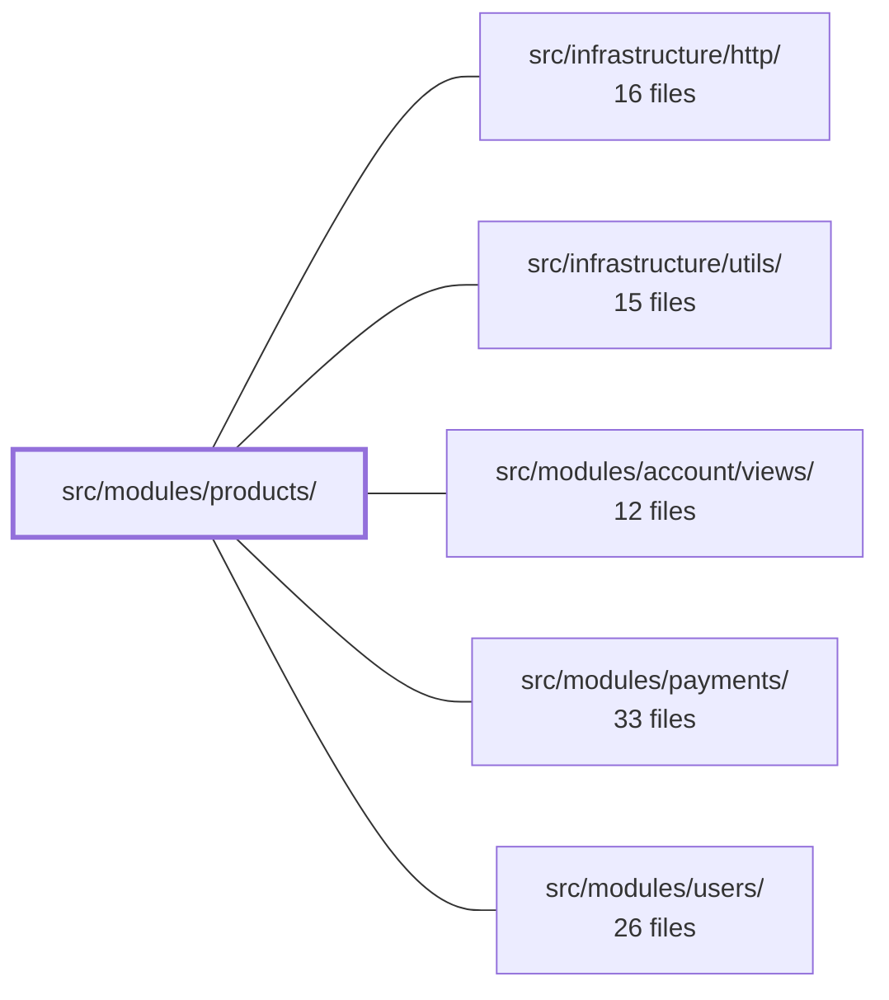

---
tags:
  - 2brain
  - 2brain/module
  - project/boilerplate-vue-frontend
type: module
module: src/modules/products/
files: 54
updated: 2026-10-17T02:55:09.713172+00:00
---

# src/modules/products/

## Purpose

The products module owns the entire product catalogue domain: listing, detail, creation, and editing. It provides the UI (shopper-facing grid, staff table, form views), the data layer (Pinia store, Zod schemas, route definitions), and the pure domain rules (shelf-state reduction, release-date conversion) that every other part of the app consumes when it needs to display or mutate a product.

## Key parts

- **`domain/`** — Pure, framework-free logic. `shelf-state.ts` reduces three boolean flags into a single `ShelfState`; `release-date.ts` converts between ISO-8601 instants and `datetime-local` strings. Both are re-exported through `domain/index.ts`.
- **`composables/`** — Shared form and data-fetching logic. `use-translated-entity-form.ts` unifies validation and tab state between Create and Edit; `translations-body.ts` encodes the POST/PATCH body asymmetry; `use-active-locales.ts` resolves the language-tab list with a safe fallback; `translation-tab-errors.ts` maps Zod issues back to a specific locale tab; `use-product-lines.ts` batch-loads product records so cart/wishlist lines resolve titles and availability without a private copy.
- **`store.ts` / `schemas.ts` / `response-schemas.ts`** — The data layer. The store derives CRUD, pagination, caching, and optimistic-update state via `useStructureCrudApi`. The Zod schemas define client-side validation that mirrors the API contract. The response schemas register envelope validation for every products endpoint.
- **`ProductCard.vue`** — The single-product atom used in the catalogue grid. Exposes a `product-actions` slot so other modules (cart, wishlist, payments) can inject buttons without the card knowing about them.
- **`module.ts` / `routes.ts` / `index.ts`** — Module wiring. The manifest registers routes, navigation, and locale dictionaries into the app kernel. `routes.ts` defines the four product routes (list, detail, create, edit). `index.ts` is the sole public barrel; lint forbids sibling modules from reaching into `./store` directly.
- **`tests/`** — A comprehensive test suite covering unit specs (form contracts, domain logic), integration specs (list view, detail view, product-lines batch), and E2E specs (a11y, keyboard, locale fallback, resilience, uploads, visual regression, product write flows).

## How it connects

- **`src/infrastructure/http/`** — The store's CRUD endpoints and composables like `use-active-locales.ts` issue requests through the shared `@api` client, which lives in this infrastructure layer. All products HTTP traffic flows through it.
- **`src/modules/account/views/`** — `ProductCard.vue` distinguishes guest from signed-in presentation, and the create/edit routes are auth-gated. Account state determines which actions are visible and whether a user can enter the admin views.
- **`src/modules/payments/`** — The `product-actions` slot on `ProductCard` is the integration point where the payments module injects "add to cart" / "buy now" buttons. `use-product-lines.ts` resolves the product data those cart lines need (title, availability, pricing).
- **`src/modules/users/`** — Staff role checks gate the create and edit routes. The products list view switches between a shopper-facing grid and a staff table based on the user's role, supplied by this module.
- **`src/infrastructure/utils/`** — Shared helpers (formatting, class manipulation, etc.) used across the products views and composables.

## Where to start

1. **`store.ts`** — Read this first to understand the data contract: what endpoints exist, what the dictionary looks like, and how caching/invalidation works. Everything else in the module (views, composables, other modules) reads from this store.
2. **`domain/shelf-state.ts`** — A two-line-logic pure function that shows the module's priority: derive one canonical label from three flags. It is the simplest domain rule and the one most UI surfaces depend on, making it a quick, low-risk entry point into how products state is interpreted.

## Connected modules

[[boilerplate-vue-frontend_ROOT|/ (repository root)]] · [[boilerplate-vue-frontend_src_infrastructure_http|src/infrastructure/http/]] · [[boilerplate-vue-frontend_src_infrastructure_utils|src/infrastructure/utils/]] · [[boilerplate-vue-frontend_src_modules_account_views|src/modules/account/views/]] · [[boilerplate-vue-frontend_src_modules_payments|src/modules/payments/]] · [[boilerplate-vue-frontend_src_modules_users|src/modules/users/]]

## Files
- `src/modules/products/components/ProductCard.vue` — Renders a single product in the shopper-facing catalogue grid: image, title (as a link to the product page), price, a shelf-state badge, and a slot for action buttons contributed by other modules. It is intentionally free of staff controls (edit/delete), which belong to a separate table view.
- `src/modules/products/composables/translation-tab-errors.ts` — Converts Zod validation failures and rejected-PATCH field pointers into a per-locale error count map so that `ProductCreate.vue` / `ProductEdit.vue` can badge the specific language tab that owns a failure. It exists because `useStructureFormValidation.formErrors` keys every issue by `issue.path[0]`, collapsing all locale-specific title/description errors into a single flat `translations` bucket with no way to distinguish which language failed.
- `src/modules/products/composables/translations-body.ts` — Transforms the product form's per-locale translation fields into the exact JSON body each API endpoint accepts. The two endpoints (POST create, PATCH update) treat "no description" differently — this file encodes that asymmetry so callers pass form state through without hand-rolling the mapping.
- `src/modules/products/composables/use-active-locales.ts` — Provides the list of active locales a product form's language tabs need. It fetches `GET /locales` via `@api` directly, filters to active entries, and guarantees a usable single-tab fallback when the optional `locales` module is uninstalled or the endpoint is unreachable.
- `src/modules/products/composables/use-product-lines.ts` — Provides the id-to-record join that id-only product lines (cart, wishlist) need: batch-loads the full `Product` records into the shared products store, then exposes small readers (`productOf`, `titleOf`, `availabilityLabel`, `isRemoved`) so any line's view resolves against the same dictionary the product page uses, rather than a private copy.
- `src/modules/products/composables/use-translated-entity-form.ts` — Extracts the shared form logic between `ProductCreate.vue` and `ProductEdit.vue`: toolkit-backed validation state, one language tab per entry in `form.translations`, per-tab error badges, and the shared tail of a failed submit. The views keep only what differs — surrounding fields, the actual HTTP request, and whether a 412 can occur.
- `src/modules/products/domain/index.ts` — Barrel (re-export) file for the **products domain layer**. It aggregates the public API of the pure domain rules—shelf-state logic and release-date formatting—behind a single import path so consumers never reach into individual domain modules. The module doc explicitly declares the layer free of Vue, Pinia, axios, and every other framework tier.
- `src/modules/products/domain/release-date.ts` — Pure conversion helpers between the wire's ISO 8601 UTC instant and the zone-less `YYYY-MM-DDTHH:mm` string that a `<input type="datetime-local">` reads and writes. They exist so the Vue product forms can bind a native date picker without each view reimplementing the two-way translation.
- `src/modules/products/domain/shelf-state.ts` — Pure domain helper that reduces a product's three shelf flags (`purchasable`, `preorder`, `inStock`) into a single `ShelfState` value. It exists so every UI surface (card, product page, add-to-cart button) derives the same label from the same priority rule without duplicating the logic.
- `src/modules/products/index.ts` — Public barrel (re-export surface) for the Products module. It is the **only** entry point that sibling modules are allowed to import; lint rules flag any direct import of `./store` from outside the module as an error. The file exists to keep the cross-module contract narrow and stable.
- `src/modules/products/module.ts` — Module manifest for the **products** domain. It registers the catalogue's routes, a navigation entry, lazy-loaded response schemas, and locale dictionaries into the app's shared module registry (`AppModule`), so the kernel can wire them up without any other module importing products directly.
- `src/modules/products/response-schemas.ts` — Declares the response-envelope schema routes for every REST endpoint attributed to the `products` domain. It feeds the shared response-schema map so that, when the products module is active, API responses are validated against the schemas derived from `openapi.yaml` (via `x-module` stamps).
- `src/modules/products/routes.ts` — Defines the four route records for the products domain (public list & detail, auth-gated create & edit) and exports them as a typed array (`satisfies RouteRecordRaw[]`) so the module manifest can merge them into the application router.
- `src/modules/products/schemas.ts` — Zod validation schemas for the product create/edit forms. The constraints are derived from the API contract (e.g. price minimum) so the client never validates more loosely than the server. The translations sub-schema mirrors the API's `translations` map shape, producing Zod issue paths shaped as `['translations', <locale>, <field>]` that the Vue views consume directly.
- `src/modules/products/store.ts` — Pinia store for the products domain. It declares the CRUD/search endpoints once, hands them to `useStructureCrudApi` (from `@guebbit/vue-toolkit`) to derive dictionary, pagination, caching, and optimistic-update state, then layers on a hard-delete action, a facets read, and a cache-invalidation helper that other modules can call.
- `src/modules/products/tests/e2e/a11y.cy.ts` — Declares the route list that drives the products module's automated accessibility (axe) sweep. It does not implement any test logic itself; it hands a structured list of routes, viewports, themes, and prep steps to the shared `sweepA11y` runner.
- `src/modules/products/tests/e2e/keyboard.cy.ts` — E2E test verifying that a products-list facet chip responds correctly to keyboard activation (Enter and Space). It lives in the `products` module rather than the central `tests/e2e/specs/` shell because the facet chip is a module-specific control and the shell-level spec should not depend on this module being present.
- `src/modules/products/tests/e2e/locale.cy.ts` — End-to-end tests that exercise locale-specific behavior unique to the products module: (1) the product store's locale-scoped cache must be dropped and refetched on an in-place language switch (no navigation), and (2) a locale that the API serves but the app does not bundle (`es`) must activate, render with per-key English fallback, and trigger a runtime dictionary download. Both cases were extracted from the central `tests/e2e/specs/locale.cy.ts` because they depend on product-level data (per-product translations, backend-seeded Spanish overrides) that no foundation page can substitute.
- `src/modules/products/tests/e2e/product-write.cy.ts`
- `src/modules/products/tests/e2e/products.cy.ts`
- `src/modules/products/tests/e2e/products.visual.cy.ts` — Declares the set of screens the products module contributes to the project-wide visual-regression sweep. It is a one-line registration (plus a comment) that feeds the `sweepVisual` runner defined in the shared support module.
- `src/modules/products/tests/e2e/resilience.cy.ts` — Catalogue-specific slice of the site-wide resilience sweep (extracted from the central `tests/e2e/specs/resilience.cy.ts`). It verifies that the products list and detail pages render gracefully under edge conditions — a sparse record, an empty search result, and pagination state — without asserting on exact titles or counts, so the specs stay green while still catching layout breaks, uncaught exceptions, or viewport overflow.
- `src/modules/products/tests/e2e/uploads.cy.ts` — End-to-end spec for image upload exercised through the product catalogue's own forms (edit and create). Extracted from the central `tests/e2e/specs/uploads.cy.ts` so that product-specific upload coverage lives with the module; the central file retains only the user-facing ("User create", "Signup") cases that must pass on a build with no catalogue at all.
- `src/modules/products/tests/product-card.spec.ts` — Vitest spec that verifies `ProductCard.vue` presents correct shopper-facing information (price, availability state, title link), renders contributed `product-actions` slots, distinguishes guest from signed-in users, and contains no staff controls.
- `src/modules/products/tests/product-create-currency.spec.ts` — Verifies that the **ProductCreate** price input (`VNumberInput`) derives its decimal precision from the shop's own currency code (`GET /shop`) rather than from a pre-existing product. Because a create form has no product to read `currency` from, the shop entity is the sole source of truth for how many decimal places the operator must type (JPY → 0, EUR → 2, KWD → 3).
- `src/modules/products/tests/product-create-extras.spec.ts` — Verifies the `product-create-extras` slot contract on `ProductCreate`: external modules register an "after create" step that receives the new product ID, and the create POST body stays free of foreign-module fields. This is the integration test for the slot mechanism described in the module doc-comment.
- `src/modules/products/tests/product-create-locales-fallback.spec.ts` — Verifies that `ProductCreate` still renders a usable form (one fallback-language tab) when `GET /locales` fails, instead of being stuck on the Vuetify skeleton loader shown while `openTags` is empty. It guards against a regression where a missing or unreachable `locales` endpoint would leave the create page in a perpetual loading state.
- `src/modules/products/tests/product-create-release-date.spec.ts` — Unit-test spec for the `ProductCreate` form's release-date field. It verifies two contract rules for the create endpoint: a user-entered date is serialised as an ISO-8601 instant in the POST body, and an empty field omits the `releaseDate` key entirely (the create body schema accepts no `null`).
- `src/modules/products/tests/product-create-tax-class.spec.ts` — Unit test verifying that the **ProductCreate** form renders a `taxClass` field and, when the user leaves it at the shop default, the submitted payload contains the key as `undefined` (i.e. the key is omitted after JSON serialization) rather than explicitly `null`. This pins the create-form contract that distinguishes it from the edit form's "clear to `null`" behaviour.
- `src/modules/products/tests/product-edit-locale-race.spec.ts` — Reproduces a fetch-ordering race in `ProductEdit.vue`: the page's independent `fetchActiveLocales()` (`GET /locales`) answering before `loadAdminProduct()` (`GET /products/{id}/admin`). Verifies the tab bar does not open a translation tab until the admin record (and its `form.translations` entry) actually arrives, preventing a render crash from accessing a missing `form.translations[tag]!.title`.
- `src/modules/products/tests/product-edit-no-withdrawal.spec.ts` — Verifies that the `noWithdrawal` flag (EU Art. 16 consumer-protection field) round-trips through the ProductEdit form: it hydrates from the admin record, is always present in the PATCH body (explicitly `true` or `false`, never omitted), and the sent shape is validated against the OpenAPI contract's own `UpdateProductByIdBody` schema so drift fails here.
- `src/modules/products/tests/product-edit-purchasable.spec.ts` — Vitest spec that verifies the `purchasable` (off-sale) flag round-trips through the ProductEdit form: it is hydrated from the admin record, present in the PATCH body on every submit, and validated against the generated contract's `UpdateProductByIdBody` schema so any drift between what the form sends and what the API expects fails here.
- `src/modules/products/tests/product-edit-release-date.spec.ts` — Vitest spec that verifies the release-date field of the product edit form: it is hydrated from the admin record into a `datetime-local` input, **excluded** from the PATCH body when the user does not change it (since a moved date notifies buyers who already paid), sent as an ISO instant when changed, and sent as `null` when explicitly cleared. All assertions are validated against the generated API contract's body schema.
- `src/modules/products/tests/product-edit-stale-record.spec.ts` — Verifies that when `ProductEdit.vue` receives a **412 Precondition Failed** response on save (the product changed server-side after the form loaded), the form surfaces an in-place *warning* (not an error), offers a "reload latest" action, and never auto-resends the stale edit. It also confirms that pressing "reload latest" triggers a fresh admin-record read and clears the warning.
- `src/modules/products/tests/product-edit-tax-class.spec.ts` — Verifies that the `ProductEdit` form correctly round-trips the `taxClass` field: it hydrates the value from the admin record (including the "shop default" case represented as an explicit `null`), and resends it unchanged on submit via PATCH. The sequencing of locale-resolution before admin-record-loading mirrors the setup in `product-edit-locale-race.spec.ts`.
- `src/modules/products/tests/product-edit-translations-link.spec.ts` — Guards against a regression in `ProductEdit.vue` where the "translations" link assumed the `EntityTranslations` route always exists. Because the `locales` module is optional (enabled/disabled via `src/modules.ts`), a build without it has no such route; this spec proves the page still renders and simply omits the link, and that the link reappears when the route is present.
- `src/modules/products/tests/product-fresh-stock.spec.ts` — Verifies the "fresh-on-open" contract of the product page: when a shopper navigates to a product that was recently read by the list (inside the store's five-minute cache window), the cached value renders immediately and a background refetch swaps in the current stock. Also confirms that `invalidateProductsCache` forces the next read back to the server. Runs against the real store and real page component, with only the HTTP boundary (`getProductById`) mocked.
- `src/modules/products/tests/product-lines.spec.ts` — Vitest spec that verifies the product-lines contract for carts and wishlists: batched `POST /products/search` (one request, not one per line), records landing in the shared store the product page reads, and titles that are human-readable strings — never raw IDs. It also covers availability-label wording and preorder formatting. `@api` is mocked at the `searchProducts` boundary so no real HTTP occurs.
- `src/modules/products/tests/product-view.spec.ts` — Unit-test suite for the `Product.vue` detail page. It mounts the real component against a real memory-history router (built the same way `app/router/index.ts` does) and exercises every product shape the API can return — stock states, slot contributions, barebones records, ability-gated UI, and analytics firing — by seeding the store directly rather than relying on a single fixture row.
- `src/modules/products/tests/products-list-view.spec.ts` — Integration-level Vitest suite for `ProductsList.vue`. It mounts the real page (with real Pinia store, router, i18n, and Vuetify) and asserts the three behaviors the page owns: role-based presentation (storefront grid vs. staff table), server-side sorting (no client reorder), and the analytics event fired on search submission. Only the HTTP client (`searchProducts`) is mocked, so the store → search pipeline runs for real and assertions target the outgoing request.
- `src/modules/products/tests/release-date.spec.ts` — Vitest spec that verifies the two spellings of the release-date field round-trip correctly: the `datetime-local` input value (wall-clock, minute precision) and the wire value (a UTC instant). It pins the contract that invalid or missing values are normalised to an empty string in both directions.
- `src/modules/products/tests/routes.spec.ts` — Table-driven assertions that every route in the products module declares the expected `meta.access` and `meta.can` values, plus a closed-set guard that fails if a new route is added without an explicit access decision. It validates declarations directly on the route records (no resolved router, no locale prefix), complementing the router spec which proves enforcement is attached.
- `src/modules/products/tests/schemas-i18n.spec.ts` — Verifies that every message key the products Zod schemas reference actually exists in both `en` and `it` locale dictionaries and resolves to different text. It runs against the **real** vue-i18n instance (not a mocked `t`) so the assertion proves genuine locale resolution rather than mere key lookup. This complements the cross-cutting test in `tests/cross-cutting/schemas-i18n.spec.ts`, which proves the thunk-re-resolution mechanism in isolation with an invented schema; this file proves *this module's* schemas and dictionaries agree.
- `src/modules/products/tests/schemas.spec.ts` — Vitest spec for `productsSchema` (the Zod form schema in `../schemas.ts`). It asserts structural and boundary rules for the product form payload—price constraints, translation slot validation, and nullish optional fields. Internationalization *messages* are explicitly out of scope (handled in `schemas-i18n.spec.ts`).
- `src/modules/products/tests/shelf-state.spec.ts` — Table-driven Vitest spec that pins the precedence rules of `shelfStateOf` — the shared ranking signal used by the product card, the product page, and the add-to-cart button. It exists to lock in the priority order (off-sale > preorder > stock badge) and the "absent `purchasable` implies on-sale" convention so that a regression in any of those consumers surfaces here first.
- `src/modules/products/tests/store.spec.ts` — Unit tests for `useProductsStore` that verify the store's own decision logic: whether a create/update call serialises as JSON or multipart, how `translations` is encoded in each case, and how the cache is scoped by active language. The CRUD wrappers over `@guebbit/vue-toolkit` are intentionally not exercised; instead the transport (`orvalMutator`) is mocked at the wire boundary so the real generated-client `FormData` encoding runs, catching regressions in array-field repetition and unset-optional handling that TypeScript cannot express.
- `src/modules/products/tests/translation-tab-errors.spec.ts` — Vitest spec that pins the three exports of `translation-tab-errors.ts`—the composable that turns validation/server errors into a per-locale error-count map used by the product form's language-tab badges. Every test targets an edge case the production code must handle: non-translation paths, malformed items, and the three envelope shapes a rejected write can arrive in.
- `src/modules/products/tests/translations-body.spec.ts` — Vitest spec for the two form→wire mappers (`toCreateTranslations`, `toPatchTranslations`) that serialize a product's locale map into the shape the API expects. The central concern is the RFC 7396 (JSON Merge Patch) rule that a *blank* field must be **omitted** on create but sent as **`null`** on PATCH — the only valid "clear this field" signal.
- `src/modules/products/tests/use-active-locales.spec.ts` — Vitest suite that verifies `useActiveLocales` degrades gracefully when the backend `GET /locales` endpoint is unavailable (404, network error) or returns a valid manifest. It exists to guard against a regression where a failed locale fetch would leave a product form with zero tabs and a perpetually-visible skeleton loader.
- `src/modules/products/tests/use-translated-entity-form.spec.ts` — Vitest spec for the `useTranslatedEntityForm` composable. Verifies the language-tab lifecycle (seed, add, remove, restore) and the error-handling contract for failed form submits, using a minimal mounted harness component.
- `src/modules/products/views/Product.vue` — Public product detail page (`ProductTargetPage`). Renders a fetched product record with hero, stat cards, detail fields, and an aside; hosts the `product-actions` slot so other modules can inject storefront visitor actions (add to cart, toggle wishlist) without this page knowing who they are.
- `src/modules/products/views/ProductCreate.vue` — The product-creation form page. It renders one language tab per active locale (the fallback locale's tab is seeded first and always open), collects a single form body plus a per-locale `translations` map, and submits a multipart `POST /products` through the products store. It is the entry point a user hits to add a new product to the catalog.
- `src/modules/products/views/ProductEdit.vue` — Admin edit form for a single product. Fetches the multi-language admin record (`GET /products/{id}/admin`), renders one tab per locale the product holds, and submits a merged PATCH through the products store. Handles locale add/remove, currency-aware pricing, image upload, stale-record (412) recovery, and conditional field inclusion (release date, tax class).
- `src/modules/products/views/ProductsList.vue` — The main products list page. It renders two views from the same data: a shopper-facing grid of `ProductCard` components (image, price, availability, add-to-cart) and a staff-facing `DataTable` with row actions (edit, soft-delete, restore, hard-delete). Both include a search/filter form, facet chips, server-side sorting, and pagination. The split is on *what the viewer may do* (any single write permission on `Product`), not on authentication.

---
[[boilerplate-vue-frontend_INDEX|← boilerplate-vue-frontend index]]
