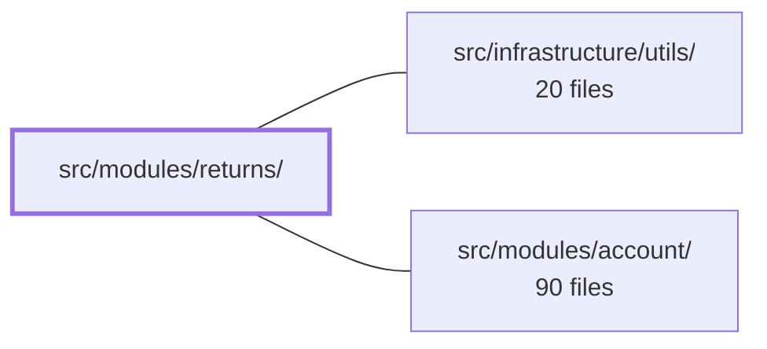

---
tags:
  - 2brain
  - 2brain/module
  - project/boilerplate-vue-frontend
type: module
module: src/modules/returns/
files: 27
updated: 2026-11-10T08:40:28.004319+00:00
---

# src/modules/returns/

## Purpose

The returns module implements the full product-return and withdrawal lifecycle for the shop, covering both EU Consumer Rights Directive Art. 11a withdrawal (buyer-initiated) and other return reasons (defective goods, wrong items, "other"). It provides the buyer-facing entry point on the order page, staff workflow actions, and the shared domain rules (remedy eligibility, time-statement conversion) that keep client-side forms in sync with the server's legal and validation logic.

## Key parts

- **Entry point & shell** — `index.ts` re-exports `WithdrawalPanel` (the single consumer-facing component the order page mounts); `module.ts` registers routes, nav entries, response schemas, and locale files into the app's module registry.
- **Components** — `WithdrawalPanel.vue` (withdrawal button + return options), `ReturnRequestForm.vue` (partial/full return request with remedy selection), `CancelRemainderDialog.vue` (cancel unshipped remainder), `RecordWithdrawalDialog.vue` (staff records off-platform withdrawal), `ReturnStaffActions.vue` (six lifecycle buttons driven by server-provided `actions` array), `StatedAtFields.vue` (shared date/channel picker for staff forms).
- **Domain logic** — `remedy.ts` (EU Directive 2019/771 Art. 13 remedy availability per reason) and `statement.ts` (datetime-local ↔ ISO conversion, future-date guard, channel enum) keep validation and legal rules in one place across three forms.
- **State & transport** — `store.ts` (Pinia store: paginated search, by-id read, and seven lifecycle actions), `schemas.ts` (Zod form schemas with i18n error thunks), `response-schemas.ts` (envelope validation for all returns endpoints).
- **Views & routing** — `ReturnsList.vue` (filterable, paginated table), `ReturnTarget.vue` (single-return detail), `routes.ts` (customer list, staff queue, detail page).
- **Tests** — Component unit specs (each dialog/form/panel), `store.spec.ts` (request-shape + cache-mutation against a mocked transport), `routes.spec.ts` (access-meta contract), domain specs (`statement`, `schemas`), and e2e specs (a11y sweep, failure-path action test).

## How it connects

- **`/` (repository root)** — `module.ts` plugs the returns subdomain into the application's `AppModule` registry (routes, nav, schemas, locales). Removing or renaming the module requires touching this wiring point.
- **`src/infrastructure/utils/`** — The store's `useStructureCrudApi` helper (paginated search, by-id read) and shared HTTP mutator (`orvalMutator`) originate here, giving the returns store its transport layer without re-implementing fetch logic.
- **`src/modules/account/`** — The buyer's authenticated identity (route `meta.access: 'auth'`, role-based visibility of staff actions) flows through the account module's auth context. The returns UI is role-agnostic at the component level; the server, informed by the account session, decides what a buyer vs. staff member can see and do.

## Where to start

Read **`WithdrawalPanel.vue`** first — it is the single component the order page mounts, and it shows how server-driven options (`GET /returns/options`) gate every affordance, how the confirmation-gated withdrawal call works, and how it hands off into `ReturnRequestForm`. Then skim **`store.ts`** to see the seven lifecycle actions and how components dispatch to them, which gives you the full state/transport picture before diving into individual dialogs or domain helpers.

## Connected modules

[[boilerplate-vue-frontend_ROOT|/ (repository root)]] · [[boilerplate-vue-frontend_src_infrastructure_utils|src/infrastructure/utils/]] · [[boilerplate-vue-frontend_src_modules_account|src/modules/account/]]

## Files
- `src/modules/returns/components/CancelRemainderDialog.vue` — A confirmation dialog that cancels the unshipped remainder of a single fulfillment order. It displays the server-provided refund amount (from `GET /returns/options`) and submits a `POST /returns` cancellation. It serves two callers in one component: the buyer (reason fixed to `withdrawal`, no note) and staff (reason `other` with a required note, or optionally recording the buyer's own withdrawal with its date and channel).
- `src/modules/returns/components/RecordWithdrawalDialog.vue` — A staff-facing dialog for recording a buyer's withdrawal that was communicated off-platform (phone, email, or letter). It captures the date the buyer sent the withdrawal and the channel used, then calls the returns store to create the return with `reason: 'withdrawal'`. It exists so staff can log withdrawals that the buyer never triggered through the in-app button, with the server judging the return window on the buyer's stated date rather than the recording date.
- `src/modules/returns/components/ReturnRequestForm.vue` — Customer (and staff) form for opening a return via `POST /returns` with a reason other than withdrawal. Lets the user pick which order lines to send back, how many of each, a reason, an optional note, an optional remedy preference, and (staff-only) the date the buyer asked. The right of withdrawal lives in the sibling `WithdrawalPanel`; this form covers defective goods, wrong items, or "other," including partial returns.
- `src/modules/returns/components/ReturnStaffActions.vue` — Renders the six staff actions available on a return (approve, decline, receive, record proof of sending, close, cancel). Which of the six are visible is driven entirely by the server-provided `Return.actions` array on the prop; this component re-implements none of the lifecycle logic itself and delegates every mutation to the returns store.
- `src/modules/returns/components/StatedAtFields.vue` — Reusable Vuetify field group that lets staff record **when** a buyer said something (a `datetime-local` picker capped to "now") and, for withdrawals, **via which channel** they said it. Extracted so the three staff-facing return forms present and validate these two fields identically.
- `src/modules/returns/components/WithdrawalPanel.vue` — The "returns corner" of the order page. It renders the EU Consumer Rights Directive Art. 11a withdrawal-from-contract button (buyer-only, with a mandatory confirmation step and no reason field), plus the server-driven options to cancel an unshipped fulfillment or return shipped goods. It never computes quantities or deadlines locally — every affordance is gated by `GET /returns/options` or the order's `actions` fields.
- `src/modules/returns/domain/remedy.ts` — Domain constants and logic that encode which remedies (repair, replace, refund) are legally available for a given return reason, per EU Directive 2019/771 Art. 13. It exists to keep the client-side forms from offering remedies the server would reject, and to determine when the buyer gets a choice at all.
- `src/modules/returns/domain/statement.ts` — Domain helpers that convert between the browser's `datetime-local` wall-clock string and the UTC ISO instant the API expects, validate that a stated moment is not in the future, and provide the channel enum values plus a type guard for the staff statement channel. Three return forms share these utilities so the conversion and validation logic lives in one place.
- `src/modules/returns/index.ts` — Public barrel for the `returns` module. It re-exports the single consumer-facing component (`WithdrawalPanel`) so that the order page mounts it as the entry point for all return-related UI (button, confirmation step, and the list of previously opened returns on that order). Keeping the store inside this component prevents sibling modules from accidentally growing their own returns flow.
- `src/modules/returns/module.ts` — Module manifest for the **returns** subdomain. Registers the module's routes, navigation entries, response schemas, and locale files into the app's module registry (`AppModule`). It is the single wiring point that ties the returns feature's UI surfaces together.
- `src/modules/returns/response-schemas.ts` — Registers the response-envelope schemas for every REST endpoint that the OpenAPI contract attributes to the `returns` backend domain. It is the single import point the module manifest uses to turn contract validation on for `returns` routes.
- `src/modules/returns/routes.ts` — Defines the Vue Router route table for the returns module: a customer-facing list, a staff queue over the same list, and a single-return detail page. Exported as the module's default array so the app's module registry can mount it without further assembly.
- `src/modules/returns/schemas.ts` — Defines individual Zod field schemas for the returns forms (buyer request, staff decline, staff close, staff cancel). Error messages are i18n thunks resolved at parse time via `translate()`, and length caps are re-exported from the generated `@api/schemas` contract so components never import that package directly.
- `src/modules/returns/store.ts` — Pinia store for the returns module. It wires a paginated search and a by-id read through `useStructureCrudApi`, and provides hand-written actions for the lifecycle moves that are not plain record edits (open, approve, decline, receive, record proof, close, cancel). Components and views in the module consume this store exclusively for return state and transitions.
- `src/modules/returns/tests/cancel-remainder-dialog.spec.ts` — Unit tests for `CancelRemainderDialog.vue`, verifying both what the dialog renders (refund amount, delivery line visibility, staff-only note field) and what it dispatches to the returns store when the user confirms (buyer withdrawal, staff note, or staff-recorded withdrawal with date/channel). Also asserts that a server refusal keeps the dialog open without emitting close events.
- `src/modules/returns/tests/e2e/a11y.cy.ts` — Declares the accessibility-sweep route list for the returns module and hands it to the shared `sweepA11y` helper. It ensures the returns list, sales-returns page, and a single seeded return detail page are all audited under the signed-in admin role. The file is co-located with the module so that removing the module automatically removes its a11y coverage.
- `src/modules/returns/tests/e2e/actions.cy.ts` — End-to-end test for the returns module's failure path: verifies that when a buyer's withdrawal request is answered with a server fault, the withdraw button remains in the DOM and an error alert is displayed. Runs the scenario through the shared `actionTable` harness rather than writing bespoke Cypress steps.
- `src/modules/returns/tests/record-withdrawal-dialog.spec.ts` — Unit tests for the `RecordWithdrawalDialog` component. Verifies that a buyer-stated withdrawal submission enforces both required fields (day and channel), rejects future dates, forwards an ISO instant + channel to the store's `openReturn`, emits `recorded` on success, and keeps server rejections (e.g. 409 window-closed) visible in-dialog.
- `src/modules/returns/tests/return-request-form.spec.ts` — Vitest spec for the `ReturnRequestForm.vue` component. It verifies the form's conditional visibility (button → panel), line and reason selection, quantity validation, remedy selection logic, note handling, staff-mode fields, error display, and cancellation. The store's `openReturn` action is spied; actual transport is left to `store.spec.ts`.
- `src/modules/returns/tests/return-staff-actions.spec.ts` — Unit tests for the `ReturnStaffActions` component. Verifies that staff-action buttons and forms render (or stay hidden) based solely on the `Return.actions` flag, and that each interaction dispatches the expected store method with the correct arguments. The transport layer is explicitly out of scope here — that belongs to `store.spec.ts`.
- `src/modules/returns/tests/routes.spec.ts` — Vitest spec that pins the `meta.access` contract of every returns route. Its goal is to catch a route that silently loses its `'auth'` requirement (which would make it publicly accessible) and to keep the route inventory exhaustive so new routes cannot be added without a corresponding test.
- `src/modules/returns/tests/schemas.spec.ts` — Vitest test suite that verifies the three return-related Zod schemas (`declineReasonSchema`, `declineMessageSchema`, `returnNoteSchema`) accept and reject the correct values, with boundary checks driven by shared contract constants rather than hardcoded numbers.
- `src/modules/returns/tests/statement.spec.ts` — Vitest spec that pins the shared stated-day time rules (local `datetime-local` string ↔ ISO instant conversion, and the "not in the future" guard) used across three staff forms. Exists so the domain logic in `statement.ts` is verified in one place rather than duplicated per form.
- `src/modules/returns/tests/store.spec.ts` — Unit tests for `useReturnsStore` that verify, against a mocked `orvalMutator` transport, three things per action: the exact request body sent (validated against the API contract's own request schemas), the correct cache mutation on the store, and header invariants (e.g. Idempotency-Key on mutating calls). Catches request-shape drift before it surfaces as a 422 in production.
- `src/modules/returns/tests/withdrawal-panel.spec.ts` — Vitest unit spec for `WithdrawalPanel.vue`. Verifies the panel's conditional rendering (server-driven button visibility, blocked-reason messaging, deadline text), the confirmation-gated withdrawal call, error surfacing, staff permission gating for "Record a withdrawal," and the hand-off of returnable/reason data into the nested `ReturnRequestForm`. Store actions are spied here; HTTP transport is deliberately left to `store.spec.ts`.
- `src/modules/returns/views/ReturnTarget.vue` — Detail page for a single return record. Renders the return's reason, status, postage responsibility, dates, line items, remedy/decline info, and — for staff — policy exceptions and available actions. Exists as the "one return" view in the returns module, reached via a route parameter (`id`).
- `src/modules/returns/views/ReturnsList.vue` — The returns list page. It renders a filterable, paginated table of product returns by wiring the `ReturnsStore`'s search action to a filter form (status, reason), a page-size selector, and a pagination control. The page is role-agnostic: the server decides which returns a customer vs. a staff member can see, so the UI is identical for both.

---
[[boilerplate-vue-frontend_INDEX|← boilerplate-vue-frontend index]]
