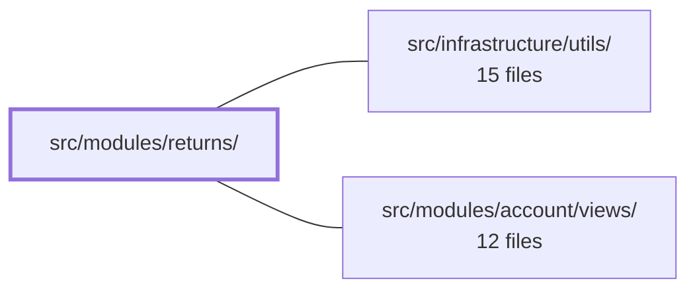

---
tags:
  - 2brain
  - 2brain/module
  - project/boilerplate-vue-frontend
type: module
module: src/modules/returns/
files: 18
updated: 2026-10-17T02:55:24.029099+00:00
---

# src/modules/returns/

## Purpose

The returns module implements the full customer- and staff-facing workflow for order returns and EU right-of-withdrawal cancellations: opening a return, cancelling an unshipped remainder, and the staff lifecycle (approve, decline, receive). It owns its own routes, Pinia store, UI components, and response-contract schemas, and exposes a single public component (`WithdrawalPanel`) for embedding in the order detail page.

## Key parts

- **Components** (`components/`) — the interactive building blocks:
  - `WithdrawalPanel.vue` — the "returns corner" on the order page; shows the withdrawal button, cancellable fulfillment orders, and return history, all server-gated.
  - `CancelRemainderDialog.vue` — confirmation dialog for cancelling an unshipped remainder (used by both buyer and staff flows).
  - `ReturnRequestForm.vue` — multi-line, multi-quantity return request form for non-withdrawal reasons.
  - `ReturnStaffActions.vue` — approve / decline / receive controls rendered strictly from server-supplied `item.actions`.
- **Views** (`views/`) — the two routed pages:
  - `ReturnsList.vue` — paginated, filterable list (customer-scoped or staff-scoped, decided server-side).
  - `Return.vue` — single-return detail with items, amounts, and staff actions.
- **Store** (`store.ts`) — Pinia store wiring `useStructureCrudApi` for list/detail reads plus four hand-written state-transition actions (`open`, `approve`, `decline`, `receive`).
- **Wiring & contracts** — `module.ts` (route/schema/locale registration), `routes.ts` (two auth-gated routes), `response-schemas.ts` (response-envelope schemas for contract validation), `index.ts` (public barrel exposing only `WithdrawalPanel`).
- **Tests** (`tests/`) — unit specs per component and the store (with schema-validated request bodies), a route access-control guard, and an e2e a11y sweep.

## How it connects

- **`src/infrastructure/utils/`** — provides shared helpers the module relies on, notably `useStructureCrudApi` (paginated search + by-id read used in the store) and the `sweepA11y` e2e helper referenced by the accessibility test.
- **`src/modules/account/views/`** — hosts the order-detail page into which `WithdrawalPanel` is embedded; the account views import the module's single public entry point from `index.ts` and never touch internal components or the store directly.
- **Repository root (`/`)** — the app shell and module registry that `module.ts` plugs into, mounting the returns routes, locale loaders, and response-schema validation into the running application.

## Where to start

Read `index.ts` first (a handful of lines) to see exactly what the module exposes to the rest of the app, then `store.ts` to understand the five data actions (`open`, `approve`, `decline`, `receive`, plus the inherited CRUD) and the caching behaviour. Together they define the module's public contract; the components and views are then straightforward consumers of that contract.

## Connected modules

[[boilerplate-vue-frontend_ROOT|/ (repository root)]] · [[boilerplate-vue-frontend_src_infrastructure_utils|src/infrastructure/utils/]] · [[boilerplate-vue-frontend_src_modules_account_views|src/modules/account/views/]]

## Files
- `src/modules/returns/components/CancelRemainderDialog.vue` — A confirmation dialog that cancels the unshipped remainder of a single fulfillment order. It displays the server-computed refund amount (from `GET /returns/options`) and, on confirm, fires a `POST /returns` cancellation. Two callers reuse it: the buyer (as part of a withdrawal, no note) and staff (with a free-text note and a step-up key handled by the HTTP layer).
- `src/modules/returns/components/ReturnRequestForm.vue` — Customer-facing form for opening a non-withdrawal return (defective goods, wrong item, or "other"). It lets the customer select which order lines to send back, how many of each, pick a reason, and add an optional note, then calls `POST /returns` via the returns store. The right of withdrawal is deliberately excluded from this component and lives in the sibling `WithdrawalPanel`.
- `src/modules/returns/components/ReturnStaffActions.vue` — Renders the three staff actions available on a single return — **approve**, **decline** (with a mandatory reason), and **receive** (with an optional handling deduction). Which of the three are shown is driven entirely by the server-supplied `item.actions`; the component performs no lifecycle logic of its own, only validation, dispatch, and feedback.
- `src/modules/returns/components/WithdrawalPanel.vue` — The "returns corner" of the order detail page. It surfaces the EU consumer-rights withdrawal button (Art. 11a), the list of still-cancellable fulfillment orders, the returnable lines, and the history of returns/withdrawals already opened — all driven by server-provided data from `GET /returns/options`. It deliberately counts nothing and never reads the withdrawal period itself; visibility and availability are entirely server-gated.
- `src/modules/returns/index.ts` — Public barrel for the Returns module. It exposes the single public entry point (`WithdrawalPanel`) so the order page can import one component that encapsulates the entire returns flow (trigger button, confirmation step, and the list of previously opened returns) without leaking internal store or sub-component details to the outside.
- `src/modules/returns/module.ts` — Module manifest for the **returns** feature. It registers the returns routes, navigation entry, response schemas, and locale loaders into the app's module registry so the framework can mount the feature. It is a pure wiring file — no business logic lives here.
- `src/modules/returns/response-schemas.ts` — Declares the response-envelope schemas for every REST endpoint attributed to the `returns` domain. It exists as a thin registration point: by exposing a `ResponseSchemaRoute[]` constant, it lets the module-manifest mechanism enable or disable contract validation for all `returns` routes simply by including or removing this file.
- `src/modules/returns/routes.ts` — Defines the Vue Router route table for the returns module. It exposes two routes—list and detail—that the app's module registry mounts. Both are auth-gated; the server (not the client) decides whether the list shows one customer's returns or all returns.
- `src/modules/returns/store.ts` — Pinia store for the returns module. It wires `useStructureCrudApi` (paginated search + by-id read) and adds hand-written actions for the four "move" endpoints that are state transitions rather than plain record edits: open (which doubles as withdrawal), approve, decline, and receive.
- `src/modules/returns/tests/cancel-remainder-dialog.spec.ts` — Unit-test spec for `CancelRemainderDialog.vue`. Verifies what the dialog renders (remainder lines, computed refund, conditional shipping note, staff-only note field) and what payload it dispatches to the store on confirm, including the error path where the server refuses the cancellation.
- `src/modules/returns/tests/e2e/a11y.cy.ts` — Registers the accessibility-audit routes for the returns module with the shared `sweepA11y` helper. It sweeps the returns list and one seeded return detail page under the **admin** (signed-in) role, ensuring both pages are checked for a11y issues as part of the e2e suite.
- `src/modules/returns/tests/return-request-form.spec.ts` — Unit test spec for the `ReturnRequestForm.vue` component. It verifies the form's user-facing contract: collapsed-until-opened state, per-line checkbox selection with quantity validation (never above remaining), mandatory reason, optional note trimming, partial-submission payload shape, server-error handling, and state reset on cancel. The store's `openReturn` action is always spied; actual transport is deferred to `store.spec.ts`.
- `src/modules/returns/tests/return-staff-actions.spec.ts` — Vitest spec for `ReturnStaffActions.vue`. Verifies that the component renders staff action controls (approve, decline, receive) strictly from `Return.actions`, and that each control dispatches the correct payload to the store. Store methods are spied; network/transport concerns are deliberately left to `store.spec.ts`.
- `src/modules/returns/tests/routes.spec.ts` — Guards the access-control contract of every returns route. A route that silently loses its `meta.access` would keep rendering but become publicly reachable, so this spec pins the expected value (`'auth'`) on each route and asserts no route-level `can` rule is present. It also acts as a closed-world check: any new route added to the module fails this file until the test is updated.
- `src/modules/returns/tests/store.spec.ts` — Unit tests for the returns Pinia store against a mocked HTTP transport. Verifies what each store action sends (URL, method, body, headers), what it caches, and that a state-mutating call **replaces** the cached record with the server's answer. Request bodies are validated against the OpenAPI contract schemas (`@api/schemas`) so payload drift fails in CI rather than as a 422 in production.
- `src/modules/returns/tests/withdrawal-panel.spec.ts` — Vitest spec for `WithdrawalPanel.vue`. Verifies the panel's three main responsibilities: rendering the withdrawal button only when the server permits it, requiring a confirmation dialog before calling the store, and reporting outcomes (success, refusal, or error). Also covers the embedded return-request form and the cancellation-of-unshipped flow.
- `src/modules/returns/views/Return.vue` — Detail page for a single return. Displays the return's items, status, postage responsibility, refund/deduction amounts, and — for staff — the actions still available. Loads by route `id` using the returns store's cache, then forces one fresh read on mount to guarantee the `actions` list is present (list-seeded cache rows carry none).
- `src/modules/returns/views/ReturnsList.vue` — The paginated returns list page. It renders a filter form (status, reason, page size), a card-per-return listing, and pagination controls. The same component serves both customers (who see only their own returns) and staff (who see all); the scoping decision is made server-side via the shared store query.

---
[[boilerplate-vue-frontend_INDEX|← boilerplate-vue-frontend index]]
