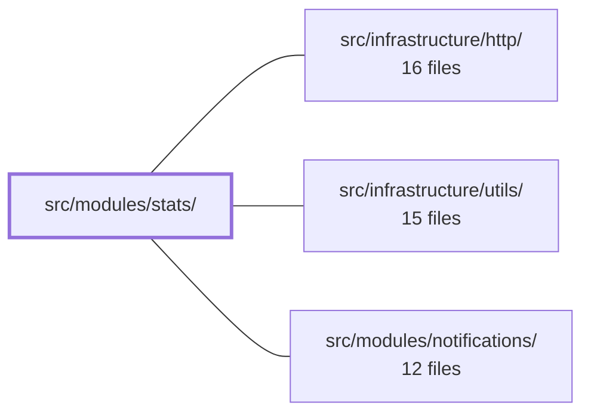

---
tags:
  - 2brain
  - 2brain/module
  - project/boilerplate-vue-frontend
type: module
module: src/modules/stats/
files: 31
updated: 2026-10-17T02:55:43.558452+00:00
---

# src/modules/stats/

## Purpose

The stats module is the read-only analytics dashboard for a shop. It lets a shop owner or admin view aggregated sales, product, and operational KPIs over a chosen date range, with charts, accessible data tables, and CSV exports. It performs no data mutation and owns no business logic—every figure arrives pre-computed from the backend, and the module's job is to format, label, and present that data safely.

## Key parts

- **Domain layer** (`domain/`) — Pure, side-effect-free logic that every component and test shares:
  - `period.ts` / `calendar.ts` — Validate and constrain the date-range + bucket "question" before any request; handle local-timezone day arithmetic.
  - `chart.ts` / `mermaid.ts` — Define the canonical `ChartModel` shape and convert it to Mermaid diagram source (with label sanitisation).
  - `csv.ts` / `series.ts` / `figures.ts` — CSV serialisation with injection guards, timezone-aware axis labels, and period-over-period change helpers.
  - `index.ts` — Barrel re-export so consumers import from a single path.

- **Components** (`components/`) — Presentational building blocks composed by the views:
  - `ChartWithTable.vue` + `MermaidChart.vue` — A single chart block: SVG diagram (lazy-loaded Mermaid), an accessible table toggle, and a CSV download, all derived from the same `ChartModel`.
  - `SalesSection.vue`, `ProductsSection.vue`, `OperationsSection.vue` — The three dashboard sections (headline cards, product table + category charts, and operational KPIs).
  - `StatsPeriodForm.vue` — Date-range / bucket picker with local validation and quick-select presets.

- **Views** (`views/`) — Top-level page components:
  - `StatsDashboard.vue` — Owns the period state, the single dashboard fetch, and delegates rendering to the three sections.
  - `ProductSales.vue` — Per-product time-series page; period is read from the URL so the view is reconstructable from a shared link.

- **Store & wiring** —
  - `store.ts` — Thin Pinia store that fires the seven dashboard endpoint calls (or one for the product page), stores responses verbatim, and exposes a shared loading flag.
  - `module.ts` / `routes.ts` / `response-schemas.ts` — Register the module's routes, navigation entry, OpenAPI contract validation, and locale files with the kernel; both views are lazy-loaded.

- **Tests** (`tests/`) — Vitest unit specs for every domain file and component, plus a Cypress e2e spec and an a11y sweep route list, all co-located so removing the module removes its coverage.

## How it connects

- **Repository root (`/`)** — `module.ts` registers the stats module (routes, nav entry, schemas, locale files) with the kernel's `AppModule` registry; deleting the folder unregisters it automatically.
- **`src/infrastructure/http/`** — `store.ts` issues all REST calls through the shared HTTP transport (the `orvalMutator` adapter); response payloads are validated against the OpenAPI contracts declared in `response-schemas.ts`.
- **`src/infrastructure/utils/`** — Shared utility helpers (locale formatting, general-purpose functions) are consumed by the domain and component layers.
- **`src/modules/notifications/`** — Sibling module in the same kernel registry; the two share the app-shell routing and locale infrastructure but have no direct data dependency.

## Where to start

1. **`views/StatsDashboard.vue`** — Shows the top-level composition: how the period form, the store fetch, and the three section components fit together in one page.
2. **`domain/chart.ts`** — The single `ChartModel` type that drives every chart, table, and CSV export in the module; reading it first makes the components and domain helpers self-explanatory.

## Connected modules

[[boilerplate-vue-frontend_ROOT|/ (repository root)]] · [[boilerplate-vue-frontend_src_infrastructure_http|src/infrastructure/http/]] · [[boilerplate-vue-frontend_src_infrastructure_utils|src/infrastructure/utils/]] · [[boilerplate-vue-frontend_src_modules_notifications|src/modules/notifications/]]

## Files
- `src/modules/stats/components/ChartWithTable.vue` — Renders one chart block: a Mermaid-drawn chart, a toggle to an accessible HTML table, and a CSV download button. All three views are derived from the same `ChartModel` prop so the picture, the table, and the export never disagree. It is the leaf building block that the stats sections compose.
- `src/modules/stats/components/MermaidChart.vue` — Renders a Mermaid diagram source string as an inline SVG element inside the stats view. It dynamically imports the `mermaid` library only on demand (keeping it out of the entry bundle), attaches the resulting SVG via `DOMParser` rather than `innerHTML`, and exposes a translated failure message if rendering throws. The component exists to give `ChartWithTable.vue` a visual chart paired with an accessible data table.
- `src/modules/stats/components/OperationsSection.vue` — Presentational section of the stats dashboard that displays operational KPIs — cancellation, return, and refund rates, new vs. returning customers, pipeline waiting amounts, and per-currency payment-method mix. It formats and labels API-provided numbers but performs no data fetching or mutation of its own.
- `src/modules/stats/components/ProductsSection.vue` — Renders the "Products" section of the stats dashboard: a compact table of top products (units ordered/reversed, net units, net sales) and one category chart per currency. Each product row links to its dedicated sales page, forwarding the current period.
- `src/modules/stats/components/SalesSection.vue` — Presentational SFC that renders the **sales** section of the stats dashboard. For each currency group supplied by the API it displays a row of headline stat cards (with period-over-period change), two over-time charts (total-sales bar, orders line), and a per-bucket revenue table with a CSV download. It formats and lays out data the backend already aggregated; it performs no sums of its own.
- `src/modules/stats/components/StatsPeriodForm.vue` — A period-picker form used at the top of every stats page. It provides two date inputs, a bucket-size selector, and quick-select preset buttons. It validates the draft locally (via `periodProblem`) so impossible ranges are explained inline rather than answered by a 422 from the API.
- `src/modules/stats/domain/calendar.ts` — Pure utility functions for calendar-day arithmetic using the browser's local timezone. Dates are represented as plain `YYYY-MM-DD` strings (the shape the stats API's `from`/`to` params and `<input type="date">` use). All logic is client-side; when the browser's zone differs from the server's, the server's interpretation wins (surfaced as `timeZone` in the stats response).
- `src/modules/stats/domain/chart.ts` — Defines the single canonical data shape (`ChartModel`) from which every stats chart is drawn, its "show as table" view is rendered, and its CSV export is generated — guaranteeing the picture, the table, and the file can never disagree.
- `src/modules/stats/domain/csv.ts` — Pure client-side CSV serialization for the stats module's on-screen tables. It exists so components can hand users a downloadable file without pulling in a library, and so every cell passes through a CSV-injection guard (OWASP) before it reaches Excel or another spreadsheet.
- `src/modules/stats/domain/figures.ts` — Pure helper functions that compute and classify period-over-period figure changes for the stats cards. Extracted from the domain layer so the math lives alongside the data shapes rather than in presentation code.
- `src/modules/stats/domain/index.ts` — Barrel (re-export) file for the stats domain layer. It aggregates the seven sibling domain modules into a single import entry point so that consumers (components, the store, tests) can import any pure domain rule—period math, figure calculations, chart/CSV/mermaid transforms, calendar helpers, series utilities—without naming individual file paths.
- `src/modules/stats/domain/mermaid.ts` — Converts a `ChartModel` into Mermaid diagram source text (`xychart-beta` for bar/line, `pie` for pie). Because Mermaid parses a mini-language and every label is free-form text a shop owner typed, this module sanitises all labels through an allow-list before embedding them in quoted Mermaid directives, providing the first line of defence alongside Mermaid's own `securityLevel: 'strict'`.
- `src/modules/stats/domain/period.ts` — Defines the "question" a stats page asks the API — a date range plus a bucket size — and provides the pure, side-effect-free logic that validates, constrains, and constructs that question before any network round-trip. It centralises the API's own limits (max range, max buckets) so the form can reject bad input locally.
- `src/modules/stats/domain/series.ts` — Converts API time-bucket start instants into short, human-readable axis labels for stat charts. It exists to handle the timezone subtlety: a bucket's `start` is the shop's local midnight encoded as a UTC instant, so it must be formatted in the shop's IANA zone (not the viewer's browser zone) to produce a correct day/month label.
- `src/modules/stats/module.ts` — Module manifest for the **stats** domain. It registers the module's routes, navigation entry, response schemas, and locale files with the kernel's `AppModule` registry. The module is purely read-only reporting: it displays shop sales figures sourced from a single backend read and owns no data or business logic.
- `src/modules/stats/response-schemas.ts` — Declares the response-schema rows for every stats-domain REST endpoint. It exists so that enabling the `stats` module (via the module manifest) automatically turns on contract validation for its routes, and deleting the folder disables it—no manual wiring in a central registry required.
- `src/modules/stats/routes.ts` — Defines the two Vue Router records for the stats domain (a general dashboard and a per-product sales page). Both views are lazy-loaded so the chart library is fetched only when the user actually navigates to a stats page.
- `src/modules/stats/store.ts` — Pinia store that holds the live answers for the sales dashboard (seven endpoint blocks) and the product drill-down page (one time-series). It fires the requests, stores each response verbatim, and exposes a shared `loading` flag. It performs no arithmetic or currency conversion — it is a thin "last answer" holder over the API.
- `src/modules/stats/tests/calendar.spec.ts` — Unit-test suite (Vitest) for the calendar utility functions in the stats domain. It pins down the expected behavior of date parsing, day arithmetic, and range counting so that regressions in `calendar.ts` are caught at the boundary of valid/invalid inputs.
- `src/modules/stats/tests/chart-with-table.spec.ts` — Vitest spec for the `ChartWithTable` component. Mermaid rendering is stubbed (its own spec covers drawing); here the assertions pin which diagram source the component passes to the chart, that the table and the CSV carry the same rows, and that formula-prefixed labels are neutralised in the CSV output.
- `src/modules/stats/tests/domain.spec.ts` — Vitest test suite covering the pure, DOM-free logic of the stats domain: period validation, bucket arithmetic, percentage-change helpers, CSV escaping, and Mermaid chart-source generation. It exists to pin down edge cases (invalid dates, hostile labels, formula injection, timezone-shifted bucket labels) that the domain functions must handle correctly.
- `src/modules/stats/tests/e2e/a11y.cy.ts` — Declares the accessibility route list for the **stats** module and hands it to the shared a11y sweep runner. It is co-located inside the module so that removing the module automatically removes its a11y coverage with no dangling test files.
- `src/modules/stats/tests/e2e/stats.cy.ts` — Cypress end-to-end spec for the **Sales dashboard** (`/en/sales/stats`). It drives the real backend to verify that the dashboard renders its stat blocks, the chart can toggle to a table, an impossible date range is rejected client-side, a preset triggers the expected API call, and a non-admin user is redirected away.
- `src/modules/stats/tests/mermaid-chart.spec.ts` — Vitest spec that pins the behavioural contract of `MermaidChart.vue` against a mocked Mermaid library. It verifies the component always configures Mermaid with strict security, renders the resulting SVG into the DOM, survives a definition change, discards a stale (slower) render in favour of the newest one, and surfaces a visible failure marker when Mermaid throws.
- `src/modules/stats/tests/routes.spec.ts` — Guards the `meta.access` and `meta.can` declarations on every stats route by asserting their exact values against hardcoded expectations. Because a route that silently loses its permission is indistinguishable from a public one, the test spells out each expected value rather than deriving it, and also enforces that no undeclared route has been added.
- `src/modules/stats/tests/sections.spec.ts` — Vitest spec that mounts the three dashboard presentational blocks (Sales, Products, Operations) with canned, pre-computed stats and asserts only what they **format and word** — card labels, chart definitions, CSV columns, empty-state copy, and link targets. It deliberately does not test any computation; the figures arrive from the API as given.
- `src/modules/stats/tests/stats-period-form.spec.ts` — Vitest suite that exercises the `StatsPeriodForm` component's public contract: it can apply the period it was handed, rejects invalid ranges with a visible explanation and a disabled submit button, auto-widens the bucket size as the range grows, applies a preset immediately, and stays in sync when the parent changes the `modelValue` prop.
- `src/modules/stats/tests/store.spec.ts` — Unit test suite for `useStatsStore`. It replaces the HTTP transport (`orvalMutator`) with a `METHOD /url`-keyed router that validates every fixture against the OpenAPI contract schemas before resolving, ensuring the store's logic is exercised against realistic, spec-shaped payloads while any contract drift fails immediately in test.
- `src/modules/stats/tests/views.spec.ts` — Page-level integration tests for the two stats views (StatsDashboard and ProductSales). Verifies which store method fires on load, with what period (URL-driven or default), how a failed load is surfaced, and what the product page links to. Sub-block rendering is covered by their own specs.
- `src/modules/stats/views/ProductSales.vue` — Vue single-file component that renders a single product's sales-over-time page. It displays ordered and reversed unit counts per time bucket as a combined bar/line chart, lets the user adjust the period via a form, and offers a link to the filtered staff-orders list. The product is identified by the `productId` route prop; the period is read from the URL query (defaulting to the last 30 days) so the view is fully reconstructable from a shared link.
- `src/modules/stats/views/StatsDashboard.vue` — Top-level page component for the sales statistics route. It owns the selected reporting period and the single `loadDashboard` fetch, then delegates pure rendering to three section components. It exists so that the period state, the loading lifecycle, and the blocking-error UX live in one place rather than being scattered across child blocks.

---
[[boilerplate-vue-frontend_INDEX|← boilerplate-vue-frontend index]]
