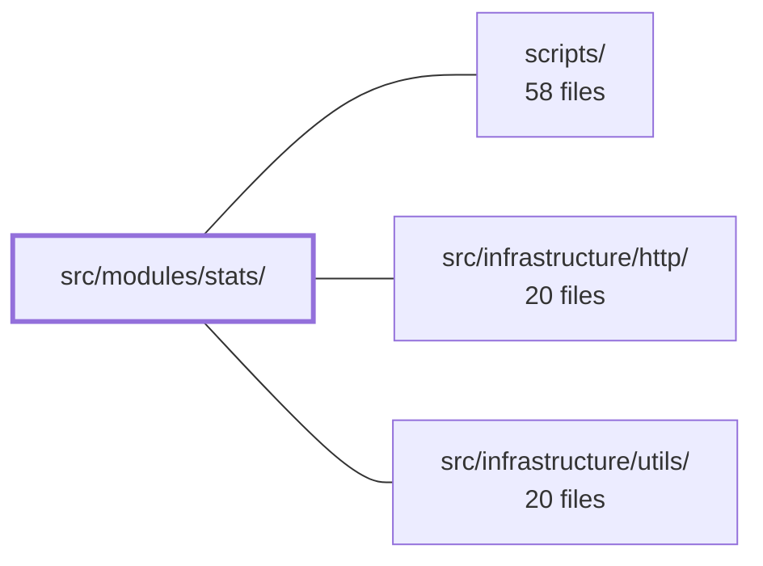

---
tags:
  - 2brain
  - 2brain/module
  - project/boilerplate-vue-frontend
type: module
module: src/modules/stats/
files: 32
updated: 2026-11-10T08:40:40.327517+00:00
---

# src/modules/stats/

## Purpose

The stats module is the shop's read-only analytics dashboard. It fetches pre-computed figures (sales, product performance, operational metrics) from the backend for a chosen date range and renders them as interactive charts, accessible tables, and downloadable CSV files across two pages: a general dashboard and a per-product drill-down. It performs no aggregation of its own—every number arrives from the API.

## Key parts

- **Domain layer** (`domain/`) — Pure, dependency-free functions and types: `period.ts` (date-range + bucket validation and construction), `chart.ts` (the canonical `ChartModel` shape shared by all three representations), `mermaid.ts` (ChartModel → Mermaid source with label sanitisation), `csv.ts` (row → CSV with injection neutralisation), `calendar.ts` (date-string arithmetic), `figures.ts` (period-over-period change helpers), `index.ts` (barrel re-export).
- **Components** (`components/`) — Presentational building blocks: `ChartWithTable.vue` (chart/table/CSV toggle for one `ChartModel`), `MermaidChart.vue` (lazy-loaded Mermaid → inline SVG), `SalesSection.vue`, `ProductsSection.vue`, `OperationsSection.vue` (the three dashboard sections), and `StatsPeriodForm.vue` (validated period picker shared by both pages).
- **Views** (`views/`) — `StatsDashboard.vue` (owns the period choice and the single `loadDashboard` call) and `StatsProductSales.vue` (single-product time-series page, period in URL query).
- **Wiring** — `module.ts` (assembles routes, schemas, i18n, nav into an `AppModule`), `routes.ts` (two lazy-loaded route records), `store.ts` (Pinia store: `loadDashboard` fires seven parallel GETs, `loadProductSales` fetches one series), `response-schemas.ts` (contract-validation rows for every stats endpoint).
- **Tests** (`tests/`) — Unit specs for every domain function, component, store, and view; co-located Cypress E2E specs for a11y, permissions, user actions, and the dashboard page itself.

## How it connects

- **`src/infrastructure/http/`** — Provides the HTTP transport (orval mutator) that `store.ts` calls for its seven dashboard GETs and the single product-series request. The store's tests stub this layer with canned, schema-validated responses.
- **`src/infrastructure/utils/`** — Supplies shared utility helpers used across the app (e.g., formatting or misc helpers) that stats components and domain functions rely on.
- **Repository root / `scripts/`** — The build and test tooling (Vitest, Cypress, build pipeline) that executes the module's test suites and bundles the lazy-loaded views and Mermaid dependency.

## Where to start

1. **`domain/period.ts` + `domain/chart.ts`** — These two files define the core data contracts (what a "period" looks like and what a `ChartModel` contains). Understanding them makes every component, test, and the store's shape immediately legible.
2. **`views/StatsDashboard.vue`** — The single orchestrating page: it owns the period state, triggers the one store action, and hands the result to the three sections. Reading top-down from here shows how the rest of the module fits together.

## Connected modules

[[boilerplate-vue-frontend_ROOT|/ (repository root)]] · [[boilerplate-vue-frontend_scripts|scripts/]] · [[boilerplate-vue-frontend_src_infrastructure_http|src/infrastructure/http/]] · [[boilerplate-vue-frontend_src_infrastructure_utils|src/infrastructure/utils/]]

## Files
- `src/modules/stats/components/ChartWithTable.vue` — Reusable chart-block component that renders a single `ChartModel` in one of three interchangeable forms — a Mermaid diagram (xy or pie), an accessible HTML table, or a downloadable CSV file — all derived from the same data. It exists so that every stats view gets a consistent title bar, chart/table toggle, and CSV export without repeating the logic.
- `src/modules/stats/components/MermaidChart.vue` — Renders a Mermaid diagram (supplied as a source string) as an inline SVG inside the stats module. It exists so the stats page can display charts without bundling the Mermaid library into the app entry—Mermaid is lazy-imported per-chart-mount, and the SVG is injected as a parsed DOM node rather than raw HTML.
- `src/modules/stats/components/OperationsSection.vue` — Presentational section of the stats dashboard that words and formats operational API data: payment mix (per-currency pie charts), cancellation/return/refund rates, new-vs-returning customer counts, and pipeline status (awaiting transfers, paid-not-shipped). It performs no fetching or mutation — every number arrives via props.
- `src/modules/stats/components/ProductsSection.vue` — A `<section>` component inside the stats dashboard that presents two data views: a table of top products (each row links to that product's dedicated sales page, passing the active period along) and one pie-per-currency chart of net sales by category. It exists to keep these two related but distinct "answers" in a single, self-contained block of the dashboard.
- `src/modules/stats/components/SalesSection.vue` — Presentational Vue SFC that renders the sales section of the stats dashboard: one block per currency containing headline stat cards (with period-over-period change), two over-time charts (total sales as bars, orders as a line), and a detailed revenue table. It formats pre-computed API figures and exports CSV; it performs no aggregation of its own.
- `src/modules/stats/components/StatsPeriodForm.vue` — A reusable period-picker form for all stats pages. It lets the visitor choose a date range, a bucket size, or a quick preset, validates the draft against API limits *before* submitting, and emits only a period the backend will accept — surfacing human-readable problems locally instead of relying on a 422 response.
- `src/modules/stats/domain/calendar.ts` — Pure-function module that treats a calendar day as a plain `YYYY-MM-DD` string (the shape of a `<input type="date">` value and the stats API's `from`/`to` params) and provides arithmetic over it. All operations run in the browser's local timezone; the shop's server-side zone is a server concern carried out-of-band via `timeZone` on the response.
- `src/modules/stats/domain/chart.ts` — Defines the single canonical data shape (`ChartModel`) from which every stats chart, its "show as table" view, and its CSV export are rendered. By funneling all three representations through one structure, the picture, the table, and the file cannot disagree.
- `src/modules/stats/domain/csv.ts` — Client-side CSV serialization for the stats tables. Converts in-memory row data into a downloadable CSV string, with built-in OWASP CSV-Injection neutralisation so that user-typed product or category titles cannot inject spreadsheet formulas.
- `src/modules/stats/domain/figures.ts` — Pure helper functions that compute and classify the period-over-period change in a single stat figure. It exists so that display logic (formatting arrows, "no change" labels, etc.) has a small, testable domain layer to call instead of repeating the arithmetic in every component.
- `src/modules/stats/domain/index.ts` — Barrel (re-export) file for the stats domain layer. It provides a single import path so consumers can pull pure domain rules—calendar logic, chart data shaping, CSV generation, figure calculations, Mermaid diagram construction, and period utilities—from one module specifier without reaching into individual files.
- `src/modules/stats/domain/mermaid.ts` — Converts a `ChartModel` (title, axis labels, one or more numeric series) into Mermaid diagram source text (`xychart-beta` or `pie`). It exists because the UI renders charts through Mermaid, and every label is user-typed free text that must be sanitised before being embedded in Mermaid's quote-delimited mini-language.
- `src/modules/stats/domain/period.ts` — Defines the stats "period" (a `from`/`to` date pair plus an interval bucket size) as a pure, dependency-free domain object. It centralises the validation rules the API enforces so the UI form can reject invalid input before a round-trip, and provides helpers to construct periods from presets or URL query params.
- `src/modules/stats/module.ts` — Module manifest for the `stats` domain. It assembles the domain's routes, response schemas, locale dictionaries, and navigation entry into a single `AppModule` object and registers it with the kernel's registry. The stats domain is read-only reporting: it renders figures fetched by individual backend reads and computes nothing itself.
- `src/modules/stats/response-schemas.ts` — Declares the response-schema validation rows for every REST endpoint the backend `stats` domain is responsible for. It plugs into the module-manifest system so that enabling or removing the `stats` folder automatically toggles contract validation for those routes.
- `src/modules/stats/routes.ts` — Defines the two route records for the stats domain (a general dashboard and a per-product sales view). Both views are lazy-loaded via dynamic `import()` so the chart library they depend on is fetched only when a user actually navigates to one of the pages.
- `src/modules/stats/store.ts` — Pinia store (setup syntax) that holds the last API answer for each block of the sales dashboard plus one product's time-series for the drill-down page. It exposes two actions—`loadDashboard` (fires all seven GETs in parallel for a chosen period) and `loadProductSales` (fetches one product's series)—and nothing else. No values are cached across periods; the API deliberately sends `no-store` because the data represents live shop takings.
- `src/modules/stats/tests/calendar.spec.ts` — Unit-test suite (Vitest) that pins the public contract of the stats **calendar** domain module — date-string validation, day arithmetic, range counting, and `Date`-to-ISO conversion — so refactors in `calendar.ts` are caught immediately.
- `src/modules/stats/tests/chart-with-table.spec.ts` — Unit tests for the `ChartWithTable` component. Mermaid rendering is stubbed out, so the suite pins down: (1) which Mermaid source string the component hands to the chart, (2) that the toggleable table carries the same rows, (3) that CSV export produces the expected content with formula cells neutralised, and (4) that an empty dataset hides all controls.
- `src/modules/stats/tests/domain.spec.ts` — Vitest test suite covering every exported pure function in the stats domain layer. It locks down the validation rules the API enforces (date range limits, bucket ceilings), the arithmetic helpers for change figures, the CSV-escaping contract, and the Mermaid label-sanitisation guarantees. Exists so the domain module can be refactored freely while its externally-visible invariants stay pinned.
- `src/modules/stats/tests/e2e/a11y.cy.ts` — Co-located accessibility (a11y) E2E test for the stats module. It declares the list of routes that belong to this module and delegates the actual sweep logic to a shared helper. By living inside the module's own directory, deleting the module automatically removes its a11y coverage.
- `src/modules/stats/tests/e2e/actions.cy.ts` — End-to-end test that drives the stats dashboard and product pages through the shared `actionTable` runner, verifying two user-visible behaviors: a page whose numbers cannot be loaded shows a single alert and recovers on reload, and a period with no data renders its empty-state copy instead of a blank table.
- `src/modules/stats/tests/e2e/roles.cy.ts` — End-to-end permission sweep for the stats module. It registers a list of stats pages and asserts that, for every known persona, the browser's access decisions (redirect, 403, or allow) agree with that persona's own `can` rules. It lives alongside the module it tests so that deleting the module also removes its sweep.
- `src/modules/stats/tests/e2e/stats.cy.ts` — Cypress end-to-end spec for the Sales Dashboard (`/en/sales/stats`). It verifies the page renders its stat blocks, that a chart can be toggled to a table and back, that an out-of-range period is rejected client-side using the server-supplied limit, and that non-admin users are redirected away. The file explicitly states that figure *correctness* is proven elsewhere (backend tests); here it only checks the page puts values on screen.
- `src/modules/stats/tests/mermaid-chart.spec.ts` — Unit tests for the `MermaidChart` component with the Mermaid library fully mocked. Pins the component's contract with Mermaid (strict security level, errors surfaced not drawn), verifies the rendered SVG lands as a DOM node, confirms a newer definition beats a slower older render, and checks the failure-state element.
- `src/modules/stats/tests/routes.spec.ts` — Pins the `meta.access` and `meta.can` values declared on every stats route so that a silently dropped or changed permission is caught immediately. Each expected value is written out explicitly (rather than derived from a helper) to make regressions obvious in diffs.
- `src/modules/stats/tests/sections.spec.ts` — Vitest spec that exercises the three presentational blocks of the stats dashboard (`SalesSection`, `ProductsSection`, `OperationsSection`) with canned API-shaped data. It asserts how each block formats numbers, phrases comparisons, renders chart stubs, and produces CSV output — never how the figures themselves are computed.
- `src/modules/stats/tests/stats-period-form.spec.ts` — Unit test suite for the `StatsPeriodForm` component. It verifies that the form correctly applies a valid period, rejects invalid ranges (reversed dates, over-length ranges) with a visible error and a disabled submit button, applies presets instantly, auto-widens the bucket interval when the range grows, and stays in sync when the parent changes `modelValue` externally.
- `src/modules/stats/tests/store.spec.ts` — Unit tests for the stats Pinia store. The HTTP transport (`orvalMutator`) is replaced with a router keyed on `METHOD /url` that serves canned responses validated against the API contract's own schemas. The tests pin that one `loadDashboard` call fires every block with the period's days, that responses are held untouched in the store, and that a single block failure rejects the whole load.
- `src/modules/stats/tests/views.spec.ts` — Integration-level Vitest spec for the two stats page views (`StatsDashboard`, `StatsProductSales`). It mounts each page against a real router, a fresh Pinia store (with its load methods stubbed), Vuetify, and i18n, then asserts on the period passed to the store, error rendering, link targets, and empty-state display. The composable blocks these pages use have their own dedicated specs.
- `src/modules/stats/views/StatsDashboard.vue` — Top-level dashboard view for the stats module. Owns the selected `StatsPeriodChoice` and the single `loadDashboard` call, then passes the resulting store state down to three section components. It is the only route in the app where Mermaid is lazily imported (inside a child chart).
- `src/modules/stats/views/StatsProductSales.vue` — Renders a single product's sales-over-time view: a bar-and-line chart of units ordered and reversed per time bucket, a period selector, and a conditional link to the filtered staff orders list. The period is carried in the URL query (so links are shareable) or defaults to the last 30 days.

---
[[boilerplate-vue-frontend_INDEX|← boilerplate-vue-frontend index]]
