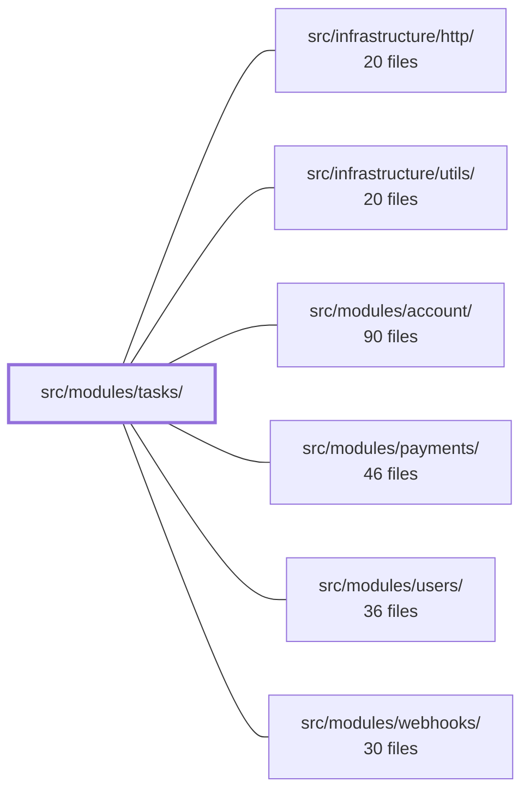

---
tags:
  - 2brain
  - 2brain/module
  - project/boilerplate-vue-frontend
type: module
module: src/modules/tasks/
files: 25
updated: 2026-11-10T08:40:56.682465+00:00
---

# src/modules/tasks/

## Purpose

The tasks module implements the **contact-form → task-inbox** workflow: a public form for visitors to submit a support or general enquiry, and a staff-facing inbox where admins search, annotate, assign, resolve, or delete the resulting tasks. It also supplies the reactive badge count shown on the app's navigation bar.

## Key parts

- **Manifest & routing** — `module.ts` registers the domain into the app's module registry (routes, nav entries, response schemas, locale loaders); `routes.ts` declares the three route records (public contact form, staff inbox, single-task detail).
- **Views** — `views/Contact.vue` (public form with honeypot, challenge widget, query-param pre-fill), `views/TaskInbox.vue` (filterable, sortable, paginated table with per-row status transitions), `views/TaskDetail.vue` (full task page with note thread, assign/resolve controls, and links to sibling tasks).
- **State & contracts** — `store.ts` is the Pinia store exposing `submitContact` and the admin inbox CRUD (search, assign, resolve, delete) via `useStructureCrudApi`; `schemas.ts` holds Zod validation with i18n-thunked messages and length caps sourced from the shared API contract; `response-schemas.ts` declares wire-level response envelopes consumed by the generated route table.
- **Small helpers** — `task-kind.ts` maps an open task-kind enum to a locale key with a safe fallback; `task-ref.ts` derives a short `#ref` from the task ID for display.
- **Badge composable** — `composables/use-task-badge.ts` reactively reads `GET /tasks/summary` and re-fetches on task-related inbox notices, eliminating polling.
- **Tests** — a thorough suite spanning unit (`store.spec`, `schemas.spec`, `task-badge.spec`, `task-kind.spec`, `routes.spec`), integration (`contact-view.spec`, `detail-view.spec`, `inbox-view.spec`), and E2E (`tasks.cy`, `roles.cy`, `actions.cy`, `a11y.cy`, `resilience.cy`, `tasks.visual.cy`).

## How it connects

- **`/` (repository root)** — `module.ts` plugs into the application's module registry so the kernel can mount the module's routes and nav entries.
- **`src/infrastructure/http/`** — the store and generated client (orval mutator) use this layer for all REST calls (`POST /tasks/search`, `PATCH /tasks/:id`, `DELETE /tasks/:id`, etc.).
- **`src/infrastructure/utils/`** — shared utilities (e.g., `useStructureCrudApi`) underpin the store's CRUD pattern.
- **`src/modules/account/`** — the badge composable and route guards depend on the current session's auth state and capability (`read` on `Task`); the Contact form renders a support-email fallback tied to account config.
- **`src/modules/payments/`** — the Contact form's optional *order-number* field and `?order=` query param cross-link to a specific payment/order record.
- **`src/modules/users/`** — the store follows the same structural pattern as the users store; the "take" (assign-to-self) and assignee filter operate on user identities.
- **`src/modules/webhooks/`** — task-specific inbox notifications (open, overdue) are delivered through the notification/webhook pipeline; the badge composable subscribes to these to trigger a re-fetch.

## Where to start

1. **`views/Contact.vue`** — it is the module's public entry point; reading it shows the full submit flow (query-param pre-fill → Zod validation → `store.submitContact` → success notification) in one file.
2. **`store.ts`** — it exposes every action the admin views call, so understanding its `searchInbox`, `assign`, `resolve`, and `delete` signatures makes the rest of the module (inbox table, detail page, badge) immediately legible.

## Connected modules

[[boilerplate-vue-frontend_ROOT|/ (repository root)]] · [[boilerplate-vue-frontend_src_infrastructure_http|src/infrastructure/http/]] · [[boilerplate-vue-frontend_src_infrastructure_utils|src/infrastructure/utils/]] · [[boilerplate-vue-frontend_src_modules_account|src/modules/account/]] · [[boilerplate-vue-frontend_src_modules_payments|src/modules/payments/]] · [[boilerplate-vue-frontend_src_modules_users|src/modules/users/]] · [[boilerplate-vue-frontend_src_modules_webhooks|src/modules/webhooks/]]

## Files
- `src/modules/tasks/composables/use-task-badge.ts` — Provides the reactive badge count shown on the Tasks entry in the app's navigation. It reads `GET /tasks/summary` (via the tasks store) when an authenticated person with `read` capability on `Task` is present, and re-reads whenever a task-related inbox notice arrives—eliminating the need for polling.
- `src/modules/tasks/module.ts` — Module manifest that registers the **tasks** domain into the application's module registry. It wires together the module's routes, navigation entries, response schemas, and locale loaders so the kernel can mount the Contact form (public) and the TaskInbox admin page. The module is intentionally self-contained: it references no other domain's records.
- `src/modules/tasks/response-schemas.ts` — Declares the response-envelope schemas for every REST endpoint attributed to the `tasks` backend domain. The rows are consumed by the generated route table (`contracts/rest/routes.ts`, derived from `openapi.yaml` `x-module` stamps) and enable contract validation on the wire whenever the `tasks` module is active.
- `src/modules/tasks/routes.ts` — Defines the three route records for the tasks module (public contact form, staff task inbox, and single-task detail page) and exports them as a typed `RouteRecordRaw[]` array for the app's module registry to mount.
- `src/modules/tasks/schemas.ts` — Defines Zod validation schemas for the contact/task forms, with i18n-thunked error messages resolved at parse time. Length caps are sourced from generated API contract constants (`@api/schemas`) so the frontend and backend stay in lockstep.
- `src/modules/tasks/store.ts` — Pinia store for the tasks module. It exposes a public `submitContact` action for the contact form and an admin inbox (search, status transitions, delete) built on `useStructureCrudApi`, following the same pattern as the users, products, and orders stores.
- `src/modules/tasks/task-kind.ts` — Provides a single helper that maps a raw task-kind string from the API to a translation key. Because task kinds form an open enum (the server may introduce new kinds the client doesn't yet know), the helper falls back to a generic `task-kind.unknown` key so unknown kinds render as "Task" rather than crashing or showing a blank.
- `src/modules/tasks/task-ref.ts` — Provides a single helper that derives a short task reference (`#ref`) from a task's full ID by taking its last eight characters. This mirrors the format the backend embeds in support-mailbox subject lines, letting staff visually match a mailbox thread to its corresponding task without needing the full ID.
- `src/modules/tasks/tests/contact-view.spec.ts` — Vitest spec that mounts the real `Contact.vue` page (with an actual memory-history router, Pinia, i18n, and Vuetify) and verifies its query-param pre-fill logic, unknown-category handling, conditional field omission, support-address rendering, and the post-submit notification. `submitContact` is spied on the tasks store so no real network call is made; the only mocked I/O is the `GET /config` HTTP request.
- `src/modules/tasks/tests/detail-view.spec.ts` — Integration-style unit test that mounts the **real** `TaskDetail.vue` page over the shared MSW server, exercising routing, i18n, session state, and the two write operations (assign / add-note) end-to-end within a single browser-less process.
- `src/modules/tasks/tests/e2e/a11y.cy.ts` — Declares the accessibility (a11y) sweep routes for the tasks module's public and admin surfaces, delegating the actual audit to the shared `sweepA11y` helper. It exists so that the tasks module's a11y coverage lives alongside the module itself and is removed automatically if the module is deleted.
- `src/modules/tasks/tests/e2e/actions.cy.ts` — E2E test for the tasks page's failure and empty-state rows. It drives two scenarios through the shared `actionTable` runner: (1) a server-fault delete that must keep the row visible and surface an alert (with a working retry), and (2) an empty inbox that must render the page's empty state.
- `src/modules/tasks/tests/e2e/resilience.cy.ts` — The tasks module's contribution to the shell-level resilience sweep. It verifies that the public contact form and the staff inbox route render without console errors and fit the viewport. It deliberately asserts no specific content, deferring to the central resilience spec for that rationale.
- `src/modules/tasks/tests/e2e/roles.cy.ts` — Cypress E2E test that verifies role-based access to the tasks page. It declares *which* personas should be able to reach the tasks route and confirms the browser's rendered UI (menu link, page root element) matches what each persona's own permission rules dictate. The file lives inside the tasks module so that deleting the module removes this sweep automatically.
- `src/modules/tasks/tests/e2e/tasks.cy.ts` — Cypress end-to-end spec that exercises the full tasks-module loop against the running app: a visitor (or bot) submits the public contact form, then an admin reads, annotates, assigns, resolves, or deletes the resulting task on the admin inbox page. It also covers route-guard behaviour (admin-only, guest redirect) and cross-linking on the static pages. The inbox is intentionally empty at the start because the demo profile seeds no tasks — the form submission *is* the fixture.
- `src/modules/tasks/tests/e2e/tasks.visual.cy.ts` — Declares the visual-regression routes for the **tasks** module. It feeds a list of page targets to the shared `sweepVisual` helper so that each route's rendered output is captured as a screenshot for pixel-level comparison. The file exists purely as a route manifest; all sweep logic lives in the shared helper.
- `src/modules/tasks/tests/inbox-view.spec.ts` — Vitest spec that mounts the real `TaskInbox` component over the shared MSW server and verifies four behaviors: URL query parameters reach the `POST /tasks/search` body, a typed text filter is sent on form submit, the short task reference renders correctly per row, and the "take" action assigns the task to the signed-in viewer. All app layers (store, generated client, interceptors, router) are real; only the network wire is faked.
- `src/modules/tasks/tests/routes.spec.ts` — Pin-tests the `meta.access` and `meta.can` values declared on every task route. Without this file, a route that loses its access metadata would silently fall through to "public" with no test failing. It also asserts the route inventory is exactly the set of names listed here, catching unregistered additions.
- `src/modules/tasks/tests/schemas.spec.ts` — Tests that `contactSchema` (from `../schemas`) enforces the same field-length caps defined in the shared API contract (`@api/schemas`). The caps are imported rather than hardcoded, so a contract change automatically moves the boundary assertions with it: exactly the cap passes, one past fails.
- `src/modules/tasks/tests/store.spec.ts` — Unit test for `useTasksStore`. It intercepts `orvalMutator` (the generated HTTP client) so the store and the orval-generated request shapes stay real while only the network is faked. It pins three behaviors: the inbox reads pages via `POST /tasks/search` (never the browser-cached `GET /tasks`), `pageTotal` comes from the server's `meta` rather than the local row count, and a write (resolve / assign / note / delete) patches or evicts the cached row—verified by the toolkit's automatic refetch.
- `src/modules/tasks/tests/task-badge.spec.ts` — Unit tests for the task-inbox navigation badge (`composables/use-task-badge.ts`). Verifies that the badge reads `GET /tasks/summary` for a permitted session, displays **unassigned + mine**, reacts to task-specific notifications (open, overdue), and displays nothing when the session lacks the `read Task` ability or has signed out.
- `src/modules/tasks/tests/task-kind.spec.ts` — Unit tests for the `taskKindKey` helper, verifying that known `TaskKind` values map to their own locale key, unknown values fall back to a generic `task-kind.unknown` key, and that generic word exists in every shipped locale (en, it).
- `src/modules/tasks/views/Contact.vue` — Public, unauthenticated contact form for visitors. Accepts name, email, subject, optional category/order-number (pre-filled from `?category=` / `?order=` query params), and a message; validates via Zod and submits through the tasks store. Includes a honeypot field, a human-challenge widget, and a fallback support-email link.
- `src/modules/tasks/views/TaskDetail.vue` — The single-task detail page. It renders one task's subject, metadata, status controls (assign / unassign / resolve / mark-spam / reopen), a staff note thread with composer, and links to earlier tasks on the same record. All mutations go through the tasks store; the page never re-fetches after an action.
- `src/modules/tasks/views/TaskInbox.vue` — Staff-facing inbox for the public contact-form tasks. Wires the tasks Pinia store's paginated search to a filter form (text, email, status, category, assignee, source, kind, overdue), a server-side sort select, and a pager. Each row exposes the status transitions the server permits (resolve, mark-spam, reopen) plus "take" (assign-to-self) and a GDPR delete, with results synced to the URL for deep-linking.

---
[[boilerplate-vue-frontend_INDEX|← boilerplate-vue-frontend index]]
