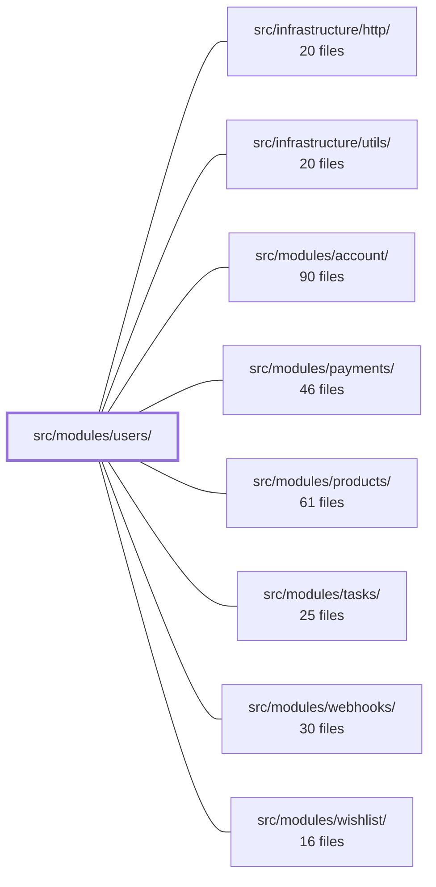

---
tags:
  - 2brain
  - 2brain/module
  - project/boilerplate-vue-frontend
type: module
module: src/modules/users/
files: 36
updated: 2026-11-10T08:41:17.512745+00:00
---

# src/modules/users/

## Purpose

The users module is the admin-facing domain for managing user accounts: CRUD with avatar upload, role and permission changes, account activation/deactivation, purchase-hold (checkout pause) controls, and the live "flagged for review" navigation badge. It ships its own Pinia store, Vuetify views, shared dialogs, validation schemas, and a full test suite, and it registers itself into the app's module registry so the kernel can discover its routes, nav entry, and locale strings.

## Key parts

- **State & data** — `store.ts` (main CRUD Pinia store built on the shared `useStructureCrudApi` primitive) and `badge-store.ts` (a deliberately split-out, single-number Pinia store for the nav badge so it can live in the shell entry chunk while the CRUD store stays in the users route chunk).
- **Views (pages)** — `UsersList.vue` (list, search, per-row actions), `UserTarget.vue` (read-only detail with quick-action controls), `UserCreate.vue`, and `UserEdit.vue`.
- **Dialogs** — `UserAccessDialog.vue` (two-step role/status change with confirm) and `UserPurchaseHoldDialog.vue` (pause checkout with a GDPR Art. 22(3) refusal note).
- **Composables** — `use-review-badge.ts` (live badge count, gated on `read User` permission), `use-role-options.ts` (role picker derived from server-authorized `grantableRoles`), `use-user-access-dialog.ts` (promise-based wrapper so three call sites await the dialog result uniformly), and `use-user-summary.ts` (shared hero/chip labels for the detail pages).
- **Schemas & contracts** — `schemas.ts` (Zod create/edit form validation with i18n-thunked messages and length bounds from `@api/schemas`), `response-schemas.ts` (response-envelope schemas for contract validation), and `index.ts` (barrel that re-exports field-rule schemas for sibling modules such as `account`).
- **Routing & registration** — `routes.ts` (lazy-loaded route table with `meta.access` / `meta.can`) and `module.ts` (manifest that wires routes, nav entry with badge, schemas, and locale loaders into the kernel).
- **Tests** — A Vitest unit/integration suite (store, schemas, dialogs, each view) and a Cypress E2E suite (functional CRUD, role sweep, a11y sweep, keyboard pattern, visual regression, fault-tolerance, and a dedicated badge spec).

## How it connects

- **`src/modules/account/`** — The module's `index.ts` barrel re-exports the user form's validation schemas so that `account` can import the same field rules instead of re-typing them and risking divergence.
- **`src/modules/products/`** — The users store is built on the same `useStructureCrudApi` primitive that the products store uses, giving the two stores a parallel shape (differing only in endpoints and filter fields).
- **`src/infrastructure/http/`** — All store actions go through the shared HTTP transport layer (the `orvalMutator` / axios boundary) that the infrastructure provides; the store never issues raw requests.
- **`src/infrastructure/utils/`** — Shared utilities (e.g., the `useStructureCrudApi` primitive, `translate()` helper for i18n-thunked Zod messages) are consumed throughout the module.
- **`src/modules/payments/`** — The purchase-hold dialog pauses checkout for a specific user, making the users module a control surface that affects the payments/checkout domain for that account.

## Where to start

Read **`store.ts`** first — it defines every state property and action (search, create, edit, role change, purchase-hold, delete/restore) that the views consume, so understanding it makes the components straightforward. Then open **`views/UsersList.vue`** to see how the store's paginated search, filter form, per-row `actions` array, and the shared dialogs come together in the page an admin actually lands on.

## Connected modules

[[boilerplate-vue-frontend_ROOT|/ (repository root)]] · [[boilerplate-vue-frontend_src_infrastructure_http|src/infrastructure/http/]] · [[boilerplate-vue-frontend_src_infrastructure_utils|src/infrastructure/utils/]] · [[boilerplate-vue-frontend_src_modules_account|src/modules/account/]] · [[boilerplate-vue-frontend_src_modules_payments|src/modules/payments/]] · [[boilerplate-vue-frontend_src_modules_products|src/modules/products/]] · [[boilerplate-vue-frontend_src_modules_tasks|src/modules/tasks/]] · [[boilerplate-vue-frontend_src_modules_webhooks|src/modules/webhooks/]] · [[boilerplate-vue-frontend_src_modules_wishlist|src/modules/wishlist/]]

## Files
- `src/modules/users/badge-store.ts` — A narrowly scoped Pinia store that holds a single number — the count of live accounts flagged for purchase-hold review — for the navigation badge. It is intentionally split out of the main users CRUD store (`store.ts`) because the badge accessor executes in the shell's entry chunk, while the CRUD store must remain in the users route chunk.
- `src/modules/users/components/UserAccessDialog.vue` — A two-step admin dialog (pick → confirm) for changing another user's role and/or active status. It gates destructive changes behind a confirm panel that names the target and warns about the logout consequences of deactivation. It exists so that both the users-list row action and the detail-page action share one UI, while `UserEdit.vue` can reuse only the confirm step after its own form has already collected values.
- `src/modules/users/components/UserPurchaseHoldDialog.vue` — A Vuetify dialog that lets an admin pause checkout for a single user account by setting an end date and writing a buyer-facing refusal note (GDPR Art. 22(3) — the reason and a way to contest it). It is a pure form component: it collects and validates input, then hands the request body up to the parent page via an emitted event. The page owns the actual write.
- `src/modules/users/composables/use-review-badge.ts` — Provides the live "accounts flagged for review, unactioned" count that the users nav entry displays in the shell. It reads the total from the users badge store, gates it on the viewer's `read User` permission, and subscribes to the shared badge-refresh triggers so the number stays current without the users list being open.
- `src/modules/users/composables/use-role-options.ts` — Provides the list of selectable role options for any role `<select>` in the users module. The options are derived from the server-authorized `grantableRoles` (published via `GET /account` abilities and stored in the session), so the picker offers exactly the roles a write would accept rather than a hard-coded enum that could drift from the backend.
- `src/modules/users/composables/use-user-access-dialog.ts` — Promise-based composable wrapper around `UserAccessDialog.vue` that lets callers await the admin's decision the same way they await `useDialogStore().confirm()` (`request(...).then(result => …)`), instead of each wiring their own open flag and resolver. The dialog component itself stays a plain `v-model` component (the module's usual pattern, cf. `LanguageFormDialog.vue`); this composable is the shared layer consumed by three call sites.
- `src/modules/users/composables/use-user-summary.ts` — Shared composable that derives the four read-only labels (hero heading, hero subheading, role chip, status chip) shown about the routed user record on both user pages. It centralises the wording logic in one place so each consuming view only manages its own store read.
- `src/modules/users/index.ts` — Public barrel (entry point) for the `users` module. Its sole job is to re-export two validation schemas so that sibling modules — specifically `account` — can import shared field rules instead of re-typing (and re-diverging from) them. It intentionally holds no runtime logic and is not a store; the API layer performs all writes.
- `src/modules/users/module.ts` — Module manifest that registers the **users** admin screens (list, detail, create, edit) into the app's module registry. It wires together the module's routes, a navigation entry (with a live review badge), response schemas, and locale loaders so the kernel can discover and mount the module.
- `src/modules/users/response-schemas.ts` — Exposes the response-envelope schemas for every HTTP endpoint attributed to the `users` backend domain. It exists so that contract validation can be toggled on/off per domain by simply including or removing this module folder.
- `src/modules/users/routes.ts` — Declares the route table for the users module. Each record pairs a URL path with a lazy-loaded Vue component and the `meta` fields (access level, capability check, i18n title) that the router guard evaluates before allowing navigation.
- `src/modules/users/schemas.ts` — Defines Zod validation schemas for the user create/edit forms. Error messages are i18n-thunked (resolved at parse time via `translate()`) so they follow the active locale. Length bounds are imported from the API contract (`@api/schemas`) rather than hardcoded, keeping client and server constraints in sync.
- `src/modules/users/store.ts` — Pinia store providing all user-domain state and actions: CRUD with avatar upload, paginated search, soft/permanent delete, account activation, role assignment/revocation, and purchase-hold management. It is built on the shared `useStructureCrudApi` primitive so its shape mirrors the products store, differing only in endpoints and filter fields.
- `src/modules/users/tests/e2e/a11y.cy.ts` — Cypress E2E accessibility test for the users module. It delegates to the shared `sweepA11y` helper, passing a list of pages and dialogs that the admin must be able to access, and runs the sweep signed in as the admin role.
- `src/modules/users/tests/e2e/actions.cy.ts` — End-to-end fault-tolerance tests for the users module. It feeds four scenario definitions into the shared `actionTable` runner, which drives each one through a scripted server failure and asserts that the UI shows the expected alert, preserves any typed input, and succeeds on retry once the stub is removed.
- `src/modules/users/tests/e2e/keyboard.cy.ts` — End-to-end tests that verify the WAI-ARIA keyboard pattern for the users module's modal dialogs: focus moves in on open, Tab stays trapped inside, Escape closes without persisting changes, and focus returns to the triggering element.
- `src/modules/users/tests/e2e/roles.cy.ts` — Declares the role-sweep case list for the users module. Each case pairs a user route with the permissions (`can`) that a persona must hold to view the page, so the browser's rendering is checked against the permission model. The file is co-located under `src/modules/users/` so that deleting the module removes its sweep automatically.
- `src/modules/users/tests/e2e/users.cy.ts` — Cypress end-to-end spec covering the **functional** CRUD lifecycle of the admin-only Users module: list rendering, create, edit, soft-delete, restore, and hard-delete. Accessibility and visual-regression coverage live in separate spec files; this one asserts that each action produces the correct server-side state through real page navigation and form submission.
- `src/modules/users/tests/e2e/users.visual.cy.ts` — Declares the visual-regression routes for the **users** module by delegating to the shared `sweepVisual` helper. It exists so that a single, consistent sweep mechanism can cover every module's visual baselines.
- `src/modules/users/tests/review-badge.spec.ts` — Unit tests for the **UsersList** navigation badge (implemented by `composables/use-review-badge.ts`). Verifies that the badge exposes the total of live accounts flagged for review via a single passive, one-row request against the users list — only when the session holds `read User` — and that the badge disappears once the session ends.
- `src/modules/users/tests/routes.spec.ts` — Pins the `meta.access` and `meta.can` values declared on every users route, verifying them by route name against the module's raw route records (not a resolved router). Its job is to catch a route that silently loses its access declaration—making it indistinguishable from a public route—by asserting each expected value explicitly rather than deriving it.
- `src/modules/users/tests/schemas-i18n.spec.ts` — Proves that the users module's Zod schemas resolve their validation messages into the active locale (English → Italian) using the **real** vue-i18n instance. The general mechanism (thunked Zod messages re-resolve at parse time) is covered by a cross-cutting test with an invented schema; this file verifies that *this module's* schemas and locale dictionaries actually agree.
- `src/modules/users/tests/schemas.property.spec.ts` — Property-based test that verifies `usersSchema` (the user form's validation) is a correct subset of the API contract `CreateUserBody`: it accepts every body the contract accepts, and rejects every contract-invalid body whose violation falls on a field the form validates. Payloads are generated from the Zod schema at runtime, so the test tracks contract changes automatically.
- `src/modules/users/tests/schemas.spec.ts` — Vitest suite that validates the structural rules (lengths, required fields, nullability) of the user schemas in `../schemas.ts`. It asserts boundary behaviour against contract constants from `@api/schemas` and confirms that no character-class composition rules are enforced on passwords. Message-content assertions live separately in `schemas-i18n.spec.ts`.
- `src/modules/users/tests/store.spec.ts` — Unit tests for the `useUsersStore` Pinia store. The transport layer (`orvalMutator`) is mocked at the HTTP boundary so that tests can inspect the raw axios config (URL, method, body) emitted by each store action. The file follows the same structure as the products store spec, with one additional concern: verifying that a user's password (or uploaded avatar blob) is never parked in client-side store state.
- `src/modules/users/tests/user-access-dialog.spec.ts` — Unit tests for `UserAccessDialog.vue`. Covers the full picker → confirm interaction flow, the `skipPicker` entry path used by `UserEdit.vue`, the self-deactivation warning, the shape of the emitted `confirm` payload (only changed fields, `null` for "no role"), and which picker controls are enabled/disabled based on the target row's `actions` and the caller's `grantableRoles`.
- `src/modules/users/tests/user-create-view.spec.ts` — Integration test for the admin "Create User" page (`UserCreate.vue`). It mounts the real component against a real memory-history router and a real Pinia store (with `createUser` spied), verifying: client-side validation, the exact payload shape sent, success navigation to the new user, API-rejection handling, role-assignment restrictions, and submit-button disabling during an in-flight request.
- `src/modules/users/tests/user-edit-view.spec.ts` — Vitest suite that mounts the real `UserEdit.vue` page against a real memory-history router and verifies the PATCH/role-door request sequence the admin triggers when editing a user. It guards the contract shape of every outgoing mutation (via Zod `strictObject` schemas) and the confirm-gate flow that separates profile saves from role changes.
- `src/modules/users/tests/user-purchase-hold-dialog.spec.ts` — Unit tests for the "pause checkout" dialog, verifying that it renders the target user's name, emits a `confirm` payload with a UTC end-of-day timestamp and trimmed note (or omits the note when blank), rejects dates before tomorrow with a visible error and a disabled confirm button, and emits `cancel` without side effects.
- `src/modules/users/tests/user-target-view.spec.ts` — Vitest suite for the `UserTarget.vue` admin user-detail page. It verifies that every UI control (Edit link, Manage-access button, two-factor strip) is rendered or hidden strictly according to the server-supplied `actions` array on the user row, and that the "Manage access" confirm flow dispatches the correct separate API calls (role assignment + status change) rather than a single PATCH.
- `src/modules/users/tests/user-view.spec.ts` — Vitest component spec that mounts the real `UserTarget.vue` detail page against a real memory-history router and two describe blocks: one asserting the "History" link is gated on the `read:AuditLog` CASL ability and the `observability` route existing, and one covering the purchase-hold / needs-review UI (pause, lift, flag) including ability checks, toast messaging, and double-click idempotency.
- `src/modules/users/tests/users-list-view.spec.ts` — Page-level integration spec for `UsersList.vue`. Verifies that header clicks drive server-side sorting (via `filters.sort` + a fresh `searchUsers` call), that the purchase-hold and needs-review filters are submitted correctly and render the corresponding row badges, and that per-row action buttons reflect the server-supplied `actions` payload rather than a global session permission.
- `src/modules/users/views/UserCreate.vue` — Renders the "Create User" form page. Collects email, username, optional role, locale, active flag, and an avatar image; validates the input client-side with a Zod schema, then delegates the actual API call (multipart or JSON) to the users store. On success it navigates to the new user's detail page; on failure it surfaces inline blocking errors.
- `src/modules/users/views/UserEdit.vue` — Admin-facing form for editing a single user's profile (username, role, locale, phone, website, avatar). It enforces server-driven permission gates on each control, confirms role changes and deactivation through a dedicated dialog, and sends a multipart `PATCH` only when a new avatar is attached. By design it exposes no email or password fields.
- `src/modules/users/views/UserTarget.vue` — Read-only user detail page. Loads a single user by route `id`, renders identity fields, role, status, and purchase-hold state, and exposes two quick-action controls (manage access, pause/lift checkout) so staff can adjust permissions without opening the full edit form.
- `src/modules/users/views/UsersList.vue` — Admin-facing users list and search page. It binds the users store's paginated search to a filter form and a `DataTable`, and exposes per-row actions (view, edit, delete, hard-delete, restore) plus a role/permission change dialog. It is the single view an admin lands on to browse and manage accounts.

---
[[boilerplate-vue-frontend_INDEX|← boilerplate-vue-frontend index]]
