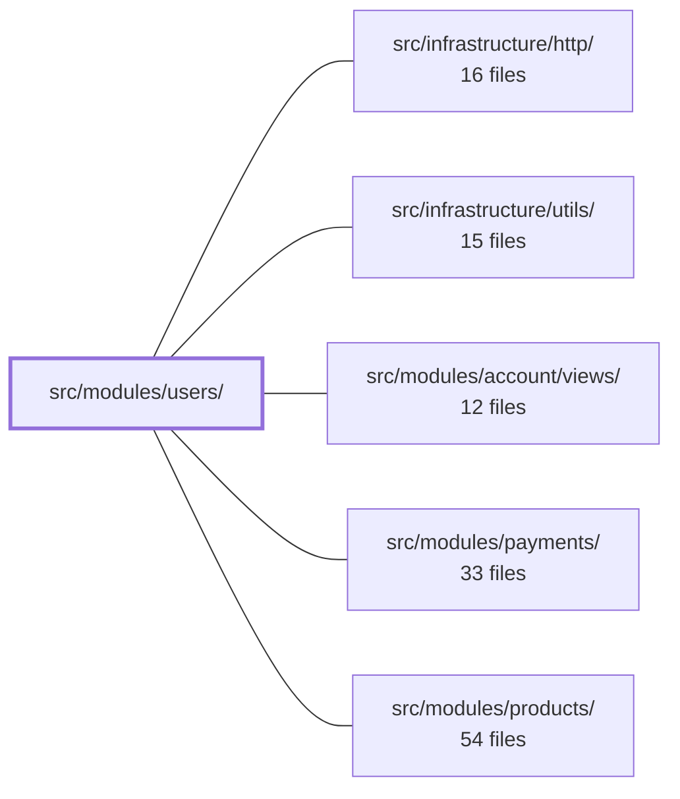

---
tags:
  - 2brain
  - 2brain/module
  - project/boilerplate-vue-frontend
type: module
module: src/modules/users/
files: 26
updated: 2026-10-17T02:55:59.544416+00:00
---

# src/modules/users/

## Purpose

The users module is the admin-facing domain for managing application user accounts: creating, editing, listing, soft-deleting, restoring, and hard-deleting users, plus the sensitive access-control mutations (role and active-status changes) that require an explicit confirmation gate. All CRUD state lives in a single Pinia store; Zod schemas define the form contracts; and a two-step dialog centralises the "confirm before PATCH" flow for privileged fields.

## Key parts

- **Views** (`views/`) — Four pages: `UsersList.vue` (paginated, server-sorted table with per-row actions), `UserCreate.vue` (create form with optional avatar upload), `UserEdit.vue` (profile edit with confirm-gated role/active changes), and `User.vue` (read-only detail with a quick "Manage access" shortcut).
- **Access-control dialog** — `components/UserAccessDialog.vue` (the two-step pick → confirm UI), `composables/use-user-access-dialog.ts` (promise-based caller API), and `composables/use-role-options.ts` (shapes the server's `grantableRoles` into select options so the picker never offers a role the API would reject).
- **State & contracts** — `store.ts` (Pinia store built on `useStructureCrudApi`; supplies endpoint bindings, multipart/JSON branching, and two hand-written actions), `schemas.ts` (Zod create/edit form schemas with i18n-thunked messages), `response-schemas.ts` (response-envelope declarations for contract validation).
- **Module wiring** — `module.ts` (manifest registering routes, nav entry, schemas, locales), `routes.ts` (path → lazy view + access metadata), `index.ts` (barrel that re-exports the Zod schemas for cross-module consumers).
- **Tests** (`tests/`) — Unit specs for every view, the store, the dialog, and the schemas (including an i18n locale-switch spec); route-metadata pin; e2e functional, a11y-sweep, and visual-regression Cypress specs; all co-located so deleting the module removes its coverage in one step.

## How it connects

- **`src/modules/account/`** — `use-role-options.ts` reads the signed-in caller's assignable roles from the account session store (`GET /account/abilities`). The module barrel (`index.ts`) re-exports the Zod validation schemas so the account views can import shared field rules without reaching into internal files.
- **`src/infrastructure/http/`** — The store's CRUD actions and avatar upload go through the generated `orvalMutator` transport layer; the store tests mock this boundary to assert raw request shapes.
- **`src/modules/products/`** — `store.ts` is deliberately shape-identical to the products store (same `useStructureCrudApi` scaffold, same action surface); the two modules differ only in endpoint bindings and filter fields, making the pattern reusable.

## Where to start

1. **`views/UsersList.vue`** — It is the entry point of the module and shows how the store, DataTable, per-row `actions` gating, and the `UserAccessDialog` composable all fit together in one screen.
2. **`store.ts`** — Reading this next reveals the full state surface (list, detail, CRUD actions, avatar upload) and the two custom actions (`hardDeleteUser`, `restoreUser`) that the views depend on, giving you the mental model before you explore individual pages.

## Connected modules

[[boilerplate-vue-frontend_ROOT|/ (repository root)]] · [[boilerplate-vue-frontend_src_infrastructure_http|src/infrastructure/http/]] · [[boilerplate-vue-frontend_src_infrastructure_utils|src/infrastructure/utils/]] · [[boilerplate-vue-frontend_src_modules_account_views|src/modules/account/views/]] · [[boilerplate-vue-frontend_src_modules_payments|src/modules/payments/]] · [[boilerplate-vue-frontend_src_modules_products|src/modules/products/]]

## Files
- `src/modules/users/components/UserAccessDialog.vue` — A two-step admin dialog (pick → confirm) for changing a target user's role and/or active status. It exists to centralise the access-control mutation behind a confirm gate that names the target, warns about deactivation consequences, and—when the target is the signed-in admin—adds a specific self-deactivation warning. One component serves two entry patterns: the list/detail "choose new values" flow and `UserEdit.vue`'s already-collected "confirm only" flow.
- `src/modules/users/composables/use-role-options.ts` — Provides the select options for every role picker in the users module. It reads the list of roles the signed-in caller is permitted to assign (sourced from `GET /account/abilities` via the session store) and shapes them into `v-select` items, ensuring the picker never offers a role the server would reject with `409`.
- `src/modules/users/composables/use-user-access-dialog.ts` — Promise wrapper around `UserAccessDialog.vue` that lets callers `request(...).then((result) => ...)` the way they already await `useDialogStore().confirm()`, instead of each wiring their own open flag and resolver. It exists so that the three call sites (`UsersList.vue`, `User.vue`, `UserEdit.vue`) share one implementation rather than each re-implementing the open/resolve dance.
- `src/modules/users/index.ts` — Barrel (public surface) for the `users` module. It exists so that sibling modules (specifically `account`) can import the shared validation schemas without reaching into internal files. By exporting the two schemas here, the field rules are written once and agreed upon across modules instead of being re-typed and allowed to diverge.
- `src/modules/users/module.ts` — Module manifest for the **users** module. It registers the module's routes, admin navigation entry, response schemas, and locale files into the app's central module registry so the kernel can wire everything together at startup.
- `src/modules/users/response-schemas.ts` — Declares the response-envelope schema list for the `users` domain. It plugs into the module-manifest pattern so that contract validation for users endpoints activates when the domain folder is present and is removed when it is deleted—no manual registration elsewhere.
- `src/modules/users/routes.ts` — Defines the route table for the users module. Each entry pairs a URL path with a lazy-loaded Vue view and the access/permission metadata the router guard checks before allowing navigation. The array is consumed by the module registry to mount these routes under the application.
- `src/modules/users/schemas.ts` — Defines Zod validation schemas for the user create/edit forms. Error messages are i18n-thunked (deferred via `() => translate(...)`) so they resolve against the active locale at parse time rather than being baked in at module-load time.
- `src/modules/users/store.ts` — Pinia store that provides all users-domain state (record cache, list/pagination, CRUD actions, avatar upload) to the user views. It is built on `useStructureCrudApi` from `@guebbit/vue-toolkit`, which generates the boilerplate CRUD/pagination plumbing; this file only supplies the endpoint bindings, the multipart-vs-JSON branching, and two hand-written actions (`hardDeleteUser`, `restoreUser`). The store is intentionally shape-identical to `products/store.ts` apart from endpoints and filters.
- `src/modules/users/tests/e2e/a11y.cy.ts` — Declares the list of users-module routes to be exercised by the shared a11y sweep, and calls `sweepA11y` to run them as the admin. Co-located with the module so that deleting the module removes its a11y coverage in one step; a cross-cutting spec asserts every routed module ships one of these files, preventing silent loss of a domain.
- `src/modules/users/tests/e2e/users.cy.ts` — Cypress functional end-to-end spec for the admin-only Users module. Covers the full CRUD lifecycle — list rendering, create, edit, soft-delete, restore, and hard-delete — against the real running app. Accessibility and visual-regression specs live in separate files; this one is purely functional coverage.
- `src/modules/users/tests/e2e/users.visual.cy.ts` — Declarative visual-regression route list for the users module. It registers the routes and selectors that the shared `sweepVisual` helper will screenshot and compare, so the users module's e2e visual suite knows *what* to capture without duplicating sweep logic.
- `src/modules/users/tests/routes.spec.ts` — Pins the `meta.access` and `meta.can` declarations on every users route by name, verifying that the route records actually carry their access decisions. It complements the router spec (which proves enforcement is wired up) by proving the declarations themselves are present and correct, without needing a resolved router or locale prefix.
- `src/modules/users/tests/schemas-i18n.spec.ts` — Verifies that the users module's Zod schemas resolve validation messages in the active locale (English → Italian) at parse time. It lives with the domain (not in the cross-cutting i18n suite) because it asserts *these specific schemas and their locale dictionaries agree*, whereas the mechanism of thunked-message re-resolution is proven once with an invented schema elsewhere.
- `src/modules/users/tests/schemas.spec.ts` — Vitest spec for the user form's validation rules (email, username, password). It asserts boundary conditions and field-acceptance semantics without testing i18n messages (those live in `schemas-i18n.spec.ts`). Bounds are read from the API contract so the tests track contract changes automatically.
- `src/modules/users/tests/store.spec.ts` — Unit tests for the `useUsersStore` Pinia store. Mocks `orvalMutator` (the HTTP transport) so that multipart encoding, JSON serialisation, and URL construction — all of which live in the generated `@api` client — are exercised for real, while the network boundary is stubbed. Asserts raw request shapes (URL, method, body encoding) and store-state invariants such as "a password never lands in client-side state."
- `src/modules/users/tests/user-access-dialog.spec.ts` — Unit tests for `UserAccessDialog.vue`. Validates the two-step picker → confirm flow, the `skipPicker` fast-path used by `UserEdit.vue`, the self-deactivation warning, the emitted payload shape (only changed fields, ready for a `PATCH` body), and which controls are enabled/disabled based on the target user's `actions` and the caller's `grantableRoles`.
- `src/modules/users/tests/user-create-view.spec.ts` — Unit-test suite for the admin **UserCreate** view. It mounts the real page against a real memory-history router and a spied `createUser` store action, then asserts the full behavioral contract: client-side validation, the exact outgoing payload, post-success navigation, error handling (both field-level and form-level), role-permission gating, and submit-button locking during an in-flight request.
- `src/modules/users/tests/user-edit-view.spec.ts` — Vitest spec that mounts the real `UserEdit.vue` admin page against a memory-history router to verify the PATCH body sent on save: that unchanged `role`/`active` are excluded (preventing a spurious backend grant-check re-run), that the `UserAccessDialog` confirm gate fires only on role/active changes, and that a 412 response is handled. `UserAccessDialog` itself is stubbed; its internal behaviour belongs to `user-access-dialog.spec.ts`.
- `src/modules/users/tests/user-target-view.spec.ts` — Integration-style unit test for the admin user-detail page (`User.vue`). It mounts the real page component against a real memory-history router (scoped to enabled modules) and verifies that every visible control is gated by the row's `actions` payload from the server, that no second-factor control exists, and that the "Manage access" shortcut correctly opens a stubbed `UserAccessDialog` and issues a `PATCH` only on confirm.
- `src/modules/users/tests/user-view.spec.ts` — Vitest spec that mounts the real `User.vue` detail page against a real memory-history router to verify one behavior: the "History" link (gated on the CASL ability `read:AuditLog`) appears, links correctly, or is absent depending on the viewer's abilities and whether the `observability` module is present in the build. The store's `watchUser` fetch is always stubbed so no network call occurs.
- `src/modules/users/tests/users-list-view.spec.ts` — Page-level spec for the `UsersList` view. It verifies two behaviours end-to-end: (1) clicking a table header triggers a **server-side** sort (the column name is sent as `filters.sort` and the search restarts from page 1) and API-unsortable columns stay inert; (2) the per-row action buttons are driven by the server's per-row `actions` object rather than the current user's global role. The suite shares its template with the equivalent "sorting from the header" tests in the orders list module.
- `src/modules/users/views/User.vue` — Read-only user detail page that loads a single user by route `id`, renders their profile fields (username, email, role, status, timestamps), and offers a lightweight "Manage access" dialog for changing role/active status without navigating to the full edit form. All mutable controls are gated by the server-provided `actions` object on the user record.
- `src/modules/users/views/UserCreate.vue` — The user-creation form page. Collects email, username, role, locale, active-status, and an optional avatar upload, validates the input client-side with a Zod schema, then delegates to the users store which branches between multipart (avatar present) and JSON submission. There is intentionally no password field: the new user is emailed a self-service credential-setup link.
- `src/modules/users/views/UserEdit.vue` — Admin-facing page for editing a single user's profile (username, role, active status, locale, phone, website, avatar). It deliberately omits email and password fields—credentials are owner-only. Role and active-status changes require an explicit `UserAccessDialog` confirmation step before any `PATCH` is dispatched, and the request body only includes those fields when they actually differ from the loaded record.
- `src/modules/users/views/UsersList.vue` — The users list/search page. Wires the users store's paginated search to a filter form (text, id, email, username, active, deleted) and a `DataTable`, and exposes per-row actions: manage access (role/active change), soft delete, restore, and hard delete. State lives in the Pinia store; this component is the view and interaction layer.

---
[[boilerplate-vue-frontend_INDEX|← boilerplate-vue-frontend index]]
