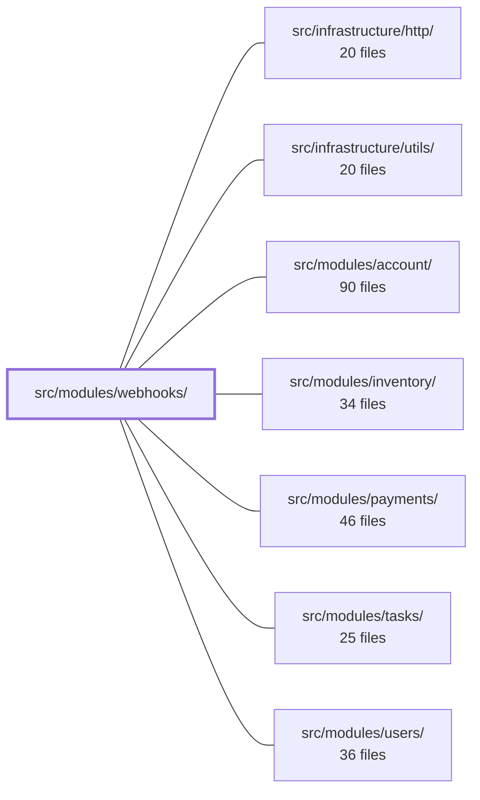

---
tags:
  - 2brain
  - 2brain/module
  - project/boilerplate-vue-frontend
type: module
module: src/modules/webhooks/
files: 30
updated: 2026-11-10T08:41:34.423571+00:00
---

# src/modules/webhooks/

## Purpose

The webhooks module implements the admin-facing webhook subscriptions feature: creating, editing, and deleting webhook subscriptions; viewing and replaying the delivery log; managing the one-time secret lifecycle; and surfacing a navigation badge for subscriptions that the failure guard has auto-disabled. It owns its own route table, Pinia state, Zod form schemas, and view components, registered as a single `AppModule` into the application's module registry.

## Key parts

- **State & domain logic** — `store.ts` (CRUD + delivery-log Pinia store wrapping two `useStructureCrudApi` instances), `badge-store.ts` (dedicated store for the auto-disabled count, split out to keep the shell chunk lean), `domain/subscription-status.ts` (the three-state discriminator and its filter mapping), and `composables/use-auto-disabled-badge.ts` (reactive badge accessor for the nav entry).
- **Views** — `views/WebhooksList.vue` (list + filter), `views/WebhookCreate.vue` (create form + one-time secret reveal), `views/WebhookEdit.vue` (update form, deliberately excludes irreversible actions), `views/WebhookTarget.vue` (read-only detail with enable/disable/rotate/delete actions), and `views/WebhookDeliveries.vue` (bookmarkable delivery log with replay).
- **Shared components & contracts** — `components/SubscriptionStatusChip.vue` (single status→colour/label mapping), `components/WebhookDeliveriesFilters.vue` (filter bar + table + pager for the delivery log), `schemas.ts` (Zod create/edit schemas with i18n error thunks), `types.ts` (view-layer filter-state contract).
- **Module wiring** — `module.ts` (registers routes, nav entries, response schemas, and locale dictionaries), `routes.ts` (Vue Router table with per-route `meta.access` / `meta.can` rules), `response-schemas.ts` (OpenAPI response-envelope rows for the global validation pipeline).
- **Tests** — Unit specs for the store, schemas, status domain, badge composable, and each view component live in `tests/`; Cypress e2e specs (functional, a11y sweep, role sweep, fault-injection resilience) live in `tests/e2e/`.

## How it connects

- **`src/infrastructure/http/`** — The store wraps two `useStructureCrudApi` instances from this layer to issue subscription CRUD and delivery search/replay requests; `orvalMutator` (the transport) is mocked at this boundary in store unit tests.
- **`src/infrastructure/utils/`** — Shared utility helpers (e.g., pagination or formatting aids) are consumed by the views and components.
- **`src/modules/users/`** — The edit/detail page split used here (edit form excludes irreversible actions; detail page owns them) mirrors the pattern established in the users module, and both share the same `useStructureCrudApi` usage pattern.
- **Repository root / module registry** — `module.ts` exports an `AppModule`-shaped object that the app shell imports alongside the sibling modules (`account`, `inventory`, `payments`, `tasks`), giving webhooks its nav entries, locale bundles, and response-schema rows within the shared application.

## Where to start

1. **`module.ts`** — the single entry point that shows which routes, nav entries, schemas, and locales the module registers; reading it orients you to every other file in one pass.
2. **`domain/subscription-status.ts`** — the three-state model underpins the list view, the detail page, the badge, and the filter bar; understanding it before touching any component prevents confusion about how `enabled` / `paused` / `auto-disabled` map to wire fields and query parameters.

## Connected modules

[[boilerplate-vue-frontend_ROOT|/ (repository root)]] · [[boilerplate-vue-frontend_src_infrastructure_http|src/infrastructure/http/]] · [[boilerplate-vue-frontend_src_infrastructure_utils|src/infrastructure/utils/]] · [[boilerplate-vue-frontend_src_modules_account|src/modules/account/]] · [[boilerplate-vue-frontend_src_modules_inventory|src/modules/inventory/]] · [[boilerplate-vue-frontend_src_modules_payments|src/modules/payments/]] · [[boilerplate-vue-frontend_src_modules_tasks|src/modules/tasks/]] · [[boilerplate-vue-frontend_src_modules_users|src/modules/users/]]

## Files
- `src/modules/webhooks/badge-store.ts` — A dedicated Pinia store that holds a single number — the count of auto-disabled webhook subscriptions shown as a navigation badge. It is split out of the main webhooks CRUD store so the badge accessor can live in the shell's entry chunk without dragging generated schemas into that chunk.
- `src/modules/webhooks/components/SubscriptionStatusChip.vue` — Renders a webhook subscription's status (enabled, paused, or auto-disabled) as a single colored `v-chip`. It centralizes the status→translation-key and status→colour mapping so the list view and the detail view display identical wording and colors without each page defining its own.
- `src/modules/webhooks/components/WebhookDeliveriesFilters.vue` — Combined filter bar, deliveries table, and pager for the webhook delivery log. It owns the local filter-form state (subscription, status, page) and converts user actions into `search` / `replay` events for the parent view. It never performs data fetching itself; all rendering is driven by props fed back from the parent.
- `src/modules/webhooks/composables/use-auto-disabled-badge.ts` — Provides the reactive badge count shown on the Webhooks nav entry in the app shell. The count represents webhook subscriptions that the failure guard auto-disabled — subscriptions that only a human operator can re-enable. The composable wires the badge store to the shared badge-refresh lifecycle and exposes a single `Ref<number | undefined>` for the nav entry to display.
- `src/modules/webhooks/domain/subscription-status.ts` — Single source of truth for a webhook subscription's three delivery states (`enabled`, `paused`, `auto-disabled`). The server persists two timestamps and a derived `enabled` flag; this file turns those wire fields into the three states the UI must distinguish, and provides the mapping between a status and the two boolean query filters the server accepts.
- `src/modules/webhooks/module.ts` — Module manifest that registers the webhooks feature into the app's module registry. It wires together the route table, two admin-section navigation entries, lazy-loaded response schemas, and locale dictionaries (en/it) behind a single `AppModule`-shaped export.
- `src/modules/webhooks/response-schemas.ts` — Declares the response-schema contract rows for every operation the generated route table (`contracts/rest/routes.ts`) attributes to the `webhooks` backend module. It exists so that the global response-envelope validation pipeline knows which OpenAPI response shapes apply to webhooks endpoints.
- `src/modules/webhooks/routes.ts` — Declares the Vue Router route table for the webhooks module. Each record pairs a URL path with a lazy-loaded view component and a `meta` permission rule, allowing the global router guard to enforce fine-grained access (read vs. create vs. update) on a per-route basis.
- `src/modules/webhooks/schemas.ts` — Zod validation schemas for the webhook subscription form (create and edit). Error messages are i18n thunks resolved at parse time, and URL constraints (max length, `https://` pattern) are pulled from the generated API contract rather than re-declared.
- `src/modules/webhooks/store.ts` — Pinia store (`useWebhooksStore`) that manages webhook subscription CRUD and the delivery log. It wraps two `useStructureCrudApi` instances (subscriptions: full CRUD; deliveries: read + replay only) alongside hand-written actions for routes that the generic shape cannot cover without leaking one-time plaintext secrets into the cache.
- `src/modules/webhooks/tests/auto-disabled-badge.spec.ts` — Vitest spec for the webhooks navigation badge (`composables/use-auto-disabled-badge.ts`). Verifies that the badge displays the total count of auto-disabled subscriptions (fetched passively with `pageSize=1`), renders nothing when the viewer lacks the `read:WebhookSubscription` ability, and clears on sign-out.
- `src/modules/webhooks/tests/e2e/a11y.cy.ts` — Declares the accessibility sweep route list for the webhooks module, executed through the shared `sweepA11y` helper as the admin user. It is co-located inside the module's test directory so that deleting the module removes its a11y coverage automatically; `tests/cross-cutting/a11y-coverage.spec.ts` asserts every routed module has one of these files, preventing silent loss of a domain.
- `src/modules/webhooks/tests/e2e/actions.cy.ts` — End-to-end resilience specs for the webhooks module. Each scenario forces a server fault on a real form/row action (create, edit, delete, slow read) and asserts that the UI shows the expected alert, preserves user input, and succeeds on retry. The file is a pure test registration module — it has no exports of its own.
- `src/modules/webhooks/tests/e2e/roles.cy.ts` — Declares the list of webhook pages (subscriptions, subscription create, deliveries) that must be verified for correct role-based access. It is the "case list" that feeds the shared `sweepRoles` helper; keeping it co-located with the webhooks module means deleting the module also removes its sweep.
- `src/modules/webhooks/tests/e2e/webhooks.cy.ts` — Cypress end-to-end spec that exercises the admin-only webhook subscriptions module through the real UI: listing, creating, editing, and deleting subscriptions. It is the functional counterpart to the separate accessibility spec (`a11y.cy.ts`).
- `src/modules/webhooks/tests/routes.spec.ts` — Pins the `meta.access` and `meta.can` values every webhooks route declares, by name. It verifies the access *declarations* are present on the route records themselves (complementary to the router spec, which proves enforcement is *attached*). It runs standalone against the raw route array—no router, no locale prefix, no app.
- `src/modules/webhooks/tests/schemas-i18n.spec.ts` — Proves that `webhookCreateSchema`'s Zod error messages re-resolve against the **active** locale at parse time, using the module's own `en.json` / `it.json` dictionaries. It complements the generic mechanism test in `tests/cross-cutting/schemas-i18n.spec.ts` (which uses an invented schema) by verifying this specific schema and dictionary pair actually agree.
- `src/modules/webhooks/tests/schemas.spec.ts` — Vitest spec that validates the **structural rules** (not i18n messages) of the webhook subscription create and edit Zod schemas. It pins down what payloads are accepted or rejected so that schema changes are caught immediately.
- `src/modules/webhooks/tests/store.spec.ts` — Unit tests for the `useWebhooksStore` Pinia store. The file mocks `orvalMutator` at the transport level and inspects the raw HTTP requests (URL, method, body, params) that each store action emits, following the same pattern as the users and products store tests. It additionally verifies a security invariant unique to webhooks: plaintext secrets (`secret`, `newSecret`) are returned to the caller but never persisted in the store's cached state.
- `src/modules/webhooks/tests/subscription-status.spec.ts` — Vitest spec that locks in the three-way status discriminator (`enabled` / `paused` / `auto-disabled`) and the bidirectional filter mapping exposed by the `subscription-status` domain module. It exists so that the subtle priority rule — `enabled: true` wins regardless of `autoDisabledAt` — and the filter round-trip contract are both enforced at test time.
- `src/modules/webhooks/tests/webhook-create-view.spec.ts` — Vitest suite that mounts the real `WebhookCreate.vue` page against a real memory-history router to verify: client-side URL validation, the exact payload shape sent on submit, the one-time secret reveal (shown once, gated behind a "saved" confirmation), and that `Done` navigates to the newly created subscription. Store methods are spied; the HTTP layer below them is covered by its own suite.
- `src/modules/webhooks/tests/webhook-deliveries-rows.spec.ts` — Vitest spec that verifies the delivery-row contract of `WebhookDeliveriesFilters.vue`: every rendered row exposes a stable `data-test` hook, displays its event type in accessible text, and respects the per-row `actions.replay` flag for the Replay control.
- `src/modules/webhooks/tests/webhook-edit-view.spec.ts` — Vitest spec that mounts the real `WebhookEdit` page against a memory-history router to verify the PATCH payload the form actually sends: `null` when the visitor clears the description, the key omitted when the field is untouched, and the 412-conflict recovery path. It deliberately does **not** test the page's own load (`watchSubscription`); that belongs to `store.spec.ts`.
- `src/modules/webhooks/tests/webhook-target-confirm-once.spec.ts` — Vitest spec that verifies `WebhookTarget`'s confirm-then-write controls (remove secret, delete subscription, disable) are idempotent under a double-click race, and that the page's visible actions and secret-status labels track the subscription record's `actions` and `retiringSecrets` fields.
- `src/modules/webhooks/types.ts` — Defines view-layer type shapes for the webhooks module. It exists to give the filter state a shared, named contract between the filter bar component and the page view, without polluting the API contract (`@types`) or the store's state definition.
- `src/modules/webhooks/views/WebhookCreate.vue` — Vue SFC that renders the "create webhook subscription" form (URL, optional description, multi-select event types). On successful submission it captures the one-time secret returned by the API, displays it via `SecretRevealModal`, and only then navigates the user to the new subscription's detail page.
- `src/modules/webhooks/views/WebhookDeliveries.vue` — Renders the webhook delivery log as a dedicated, bookmarkable route. It wires the webhooks store's paginated search to `WebhookDeliveriesFilters`, keeps the active filters and page in the URL query string, and exposes a per-row replay action. Living on its own route (rather than a tab) lets a filtered view—e.g. "failed deliveries for subscription X"—be deep-linked or handed to a support agent.
- `src/modules/webhooks/views/WebhookEdit.vue` — Webhook subscription edit page. Loads the target record by route `id` and presents a three-field form (URL, description, event types) for updating it. Deliberately excludes irreversible or audited actions (secret-ring rotation, enable/disable) that belong on the detail page, following the same edit/detail split used by the `users` module.
- `src/modules/webhooks/views/WebhookTarget.vue` — Read-only webhook subscription detail page. Given a route `id`, it loads the subscription from the webhooks store, renders its identity fields (URL, description, event types, timestamps) in a standard detail layout, and exposes the four mutating actions (enable, disable, rotate secret, remove secret, delete) gated by the record's own `actions` flags.
- `src/modules/webhooks/views/WebhooksList.vue` — List/search page for webhook subscriptions. Wires the Pinia store's paginated search to a filter form (status + page size), renders results in a `DataTable` with per-row view/edit/delete actions, and keeps filters and pagination in sync with the URL for deep-linking.

---
[[boilerplate-vue-frontend_INDEX|← boilerplate-vue-frontend index]]
