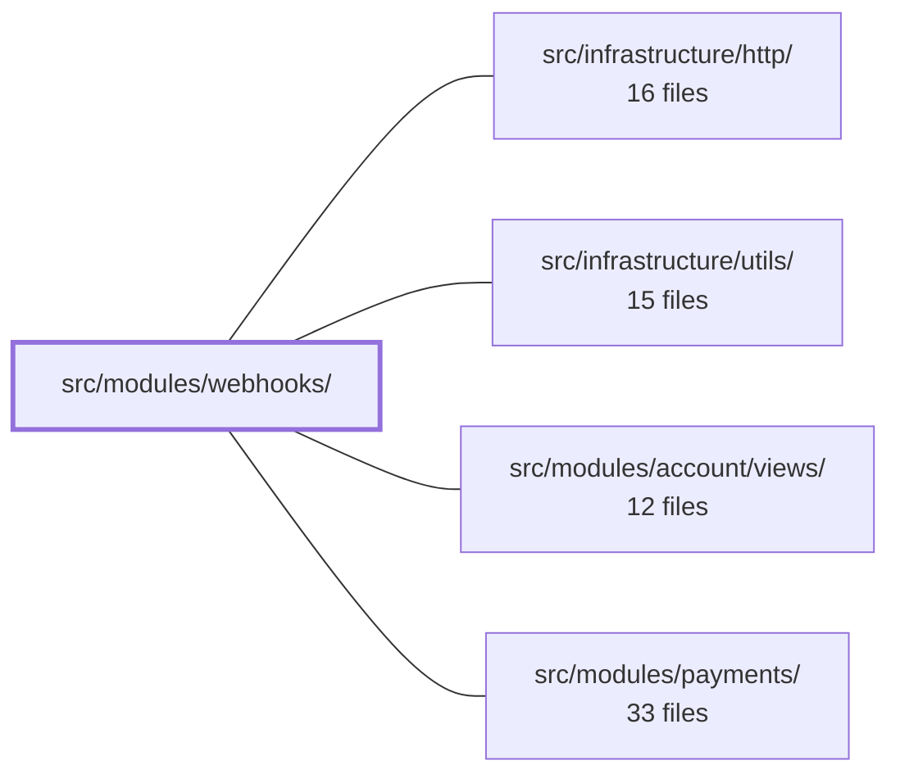

---
tags:
  - 2brain
  - 2brain/module
  - project/boilerplate-vue-frontend
type: module
module: src/modules/webhooks/
files: 21
updated: 2026-10-17T02:56:18.019318+00:00
---

# src/modules/webhooks/

## Purpose

The webhooks module provides the admin-facing interface for managing webhook subscriptions: creating, editing, and deleting subscription endpoints, viewing a single subscription's detail (including secret-ring rotation), and browsing the paginated delivery log. It registers itself into the app's module registry so that routes, navigation entries, response-schemas, and locale dictionaries are discovered automatically.

## Key parts

- **Module wiring** — `module.ts` is the manifest that plugs the feature into the `AppModule` registry; `routes.ts` declares the route table (path → lazy view + access/meta); `response-schemas.ts` registers contract-validation rows for every webhook endpoint. Deleting the folder disables all three.
- **State** — `store.ts` is a single Pinia store covering subscription CRUD, the read-only delivery log, the event catalogue, and hand-written secret-lifecycle actions (rotate, reveal). All views share this one source of truth for pagination, caching, and loading indicators.
- **Validation & types** — `schemas.ts` holds the Zod schemas for create/edit forms (i18n-thunked error messages, HTTPS regex reused from `@api/schemas`). `types.ts` defines the narrow view-to-component prop type for the delivery-log filter bar.
- **Views** — `WebhooksList.vue` (list + filter + table), `WebhookCreate.vue` (create form + one-time secret reveal), `WebhookEdit.vue` (PATCH form), `WebhookTarget.vue` (read-only detail + rotate/delete), `WebhookDeliveries.vue` (delivery-log page, URL-synced filters), and `components/WebhookDeliveriesFilters.vue` (presentational filter bar + rows + pager).
- **Tests** — Vitest specs cover schema rules, i18n message resolution, store actions, and view integration; Cypress specs cover the functional CRUD e2e flow and an automated a11y sweep of every routable page.

## How it connects

- **Repository root / kernel** — `module.ts` imports `AppModule` from `@/kernel/registry` to register routes, nav entries, response-schemas, and locales, making this module discoverable to the app shell.
- **`src/infrastructure/http/`** — The store's HTTP actions are issued through the generated API client (`orvalMutator`), so all request/response shapes are governed by the infrastructure HTTP layer and its OpenAPI contract.
- **`src/modules/payments/`** — The event catalogue that the store exposes (and that the create/edit multiselects render) includes payment lifecycle events such as `order.created`, meaning webhook subscriptions ultimately target payment-domain events defined in the payments module.
- **`src/infrastructure/utils/`** — Shared utilities (e.g., date formatting, URL helpers) are consumed by the views and store.
- **`src/modules/account/views/`** — Appears in the dependency graph as a related admin-area module; specific cross-references are limited to the shared navigation and auth context provided by the app shell.

## Where to start

1. **`store.ts`** — Reading the Pinia store first gives you the full picture of state shape, action surface (CRUD, delivery search, secret lifecycle), and what the HTTP layer is expected to return. Every view and component in the module flows from this file.
2. **`views/WebhooksList.vue`** — The list page is the simplest view: it shows how the store's paginated search, URL-query sync, and `DataTable` composition work together, establishing the pattern the create/edit/detail pages then extend.

## Connected modules

[[boilerplate-vue-frontend_ROOT|/ (repository root)]] · [[boilerplate-vue-frontend_src_infrastructure_http|src/infrastructure/http/]] · [[boilerplate-vue-frontend_src_infrastructure_utils|src/infrastructure/utils/]] · [[boilerplate-vue-frontend_src_modules_account_views|src/modules/account/views/]] · [[boilerplate-vue-frontend_src_modules_payments|src/modules/payments/]]

## Files
- `src/modules/webhooks/components/WebhookDeliveriesFilters.vue` — Presentational filter bar, deliveries table, and pager for the webhook delivery log. Owns the filter form's local state and emits it upward; never fetches data itself. The parent view (`WebhookDeliveries.vue`) owns all fetching, URL-query sync, and the in-flight replay set. The pattern mirrors `admin/components/AdminAuditTab.vue` (filters + table + pager in one component).
- `src/modules/webhooks/module.ts` — Module manifest that registers the webhooks feature into the app's module registry (`AppModule` from `@/kernel/registry`). It wires together the routes, two admin navigation entries, lazy-loaded response schemas, and locale dictionaries so the rest of the app can discover and render the webhook subscription and delivery-log pages.
- `src/modules/webhooks/response-schemas.ts` — Declares the response-envelope schema rows for every HTTP endpoint attributed to the `webhooks` module. It plugs into a manifest-based registration pattern so that contract validation for webhooks routes is enabled simply by this file existing and disabled by deleting the folder.
- `src/modules/webhooks/routes.ts` — Defines the route table for the webhooks module. Each entry pairs a URL path with a lazy-loaded Vue view and a `meta` object (access level, resource permission, i18n title) that the app's router guard evaluates before rendering the view. This file exists so that navigation, authorization, and page-title display for all webhook screens are declared in one place.
- `src/modules/webhooks/schemas.ts` — Defines Zod validation schemas for the webhook subscription create/edit forms. Error messages are i18n thunks resolved at parse time, and the HTTPS scheme check reuses a contract-generated regex from `@api/schemas` rather than a hand-rolled refine.
- `src/modules/webhooks/store.ts` — Pinia store that manages webhook subscription CRUD, the read-only delivery log, the event catalogue, and the hand-written secret-lifecycle actions. It exists as a single store so that the subscription, delivery, and event views share one source of truth for state, pagination, caching, and loading indicators.
- `src/modules/webhooks/tests/e2e/a11y.cy.ts` — Cypress a11y (accessibility) sweep route list for the webhooks module. It registers every routable page—including phone-viewport and form-error variants—through the shared `sweepA11y` helper so that an automated axe scan runs as the admin role. The file is co-located with the module so that deleting the module also deletes its a11y coverage; a cross-cutting spec (`tests/cross-cutting/a11y-coverage.spec.ts`) enforces that every routed module ships one of these files.
- `src/modules/webhooks/tests/e2e/webhooks.cy.ts` — Cypress end-to-end spec covering the functional CRUD lifecycle (list, create, edit, delete) of the admin-only webhook subscriptions module. It drives the real UI forms and verifies server-side effects (redirects, toast messages, persistence). Accessibility coverage lives in a separate spec (`a11y.cy.ts`).
- `src/modules/webhooks/tests/routes.spec.ts` — A Vitest spec that pins the `meta.access` and `meta.can` values declared on every webhooks route, checked by name against the module's raw route records (not a resolved router). It guarantees that no route silently loses its access declaration and that no route is added to the module without an explicit access decision.
- `src/modules/webhooks/tests/schemas-i18n.spec.ts` — Domain-level i18n test for the webhooks module: it proves that `webhookCreateSchema`'s Zod error messages actually resolve to the correct localized strings (from the module's own locale dictionaries) when the active locale changes. It runs against the **real** vue-i18n instance so that a silently frozen or wrong-language message would be caught — something a mocked `t` cannot detect. The generic *mechanism* proof (thunked messages re-resolve at parse time) lives in `tests/cross-cutting/schemas-i18n.spec.ts`; this file only checks that *this* module's schema and dictionaries agree.
- `src/modules/webhooks/tests/schemas.spec.ts` — Vitest spec that validates the *rules* (allowed/disallowed values) of the webhook create and edit Zod schemas. It deliberately excludes i18n message assertions, which live in a companion `schemas-i18n.spec.ts`.
- `src/modules/webhooks/tests/store.spec.ts` — Unit tests for the webhooks Pinia store (`useWebhooksStore`). The HTTP transport (`orvalMutator`) is fully mocked at the module boundary, so every assertion inspects the raw request the store's actions emit and/or the shape of the cached state they write. The file also contains the project's only tests that verify plaintext secrets (`secret`, `newSecret`) are returned to the caller but never persisted in store state.
- `src/modules/webhooks/tests/webhook-create-view.spec.ts` — Integration-level Vitest suite that mounts the real `WebhookCreate` page against a real memory-history router and a real Pinia store (with HTTP calls spied). It verifies: client-side validation before submit, the exact payload shape sent to the store, the one-time secret reveal flow (including the confirm-saved gate), post-create navigation, and inline error handling on API rejection.
- `src/modules/webhooks/tests/webhook-deliveries-rows.spec.ts` — Verifies that each row rendered by `WebhookDeliveriesFilters` carries a stable `data-test="webhook-delivery-row"` attribute and that the event type string is visible in the row's text. This lets other specs (and e2e flows) assert "a delivery for `order.created` exists" without coupling to delivery status, which stays `pending` in the absence of a live broker.
- `src/modules/webhooks/tests/webhook-edit-view.spec.ts` — Integration-style unit test for the `WebhookEdit.vue` page. It verifies the PATCH body the form emits: a cleared `description` must serialize to `null` (not `""`), and an untouched field must be omitted entirely. Hydration is seeded directly into the Pinia store cache because the API has no per-ID `GET` endpoint for this page.
- `src/modules/webhooks/types.ts` — Defines the view-layer type that bridges the `WebhookDeliveries` page and its filter bar component. It intentionally sits outside the API contract (`@types`) and outside the store's own state, existing solely to describe the shape passed between a view and a presentational component.
- `src/modules/webhooks/views/WebhookCreate.vue` — The "create webhook subscription" page. It renders a form (URL, optional description, event-type multiselect), validates it against `webhookCreateSchema`, and on success intercepts the flow to show a one-time API secret via `SecretRevealModal` before the visitor is ever sent to the new subscription's detail page.
- `src/modules/webhooks/views/WebhookDeliveries.vue` — Route-level page component for the webhook delivery log. It wires the webhooks store's paginated search to the `WebhookDeliveriesFilters` child component and keeps the active filter state in the URL query string, making filtered views (e.g. "failed deliveries for subscription X") bookmarkable and shareable. It exists as a dedicated route rather than a tab so those deep links are stable (see `docs/modules/webhooks.md`).
- `src/modules/webhooks/views/WebhookEdit.vue` — Single-file Vue 3 component (named `WebhookEditPage`) that renders the edit form for a webhook subscription. It hydrates the form from the webhooks store cache, validates via a Zod schema, and persists changes to `url`, `description`, `eventTypes`, and `enabled`. Deliberately excludes destructive/secret-ring actions (delete, token rotation), which live on the target/detail page.
- `src/modules/webhooks/views/WebhookTarget.vue` — Read-only detail page for a single webhook subscription. It hydrates the subscription from the Pinia store's cache (keyed by the route `id` prop), renders its metadata (URL, event types, status, failure count), and exposes the secret-ring management actions (rotate, remove) plus a page-level delete. There is no dedicated `GET` endpoint for a single subscription; all data comes from the store.
- `src/modules/webhooks/views/WebhooksList.vue` — Renders the webhook-subscriptions list page: a filter form (enabled status + page size), a paginated `DataTable` with per-row view/edit/delete actions, and URL-synced state so deep links and reloads preserve the current view.

---
[[boilerplate-vue-frontend_INDEX|← boilerplate-vue-frontend index]]
