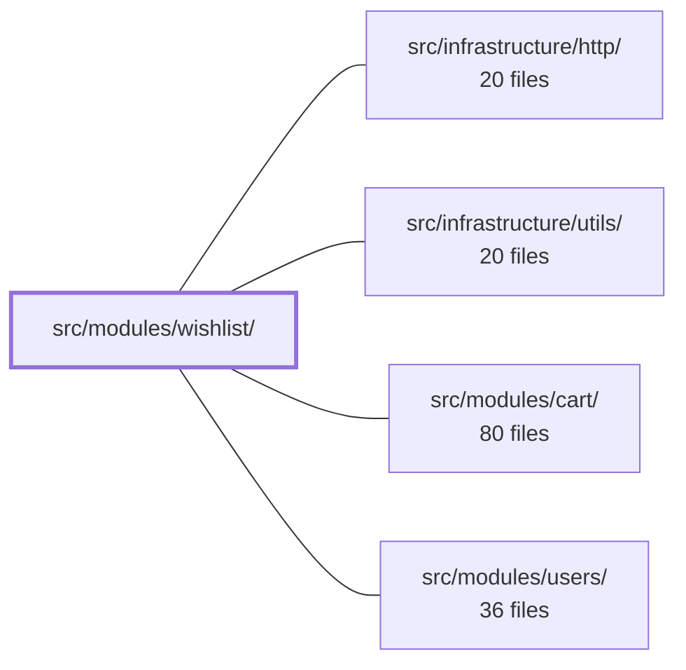

---
tags:
  - 2brain
  - 2brain/module
  - project/boilerplate-vue-frontend
type: module
module: src/modules/wishlist/
files: 16
updated: 2026-11-10T08:41:47.482102+00:00
---

# src/modules/wishlist/

## Purpose

The wishlist module lets authenticated users save products for later, toggle them on/off from the product page, and move saved items into the cart. It is registered as a self-contained feature module: the products module never imports it directly—instead the wishlist contributes its heart-toggle into a `product-actions` slot and mounts its own saved-list page via the app registry.

## Key parts

- **Module bootstrap** – `module.ts` registers routes, the nav entry, response schemas, locale loaders, and the `product-actions` slot contribution into the `AppModule` registry. `routes.ts` declares the single authenticated, lazy-loaded route that hosts the saved-list view.
- **State** – `store.ts` (Pinia `useWishlistStore`) holds the saved product-ID list, exposes `toggle` / `ensureWishlist` / `moveToCart` actions, and replaces the local list wholesale on every API response to stay consistent with the server.
- **Views & components** – `views/Wishlist.vue` renders the saved list with per-line move-to-cart and remove actions, an empty state, and a shared loading lock. `components/WishlistToggle.vue` is the product-page heart button (hidden for guests).
- **Contract validation** – `response-schemas.ts` plugs the wishlist's HTTP endpoints into the shared runtime contract-validation pipeline.
- **Tests** – Unit specs (`store.spec.ts`, `wishlist-toggle.spec.ts`, `wishlist-view.spec.ts`, `routes.spec.ts`, `store-ordering.spec.ts`, `move-to-cart-checkout-key.spec.ts`) and co-located Cypress e2e suites (`actions.cy.ts`, `wishlist.cy.ts`, `a11y.cy.ts`, `wishlist.visual.cy.ts`) cover behaviour, access-control, failure-recovery, ordering, and visual baselines. Deleting the module deletes all of its coverage.

## How it connects

- **`src/infrastructure/http/`** – The store's HTTP calls travel through the shared orval-generated client and its mutator; tests mock at the `orvalMutator` boundary.
- **`src/infrastructure/utils/`** – Shared helpers (e.g., toast/notification utilities) used by store actions and views.
- **`src/modules/cart/`** – `moveToCart` is the only cross-module side effect: after the API confirms the transfer, the store refetches the cart so the header badge updates immediately. The checkout-key test guards the invariant that a cart mutation invalidates any prior idempotency key.
- **`src/modules/users/`** – Guest vs. authenticated gating: `WishlistToggle` renders nothing for guests, the route requires `meta.access: 'auth'`, and the store's ticket-rule tests model viewer switches.
- **Repository root** – `openapi.yaml` `x-module: wishlist` stamps drive the generated route table and schema pipeline that `response-schemas.ts` feeds into; the `AppModule` registry in the root wiring is what `module.ts` populates.

## Where to start

1. **`module.ts`** – Read this first to see how the wishlist plugs into the app (slots, routes, schemas) without any other module importing it. It gives the full registration surface in one short file.
2. **`store.ts`** – Next, read the Pinia store to understand the data contract (wholesale list replacement, `moveToCart` side effect, dedup of concurrent fetches). From there the two views are straightforward rendering of that state.

## Connected modules

[[boilerplate-vue-frontend_ROOT|/ (repository root)]] · [[boilerplate-vue-frontend_src_infrastructure_http|src/infrastructure/http/]] · [[boilerplate-vue-frontend_src_infrastructure_utils|src/infrastructure/utils/]] · [[boilerplate-vue-frontend_src_modules_cart|src/modules/cart/]] · [[boilerplate-vue-frontend_src_modules_users|src/modules/users/]]

## Files
- `src/modules/wishlist/components/WishlistToggle.vue` — A single heart-toggle button that saves or unsaves the current product to/from the user's wishlist. It is contributed to the `product-actions` slot via the wishlist module's manifest, so the products module owns the page and never imports the wishlist. The component renders nothing for guests.
- `src/modules/wishlist/module.ts` — Module manifest for the **wishlist** feature. It registers the module's routes, navigation entry, response schemas, locale loaders, and UI slots into the app registry (`AppModule`), making the wishlist discoverable to the framework without any other module importing it directly.
- `src/modules/wishlist/response-schemas.ts` — Declares the response-envelope schemas for every HTTP endpoint attributed to the `wishlist` backend module. It plugs the wishlist domain into the shared contract-validation pipeline so that generated route tables (derived from `openapi.yaml` `x-module` stamps via `contracts/rest/routes.ts`) are enforced at runtime.
- `src/modules/wishlist/routes.ts` — Defines the single route record for the wishlist module so the app router can mount it under the module's registered path. It exists to decouple route declarations from the module bootstrap and to give the wishlist view a lazy-loaded, authenticated entry point.
- `src/modules/wishlist/store.ts` — Pinia store (`useWishlistStore`) for the wishlist module. It holds the visitor's saved product ids and exposes toggle, fetch, and move-to-cart actions. Every mutating action replaces the local `items` list wholesale with the payload the API returns, and `moveToCart` additionally refetches the cart store so the header badge reflects the write immediately.
- `src/modules/wishlist/tests/e2e/a11y.cy.ts` — Co-located accessibility (a11y) route test for the wishlist module. It declares the module's routed paths so the shared a11y sweep can audit them. Living inside the module ensures that deleting the module also removes its a11y coverage, preventing stale route entries in a central list.
- `src/modules/wishlist/tests/e2e/actions.cy.ts` — Cypress e2e spec that exercises the wishlist's **failure-recovery** flows (server fault during add/remove) through the shared `actionTable` runner. It asserts that a failed action keeps the UI element in a "listed" state, surfaces the correct error alert, and that a subsequent retry succeeds.
- `src/modules/wishlist/tests/e2e/wishlist.cy.ts` — Cypress end-to-end spec covering the wishlist's three user-facing behaviors: toggling the heart on a product page, the saved-list page (item links, move-to-cart), and the guest-redirect guard. Co-located inside the wishlist module so deleting the module also deletes its coverage.
- `src/modules/wishlist/tests/e2e/wishlist.visual.cy.ts` — Visual regression test for the wishlist screen. It registers the module's screens with the shared `sweepVisual` helper so that pixel-level baselines are captured and compared. The file exists per-module (rather than in a central location) so that deleting the wishlist module also removes its snapshot PNGs.
- `src/modules/wishlist/tests/move-to-cart-checkout-key.spec.ts` — Verifies that after a saved product is moved into the cart, the next checkout attempt carries a **fresh** `Idempotency-Key` rather than reusing the key of a prior attempt whose server response was lost. The invariant exists because the key is derived from a cart fingerprint; mutating the cart invalidates any previous key, and reusing it would cause the server to replay a stale order for a different basket.
- `src/modules/wishlist/tests/routes.spec.ts` — Guards the wishlist route definitions against two failure modes: a route silently losing its `meta.access: 'auth'` declaration (which would leave it publicly accessible), and unrecognised routes appearing in the array. It exists so that access-control regressions are caught at test time rather than discovered in production.
- `src/modules/wishlist/tests/store-ordering.spec.ts` — Tests that the wishlist store discards or overrides stale async responses when answers arrive out of order, and that a response in-flight during a viewer switch never leaks the previous viewer's list to the next one. It encodes the same "ticket rule" as the cart store tests.
- `src/modules/wishlist/tests/store.spec.ts` — Unit-test suite for `useWishlistStore` that verifies the store's contract: it renders only API-answered lists (never local mutations), deduplicates concurrent `ensureWishlist` calls, toasts failures exactly once, and fires the single cross-module side effect (`moveToCart` → cart refetch). The HTTP transport is mocked at the `orvalMutator` boundary so the generated client, cart store, and wishlist store all run for real.
- `src/modules/wishlist/tests/wishlist-toggle.spec.ts` — Unit tests for the `WishlistToggle` component (the product-page "heart"). Verifies that the toggle is hidden for guests, saves/unsaves a product depending on current list state for an authenticated user, and surfaces an inline error when the write fails.
- `src/modules/wishlist/tests/wishlist-view.spec.ts` — Vitest component spec for `Wishlist.vue`. Verifies that each saved wishlist line renders a product link whose **href** carries the product ID and whose **text** carries the product title; that the item list renders one card per line (or an empty state); and that each line's availability state is surfaced with the correct label and cart-action disabled state. The router is real (not stubbed) so link resolution is actually exercised.
- `src/modules/wishlist/views/Wishlist.vue` — Wishlist page view. Renders the saved lines (product IDs) from the wishlist store, resolves their display titles and availability from the products store, and exposes two per-line actions: move-to-cart and remove. Handles the empty state, a shared in-flight loading lock, and a single above-the-list error alert.

---
[[boilerplate-vue-frontend_INDEX|← boilerplate-vue-frontend index]]
