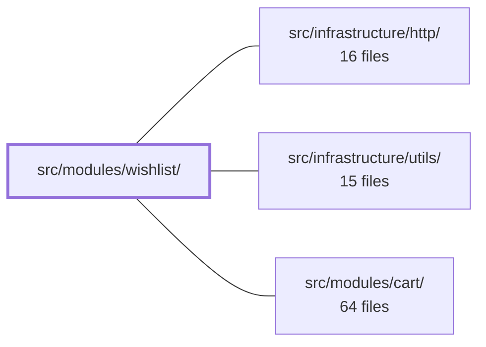

---
tags:
  - 2brain
  - 2brain/module
  - project/boilerplate-vue-frontend
type: module
module: src/modules/wishlist/
files: 15
updated: 2026-10-17T02:56:29.511367+00:00
---

# src/modules/wishlist/

## Purpose

The wishlist module lets authenticated users save products for later, view their saved list, and move items into the cart. It owns the heart-toggle button that appears on product pages, the dedicated wishlist view, the client-side state, the API contract definitions, and the module's own route and navigation registration.

## Key parts

- **Module wiring** — `module.ts` is the manifest that registers the route, sidebar entry, response schemas, locale bundles, and the `WishlistToggle` slot contribution into the global `AppModule`. `routes.ts` declares the single authenticated path; `response-schemas.ts` supplies OpenAPI-derived contract rows so the shared validation layer can guard every wishlist endpoint.
- **UI** — `views/Wishlist.vue` renders the saved list (product title, availability chip, move-to-cart and remove actions, empty state). `components/WishlistToggle.vue` is the per-product heart button injected via the `product-actions` slot; it hides itself for guests and disables in-place on a failed write.
- **State** — `store.ts` is a Pinia (composition-style) store holding `WishlistItem[]`. Every mutation (add, remove, move-to-cart) replaces the list wholesale from the API response; `moveToCart` additionally refetches the cart store so the header badge stays current.
- **Tests** — A co-located e2e suite (`tests/e2e/`) covers accessibility, functional flows, and visual regression via a thin screen-list file. Unit specs in `tests/` guard store ordering/cancellation semantics, toggle behaviour, view DOM contract, route access-control, and the cross-module idempotency-key invariant for move-to-cart.

## How it connects

- **`src/modules/cart/`** — The store's `moveToCart` action triggers a cart-store refetch after the wishlist write, keeping the cart badge in sync. The `move-to-cart-checkout-key` spec verifies that the cart's idempotency key rotates when the basket fingerprint changes.
- **`src/infrastructure/http/`** — The store calls the wishlist REST endpoints through the shared `orvalMutator` transport; response-envelope schemas in this module are consumed by that infrastructure for contract validation.
- **`src/infrastructure/utils/`** — Shared utilities (e.g. the module-manifest registry, validation helpers) are what allow `module.ts` to contribute its slot, route, and schema rows without the shell importing them directly.
- **Repository root** — The wishlist is visible to the app solely because `module.ts` registers itself into `AppModule`; deleting the `wishlist/` directory removes its route, navigation entry, slot, schema, and a11y coverage in one action.

## Where to start

Read `module.ts` first to see how every piece (route, slot, schemas, locale) is declared in one place and how the module plugs into the shell. Then read `store.ts` to understand the state contract—whole-list replacement, the single cross-module side-effect, and session-change invalidation—that the toggle, the view, and the tests all depend on.

## Connected modules

[[boilerplate-vue-frontend_ROOT|/ (repository root)]] · [[boilerplate-vue-frontend_src_infrastructure_http|src/infrastructure/http/]] · [[boilerplate-vue-frontend_src_infrastructure_utils|src/infrastructure/utils/]] · [[boilerplate-vue-frontend_src_modules_cart|src/modules/cart/]]

## Files
- `src/modules/wishlist/components/WishlistToggle.vue` — A heart-shaped toggle button that saves or unsaves a product to/from the user's wishlist. It is contributed to the `product-actions` slot by the wishlist module's manifest, so the products module never imports it directly. Renders nothing for guests; a failed toggle disables this one button in place.
- `src/modules/wishlist/module.ts` — Module manifest for the Wishlist feature. It registers the module's routes, sidebar navigation entry, response schemas, locale bundles, and a UI slot contribution into the global app registry (`AppModule`). Importing this file is what makes the wishlist visible to the shell.
- `src/modules/wishlist/response-schemas.ts` — Defines the response-envelope schemas for every wishlist REST endpoint that the backend module calls. It exists so the wishlist domain can register its OpenAPI-derived contract-validation rows through the shared module-manifest mechanism, turning validation on or off simply by the presence or absence of the `wishlist` folder.
- `src/modules/wishlist/routes.ts` — Declares the wishlist module's route table (a single authenticated route) for consumption by the app-level router. It exists so the module can register its own path without the app router hard-coding module-specific routes.
- `src/modules/wishlist/store.ts` — Pinia store (composition-API style) that holds the viewer's wishlist as a list of `WishlistItem` objects and exposes the add / remove / move-to-cart mutations. Every mutating action replaces the local list wholesale with whatever the API returns rather than patching it locally, and `moveToCart` additionally refetches the cart store so the header badge stays in sync with the write.
- `src/modules/wishlist/tests/e2e/a11y.cy.ts` — Co-located accessibility smoke test for the wishlist module's routes. It declares the wishlist's routable paths so the shared a11y sweep can audit them, keeping coverage tied to the module's lifecycle (deleting the module removes its a11y test automatically). A cross-cutting spec (`tests/cross-cutting/a11y-coverage.spec.ts`) asserts every routed module ships one of these files.
- `src/modules/wishlist/tests/e2e/wishlist.cy.ts`
- `src/modules/wishlist/tests/e2e/wishlist.visual.cy.ts` — Declares the wishlist screen for visual-regression testing. This file is a thin "screen list" that registers one route with the shared sweep utility; it contains no test logic of its own.
- `src/modules/wishlist/tests/move-to-cart-checkout-key.spec.ts` — Verifies that moving a product from the wishlist into the cart invalidates any prior checkout attempt: the next `POST /cart/checkout` must carry a **new** `Idempotency-Key` because the cart's fingerprint (the basis of the key) has changed. Without this, the server could replay the lost attempt's order against a now-different basket.
- `src/modules/wishlist/tests/routes.spec.ts` — Vitest spec that guards the wishlist router against two failure modes: a route silently losing its `meta.access` declaration (which would leave it publicly reachable) and the introduction of a new route that no test is aware of. It exists so that access-control regressions surface in CI rather than in production.
- `src/modules/wishlist/tests/store-ordering.spec.ts` — Verifies that the wishlist store correctly handles out-of-order API responses (a later write's answer wins regardless of arrival order) and that an in-flight response belonging to a previous viewer is discarded when the session changes. It mirrors the ticket-ordering guarantees already tested for the cart store.
- `src/modules/wishlist/tests/store.spec.ts` — Unit-test suite for the wishlist store that verifies its **coordination** behaviors—whole-list replacement on every mutation, the single cross-module side-effect (move-to-cart re-fetching the cart), idempotent `ensureWishlist`, and session-change invalidation. It mocks only the HTTP transport (`orvalMutator`) so the generated client, the cart store, and the wishlist store under test all run for real.
- `src/modules/wishlist/tests/wishlist-toggle.spec.ts` — Vitest component test for `WishlistToggle.vue` — the "heart" button rendered in a product page's `product-actions` slot. Verifies that the toggle is hidden for guests, dispatches the correct store action (add vs. remove) based on current list state, and surfaces an inline error when a write fails.
- `src/modules/wishlist/tests/wishlist-view.spec.ts` — Vitest spec that mounts the real `Wishlist.vue` view against a memory-history router built from the app's actual module route table, then asserts on the rendered DOM: link `href` vs. text, item-list cardinality, availability labels, move-to-cart visibility/enablement, and the empty state. It exists to pin the view's contract (what the browser sees) without exercising the network layer.
- `src/modules/wishlist/views/Wishlist.vue` — Renders the user's saved wishlist as a list of product cards. Each card shows the product title (pulled from the products store by id), an availability chip, and two actions—move-to-cart and remove. Exists as the single-page UI entry point for the wishlist module.

---
[[boilerplate-vue-frontend_INDEX|← boilerplate-vue-frontend index]]
