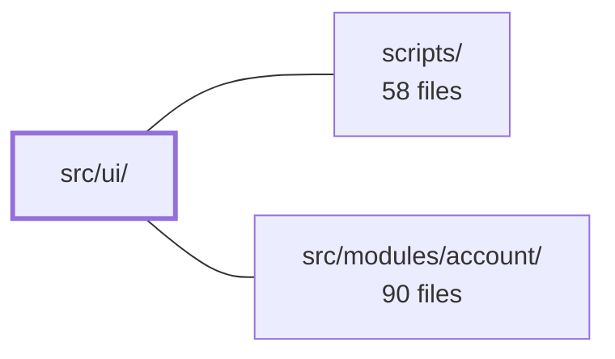

---
tags:
  - 2brain
  - 2brain/module
  - project/boilerplate-vue-frontend
type: module
module: src/ui/
files: 23
updated: 2026-11-10T08:42:03.618541+00:00
---

# src/ui/

## Purpose

`src/ui/` is the app's shared design-system and component layer. It owns the Vuetify configuration (theme, icons, breakpoints, component defaults), a small library of reusable presentational "organisms" (cards, data tables, dialog shells, form layouts, detail-page skeletons), a promise-based confirmation-dialog store, shared type contracts, and a couple of targeted accessibility directives. It contains no business logic—callers in feature modules supply all data and handlers.

## Key parts

- **`vuetify/`** – The single Vuetify instance and everything that configures it:
  - `index.ts` – Assembles theme, icons, breakpoints, locale, and component defaults into the instance installed by `main.ts`.
  - `theme.ts` – Pure-data light/dark palettes and intrinsic colour names; readable by scripts that can't load Vuetify at runtime.
  - `icons.ts` – Registers lucide-vue-next as the icon renderer, avoiding an extra icon-font payload.
  - `breakpoints.ts` – Single source of truth for the mobile/desktop pixel split shared by Vuetify and Tailwind utilities.
  - `field-error.ts` – Maps a field's error strings to the `error-messages` + `aria-invalid` props Vuetify expects.

- **`organisms/`** – Reusable, presentational components:
  - **Dialog stack** – `DialogHost.vue` (renders the queued confirmation as a Vuetify alertdialog), `DialogShell.vue` (standardised `v-dialog` wrapper with fullscreen sizing, a11y naming, focus return), `dialog-width.ts` (named width tiers).
  - **Detail/edit page scaffolding** – `ItemDetailLayout.vue` (responsive grid + `--detail-accent` CSS var), `ItemDetailHero.vue`, `RecordAsideCard.vue`, `CardDetail.vue`, `CardInfo.vue`, `CardMaterialStat.vue`, `FormCard.vue`.
  - **Data & forms** – `DataTable.vue` (generic `v-data-table` wrapper with selection/sorting), `data-table-headers.ts` (column type contract), `TranslationTabs.vue`, `HumanCheck.vue` (provider-neutral CAPTCHA/ALTCHA/Turnstile widget).
  - **Specialised UI** – `SecretRevealModal.vue` (one-time credential display with acknowledgement).

- **`dialog.ts`** – Pinia store that queues `DialogRequest`s and resolves them with a `boolean`, replacing `globalThis.confirm()` with an async, themeable flow.

- **`directives/focusable-scroll.ts`** – Vue directive that makes Vuetify's internal table scroller keyboard-focusable (fixes an axe violation with no prop-level workaround).

- **`types.ts`** – Shared colour-name vocabulary and a small UI-row shape so template `color` props and script-side maps resolve against one canonical set.

## How it connects

- **`/` (repository root / `src/main.ts`)** – Installs the Vuetify instance exported from `src/ui/vuetify/index.ts`; every view in the app inherits the theme, icon set, and component defaults defined here.
- **`scripts/`** – Design-policy and lint tooling import `src/ui/vuetify/theme.ts` to read the exact hex palettes without loading the full Vuetify bundle.
- **`src/modules/account/`** – Consumes organisms such as `FormCard`, `DialogShell`, `CardDetail`, and `RecordAsideCard` to render its create/edit/detail pages without re-implementing shared layout chrome.

## Where to start

1. **`src/ui/vuetify/index.ts`** – Reading this file first tells you how the app's visual identity is wired (which theme, icons, breakpoints, and defaults are active) and where to look when you change a global style.
2. **`src/ui/organisms/FormCard.vue`** – A short, self-contained component that shows the organism pattern in practice: fixed layout concerns handled here, all data and submit logic left to the caller. It makes the "who owns what" split between `src/ui/` and feature modules concrete.

## Connected modules

[[boilerplate-vue-frontend_ROOT|/ (repository root)]] · [[boilerplate-vue-frontend_scripts|scripts/]] · [[boilerplate-vue-frontend_src_modules_account|src/modules/account/]]

## Files
- `src/ui/dialog.ts` — A Pinia store that replaces the synchronous, un-themeable `globalThis.confirm()` with an async, queueable, promise-based confirmation dialog. Callers push a `DialogRequest` and `await` a `boolean` resolution; a separate host component renders the queue's head and calls back to settle the promise.
- `src/ui/directives/focusable-scroll.ts` — Fixes the axe `scrollable-region-focusable` violation on Vuetify's `v-table` by making the internal `.v-table__wrapper` div keyboard-focusable and, when a string is passed, a named `region` landmark. Exists because `v-table` exposes no prop, slot, or ref for that inner scroller.
- `src/ui/organisms/CardDetail.vue` — A thin, presentational card shell (wrapping Vuetify's `v-card`) that all detail-page and edit-page cards render through. It standardises the flat-bordered card chrome, the optional heading block (title + subtitle + actions), and the semantic root tag, so callers like `ItemDetailHero` or stat tiles only supply content rather than repeating card markup.
- `src/ui/organisms/CardInfo.vue` — A presentational "organism" that renders a small info card: a gradient icon tile (colored by theme accent) beside a title and description. Exists to give the UI kit a consistent, reusable card layout without any stateful logic beyond accent resolution.
- `src/ui/organisms/CardMaterialStat.vue` — A presentational stat tile that displays a label, a headline value, and an optional subtitle inside a Vuetify card with a single accent-coloured top border. It exists to give callers a consistent, minimal "material stat" widget without any business logic — the caller supplies all formatted values.
- `src/ui/organisms/DataTable.vue` — A generic Vue 3 wrapper (`<script setup generic="T extends object">`) over Vuetify's `v-data-table` that adapts the app's `CoreDataTableHeader<T>` shape into Vuetify's header format, conditionally forwards `header.*`/`item.*` slots, and layers two opt-in behaviours—single-row selection and sorting—on top, each activated only when the parent actually binds the corresponding `v-model`.
- `src/ui/organisms/DialogHost.vue` — Single-instance host component that renders the head of the dialog store's confirmation queue as a Vuetify `alertdialog`. Mounted once by the layout (analogous to the toast stack), it is the sole component that knows confirmations are Vuetify dialogs, so restyling every confirmation in the app requires editing only this file.
- `src/ui/organisms/DialogShell.vue` — A thin, presentational wrapper around Vuetify's `v-dialog` that standardises three cross-cutting concerns for every form/step dialog: fullscreen sizing on small screens, accessible naming via an auto-generated `titleId`, and focus return to the opener on close. It renders no content of its own — the caller supplies the `v-card` and everything inside it through a single slot.
- `src/ui/organisms/FormCard.vue` — A shared card layout for single-form pages (e.g. `ProductCreate`, `UserCreate`, auth pages). It fixes the card width, the `novalidate` `<form>` wrapper, the block submit button, and the optional centred "back" text link, so each page only supplies its own fields and submit logic. It is deliberately a sibling of `ItemDetailLayout` rather than a child of `LayoutDefault`, because the page owns its own layout.
- `src/ui/organisms/HumanCheck.vue` — Provider-neutral human-challenge widget (CAPTCHA alternative). On mount it fetches the active antibot provider from `GET /config` and renders the corresponding vendor UI (ALTCHA web component or Cloudflare Turnstile iframe), or nothing for `none`. Hosting forms read the solved token via a template ref and attach it to their own submit; this component never calls the protected route itself.
- `src/ui/organisms/ItemDetailHero.vue` — Renders the top section of a record detail page: a 72 px image (or an icon-tile placeholder) alongside the record's eyebrow, title, and description. It exists so that different record types (products, users, orders, …) can share one hero layout while controlling whether a picture is shown at the **type** level rather than per-instance.
- `src/ui/organisms/ItemDetailLayout.vue` — Shared layout skeleton for entity detail/edit pages (product, order, user, etc.). It establishes a responsive grid structure via named slots and sets a `--detail-accent` CSS custom property so that descendant components (e.g. `ItemDetailField`, `ItemDetailHero`, chips) can pick up a per-entity accent color without each one receiving it as a prop.
- `src/ui/organisms/RecordAsideCard.vue` — A purely presentational right-hand summary card for detail or edit pages. It renders an accent tile (title, description, optional icon) followed by a set of labelled field rows and any additional content supplied via the default slot. The component owns no business logic; all labels and values arrive already translated and formatted, making it reusable across any module.
- `src/ui/organisms/SecretRevealModal.vue` — A one-time, blocking dialog that displays a plaintext secret (e.g. a webhook subscription secret or a minted API key) in the clear for the sole chance it will ever be shown to the user. It enforces an explicit "I saved this" checkbox before the user can dismiss it, preventing accidental loss of a credential that cannot be recovered.
- `src/ui/organisms/TranslationTabs.vue` — A purely presentational tab bar shared by every per-locale translation screen (product create/edit forms, generic entity-translations). It renders one tab per open locale, a fallback-locale guard, an optional per-tab error badge, a "add language" picker for unopened locales, and a single remove button. All data ownership and ordering live with the caller; this component only reports user intent via `add`/`remove` emits and a `v-model` for the active tab.
- `src/ui/organisms/data-table-headers.ts` — Defines the column-header type contract for the `DataTable` organism. It splits a column into two explicit shapes—field-reading vs. synthetic—so the type system catches a column key that names a property the row type doesn't have. Lived in its own module because Vue's `<script setup>` can export an `interface` but not a `type` alias.
- `src/ui/organisms/dialog-width.ts` — Defines the three named dialog-width tiers used across the app so each dialog declares *which* tier it is (e.g. `DIALOG_MAX_WIDTH.form`) rather than repeating a raw pixel value. It is deliberately **not** wired as a `VDialog` default, keeping the width choice explicit at every usage site.
- `src/ui/types.ts` — A types-only module (`@module`) that defines the shared colour-name vocabulary and a small UI-row shape used across organisms and molecules. It exists so that template `color` props, `--v-theme-*` variables, and script-side status maps all resolve against one canonical set of valid Vuetify colour strings, giving `vue-tsc` a way to reject typos that no template-level lint rule could catch.
- `src/ui/vuetify/breakpoints.ts` — Single source of truth for Vuetify's display configuration. Defines breakpoint thresholds and the mobile/desktop split so that Vuetify's `useDisplay()`, `VRow`/`VCol` sizing, and Tailwind utility classes (`sm:`, `md:`, `lg:`) all agree on the same pixel boundaries.
- `src/ui/vuetify/field-error.ts` — Provides a single helper that converts a field's error messages into the two props Vuetify (and assistive tech) need: the visible `error-messages` and the `aria-invalid` attribute. Centralizing this avoids repeating the same two-key object literal on every form field.
- `src/ui/vuetify/icons.ts` — Wires **lucide-vue-next** into Vuetify as its icon system, providing the alias map Vuetify internals look up and the render function Vuetify calls to produce icon vnodes. This keeps the app on a single icon library (already used in views) and avoids adding the `@mdi/font` icon-font payload.
- `src/ui/vuetify/index.ts` — Creates and exports the single Vuetify instance for the app. It wires together the theme palette, icon set, responsive breakpoints, locale messages, and a block of component `defaults` that define the app's visual personality. Installed once by `src/main.ts`; every Vuetify component in the app inherits from it unless a view overrides a prop.
- `src/ui/vuetify/theme.ts` — Pure-data definition of the light and dark colour palettes, their generated-variant configuration, and the set of Vuetify-intrinsic colour names. The file imports only a type from Vuetify (no runtime code), so tooling that cannot load the full Vuetify bundle—lint rules, the design-policy script, and token specs—can still read the exact hex values the app ships with.

---
[[boilerplate-vue-frontend_INDEX|← boilerplate-vue-frontend index]]
