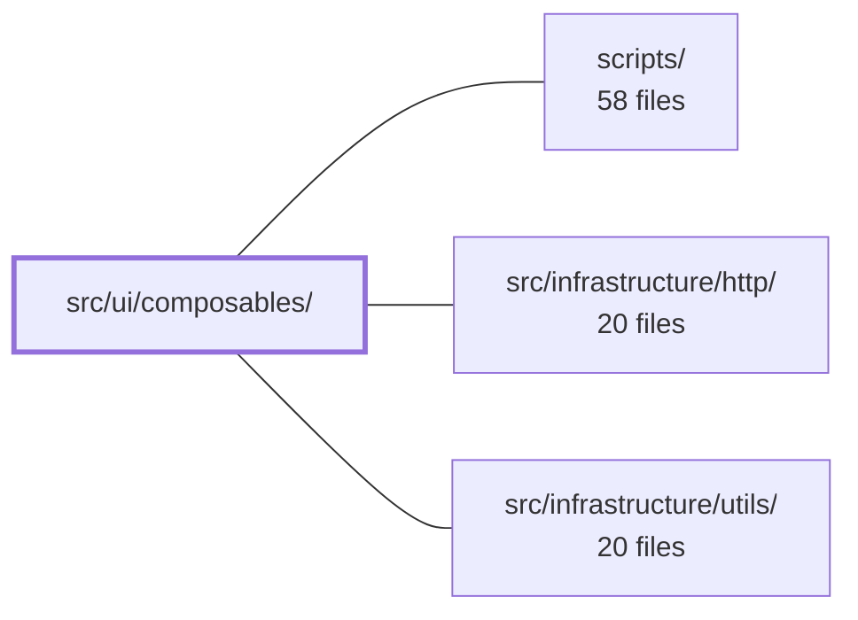

---
tags:
  - 2brain
  - 2brain/module
  - project/boilerplate-vue-frontend
type: module
module: src/ui/composables/
files: 16
updated: 2026-11-10T08:42:19.304356+00:00
---

# src/ui/composables/

## Purpose

A collection of small, single-responsibility Vue composables that extract cross-cutting UI logic—filter state, form safety, dialog behaviour, list interactions, theming—into reusable functions so that components and admin screens never reimplement the same glue inline.

## Key parts

- **List & filter state** — `use-list-search`, `use-list-url-state`, `use-server-sort`, `use-deleted-filter-options`, `use-any-filter-choice`. Together they give every filtered list page a consistent apply/clear handler, URL round-tripping, sort-binding, and the "Any / Live / Soft-deleted" option set, eliminating the four-line snippets that were previously copy-pasted across five pages.
- **Form safety & user feedback** — `use-leave-guard` (blocks accidental navigation with unsaved input), `use-hold-while-submitting` (freezes optimistic-rollback hydration during a save), `use-copy-to-clipboard` (wraps clipboard writes with a guaranteed toast).
- **Dialog & input ergonomics** — `use-fullscreen-dialog` (mobile vs. desktop dialog sizing), `use-return-focus` (restores keyboard focus to the activator on close), `use-touch-friendly-size` (bumps Vuetify `size` up on touch devices to meet the 44 px tap-target minimum).
- **Row-action pipeline & file upload** — `use-row-actions` (standardises clear-alert → write → toast → optional-reload → error-alert for delete/restore/status-change, with an optional confirm-dialog gate) and `use-axios-upload-progress` (wires the app's Axios client to the upload-progress tracker so progress bars don't need per-form glue).
- **Theme & platform queries** — `use-theme-color-meta` (syncs `<meta name="theme-color">` to the active Vuetify theme) and `use-media-query` (the project's single reactive `matchMedia` wrapper, since `@vueuse/core` is not a dependency).
- **Translation screens** — `use-translation-tab-order` (derives the ordered "open" locale tabs for ProductCreate / ProductEdit / EntityTranslations from any locale→content record).

## How it connects

- **`src/infrastructure/http/`** — `use-axios-upload-progress` receives the app's Axios instance (created in this layer) and attaches the `@guebbit/vue-toolkit` progress interceptor to it, making every subsequent upload request report progress automatically.
- **`src/infrastructure/utils/`** — Several composables lean on shared helpers (e.g. locale/reactivity utilities) defined there rather than importing a third-party library, keeping the dependency surface narrow.
- **`/` (repository root) & `scripts/`** — The composables are consumed by the Vue components and stores under `src/`; no build or dev-script step is required to use them—they are plain `.ts` files resolved by the Vite/esbuild toolchain configured at the root.

## Where to start

1. **`use-leave-guard.ts`** – It is the composable a newcomer will hit first in any edit form. Reading it shows the module's core pattern: intercept a user action, decide whether it is safe, and delegate to the shared confirm-dialog infrastructure.
2. **`use-list-search.ts`** – The shortest composable in the directory. It illustrates the "replace a repeated four-line snippet" rationale and how a composable plugs into the store, giving a quick mental model before tackling the more involved URL-state or row-action files.

## Connected modules

[[boilerplate-vue-frontend_ROOT|/ (repository root)]] · [[boilerplate-vue-frontend_scripts|scripts/]] · [[boilerplate-vue-frontend_src_infrastructure_http|src/infrastructure/http/]] · [[boilerplate-vue-frontend_src_infrastructure_utils|src/infrastructure/utils/]]

## Files
- `src/ui/composables/use-any-filter-choice.ts` — Provides a single `WritableComputedRef` that bridges the `null` ↔ `undefined` mismatch between Vuetify `v-select` "any" items and the store's filter fields, eliminating the need to repeat this sentinel-mapping logic across every admin filter component.
- `src/ui/composables/use-axios-upload-progress.ts` — Single source of truth for wiring `@guebbit/vue-toolkit`'s upload-progress tracker to this app's Axios client. Every form that submits a picked file (avatar, product image) used to repeat this glue inline; this composable centralises it so the progress bar and the conditional tracking logic live in one place.
- `src/ui/composables/use-copy-to-clipboard.ts` — A small Vue composable that wraps a clipboard-copy operation with guaranteed user feedback: a success toast or a caller-customized danger toast. It exists so that any component copying sensitive values (secrets, bank references, request IDs) can treat "copied" vs. "not copied" as equally loud outcomes.
- `src/ui/composables/use-deleted-filter-options.ts` — Defines the three choices for an admin list's "Deleted" filter (any / live / soft-deleted) and exposes them as a locale-reactive composable. It exists so that every list whose records can be soft-deleted (products, users, orders) shares a single, consistent set of filter options rather than each hard-coding its own.
- `src/ui/composables/use-fullscreen-dialog.ts` — Single-source composable that tells every dialog in the app whether it should render fullscreen (mobile) or as a fixed-width floating panel (desktop). Centralising the breakpoint check here means individual dialogs bind `:fullscreen` without ever reading the viewport themselves.
- `src/ui/composables/use-hold-while-submitting.ts` — Prevents an optimistic-update rollback from overwriting in-progress form input. While a save is in flight the composable freezes the hydration source, so the store's "put the old record back" path cannot clobber what the user typed. A change is only applied to the form once the server confirms it (i.e., the record's content actually differs from the last held value).
- `src/ui/composables/use-leave-guard.ts` — A design-system composable that prevents a user from accidentally discarding unsaved form input. It intercepts in-app route changes (via the shared confirm dialog) and browser-level unloads (via the native `beforeunload` prompt), but stays silent when there is nothing to lose—the form is clean, was just saved, or the session has already ended.
- `src/ui/composables/use-list-search.ts` — A single Vue composable that provides the two handlers every filtered list page needs — apply current filters and clear all filters. It exists to replace the same four-line snippet that was duplicated across five list pages.
- `src/ui/composables/use-list-url-state.ts` — Vue composable that mirrors a list page's filters, page, and page-size into the URL query string (and back on load) so that a filtered view is bookmarkable and shareable. The store remains the single source of truth; this composable only reads from the URL once on mount and writes back via `router.replace` after each search or page/size change.
- `src/ui/composables/use-media-query.ts` — Provides a single reactive `useMediaQuery` composable that wraps `window.matchMedia` in a Vue ref. It exists because the project does not depend on `@vueuse/core`, and Vuetify's own `matchMedia` usage is limited to theming—so this is the one sanctioned place for a component to ask the browser about pointer/input modality.
- `src/ui/composables/use-return-focus.ts` — Restores keyboard focus to the element that opened a dialog once the dialog closes. Without this, a dialog opened via an external activator (a button, etc.) drops focus to `<body>` on close, forcing keyboard users to navigate from the top of the page again.
- `src/ui/composables/use-row-actions.ts` — Provides a single composable (`useRowActions`) that standardises the post-write pipeline for any row action in a list (delete, restore, revoke, status change): clear the list's blocking alert → execute the write → toast a success message → optionally run a follow-up (e.g. reload) → funnel any failure back into that alert. A second variant adds a confirm-dialog gate before the write runs.
- `src/ui/composables/use-server-sort.ts` — Binds a list page's `filters.sort` (a CSV string that lives in the URL) to two UI controls — a table's `v-model:sort-by` and a plain `<select>` — so that editing either one updates the store and immediately re-runs the search from page 1.
- `src/ui/composables/use-theme-color-meta.ts` — Keeps the browser address-bar colour (the `<meta name="theme-color">` tags) in sync with the app's active Vuetify theme. This is necessary because the static pair in `index.html` only reflects `prefers-color-scheme` (i.e. the OS), so a user who forces the opposite theme would otherwise see the wrong chrome colour.
- `src/ui/composables/use-touch-friendly-size.ts` — Centralises the "is this a touch input?" decision and derives reactive Vuetify `size` values from it. Vuetify's default `small` (28 px) is below the 44 px a finger needs, so on touch devices these composables swap to a larger size (or explicit min-dimensions) where a tap replaces a mouse click.
- `src/ui/composables/use-translation-tab-order.ts` — Derives the ordered list of "open" locale tabs for per-locale translation screens (ProductCreate, ProductEdit, EntityTranslations). It reads a locale→content record, drops `null` entries (tabs marked for removal), and moves the fallback tag to the front if it is already present. It exists so that the three screens sharing this ordering logic can read their *different* data sources (`form.translations`, `drafts`, etc.) through one small composable rather than duplicating the filter-and-reorder.

---
[[boilerplate-vue-frontend_INDEX|← boilerplate-vue-frontend index]]
