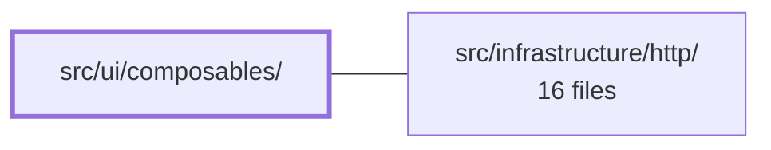

---
tags:
  - 2brain
  - 2brain/module
  - project/boilerplate-vue-frontend
type: module
module: src/ui/composables/
files: 11
updated: 2026-10-17T02:56:40.379399+00:00
---

# src/ui/composables/

## Purpose

Reusable Vue composables that extract cross-cutting UI concerns—filter state, URL synchronization, sort binding, upload progress, and small accessibility/UX helpers—so that list pages and forms share one implementation instead of each hand-rolling the same plumbing.

## Key parts

- **URL ↔ state sync** — `use-list-url-state.ts` and `use-query-synced-filters.ts` read the route query string into the store on load and write store changes back into the query, giving every filtered list a bookmarkable/shareable URL.
- **Filter helpers** — `use-any-filter-choice.ts` (null ⇄ undefined sentinel mapping for Vuetify `v-select` "any" items) and `use-deleted-filter-options.ts` (localized any/live/deleted options mapped to the API `deleted` param).
- **Server sort** — `use-server-sort.ts` binds a CSV `filters.sort` value to `v-model:sort-by` / a `<select>` and re-triggers the search from page 1 on change.
- **Upload progress** — `use-axios-upload-progress.ts` wraps `@guebbit/vue-toolkit`'s `useUploadProgress` around the app's Axios calls for a consistent 0–1 progress bar.
- **UX / accessibility utilities** — `use-fullscreen-dialog.ts`, `use-return-focus.ts`, `use-touch-friendly-size.ts`, `use-translation-tab-order.ts`, and `use-list-search.ts` provide small, single-purpose behaviors (focus management, touch sizing, tab order, search wiring) shared across components.

## How it connects

The composable `use-axios-upload-progress.ts` depends on **`src/infrastructure/http/`**: it adapts the infrastructure's Axios instance so that upload progress events (dispatched by the http layer) are surfaced as a reactive 0–1 value usable by any form's progress bar.

## Where to start

Read **`use-any-filter-choice.ts`** first—it is a single, short function that shows the module's pattern (one composable, one narrow responsibility, documented sentinel mapping). Then read **`use-list-url-state.ts`** to see how the composables compose with the store and the router to produce a shareable list URL.

## Connected modules

[[boilerplate-vue-frontend_src_infrastructure_http|src/infrastructure/http/]]

## Files
- `src/ui/composables/use-any-filter-choice.ts` — A single-function composable that bridges Vuetify `v-select` (which requires `null` as the "any" item value) and the store's filters object (which carries `undefined` for unset filters). It exists as the one canonical place for this `null ⇄ undefined` sentinel mapping so that eleven admin filters don't each hand-roll it.
- `src/ui/composables/use-axios-upload-progress.ts` — Single composable that adapts `@guebbit/vue-toolkit`'s `useUploadProgress` to this app's Axios-based API calls, so that every file-upload form (avatar, product image, etc.) gets a consistent 0–1 progress bar without repeating the wiring.
- `src/ui/composables/use-deleted-filter-options.ts` — Provides the three localized options for a "Deleted" status filter (any / live-only / deleted-only) used across all admin lists whose records can be soft-deleted (products, users, orders). The values map directly to the API's `deleted` search parameter.
- `src/ui/composables/use-fullscreen-dialog.ts`
- `src/ui/composables/use-list-search.ts`
- `src/ui/composables/use-list-url-state.ts` — Composable that mirrors a list page's filters, page number, and page size into the URL query string so a filtered view can be bookmarked, reloaded, or shared. The store remains the source of truth; this composable reads the URL into the store once on load and writes the store back into the URL after each search or page change.
- `src/ui/composables/use-query-synced-filters.ts` — A Vue composable that ties a list page's filter state to the URL query string. It hydrates initial filters from the current route query on load and provides a single `syncToQuery` call that mirrors subsequent filter changes back into the URL—enabling shareable, bookmarker-friendly filtered views without each page hand-rolling its own query-string plumbing.
- `src/ui/composables/use-return-focus.ts`
- `src/ui/composables/use-server-sort.ts` — Binds a list page's `filters.sort` (a CSV string kept in the URL) to two editable UI controls — a table's `v-model:sort-by` and a plain `<select>` — and ensures that any change re-triggers the search from page 1, since the server re-sorts the entire result set.
- `src/ui/composables/use-touch-friendly-size.ts`
- `src/ui/composables/use-translation-tab-order.ts`

---
[[boilerplate-vue-frontend_INDEX|← boilerplate-vue-frontend index]]
