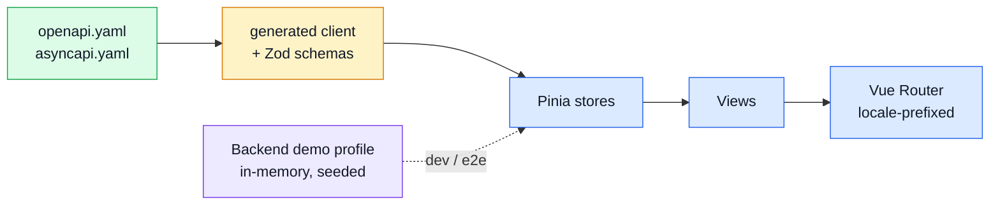

# boilerplate-vue-frontend

> Vue 3 + TypeScript SPA. Contract-first and modular.
> Paired with [`boilerplate-node-backend`](https://github.com/Guebbit/boilerplate-node-backend).

**📚 The documentation is the real reference — this file is only the door.**
Run `npm run docs:dev`, or read `docs/`.

---

## Start here

> Requires **[Node.js 24+](https://nodejs.org/)** (the repo and CI run 26, see `.nvmrc`) and `npm`.

The dev server talks to the paired backend at `http://localhost:3000` — there is no
backend-less mode. The lightest way to have one is its demo profile: the real API against an
in-memory, seeded database, no Docker.

```bash
npm ci                    # install exactly the lockfile
cp .env-example .env
npm --prefix ../boilerplate-node-backend run demo   # terminal 1
npm run dev                                         # terminal 2 — http://localhost:8080
```

That gives you a browsable storefront — products, cart, orders, a signed-in user — every screen of
it answered by the real API.

Or start the full stack (`compose`) for real Redis/queue behaviour.

→ Full setup, both modes, port map and the pre-commit gate: **[Getting Started](./docs/build/run-locally.md)**
→ What to set up by hand before it is yours (domain, TLS, brand, legal): **[INSTALL.md](./INSTALL.md)**

---

## What this is



Four ideas carry the whole repository:

1. **The contract is the source.** `openapi.yaml` and `asyncapi.yaml` come from the backend and
   generate the axios client, the Zod schemas and the realtime types. None of that is hand-written.
2. **A module is a value, not a convention.** Every domain declares what it needs — routes,
   navigation, locales, response schemas — in one typed object.
   `src/modules.ts` lists them. Adding a domain is one folder plus one line; removing it is
   `rm -rf` plus that line.
3. **The backend is the paired half.** The app is built against it and tested against the real thing:
   its demo profile is the lightest way to have one.
4. **The tests are part of the boilerplate.** Unit, component, e2e, accessibility, visual
   regression, property and mutation testing are all wired and all run.

---

## Where things live

The tiers and the folder map live in [`docs/understand/layers.md`](docs/understand/layers.md#tiers) (`#tiers`, `#quick-map`).

---

## The map

| You want to                      | Read                                                                                                                                |
| -------------------------------- | ----------------------------------------------------------------------------------------------------------------------------------- |
| Get it running                   | [Getting Started](./docs/build/run-locally.md)                                                                                      |
| **Read the code, first time**    | **[Reading Path](./docs/understand/reading-path.md)** — nine files, in order                                                        |
| Know what one file _is_          | [File Glossary](./docs/reference/) — every file in the repo, one hop to an answer                                                   |
| Understand the shape             | [Architecture](./docs/understand/architecture.md) · [Layers](./docs/understand/layers.md) · [Modules](./docs/understand/modules.md) |
| Add or remove a domain           | [Adding & Removing a Module](./docs/build/module-lifecycle.md)                                                                      |
| Change an endpoint               | [OpenAPI Workflow](./docs/build/openapi-workflow.md)                                                                                |
| Configure something              | [Environment Variables](./docs/operate/environment.md)                                                                              |
| Look up a script                 | [Package Scripts](./docs/reference/package-scripts.md)                                                                              |
| Understand a dependency          | [Tools Explained](./docs/understand/tools-explained.md)                                                                             |
| Test something                   | [Testing overview](./docs/build/testing-and-docs.md)                                                                                |
| Know what is planned but unbuilt | [Roadmap](./docs/understand/roadmap.md)                                                                                             |
| Deploy it                        | `docker/Dockerfile.production` · `docker-compose.production.yml`                                                                    |

---

## Before you commit

```bash
npm run complete    # lint + spec lint + contract identity + format + build + unit + e2e
```

The full gate. The pre-commit hook (also run on a conflict-free merge) fixes lint and formatting on the staged files, then runs a faster subset,
`npm run complete:light:gates` (no build or Cypress). A lane merges on `npm run complete:light:fix`; run this one on main at the checkpoints; CI is authoritative. It takes **around ten minutes**,
mostly Cypress — start it and go do something else. `npm run complete:fix` is the same gate with lint and formatting fixed
rather than reported.

Two suites sit outside it: the live-backend e2e run (`npm run complete:manual`), which needs the
paired API up, and pixel diffing, which answers to the machine that took the snapshots and so runs
only in its pinned CI image (`visual.yml`).
See [Test timings](./docs/build/testing-and-docs-gates.md#test-timings) for what each layer costs.

---

## License

AGPL-3.0-or-later. See [LICENSE](./LICENSE).

Copyright (C) 2023-2026 Andrea Guerzoni. This program is free software: you can redistribute it
and/or modify it under the terms of the GNU Affero General Public License as published by the Free
Software Foundation, either version 3 of the License, or (at your option) any later version. It is
distributed WITHOUT ANY WARRANTY; see the GNU Affero General Public License for details.

This app is shipped straight to browsers, so AGPL §13 applies the same way it does to the paired
backend: if you modify it, you must offer everyone who interacts with it remotely a way to get the
Corresponding Source of your modified version, including the AGPL toolkits it bundles
(`@guebbit/vue-toolkit`, `@guebbit/js-toolkit`). This binds _you_, the operator, not your users. It
is not legal advice — some organisations forbid AGPL dependencies outright; check before adopting.
