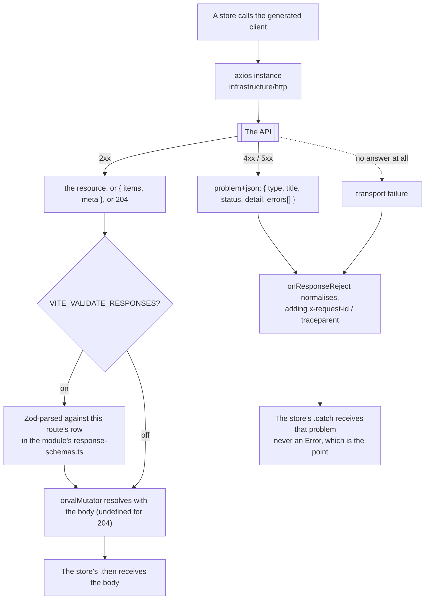
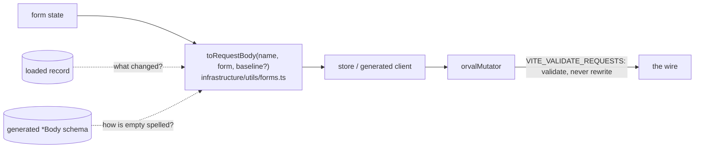

# Endpoints

What every HTTP endpoint answers and what a write sends. The endpoints themselves are not listed here:
the generated client in `contracts/rest/index.ts` calls them, and `contracts/rest/routes.ts` is the
complete list (method, path, auth and owning module per operation).

## The answers every endpoint travels in

Every endpoint answers a success with the resource itself (a list is `{ items, meta }`, a
result with nothing to say is a body-less `204`), and every rejection reaches a call site as
the same problem-details document (RFC 9457). That normalisation is the http tier's job, not each store's:

Two consequences worth carrying into every call. A rejection is always a problem, so
`absentIs` and `rethrowUnlessAbsent` can read `status` off it to tell "nothing there" (a 404 on a
payment read) from a real failure. And `errors[]` is where a machine-readable `code` lives —
`REAUTH_REQUIRED`, `PAYMENT_DECLINED` — which is what the step-up interceptor and the checkout
error classifier match on, rather than on a status alone.

## What a write sends: the form-to-wire boundary

A text field the user empties gives `''`. The wire has three ways to say "empty", and only the
contract knows which one a field accepts: omitted (leave it alone), `null` (clear it), `''` (a real
blank, only where the schema allows). So a form never builds a body by hand:

- **The helper decides.** With a `baseline` (a PATCH) it omits every unchanged field; without one (a
  create, a PUT) it sends everything the form holds. Each emptied field is probed against the
  operation's own schema through `safeParse`, so a field with no clear spelling is left off.
- **The transport checks.** `orvalMutator` parses every outgoing JSON body against the schema its
  route maps to. Dev, unit and e2e throw and name the field; production reports to Faro and sends
  anyway, since the backend answers with a real 422. A multipart body is not checked.
- **An upload cannot carry a clear.** A multipart part is a string or a file, never `null`, so the
  `*RequestMultipart` types have no `null` in them. A store that uploads and clears in one save goes
  through `uploadThenClear`: the multipart first, then a JSON PATCH with only the clears.

## Where each endpoint is listed

The method, path and auth of every operation is the generated route table `contracts/rest/routes.ts`
(one row per operation, with the module that owns it) and the backend's own contract: the root
`openapi.yaml` and its per-module fragments. This page does not copy them. A module's page says
which of them it calls and why.

The live stream is described in [Realtime](../tools/realtime.md) and the observability contract
(`asyncapi.yaml`); the reads behind the Admin Dashboard are in
[the backend's observability page](https://github.com/Guebbit/boilerplate-node-backend/blob/main/docs/api/observability.md).

## Related pages

- [API overview](./index.md)
- [OpenAPI Workflow](./openapi-workflow.md)
- [Realtime](../tools/realtime.md)
