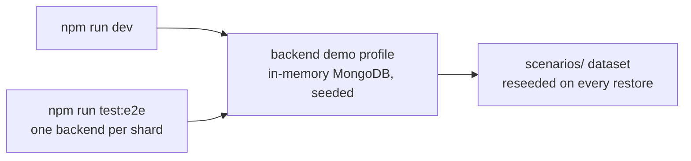

# The demo profile

Run the app against a real, seeded, disposable backend with one command.

::: tip Mechanism here, domain on its module page
The seeded backend, the profile and the commands are here. The `example` **module** — the small domain written to be copied, which `npm run demo:remove` deletes with the shop (copy it first) — is explained in [Adding & deleting a domain](../understand/modules-adding-and-deleting.md#adding-and-deleting-a-domain).
:::

Development and the fast e2e suite run against the paired backend's **demo profile** — the real API, booted self-contained and disposable:

```sh
npm --prefix ../boilerplate-node-backend run demo
```

One process: the actual application against an in-memory MongoDB (the same `mongodb-memory-server` its test suite uses), seeded with every enabled module's demo fixtures, cache and queue running `disabled` — a supported deployment shape the health endpoint reports honestly. It boots in seconds, holds nothing on disk, and several instances run side by side (`NODE_PORT=3101 npm run demo`), each owning its own database.

## Why a real backend, not a mock

There is one implementation of the API's behaviour, the backend's, and both the dev server and the e2e suite talk to it. A new endpoint exists here the moment the backend implements it, and a filtering rule is right because it is the same code. A hand-written imitation is allowed to be wrong; a copy cannot be.



What each concern maps to:

| Concern                                        | Where it lives                                                                                              |
| ---------------------------------------------- | ----------------------------------------------------------------------------------------------------------- |
| Seeded, deterministic data                     | The backend's own `scenarios/` dataset, seeded at boot and on every restore                                 |
| Restore between e2e specs                      | `POST /__test/restore` — empties the in-memory database and reseeds the `shop` scenario, in-process         |
| Reading "sent" emails (reset tokens)           | `GET /__test/emails` — in demo mode the mailer records to an outbox instead of SMTP                         |
| Contract conformance of responses              | `orvalMutator` parses every response through its OpenAPI-derived Zod schema (see [Live E2E](./live-e2e.md)) |
| Full-stack behaviour (real Redis, real broker) | The **live profile**, unchanged: `npm run test:e2e:live` and the required `test-e2e-live` CI job            |

## How the e2e suite uses it

`npm run test:e2e` builds the bundle once, then boots **one demo backend per shard** (ports `3101+`) so the four Cypress processes cannot see each other's writes. Each shard's Cypress carries `CYPRESS_apiUrl`, and the overwritten `cy.visit` injects it into the page as `window.__APP_CONFIG.API_URL`, the runtime override the axios client reads before falling back to the baked `VITE_API_URL` (`src/infrastructure/http/client.ts`).

`E2E_SESSION_MODE=cookie npm run test:e2e` boots every shard's backend with `NODE_SESSION_MODE=cookie` (the default is `jwt`) and tells the journeys the same, so the whole suite also runs against the cookie session; CI runs both.

`cy.restore()` POSTs the shard's own `/__test/restore` before every spec — a replay of a copy the backend process built at boot, so it costs milliseconds — and then re-reads `GET /__test/scenario`, which is where `cy.subjectId('order.paid')` and `seedAccount('admin')` get their answers. `cy.emailTo(address)` reads the outbox — or, against the live profile, Mailpit (see [Live E2E](./live-e2e.md)). Specs that need the full stack open with `cy.skipUnlessLive()`; specs that read mail open with `cy.skipUnlessMailbox()`, which skips only a live run with no Mailpit to read; `cy.skipUnlessDemo()` is left for what only the demo has, like the fake OAuth provider.

### What a journey can do beyond restoring

Four more doors, for the journeys (see [Tests — Journeys](../reference/tests-e2e.md#journeys-—-stories-that-cross-modules)):

| Need                    | How                                                                                                                                                                                                                                                                    |
| ----------------------- | ---------------------------------------------------------------------------------------------------------------------------------------------------------------------------------------------------------------------------------------------------------------------- |
| Run a background job    | `POST /__test/jobs/reap-orders` (the backend's job lever), after `cy.travel(ms)` moved the clock                                                                                                                                                                       |
| See a webhook arrive    | The Cypress process hosts a receiver over TLS (the backend's test certificate, `scripts/e2e/tls/`); each demo backend boots with `NODE_WEBHOOK_DEMO_SINK_URL` pointing at its `https://` address and trusts the certificate itself, so a replayed delivery lands there |
| Sign a provider webhook | The backend's demo secret is known, so a `cy.task` signs `POST /payments/webhook` itself                                                                                                                                                                               |
| Test the challenge      | A shard booted with the altcha provider on — see [Live E2E — the antibot run](./live-e2e.md#the-antibot-run)                                                                                                                                                           |

## Working without any backend

There is no offline mock of the app, deliberately: a stateless imitation renders pages whose every flow is dead, which demonstrates less than it appears to. The demo profile _is_ the no-infrastructure path — it needs Node and the sibling checkout, nothing else.
