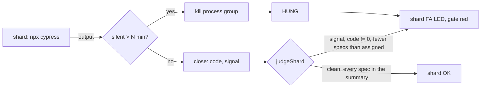
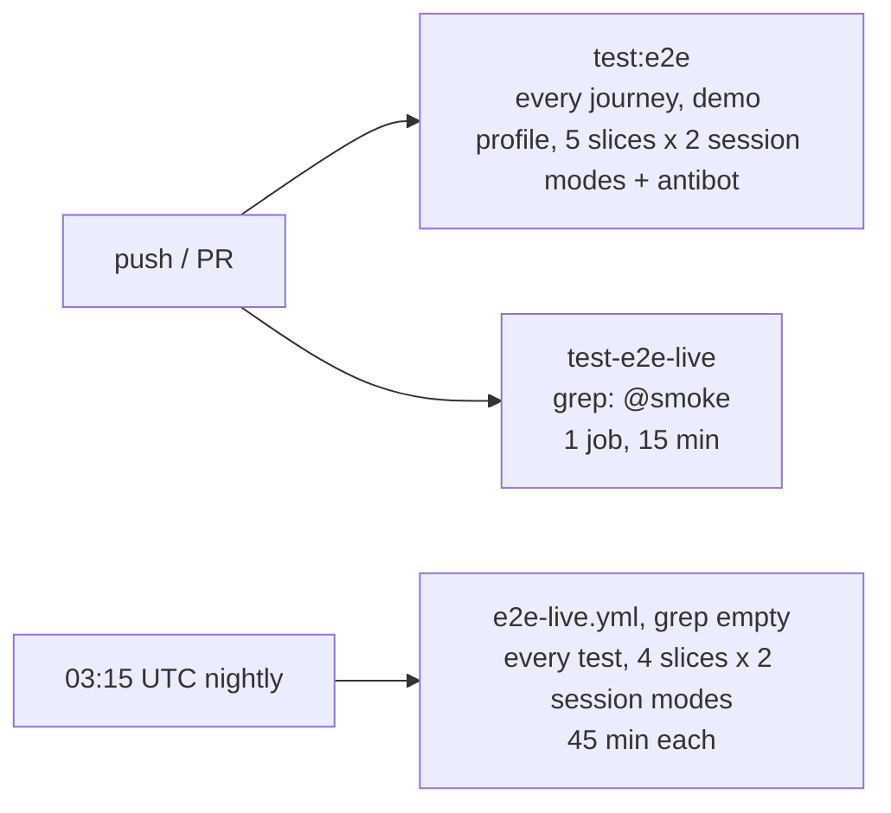
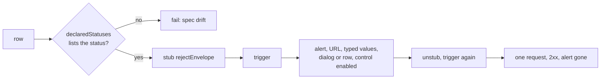
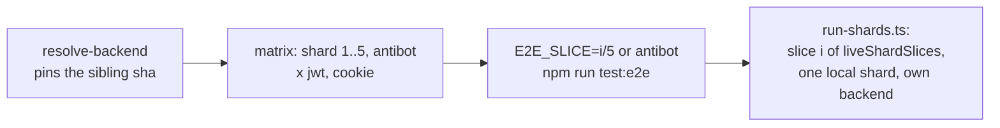
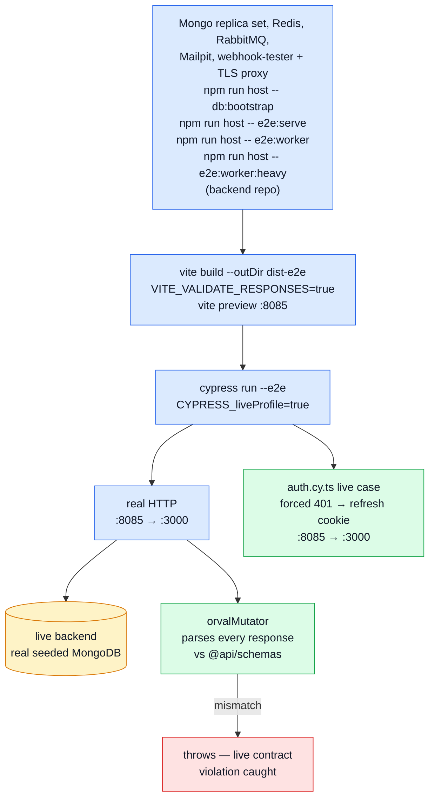

# Live E2E (FE ↔ real backend)

The demo profile ([The demo profile](./demo-profile.md)) runs the same API this one does, minus the infrastructure: in-memory Mongo, cache and queue disabled. What it cannot prove is full-stack behaviour — a real Redis, a real broker, a session cookie crossing a real network — and that gap is closed by running the same Cypress specs against the fully-composed backend instead.

**This is the full-stack profile.** Both profiles run the real application; this one runs it with everything attached. This page documents it: when CI runs it, how to run it by hand, and what guards it.

## Where it runs, and where it does not

Two tiers and a hand run, all through the same `e2e-live.yml`:

- **Every push: a `@smoke` subset.** The `test-e2e-live` job in `.github/workflows/ci.yml` calls `e2e-live.yml` through `workflow_call` with `grep: '@smoke'`: one job, only the tests tagged `@smoke`, a 15-minute budget. It is a required job of the `ci` aggregate, so it gates. Every journey also runs on every push in the demo profile (`test:e2e`), so breadth costs nightly minutes, not push time.
- **Nightly: everything.** `e2e-live.yml`'s own `cron` (03:15 UTC), or a manual run with an empty `grep`, runs every test, split into a matrix of jobs (see [Tiers](#tiers)). It reports; it does not block a push. It also answers a question no push can: does `main` still agree with the _backend's_ default branch? The backend moves on its own, so a frontend that was green yesterday can be wrong today without anyone touching it.
- **By hand**, with [the recipe](./live-e2e-recipe.md) below. It is the same recipe: `e2e-live.yml` is this page, service for service and variable for variable, so change one and change the other.

Both tiers share one definition of the services, the sibling checkout and the seeding, so they cannot drift apart. **Scheduled workflows only ever run on the default branch**: a `cron` fires against `main` and nothing else.

## The shard watchdog

`npm run test:e2e` never trusts a shard's exit code alone.



- **Silence:** no stdout or stderr for 10 minutes (`E2E_SHARD_QUIET_MINUTES` changes it) kills the shard's process group and fails it as HUNG. The longest healthy spec is ~90 s.
- **Signal:** any signal fails the shard, even when the `npx` wrapper exited 0.
- **Spec count:** the specs in Cypress' final summary table must equal the specs assigned. A shard that exits 0 with fewer finished fails.
- Code: `scripts/e2e/shard-process.ts` (the watchdog), `scripts/e2e/shard-verdict.ts` (the pure verdict). `tests/unit/scripts/e2e/shard-process.spec.ts` proves the hang against a stand-in that sleeps forever.

## Tiers



A test joins the smoke tier by carrying the tag; a test with no tag runs nightly:

```ts
it('a customer buys a product', { tags: '@smoke' }, () => { … });
describe('Checkout', { tags: '@smoke' }, () => { … }); // every test inside
```

Tags come from [`@cypress/grep`](https://github.com/cypress-io/cypress/tree/develop/npm/grep), registered in `tests/support/e2e/e2e.ts` and `cypress.config.ts`. Tags, not file names: `@smoke` works in any file layout and keeps each spec's recorded run time. A journey is in the push tier when its spec carries `@smoke`: `grep -rl @smoke tests/e2e` lists them.

| Tier     | Runs               | Grep     | Jobs                                                                         | Budget per job |
| -------- | ------------------ | -------- | ---------------------------------------------------------------------------- | -------------- |
| Per push | the `@smoke` tests | `@smoke` | 1                                                                            | 15 min         |
| Nightly  | every test         | empty    | 4 (`LIVE_SHARDS` in the `plan` job) per session mode, plus the antibot entry | 45 min         |

- **The `grep` input** (`workflow_call` and `workflow_dispatch`) takes any `@cypress/grep` expression: space is OR, `+` is AND, `-` is NOT. Run `grep: '@smoke'` by hand from the Actions tab to reproduce the push tier. It reaches Cypress as `E2E_GREP_TAGS`, which `cypress.config.ts` puts in `expose.grepTags`. (v7 reads `expose`, not `env`: a `CYPRESS_grepTags` variable is silently ignored.)
- **The matrix.** Live specs share one seeded Mongo and reset it between specs, so slices cannot share a database: each matrix job has its own services and runs its slice sequentially. `scripts/e2e/print-live-shard.ts <i> <n>` prints slice `i` of `n` as a `--spec` value, balanced by recorded duration like the demo shards (see [Shard weights](#shard-weights)), and `npm run test:e2e:live` runs it (`E2E_SPEC=<specs>`). Between them the slices cover the suite exactly once. Raise `LIVE_SHARDS` as journeys are added; the full run is ~85-115 min sequential.
- **An empty tier warns, it does not fail.** If no spec carries the tag, the run ends with a warning annotation ("No spec carries @smoke") rather than Cypress's "no spec files were found". Until the first `@smoke` journey lands, the push tier therefore runs nothing: it is green and says so.
- **By hand**, `E2E_GREP_TAGS=@smoke npm run test:e2e:live` runs the smoke tier locally.
- **The `session-mode` input** (`jwt`, the default, or `cookie`) sets the backend's `NODE_SESSION_MODE` and the journeys' `E2E_SESSION_MODE` together, so both always agree. The schedule passes no input, so the nightly runs every slice once per mode (the antibot entry stays `jwt`: it is about the challenge, not the session); the push tier stays `jwt`, since the demo run already covers both modes on every push. By hand, export both before the recipe below, e.g. `NODE_SESSION_MODE=cookie` for the backend and `E2E_SESSION_MODE=cookie` for `npm run test:e2e:live`; `harness.cy.ts` fails if the two disagree. Journeys about one mode's own machinery skip themselves in the other (`skipUnlessSessionMode`).

### Shard weights

Both the demo shards and the nightly slices weigh a spec by seconds, read in this order: this checkout's `reports/e2e/durations.jsonl` (what `cypress.config.ts` records), then the committed medians in `scripts/e2e/spec-seconds.json`, then the hand-written `SECONDS` table by file name, then the mean of the known ones with a warning. A CI runner has no recordings, so the committed file is what balances it. A 0 s entry counts as no measurement.

To refresh it: download the nightly's `e2e-durations-*` artifacts, concatenate them into one file, run `npm run e2e:spec-seconds -- <file>`, and commit `spec-seconds.json`. The command refuses to write when the file holds nothing for any current spec.

### The antibot run

A backend with a human-challenge provider asks every signup and login to solve it, so the plain specs could not get in. The specs that need the provider are named `<name>.antibot.cy.ts`, are kept out of the functional run (`ANTIBOT_SPEC_GLOBS`), and run against their own backend:

- **Demo:** `npm run test:e2e` adds one more shard, booted with `NODE_ANTIBOT_PROVIDER=altcha`, a fixed secret, a low cost and a small per-account login budget (`NODE_AUTH_RATE_LIMIT_MAX=6`, so the login check is asked of the fourth try, after three wrong passwords) (`scripts/e2e/antibot-backend.ts`). `npm run test:e2e:antibot` runs the same specs by hand.
- **Live, nightly:** the matrix gets an `antibot` entry. Its backend boots with the same four variables (the other entries keep the job's `NODE_AUTH_RATE_LIMIT_MAX`), and `print-live-shard.ts antibot` prints its specs. A unit test holds the workflow's values equal to the constant.
- **By hand, live:** the recipe below with `NODE_ANTIBOT_PROVIDER=altcha NODE_ANTIBOT_ALTCHA_SECRET=e2e-not-a-secret-altcha-key NODE_ANTIBOT_ALTCHA_COST=1000 NODE_AUTH_RATE_LIMIT_MAX=6` exported in step 2, then `E2E_SPEC="$(npx tsx scripts/e2e/print-live-shard.ts antibot)" npm run test:e2e:live`.

`tests/e2e/specs/harness.antibot.cy.ts` proves the provider really is on, so a mis-wired run cannot pass by testing the provider-off branch.

## The action table

`actionTable(module, rows)` (`tests/support/e2e/action-table.ts`) runs one control per row, answered with a failure or an empty list. Rows sit in `src/modules/<m>/tests/e2e/actions.cy.ts`, so `demo:remove` takes them with the module. The jwt leg only: a stubbed answer never reaches the session layer. With `E2E_DESIGN_CAPTURE=true` the same rows are photographed instead of asserted (loading with the request held open, then the error or empty state); see [Design Review](./design-review.md#the-capture-matrix).



`declaredStatuses` is a Node task in `cypress.config.ts` reading the synced root `openapi.yaml`.

## The role sweep

`sweepRoles(label, cases)` (`tests/support/e2e/role-sweep.ts`) signs each persona in once, with `cy.loginAsFast` (one `POST /account/login` and the `isAuth` hint, no form), and walks a module's pages. Each module's `roles.cy.ts` holds its case list. What a persona may open is derived from its own the `abilities` of `GET /account`, evaluated like `session.can` (both scopes), never typed. An allowed page must render, keep its path and call no door that answers 401 or 403; a refused one turns the visitor back. A case with no `can` asks no rule, so every persona, the shopper included, must load it. The jwt leg only: the doors a page calls do not depend on how the session is kept.

## A backend with a boot-time knob

A spec that needs the backend booted differently gets its own backend, as the antibot run does: name the spec `<name>.antibot.cy.ts`-style, keep it out of the functional glob, and boot one more shard (`scripts/e2e/run-shards.ts`, the antibot entry). There is no mechanism beyond that. Idle goes through `cy.travelEverywhere`, and an oversize upload through a stubbed 413, so neither needs a knob.

## CI slices

The push gate's demo run (`ci.yml` `test-e2e`) is a matrix, one slice per runner, because the whole suite on one 4-vCPU runner measured ~178 min of Cypress time against a 75 min limit.



- `E2E_SLICE=<i>/<N>` makes `run-shards.ts` run only slice `i` of `liveShardSlices` (the split `print-live-shard.ts` prints for the nightly). `E2E_SLICE=antibot` runs the antibot specs on a backend with the provider on. Unset is the local all-slices run, and `E2E_SHARDS` still sizes that.
- A malformed value or an empty slice exits non-zero instead of passing having run nothing.
- The antibot run is a matrix entry in both session modes: the cookie leg has its own antibot failures, and a jwt-only entry would hide them.
- Every slice of one push must see the same sibling commit, or two slices compute different splits and a spec runs twice or never. `resolve-backend` runs `git ls-remote` once and each slice checks out that sha.
- `N` (5) is written twice in the workflow, in the `shard` list and in `E2E_SLICE`; change both. Size it from one uncontended measured run, aiming at ~30 min per slice under the 45 min limit.

## Why the push tier is only a subset

A full live run is minutes to hours, not seconds, and live CI must stay a signal people read. So the push tier is the smallest set that answers "does the real infrastructure work" — a real Mongo replica set, Redis, a real broker, a cookie over a real network — and the nightly is the full sweep. The price: a live-only break outside `@smoke` shows up the next morning, not on the push. Everything else is covered on the push by the demo run, which already runs every journey.

What carries the weight for the infrastructure the demo profile lacks:

- **response validation** (`VITE_VALIDATE_RESPONSES`), which, with `VITE_CONTRACT_THROW` (both set by `build:e2e`), turns any live contract violation into a hard failure: the call rejects, a `[contract]` line reaches `console.error`, and a global Cypress hook fails the running test on it
- the **specs themselves**, which run unchanged against the real API: a handler that has drifted from the service it mirrors fails here, on the push that introduced it (when the test is `@smoke`) or the next morning

## Architecture



## `BACKEND_PATH`

`cy.restore()` shells out to the backend checkout for `host -- scenario:apply:reset` (under the demo profile it POSTs the backend's in-process `/__test/restore` instead — see `tests/support/e2e/commands.ts`). The live command also carries `--describe-to={describeTo}`: a live deployment mounts no `/__test/scenario`, so the reset writes the accounts and subject ids to a file that `tests/support/e2e/scenario.ts` reads back. Without `LIVE_RESET_COMMAND` there is no reset and no description, and a spec asking for either says so. Either profile's restore also empties the browser's HTTP cache (Chromium's `Network.clearBrowserCache`), because the backend's `setCache` reads — `GET /products/categories` among them — are served with `Cache-Control: max-age` and would otherwise be replayed from the previous spec's data. The command's `{scenario}` placeholder is where `cy.restore('name')` puts the scenario name (empty for a plain `cy.restore()`, so the backend's default `shop`). Naming a scenario against a command with no placeholder throws, rather than quietly reseeding `shop`. Which checkout that is comes from `scripts/pairing/paired-backend-path.ts`, which `cypress.config.ts` reads:

```sh
# default: a sibling checkout
../boilerplate-node-backend

# override for a different layout
BACKEND_PATH=/path/to/boilerplate-node-backend npm run test:e2e:live
```

The resolved value is always an absolute path, so `npm --prefix` errors name a real location instead of something relative to whatever `cwd` Cypress happened to have.

## Response validation

`orvalMutator` (`src/infrastructure/http/index.ts`) normally just unwraps `response.data`. Behind `VITE_VALIDATE_RESPONSES`, it additionally parses every response through the Zod schema matching its route (`src/infrastructure/http/response-schema-map.ts`, built from the generated route table `contracts/rest.generated/routes.ts`) and throws on a mismatch — the client-side mirror of the backend's own `toSatisfyApiSpec()` contract tests.

- `build:e2e` bakes it to `true`, so every e2e profile carries it.
- Otherwise it defaults to on (`MODE !== 'test'`) — so it also fires during ordinary local development against a live API — but off inside Vitest, where plenty of unit tests exercise `orvalMutator` against deliberately partial fixtures.
- A route with no entry in `response-schema-map.ts` logs a dev-only warning rather than throwing: a missing map entry means the generated route table is stale (run `npm run regenerate`), not that the response is wrong.

This is the single highest-value piece of this profile: it converts all five pre-existing specs into live contract tests for free, closing the exact bug class that has previously shipped (an `_id`/`id` mismatch, a leaked password field) unnoticed by a green suite.

## Where seed drift is caught

Not here, and not in a copy either. The demo dataset lives in the backend's `scenarios/` and stays there: nothing in it is in `SHARED_FILES`, so nothing copies it over and the spec-identity check never compares it. This repo reads the backend's seeded database through the API like any client, and it no longer keeps a copy of the credentials either: the backend publishes them, along with a row id per guarantee name, and `tests/support/e2e/scenario.ts` asks. Whether those rows still hold what the specs lean on is a property of the backend's scenarios, and the backend asserts it in its own test suite: each module declares the guarantees its scenario makes, and `boilerplate-node-backend/scenarios/check.ts` fails the suite when a built scenario stops offering one.

The check lives there, not here: the slowest harness available, in the repo that cannot fix a migration, would go stale the first time the backend added a product.

## Live session refresh

`src/modules/account/tests/e2e/auth.cy.ts` has one live-only case: it forces a single `401` on an otherwise-valid authenticated request and asserts the session survives. It runs here rather than in the demo suite for history's sake more than necessity — both profiles now cross `:8085 → :3000` over a real network — and stays live-only so the case also covers the fully-composed stack.

## File map

| Path                                             | Contents                                                            |
| ------------------------------------------------ | ------------------------------------------------------------------- |
| `scripts/pairing/paired-backend-path.ts`         | `resolveBackendPath()`, read by `cypress.config.ts`                 |
| `src/infrastructure/http/index.ts`               | `orvalMutator`, `VITE_VALIDATE_RESPONSES` gate                      |
| `src/infrastructure/http/response-schema-map.ts` | Route → Zod schema table `orvalMutator` validates against           |
| `src/modules/account/tests/e2e/auth.cy.ts`       | Live session-refresh case (alongside the demo-profile auth specs)   |
| `tests/support/e2e/commands.ts`                  | `cy.restore()`'s live branch, `cy.skipUnlessLive()`, `cy.emailTo()` |
| `scripts/e2e/mail-message.ts`                    | A Mailpit message read back into the outbox's shape                 |
| `scripts/e2e/mail-filters.ts`                    | `byTemplate` and `inLocale`, the matchers `cy.emailTo()` takes      |
| `scripts/e2e/declared-statuses.ts`               | The statuses the contract declares for one operation                |
| `scripts/e2e/webhook-tester.ts`                  | A `webhook-tester` session, read in the demo sink's shape           |
| `scripts/e2e/webhook-tls.ts`, `scripts/e2e/tls/` | The demo webhook sink's test CA and leaf (backend-owned copies)     |
| `tests/support/e2e/scenario.ts`                  | the accounts and subject ids, from the route or the described file  |
| `cypress.config.ts`                              | `env.backendPath`, `env.liveProfile`, `env.apiUrl`                  |

## Related pages

- [The recipe](./live-e2e-recipe.md)
- [Testing](./testing-and-docs.md) — suite overview
- [Unit Testing](./unit-testing.md) — `http-validate-responses.spec.ts` unit-tests the gate this page's response validation relies on
- [The demo profile](./demo-profile.md) — the fast profile this one complements
- [OpenAPI Workflow](./openapi-workflow.md)
