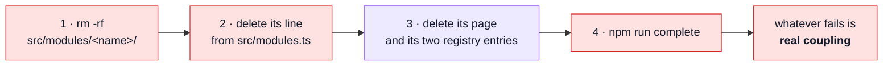
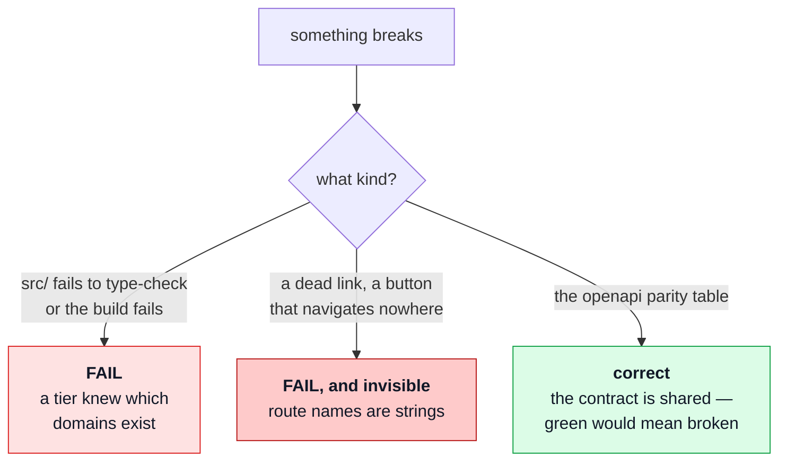

# Removing a module

Part of [Adding & removing a module](./module-lifecycle.md): deleting a module and proving it left nothing behind.

## Removing a module



```bash
rm -rf src/modules/<name>
# delete the import and the array entry in src/modules.ts
rm docs/modules/<name>.md
# and any sub-pages it had, e.g. docs/modules/<name>-<flow>.md
npm run complete
```

Then drop its row from the pairing table in `docs/modules/start.md`, and its sidebar entries from
`docs/.vitepress/config.mts`. The pages and the sidebar are yours to check, since nothing generates them.

Deleting a module a sibling still imports fails `npm run build` at the unresolved `@/modules/<name>`
specifier, with the importing file and line named — not a blank page on whichever navigation first
crosses the gap. Drop the deleted name from the other modules' `dependsOn` too, so the coupling
rule stops naming a sibling that no longer exists. The deleted module's own `module.yaml` goes with its folder.

### Read the failures — they are not all equal



### A route name is a string — the one gate nothing else catches

This is the failure class worth remembering, because **neither the compiler, `vue-tsc`, nor lint can
see it.** Three places in the app shell address a module's route by name:

| File                                   | Names                       |
| -------------------------------------- | --------------------------- |
| `src/app/views/Home.vue`               | `ProductsList`              |
| `src/app/components/AppNavigation.vue` | `Signup`, the sign-in route |
| `src/app/router/navigation.ts`         | the sign-in route           |

Each rendered a control that navigated nowhere once its module was deleted — and a 401 with no
sign-in route aborted the navigation and stranded the visitor on a blank screen. All of them now ask
`router.hasRoute()` first.

**If you add a reference to a route by name from outside the module that declares it, guard it with
`hasRoute()`.** That is the rule; there is no type that enforces it.

### The contract is not ours alone

`openapi.yaml` is shared **byte-identically** with the paired backend. Deleting a domain here does
not delete it from the contract, so `response-schema-map.spec.ts` reports the orphaned operations:

```
expected [ 'GET /products', …(25) ] to deeply equal []
```

**That is the parity gate working, and a green suite would mean it had stopped checking.** Trimming
the contract is a two-repo change driven from the backend, which owns the fragments the document is
assembled from — not a frontend chore.

### What it actually cost

Deleting `products`, `cart`, `orders` **and `account`** together — four folders, five lines, and
`account` is the hard one because the app shell shows who is signed in:

|                    |                                                                                                                                                                                                          |
| ------------------ | -------------------------------------------------------------------------------------------------------------------------------------------------------------------------------------------------------- |
| `src/` type-checks | **no** — 12 errors: 4 in the shell (`AppVerificationBanner.vue`, `ReauthDialog.vue` importing `account`'s stores directly), the rest in `inventory` (reaches `products`) and `wishlist` (reaches `cart`) |
| production build   | **fails** — `vite build` cannot resolve `InventoryLedger.vue`'s static import of `@/modules/products`, on top of the type errors above                                                                   |
| app-shell breakage | **none** — no menu entry, no sign-in button, no dead link                                                                                                                                                |
| unit specs failing | the openapi parity table, `response-schema-map.spec.ts`                                                                                                                                                  |

None of this is fixable inside this repo alone: the type errors and the failed build are real
coupling the deletion makes visible — `inventory` and `wishlist` import `products`/`cart` directly
rather than through an event, unlike the pairs this page elsewhere holds up as the pattern to
copy — and the shared contract is a gate that isn't this repo's to satisfy alone.

---

## Re-running the deletability check

Worth running deliberately after any significant change — not to prove it stays clean, but because
a deletion is exactly the moment a module's real coupling — not its declared one — shows up, and it catches breakage `lint` and a fully green suite both miss.

Run it on a throwaway copy so nothing in the repo is touched:

```bash
SB=$(mktemp -d)                                   # outside the repo
rsync -a --exclude node_modules --exclude .git ./ "$SB"/
cp -al node_modules "$SB"/node_modules            # same filesystem, or copy it
cd "$SB"

rm -rf src/modules/{products,cart,orders,account}
# drop the imports + array entries from src/modules.ts

npm run build                                     # THE assertion: does type-check and build both pass, or name real coupling
npm run lint
npm run test:unit                                 # expect the parity table red, nothing else
npm run test:e2e                                  # the app shell — what the build cannot see
```

The e2e run is where a deletion could leave debris. A domain's own specs go with the folder,
so what stays red is only the cross-cutting suite — and that is the point of running it: `journey`,
`storefront` and `commerce` walk arcs that pass THROUGH the deleted domain, and their failure is
the honest report that the arc is gone.

Include `account` and at least one depended-upon domain. Deleting a leaf proves very little; the set
above is interesting because `cart → orders`, `cart → products` are declared edges and `account` is
the one the shell reads on every page.

### Why this is a procedure and not a test

Nothing in the suite runs the deletion, and that is deliberate — the interesting failures are the
ones a sweep cannot express:

- **A route addressed by name from outside its module.** A string, in a `.vue` file, that resolves
  at runtime. `hasRoute()` is the discipline; the e2e suite is the net. This is the one that
  actually bit, and no gate but a real deletion has ever found it.
- **A count calibrated to the current build.** `expect(x.length).toBeGreaterThanOrEqual(7)` is a
  copy of `src/modules.ts` written as an integer, in a file that names no domain and therefore reads
  as domain-free. Assert the sweep is consistent with the disk instead, with a floor of `≥ 1`.
- **A mechanism test using a domain as sample data.** Every such import goes through a legitimate
  public surface, so no import rule can tell it from a correct one. What makes it fragile is the
  _reason_ for the import. The rule that fixed this class is a review rule, not a test:

    > A spec outside a module may **iterate** the registry. It may never **name** a domain.

    So the mechanism tests use invented domains (`public-domain`, `staff-domain`, `/widgets`) and
    invented schemas, and the per-domain facts live in `src/modules/<name>/tests/`.

What the suite does cover is the neighbouring ground: `registry.spec.ts` sweeps every enabled module
for the invariants — every navigation entry points at a route that module declares, every module
ships the same set of locales — without ever naming a domain. Two DAG-shaped checks run alongside
it rather than inside it, both at every `npm run lint`, not only in a test run: `collectModuleRoutes`
(`kernel/registry.ts`) refuses two routes sharing a name or a normalised path, at any depth; a
top-level check in `eslint.config.ts` refuses a cycle in the `dependsOn` graph itself. That is not a substitute for actually deleting a folder.

## Read next

- [Adding & removing a module](./module-lifecycle.md)
