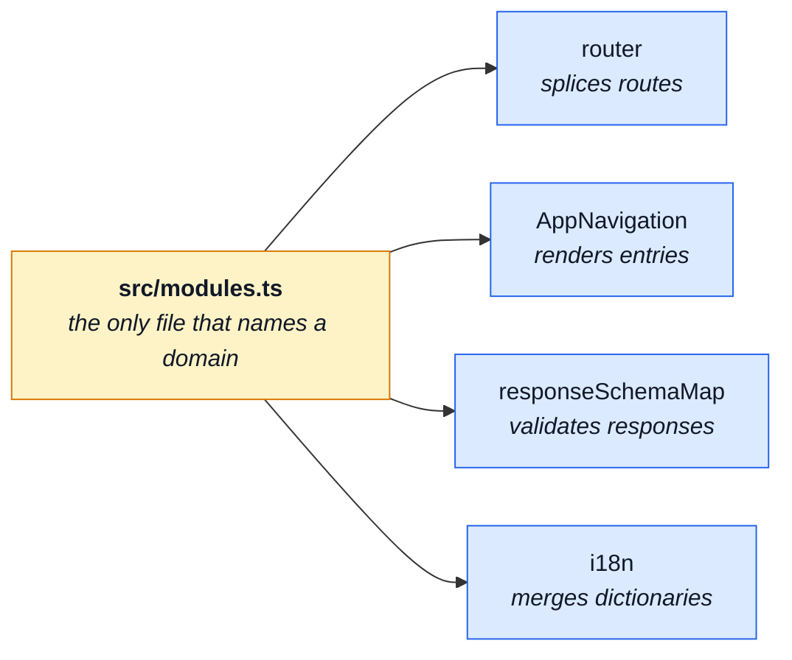
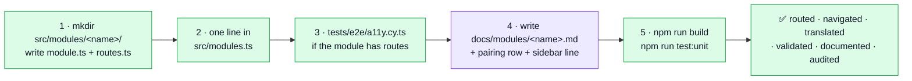

# Adding & removing a module

The procedure, in order, with the commands. [Modules](../understand/modules.md) is the reasoning behind the
shape; this page is what you actually type.

Both halves are the same claim read in two directions:

> A domain is one folder plus one registry line. Adding it costs a folder and a line; removing it
> costs `rm -rf` and a line. Anything else that breaks is **real coupling**, and seeing it is the
> point.

That claim is measured, not asserted — a scaffold module was added under it and four domains were
deleted under it. What each one actually cost is recorded below, including the parts that are not
one line.

## Two registries — one for the code, one for the docs



Every one of those four reads the registry and never names an entry, so none of them appears in
either checklist. **`src/modules.ts` is the whole runtime registry on this side** — unlike the
backend, which also owns the contract fragments and their section lists. Here the contract is
_consumed_:
`openapi.yaml` arrives from the paired backend, and `contracts/rest.generated/schemas.zod.ts` and `api/` are
generated from it.

That asymmetry is the single most important thing to know before deleting anything — see
[the contract is not ours alone](./module-lifecycle-removing.md#the-contract-is-not-ours-alone).

The second registry is not runtime: the table in
[`docs/modules/start.md`](../modules/start.md#the-two-repositories) names the **backend** module
each domain here answers. It is prose, kept in step by review.

---

## Adding a module



### 1 · The folder

At minimum a `module.ts` and a `routes.ts`. Everything else is the domain's own business — add a
file when the domain needs it, not because the table has a row for it.

```
src/modules/<name>/
    module.ts                  the manifest — the only file src/modules.ts imports
    routes.ts                  the domain's route records
    views/*.vue                the pages those routes render
    store.ts                   Pinia state, if it has any
    index.ts                   the barrel: everything a sibling may import
    domain/                    pure business rules — lint-guaranteed framework-free
    response-schemas.ts         the response schemas for the endpoints it calls
    locales/{en,it}.json       its dictionaries
    tests/*.spec.ts            unit specs — co-located, deleted with the module
    tests/e2e/*.cy.ts          Cypress specs for THIS domain only — likewise
    tests/e2e/a11y.cy.ts       MANDATORY once routes.ts exists — see step 4
```

A domain's e2e specs live inside it for the same reason its unit specs do. A spec that walks one
domain's screens is that domain's; left under `tests/e2e/specs/` it survives the `rm -rf` as an
orphan addressing routes that no longer exist, and nothing in the build can see that it has. Specs
that belong to no single domain — the shell, the locale layer, the a11y sweep, the arcs that cross
four modules — stay central, where a failure after a deletion is correct signal rather than debris.
A central spec that needs a module says so on a `// requires-module:` line, and `demo:remove`
deletes it with that module — see [Journeys](../reference/tests-e2e.md#journeys-—-stories-that-cross-modules).

Nothing needs rescoping to add one: `src/modules/<name>/tests/` is already outside
`tsconfig.app.json`, the Vitest `include` and the Stryker `mutate` list.
`tsconfig.cypress.json` claims the `e2e/` folder (so the specs get Cypress' ambient types rather
than the app's), `tsconfig.vitest.json` excludes it, and both `cypress.config.ts` and
`scripts/e2e/run-shards.ts` discover the two homes by glob rather than by list.

`example` is the template to copy ([The module template](../understand/modules.md#the-module-template)); `cart`
is the next read — it has one of everything, including the `domain/` folder that nothing may import a
framework into.

### 2 · The manifest

A module is a **value, not a convention**. Everything the application does for a domain is declared
in one typed object:

```ts
// src/modules/<name>/module.ts
import { Puzzle } from 'lucide-vue-next';
import type { AppModule } from '@/kernel/registry';
import routes from './routes';
import { widgetsResponseSchemas } from './response-schemas';

/**
 * Widgets: a supporting subdomain, specific to this business but not a differentiator.
 *
 * Reaches into `products` — a `conformist` read of `useProductLines` as it is, to name the
 * product a widget belongs to.
 */
export default {
    name: 'widgets',
    routes,
    navigation: [
        {
            name: 'WidgetsList',
            label: 'navigation.label-widgets',
            plural: 2,
            order: 40,
            icon: Puzzle
        }
    ],
    responseSchemas: widgetsResponseSchemas,
    locales: {
        en: () => import('./locales/en.json').then(({ default: dictionary }) => dictionary),
        it: () => import('./locales/it.json').then(({ default: dictionary }) => dictionary)
    }
} satisfies AppModule;
```

Three fields need care:

| Field               | Rule                                                                     |
| ------------------- | ------------------------------------------------------------------------ |
| `name`              | must match the folder name under `src/modules/`                          |
| `navigation[].name` | must be a route **this module declares** — swept by `registry.spec.ts`   |
| `navigation[].icon` | required, not optional — every surface an entry renders on leads with it |

Two more things need care that are not fields at all:

- **which subdomain the module sits in, and what kind of relationship each import to a sibling is** —
  write the subdomain in the docblock above the manifest, the way the `widgets` example above does,
  and each edge's kind in the overview's "The whole map" (`docs/modules/start.md`). Nothing reads either at runtime,
  so neither is a typed field — see [Strategic DDD](../understand/strategic-ddd.md) §2 and §4 for why.
- **which siblings the module may import at all** — list the sibling(s) under `dependsOn` in the module's
  `module.yaml` the moment it reaches one, next to its `group`. This is the part that
  stays enforced, on `module.yaml` rather than the manifest: an import to a sibling not in that list fails
  `npm run lint` at the offending line.

The temptation is to fill the docblock in later. Do not — the questions are easiest to answer while
you still remember why you drew the boundary.

### 3 · The line

```ts
// src/modules.ts
import widgets from '@/modules/widgets/module';

export const enabledModules: AppModule[] = [account, apiKeys, cart /* … */, widgets];
```

Keep the array alphabetical. Order only decides the sequence route records are spliced in, which
vue-router's own ranking makes irrelevant for distinct paths.

### 4 · The a11y sweep

Skip this step only when the module has no `routes.ts` at all (`delivery`, `notifications` and
`shop-tasks` are the examples — each is reached through another module's page or the app bar,
or has no screen at all).

Otherwise write `tests/e2e/a11y.cy.ts`: an axe run that visits every `path` the module's `routes.ts`
declares, at whatever authentication level that route needs. `tests/cross-cutting/a11y-coverage.spec.ts`
reads both files and fails on any route its sweep does not reach — a routed page with no sweep
cannot merge, and a sweep that outlives its module's routes cannot either. `tasks` is a short
reference: one public route, one `auth` route, one file.

### 5 · The page

Write `docs/modules/<name>.md`. Copy the section order from a page of a domain the same size —
**At a glance**, **Its neighbourhood**, **The story**, **State**, **Screens**, **Wiring**, **Files**,
**Working on it**, **Related pages** — and fill it from the manifest, the route records, the store
and the response-schema rows. Every block is hand-written — nothing generates any part of this page
from the code. The two sections worth the most care are the ones only you can write:

- the **At a glance** box — what it owns, what it depends on, what breaks if you change it
- **The story** — why the domain exists, the decisions that are not obvious from the code, the traps

Then add a row to the pairing table in `docs/modules/start.md`, and the page to the `/modules/`
sidebar in `docs/.vitepress/config.mts`.

### 6 · Check

```bash
npm run build          # vue-tsc + vite build
npm run test:unit
```

Every module has an `index.ts` barrel exporting everything it offers a sibling: its stores,
composables, components and `domain/` rules. Unused exports are allowed on purpose.

::: warning A spec that touches http or i18n must wire the modules itself
`infrastructure` may not import `@/modules`, so `main.ts` hands the response schemas and the locale
contributors _down_ at module scope. A test that exercises either subsystem without doing the same
wiring silently measures an app with no domain vocabulary and no contract validation.
`tests/support/unit/wire-modules.ts` exists for exactly that.
:::

### What it actually cost

A scaffold `events` module, measured:

|                                                  |                                                                                                                                                             |
| ------------------------------------------------ | ----------------------------------------------------------------------------------------------------------------------------------------------------------- |
| files added                                      | 8 — `module.ts`, `routes.ts`, one view, `locales/{en,it}.json`, `tests/routes.spec.ts`, `tests/e2e/a11y.cy.ts`, its `docs/modules/` page                    |
| lines, across those 8 files                      | ~196                                                                                                                                                        |
| existing files needing an edit to accommodate it | **3** — `src/modules.ts` (the import and the array entry), the pairing table in `docs/modules/start.md`, the sidebar config in `docs/.vitepress/config.mts` |
| documentation written by hand                    | the whole page — every block, per step 5 above                                                                                                              |
| result                                           | type-check, lint and the unit suite green; the view built into its own lazy chunk                                                                           |

---

## Related pages

- [Removing a module](./module-lifecycle-removing.md)
- [Modules overview](../modules/start.md) — the domain pages this procedure adds to and removes from

- [Modules](../understand/modules.md) — why the shape is what it is
- [Layers](../understand/layers.md) — the folder map
- [Unit testing](./unit-testing.md) — where a spec lives, and why
- [The demo profile](./demo-profile.md) — why the handlers live under `src/`
