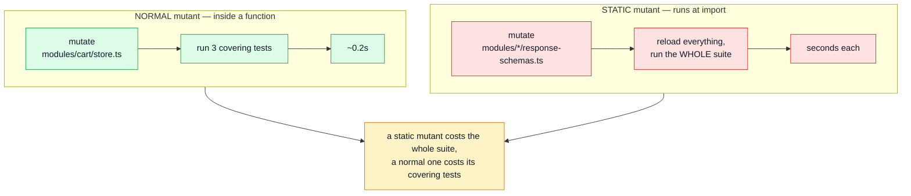
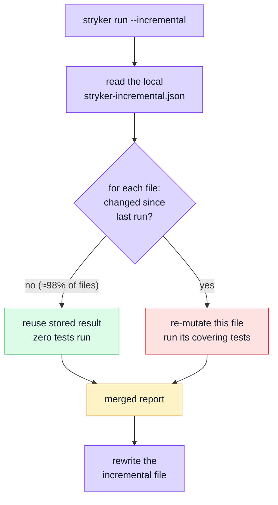

# Mutation testing: why a run is slow

Part of [Mutation Testing](./mutation-testing.md): static mutants, incremental mode and why this repo cannot hit the OOM loop.

## Why this repo does not hit the backend's OOM loop

The paired backend has a failure mode where a mutation run never finishes — workers grow until Node
kills them, restart having completed nothing, and the ETA climbs instead of falling. It is worth
knowing here for one reason: **this repo is immune by construction, not by luck, and the
property that makes it immune is easy to give away.**

The backend transforms TypeScript with **ts-jest**, which does two jobs — translate, and type-check.
Type-checking needs a TypeScript `LanguageService`, which caches a program in memory. Stryker calls
the runner repeatedly inside one process, every mutant gives a file new contents, and the cache
grows with each one.

Vitest transforms with **esbuild**, which only translates. It type-checks nothing, so it caches
nothing, and a mutant is just another file to strip types from. `vitest.config.ts` sets no
`typecheck` option, so there is nothing to switch off. Types are checked once, by `vue-tsc` inside
`npm run build`, which is where a type error is a build failure rather than a mutant.

**What would give it away:** enabling vitest's `typecheck` option, or introducing a transform plugin
that holds a cross-file program. If either ever lands, this page's claim stops being true, and the
symptom to look for is the one the backend documents — read `ELAPSED` on the worker processes, and
if the parent has been up for hours while its children are minutes old, they are being restarted.

The other half of that story is disk: the backend's runner starts an in-memory MongoDB per suite, so
a killed worker strands a data directory. Nothing here starts a server, so a killed run costs a
sandbox and nothing else — which is why `.stryker-tmp/` is absent between runs here and was 88 GB
there.

## Why a run is slow — static mutants

This is the thing worth understanding, because it explains an otherwise baffling number.

`coverageAnalysis: perTest` means Stryker normally runs only the handful of tests that touch the mutated line. But some mutants are **static** — they live in code that executes when the module is _imported_ rather than when a test calls it:

```ts
export const userSchema = new Schema({ ... });        // runs at import
export const userRepository = createBaseRepository(); // runs at import
```

Stryker cannot swap those in and out per test. It has to reload the whole environment — and so, from its planner:

```js
else {  // static, and ignoreStatic is off
    return this.createMutantRunPlan(mutant, {
        netTime: this.timeSpentAllTests,
        testFilter: this.globalTestFilter,   // ← every test in the suite
    });
}
```

Visually, the difference:



**One static mutant runs the entire suite.** The static share is worth measuring rather than guessing, and the JSON reporter is what measures it: it labels each mutant `static`, so counting them per file names the handful that dominate a run's wall clock. Expect the concentration to sit in module-scope declarations — the response-schema lookup tables, the router's route array, each module's zod schemas.

No run has measured the current `mutate` scope yet, so there are no per-file numbers here to read. The first full run is what fills this in.

It also inflates timeouts, because the timeout is derived from how long the tests are expected to take:

```
timeout = timeoutFactor × netTime + timeoutMS + overhead
```

with `timeoutMS` at 20000 in `stryker.config.json`. For a static mutant `netTime` is the whole suite, so its timeout is far longer than a normal mutant's. Declarative module-scope code — lookup tables, zod schemas, route arrays — is idiomatic here, so the static surface is large by design.

### What can be done about it — an open question

| Option                                   | Effect                                                            | Status                                                            |
| ---------------------------------------- | ----------------------------------------------------------------- | ----------------------------------------------------------------- |
| Raise `concurrency`                      | Near-linear speed-up, **changes no measurement**                  | **Done** — 8 locally, 3 in CI                                     |
| `incremental: true`                      | A local re-run re-mutates only changed files                      | **Enabled** — a PR run that would consume it does not exist       |
| Split the nightly into one job per layer | Wall-clock becomes the slowest group, not the sum                 | Not done; probably unnecessary if the cost is fixed at the source |
| `ignoreStatic: true`                     | Removes the whole-suite reruns — but stops measuring some mutants | **Not enabled. Deliberately undecided — see below.**              |
| Move logic out of module scope           | The only fix that costs nothing in measurement                    | Invasive; module-scope schemas are idiomatic Mongoose             |

`ignoreStatic` is a real, documented Stryker option, and Stryker's own description of it says "it might make sense to ignore static mutants". But **its default is `false`**, and that default is a judgement by the people who wrote the tool: measuring those mutants is the safer behaviour.

Two things argue for caution before switching it on here:

1. **It is a trade-off, not a fix.** It buys speed by not measuring some code. Most static mutants also have per-test coverage and would still be scored, so the number actually dropped is usually small — but it is never zero, and those mutants should be enumerated from a real report before they are silenced.
2. **Soundness.** With `ignoreStatic` on, a static-but-covered mutant is activated at _runtime_ rather than at module load (`mutantActivation: 'runtime'` in the planner). A mutant whose only effect happens during import may then never actually trigger, and be reported as survived when it was never really tested. That is a quieter failure than a slow run.

The honest position: it is standard and supported, it is probably the right call eventually, and it should be decided from a measurement of _this_ repo — one run with the JSON reporter enumerating exactly which mutants would stop being measured, recorded in the config — rather than from someone else's numbers.

## Incremental mode — what it is

**Enabled**, for local runs. A pull-request run that would consume the cache does not exist; the nightly ignores it.

**The problem.** Every run starts from scratch. Change one line in one store, and Stryker still re-mutates every mutant across the whole codebase — including all the ones in files you did not touch, whose results will be identical to last time.

**The mechanism.** With `incremental: true`, Stryker writes every mutant's result to `reports/stryker-incremental.json` and **does not commit it**: `reports/*` is gitignored, because the file is a cache and nothing automated reads it. On the next run it is reused from your own disk, and it compares the new source against what the file remembers:

- file unchanged → reuse the stored result, run nothing
- file changed → re-mutate it properly
- a _test_ changed → re-run the mutants that test covers, because the answer may now be different



**What it changes in practice.** A pull request touching one store goes from every mutant in the repo to a few dozen — seconds instead of the full run. That is what turns mutation testing from "a nightly you read the next morning" into "a check on your PR".

**The catch, and why the nightly still runs in full.** The incremental file is a cache, and caches go stale — a refactor that moves code between files, a dependency upgrade, or a merge conflict resolved badly can leave it describing a codebase that no longer exists. So the intended shape is two runs with different jobs:

| Run     | Trigger | Setting             | Purpose                                    |
| ------- | ------- | ------------------- | ------------------------------------------ |
| Local   | by hand | `incremental: true` | Fast feedback on what you actually changed |
| Nightly | cron    | `force: true`       | Full run; refreshes the file from scratch  |

`force: true` tells Stryker to ignore the stored results entirely, which is what stops staleness accumulating.

## Read next

- [Mutation Testing](./mutation-testing.md)
