# OpenAPI Workflow

How the HTTP contract reaches this repo, what is generated from it and how to change it.

## The backend owns the contract

`openapi.yaml` and `asyncapi.yaml` are **owned by the backend**, which builds them from per-module
fragments. This repo never edits them: they arrive here through the backend's `npm run
sync:frontend`, and everything else in `contracts/` is generated from them.

```mermaid
%%{init: {'flowchart': {'nodeSpacing': 50, 'rankSpacing': 65}}}%%
flowchart LR
    Idea[Need a new endpoint\nor payload change] --> Spec[Edit the module's contract\nin the backend]
    Spec --> Regen[Backend: npm run regenerate]
    Regen --> Sync[Backend: npm run sync:frontend]
    Sync --> Generate[Here: npm run regenerate]
    Generate --> Update[Update stores / views\nif signatures changed]
    Update --> Test[npm run test]

    classDef change fill:#dbeafe,stroke:#2563eb,color:#111827;
    classDef contract fill:#dcfce7,stroke:#16a34a,color:#111827;
    classDef tooling fill:#fef3c7,stroke:#d97706,color:#111827;
    classDef app fill:#ede9fe,stroke:#7c3aed,color:#111827;
    class Idea change;
    class Spec,Regen,Sync contract;
    class Generate tooling;
    class Update,Test app;
```



If the contract changes, always start with the contract, in the backend.

## Keeping the two copies in sync

The two repos stay independently clonable, so each carries its own copy of the contract. What
keeps the copies identical is `npm run check`: it compares this repo's `openapi.yaml`
and `asyncapi.yaml` with the backend's `boilerplate-node-backend/openapi.yaml` and `boilerplate-node-backend/asyncapi.public.yaml` (the async contract
minus the internal queues no API client can reach), skips when the backend is not on disk, and is
fatal under CI (the `check` job, which runs `npm run check`).

**Whenever the backend's spec changes**, the backend copies both files over with `npm run
sync:frontend`; here you regenerate and read the diff:

```bash
npm run regenerate     # gen:api + gen:asyncapi + gen:permission-vocabulary + gen:shared-rules
npm run check
```

Reading the diff is the human step: a spec change may require store or view updates. To confirm parity by hand,
`diff openapi.yaml ../boilerplate-node-backend/openapi.yaml` should print nothing.

CI catches a copy that has fallen behind the backend (`spec-identity`). The generated code cannot
drift from the spec: every install rebuilds it.

## The generated code is not committed

`contracts/rest.generated/` and the other generated files are gitignored, so there is no freshness check to
run and nothing to commit after a spec change. `npm install` and `npm ci` run `postinstall`, which
is `npm run regenerate`; the container images run it once after `COPY . .`
(`npm ci --ignore-scripts` skips `postinstall`).

- **After a pull that changed `openapi.yaml`, `asyncapi.yaml` or `shared/rules/`:** run `npm install`
  (or `npm run regenerate`). A stale `contracts/rest.generated/` makes `vue-tsc` fail, not the app misbehave.
- **The pre-commit hook** regenerates when `openapi.yaml` or `asyncapi.yaml` is staged, so the
  type-check and unit run on the new contract. The regenerate step stages nothing; lint-staged stages its
  own lint and formatting fixes to the files you staged.
- **What `npm run check` still guards:** `openapi.yaml` and `asyncapi.yaml` are the backend's bytes
  (`spec-identity`), and the committed shared-rules JSON Schemas are what the generator writes.

## OpenAPI vs AsyncAPI in this repository

- Use **OpenAPI** for REST endpoint contracts (`openapi.yaml`).
- Use **AsyncAPI** for SSE/event-driven contracts (`asyncapi.yaml`).

## Tools around the contract

| Tool                                                        | Job                                                              |
| ----------------------------------------------------------- | ---------------------------------------------------------------- |
| [`openapi.yaml`](https://spec.openapis.org/oas/latest.html) | single contract file (OpenAPI 3.x)                               |
| [orval](https://orval.dev)                                  | generate `contracts/rest.generated/` — axios client, Zod schemas |

## Generated output (`contracts/rest.generated/`)

Running `npm run gen:api` regenerates the entire `contracts/rest.generated/` directory. It is gitignored and rebuilt on `npm install`. **Never edit files inside `contracts/rest.generated/` manually** — they are overwritten.

```
contracts/rest.generated/
├── index.ts          ← typed axios functions (one per operation)
└── schemas.zod.ts    ← Zod schemas for every request/response shape
```

## Importing generated types and functions

```ts
// Axios functions + TS types — always via @api alias
import { listProducts, createProduct } from '@api';
import type { Product, CreateProductRequest } from '@api';

// Zod schemas — always via @api/schemas alias
import { CreateProductBody, ListProductsResponse } from '@api/schemas';
```

Never import from the file path directly (`../../contracts/rest.generated/index.ts`) — always use the alias.

## Enum const objects

Orval generates enums as `as const` objects (not TypeScript `enum` declarations). Use them with `z.nativeEnum()` or for runtime checks:

```ts
import { ReauthPasswordRequestMethod } from '@api';

const schema = z.nativeEnum(ReauthPasswordRequestMethod);
```

Naming convention: schema name + property name, PascalCase. Example: `ReauthPasswordRequest.method` → `ReauthPasswordRequestMethod`. An enum named in the contract (`OutsideMoneyMethod`) keeps its own name wherever it is used.

## Orval configuration

`orval.config.ts` at the project root controls code generation. It defines **two independent output blocks**, each reading the same spec:

| Block        | Target                                      | Effect                                               |
| ------------ | ------------------------------------------- | ---------------------------------------------------- |
| `api`        | `./contracts/rest.generated/index.ts`       | typed axios functions, routed through `orvalMutator` |
| `zodSchemas` | `./contracts/rest.generated/schemas.zod.ts` | Zod schema per request/response shape                |

### Multipart operations generate two functions

Eight operations accept the same payload as either JSON or `multipart/form-data` — everything
with an optional image: replace/update the account, create and replace/update a user, create and
replace/update a product. Orval only emits
`FormData` encoding for operations with a **single** request content type; given two, it passes
the body straight to the mutator and generates no encoding at all.

`splitByContentType` therefore generates one function per content type, and an inline
`transformer` in `orval.config.ts` names them:

| Call                               | Sends                                                  |
| ---------------------------------- | ------------------------------------------------------ |
| `createProduct(body)`              | `application/json`                                     |
| `createProductWithMultipart(body)` | `multipart/form-data`, encoded by the generated client |

The JSON function keeps the plain operation name, so JSON call sites are unaffected by the split.
Pick the `WithMultipart` variant only when there is a file to send — see `modules/products/store.ts`,
which branches on `imageUpload` and is the reference for this pattern.

Do not hand-roll `FormData` in a store. The generated encoder already omits unset optional fields
(rather than sending the string `"undefined"`) and writes arrays as repeated fields
(`categories`, not `categories[0]`), which is what the API expects.

### Per-call axios options

`orvalMutator` declares a second `options` parameter, so every generated function takes an
optional third argument forwarded to axios — this is how `ProductEdit.vue` passes
`onUploadProgress` through `updateProduct` without bypassing the generated client:

```ts
updateProductByIdWithMultipart(id, body, { onUploadProgress });
```

`options` cannot override the url, method or body: the codegen-built config is merged last.

Note that generated routes do **not** URL-encode path parameters — `@orval/axios` ignores the
`urlEncodeParameters` option that the fetch and query clients honour. Ids are server-issued, so
this has never mattered in practice; do not add encoding at one call site only, which would make
that call inconsistent with the other two dozen.

## Commands

```bash
npm run gen:api         # regenerate contracts/rest.generated/ from openapi.yaml
```

## Mocks

Orval can emit an MSW stub per operation, and `orval.config.ts` deliberately declares no `mocks` block: the stubs are stateless — no cart persistence, no login, no filtering — so they could never answer a journey spec.

There is no hand-written mock of the new endpoint to update: dev and e2e run against the paired backend's **demo profile** (`npm --prefix ../boilerplate-node-backend run demo`) — the real API against an in-memory, seeded database — so the new endpoint exists the moment the backend implements it. See [The demo profile](./demo-profile.md).

## Useful links

- [OpenAPI 3.1 specification](https://spec.openapis.org/oas/v3.1.0)
- [orval documentation](https://orval.dev/guides/overview)
- [orval configuration reference](https://orval.dev/reference/configuration/overview)

## Related pages

- [AsyncAPI Workflow](./asyncapi-workflow.md)
- [The demo profile](./demo-profile.md)
- [Layers](../understand/layers.md)
- [API overview](./api-contracts.md)
