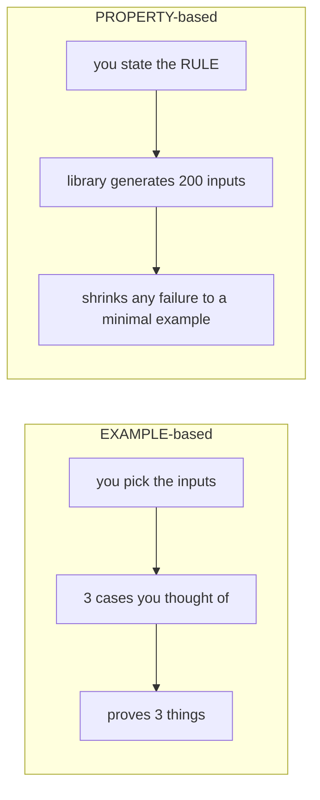

# Property-Based Testing

An ordinary test says _"for this input, expect that output."_ A property says _"for **every** input, this must hold."_ The library generates the inputs, and when it finds one that breaks the rule it shrinks it to the smallest example that still fails.

## The idea

Example tests encode the cases someone thought of. That documents intent and pins a historical bug, but it is bounded by imagination. **Sampling a space you could have generated is the failure mode to watch for.** A 52-row lookup table tested by a handful of sampled rows scored 55% on mutation; exhaustive generation took that file to ~96%.

## What makes a good target

Pure, total, and rich in invariants:

| Target                                   | Invariants worth stating                                                                                                                 |
| ---------------------------------------- | ---------------------------------------------------------------------------------------------------------------------------------------- |
| `src/infrastructure/utils/formatters.ts` | never returns a blank cell, falls back for exactly the inputs carrying no value, idempotent, never throws on an unknown currency or date |
| `src/infrastructure/utils/uploads.ts`    | accepts a type if and only if it is on the shared list, case-sensitive to match the backend, size limit inclusive on both sides          |

A function whose only "invariant" is its exact return value for one input is not a property target — write an example.

This is a short list, and that is the honest shape of it on a client. The functions worth generating against are the pure, total ones — and most of what a frontend does is neither: a component renders, a store talks to the network, a composable owns a lifecycle. Prices, totals and eligibility, which _are_ pure and rich in invariants, are decided in the paired backend (see [Domain layer](../understand/domain-layer.md)), and its own property suite is where they are generated against.

## Two rules, both about determinism

**Seed every run.** `fast-check` defaults to a random seed. That makes a failure irreproducible and, worse, makes a test that fails one run in fifty look like flake — and flake teaches a team to press retry. Every property file here fixes a seed at the top. The generated-payload helper (`tests/support/unit/contract-data.ts`) is the one random source: it takes `RANDOM_DATA_SEED`, or draws a fresh seed and prints it on first use.

**Commit every counterexample.** When generation finds a failure, the property stays as the general rule and the specific input becomes an ordinary example with its seed in a comment. The property states what must be true; the example remembers what once was not.

## The split with example tests

Both kinds live side by side, and each owns what the other cannot say. The headers of the property files name the division explicitly, so nobody re-adds the overlap.

| The example file owns                                                                   | The property file owns                                    |
| --------------------------------------------------------------------------------------- | --------------------------------------------------------- |
| The exact boundary — a file of precisely `MAX_UPLOAD_BYTES`, and one byte over          | Totality over arbitrary input                             |
| The shipped copy of a rendered string, which a property can only say is non-blank       | Generated _combinations_, not one value at a time         |
| Named near-misses like the non-canonical `image/jpg`, where the diagnostic is the point | Algebraic laws: idempotence, non-mutation, biconditionals |

A fact asserted twice is a fact maintained twice — and it costs more than it looks in this repo, because a static mutant replays the entire suite (see [Mutation Testing](./mutation-testing.md)).

## Running budget

`numRuns` is deliberately modest. These execute on the pre-commit path, which is already the slower of the two repos' gates, and a property that needs ten thousand cases to find its bug belongs in a nightly, not a commit hook. Raise it while hunting something specific, not as a default.

The count is one knob, `TEST_PROPERTY_RUNS` (default 200, floor 10), set in `.env` or the shell (the shell wins) and read by `vitest.config.ts`, which hands it to the workers. `setup.ts` passes it to `fc.configureGlobal`, so a property file does not pin its own `numRuns`. `RANDOM_DATA_SEED` does the same for the seed of anything that pins none. The backend has the same knob by the same name (`knobs.ts` in its test support folder); this one is a fork, not kept in step.

## File map

| Path                                                          | Contents                                                                     |
| ------------------------------------------------------------- | ---------------------------------------------------------------------------- |
| `tests/unit/infrastructure/utils/formatters.property.spec.ts` | Every property in this repo — the formatters and the two upload predicates   |
| `tests/unit/infrastructure/utils/formatters.spec.ts`          | The example-based half: exact rendered strings, the shipped copy             |
| `tests/unit/infrastructure/utils/uploads.spec.ts`             | The example-based half: the exact size boundary, the non-canonical mime type |
| `src/modules/users/tests/schemas.property.spec.ts`            | The user form against the contract's `CreateUserBody`, by generated payloads |

One property file, covering two modules. It is listed as a table anyway because the split with the example files beside it is the part worth navigating, not the count.

The same technique and the same two rules apply in the paired backend, over its order totals, its serializer and its search escaping — a larger surface, because that is where the pure domain functions live.

## Related pages

- [Unit Testing](./unit-testing.md) — the example-based layer these sit beside
- [Component Testing](./component-testing.md) — the other half of the unit suite
- [Mutation Testing](./mutation-testing.md) — how you find out whether either kind actually asserts anything
- [Testing & Docs](./testing-and-docs.md) — the map
