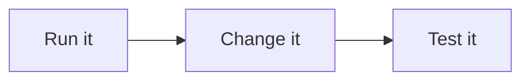

# Build

Run the app, change a contract, add a module, test it. The pages here are the ones you open with a
terminal beside them.

| You want to                    | Start at                                            |
| ------------------------------ | --------------------------------------------------- |
| See the app running            | [Getting Started](./run-locally.md)                 |
| Run it against a real backend  | [The demo profile](./demo-profile.md)               |
| Add or remove a domain         | [Adding & removing a module](./module-lifecycle.md) |
| Change an endpoint or an event | [API](./api-contracts.md)                           |
| Know which test to write       | [Testing — Quick Start](./testing-quickstart.md)    |

## Run it

- [Getting Started](./run-locally.md)
- [The demo profile](./demo-profile.md)
- [Docker & Podman](./docker-and-podman.md)

## Change it

- [Adding & removing a module](./module-lifecycle.md)
- [API](./api-contracts.md)
- [OpenAPI Workflow](./openapi-workflow.md)
- [AsyncAPI Workflow](./asyncapi-workflow.md)

## Test it

- [Testing & Docs](./testing-and-docs.md) and [Quick Start](./testing-quickstart.md)
- [Unit](./unit-testing.md), [component](./component-testing.md) and [property](./property-testing.md) tests
- [Live E2E](./live-e2e.md), [Lighthouse](./lighthouse.md) and [Mutation Testing](./mutation-testing.md)
- Interface checks: [accessibility](./accessibility-testing.md), [layout](./layout-sweep.md), [touch](./touch-testing.md), [design lint](./design-lint.md), [visual regression](./visual-regression.md)
- Review with an AI: [AI Auditing](./ai-auditing.md), [Design Review](./design-review.md)
