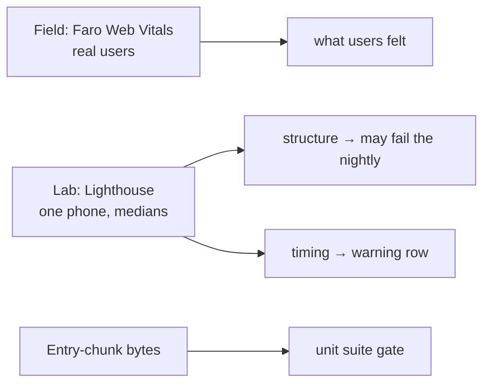

# Testing: timings, gates and what is not done

Part of [Testing & Docs](./testing-and-docs.md): how long each layer takes, what may gate, and what is deliberately left out.

## Test timings

Measured 2026-08-14 on a 16-core / 30 GB machine. They are here so a number that doubles is visible
as a regression rather than as "tests feel slow lately" — treat them as an order of magnitude, not a
promise.

| Command                   | Time       | What it runs                                                           |
| ------------------------- | ---------- | ---------------------------------------------------------------------- |
| `npm run test:unit`       | **~8s**    | 70 files, 1043 tests, jsdom                                            |
| `npm run test:e2e`        | **~3m30s** | 17 specs, 136 tests, sharded across `E2E_SHARDS` Cypress processes     |
| `npm run complete`        | **~5m**    | the gate: lint + format + contract identity + build + all of the above |
| `npm run test:mutation`   | ~9m        | 2182 mutants, incremental; nightly in CI                               |
| `npm run test:e2e:visual` | ~4m        | pixel diffs — pinned CI image, not the gate                            |
| `npm run test:e2e:live`   | ~13m       | the full suite against a real backend — `complete:manual`, sequential  |

**Cypress is the gate**, and the reason `test:e2e` is sharded. Sequentially those 17 specs take
**12m54s** on one core; `scripts/e2e/run-shards.ts` splits them across processes sharing one preview server.
`npm run test:e2e:serial` keeps the old behaviour for when an interleaved failure is hard to read.

Measured on the 16-core / 30 GB machine, same 17 specs:

| `E2E_SHARDS`          | Wall-clock | Result                  |
| --------------------- | ---------- | ----------------------- |
| 1 (`test:e2e:serial`) | 774s       | green                   |
| **4**                 | **214s**   | **green — the default** |
| 6                     | 158s       | **2 shards failed**     |

**More shards is not simply better.** At six, six Chrome instances took the machine to 1.6 GB free
and two shards failed on commands exceeding a 15-second timeout — a budget already four times
Cypress's default, so that is starvation rather than a tight setting. Four leaves headroom and the
box stays usable while it runs. Raise it only with the memory measured, not the core count.

Two further limits:

- **Wall-clock cannot go below the longest single spec** — `uploads.cy.ts` at ~86s. Even a perfect
  split cannot beat it, which is what caps the return well before the core count does.
- **The live profile is never sharded.** `cy.restore()` re-seeds the paired backend's real
  database there, which every shard would reset out from under the others. The script refuses rather
  than trusting the caller to remember.

## Delivery performance: lab, field, and what may gate

Performance has two halves, and they answer different questions.

- **Field** is what real visitors felt. Faro reports their Web Vitals to your own collector, behind consent. It is the truth and it arrives after shipping.
- **Lab** is one emulated phone, measured the same way every time. [Lighthouse](./lighthouse.md) is the lab half, run nightly over six routes.

What may fail a build follows from how noisy the number is:

| Measurement                                                | Gates?                 | Why                                                                                                      |
| ---------------------------------------------------------- | ---------------------- | -------------------------------------------------------------------------------------------------------- |
| Entry-chunk bytes                                          | yes, in the unit suite | deterministic, cheap, catches the commonest regression (an import pulling a library into the main chunk) |
| Weighted best-practices and SEO audits, no outside request | yes, the nightly       | structure does not depend on data volume or CPU speed                                                    |
| LCP, TBT, Speed Index, score, layout shift                 | no, a warning row      | these move with the machine's load; a hard threshold is a flake that gets disabled                       |

This answers the two reasons performance testing was once rejected here. A threshold measured on fixtures would be inherited by forks as authoritative: timing now **reports and never gates**, so a fork inherits numbers, not a verdict. Timing noise on a shared runner is what gets a job disabled: a median of five runs, a baseline taken in the same pinned image (1.4 × headroom, the backend's load-test rule), and timing demoted to a report.

## Gate or hunter

Worth naming explicitly, because it decides where a suite runs and how a failure is read.

A **gate** answers a yes/no question definitively enough to block a merge. Unit, component, property, the demo e2e profile, the a11y pass and the **live `@smoke` subset** are gates: a failure means "do not merge this".

A **hunter** goes looking for problems nobody asked about. Mutation testing is the hunter: slower, nightly, and a failure is usually a **finding to read** rather than a merge to stop. A hunter wired as a gate gets switched off the first week it is inconvenient — which is why it lives in its own workflow file, where it cannot become a PR gate by accident.

Note that "gate" is about the strength of the answer, not its speed, and the live profile is split by it. The demo profile already runs every journey on every push, so live only has to answer what demo cannot — "does the real infrastructure work" — and a small `@smoke` subset (about 15 minutes) answers that on every push. It still runs _after_ the fast gates, so an ordinary regression is caught in seconds and never reaches it.

The **full** live run is the nightly, and it is a hunter: every test against the real stack, split across CI jobs, asking also whether `main` still agrees with the backend's default branch, which no push can, because the backend moves on its own. A live-only break outside `@smoke` therefore shows up the next morning, not on the push. See [Live E2E — Tiers](./live-e2e.md#tiers).

The corollary: a green pull request is a claim that this frontend and that backend agreed at that moment. It is not a claim that the mutation run is happy.

## Deliberately not done

Recorded rather than dropped silently, because "absent" and "rejected for a reason" look identical in
a codebase. The backend keeps the same list, in its own `docs/build/testing-and-docs.md`, and the
reasoning is shared; what differs is the frontend-specific shape of each.

### Runtime performance testing

**What it is.** The _delivery_ half of performance (bytes, first paint, layout shift) is covered: see
[Delivery performance](#delivery-performance-lab-field-and-what-may-gate). This entry is the other
half, the _runtime_ one: does this list still render in one frame with 500 rows, or did a `computed`
become quadratic? The tool for it is a benchmark harness.

**Why it is not here.** The demo's data volumes are fixtures — a handful of products and orders — so
any threshold measured against them is inherited by forks as authoritative while describing nothing
they will experience. Timing numbers are also a property of the machine, and on a shared CI runner a
render benchmark largely measures the runner; that flakiness is what gets a job disabled.

**What would change it.** A fork with real page weights and a real device profile, and a render path
slow enough that users notice.

### Diff coverage as a separate gate

Coverage is not measured here: the per-file mutation baseline answers "did the tests get weaker",
and an unrun line is a `NoCoverage` mutant. A coverage gate on top buys CI complexity and a second
number to argue about. It becomes the right tool if a large untested area ever lands far below the
baseline, where fixing history is not realistic.

### Type-level tests

Assertions about types rather than values — that a prop signature did not widen to `any`, that a
generic infers correctly. They earn their place when the types **are** the product, as in a published
library. Here the public contract is `openapi.yaml`, and the types over it are _generated_ by orval
rather than hand-written, then checked by the spec-identity check against the backend's copy. Writing
type assertions over generated types mostly tests the generator.

### Incremental mutation mode

Stryker caches per-mutant results and re-tests only what a diff touched. It is enabled locally (`incremental: true` in `stryker.config.json`) and the nightly forces a full run. How it works and why the nightly stays full: [Incremental mode](./mutation-testing-speed.md#incremental-mode-—-what-it-is).

## Read next

- [Testing & Docs](./testing-and-docs.md)
