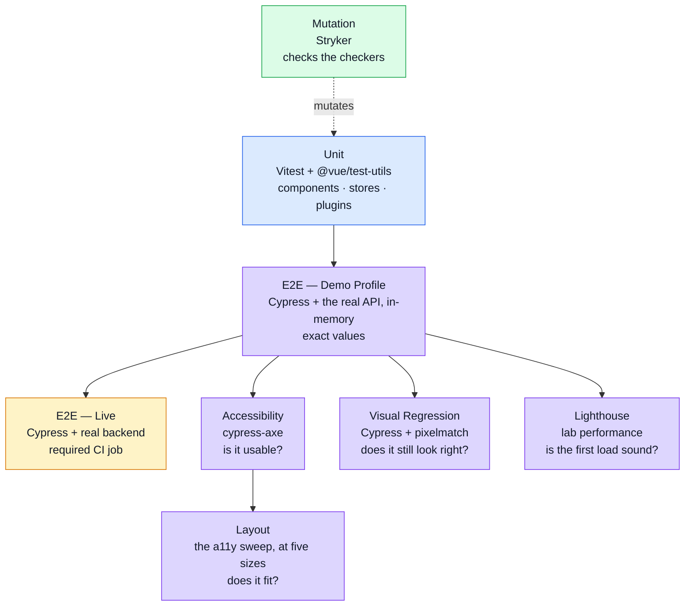
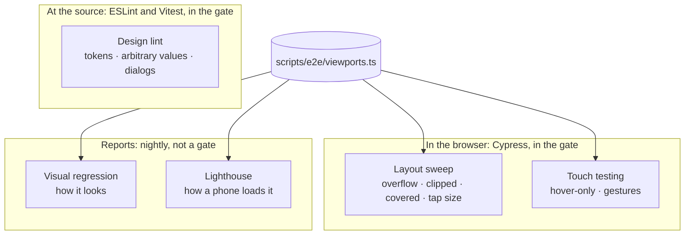
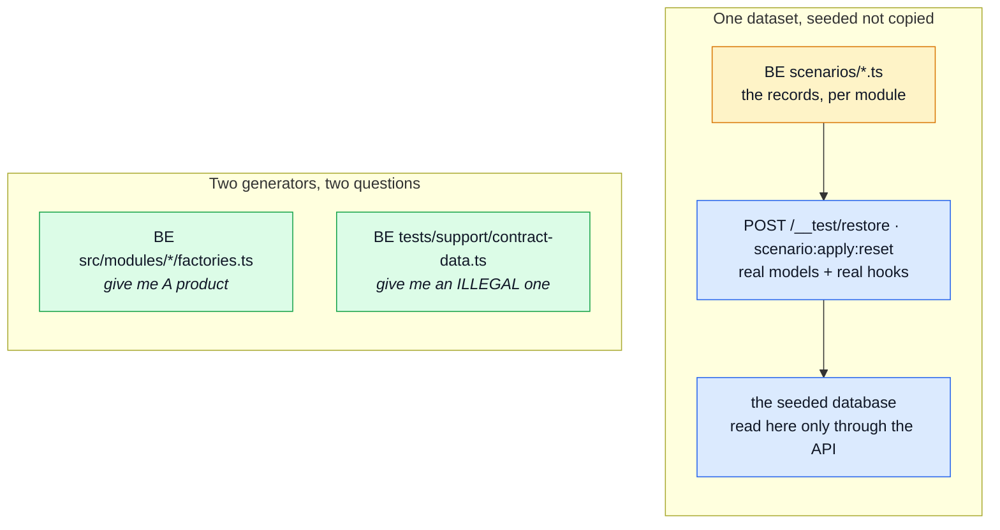
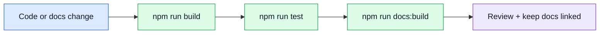

# Testing & Docs

This page is the map. Each layer has its own detail page — code, tools, patterns, file map and a diagram — linked from the table below and from "Related pages" at the bottom of every one of them, so you can start anywhere and always find your way back here.

## The layers, end to end



| Layer              | Question it answers                                                         | Tool(s)                                              | Detail page                                                                                                    |
| ------------------ | --------------------------------------------------------------------------- | ---------------------------------------------------- | -------------------------------------------------------------------------------------------------------------- |
| Unit               | Does this one component/store/plugin behave correctly in isolation?         | Vitest + @vue/test-utils + jsdom                     | [Unit Testing](./unit-testing.md)                                                                              |
| Component          | Does this `.vue` render, emit and **clean up** correctly?                   | @vue/test-utils                                      | [Component Testing](./component-testing.md)                                                                    |
| Property           | Does the rule hold for _every_ input, not just the ones someone thought of? | fast-check                                           | [Property Testing](./property-testing.md)                                                                      |
| Cross-cutting      | Is the repository still the shape it claims to be?                          | Vitest, reading the filesystem                       | [Unit Testing](./unit-testing.md#the-cross-cutting-layer)                                                      |
| Accessibility      | Are there mechanical a11y failures on the routes a user reaches?            | cypress-axe                                          | [Accessibility Testing](./accessibility-testing.md)                                                            |
| Layout             | Does every page fit, and stay usable, at every width?                       | Cypress + the a11y sweep's own checks                | [Layout Sweep](./layout-sweep.md)                                                                              |
| Touch              | Can a finger reach everything a mouse can?                                  | Cypress + CDP touch emulation + cypress-real-events  | [Touch Testing](./touch-testing.md)                                                                            |
| Visual Regression  | Does the page still **look** the way it did?                                | Cypress + pixelmatch                                 | [Visual Regression](./visual-regression.md)                                                                    |
| Lab performance    | Is a phone's first load stable and structurally sound?                      | Lighthouse (Node API) + puppeteer-core               | [Lighthouse](./lighthouse.md)                                                                                  |
| E2E — Demo Profile | Does the app behave correctly against **known** data?                       | Cypress + the real API on an in-memory Mongo, seeded | [The demo profile](./demo-profile.md), [Journeys](../reference/tests.md#journeys-—-stories-that-cross-modules) |
| E2E — Live         | Does the frontend agree with the **actual** backend?                        | Cypress + real API                                   | [Live E2E](./live-e2e.md), [Journeys](../reference/tests.md#journeys-—-stories-that-cross-modules)             |
| Mutation           | Do the tests **notice** when the source is wrong?                           | Stryker + vitest-runner                              | [Mutation Testing](./mutation-testing.md)                                                                      |

The commands are in [Every command, and when to reach for it](./testing-quickstart.md#every-command-and-when-to-reach-for-it).

None of these layers replaces another — each closes a gap the others structurally cannot:

- **Unit** is fast and isolated, but a component that's individually correct can still be wired up wrong, or agree with a fixture that's drifted from reality.
- **Cross-cutting** tests no behaviour at all. It reads the filesystem and the manifests, and it is the only layer that can fail on a file **nobody wrote** — a module with no accessibility sweep, a store the coverage glob cannot see, a form missing the wiring that moves focus. Every one of those is invisible to a suite that can only run the code that exists.
- **Demo profile** runs the whole app against the real API — the paired backend's [demo profile](./demo-profile.md), one in-memory instance per shard — deterministic because the seeds are, so it can assert exact counts and values. The awkward shapes it needs (a soft-deleted product, an inactive one, one whose optional fields are all at their schema defaults) are records in the backend's demo dataset rather than generated: a named record can be asserted on, and it is a shape the real API actually answers with, because the real API is answering.
- **Live** runs the same specs against the fully-composed stack — the real cache, the real broker, a cookie over a real network — everything the demo profile deliberately disables. It needs both repos plus a Mongo and a Redis, so it is minutes rather than seconds; it still gates every PR, after the fast layers have had their say.
- **Mutation** doesn't test the app at all — it tests the _tests_, and only for the layer it's pointed at (unit).

## Design and mobile checks

A screen can pass every test above and still break on a phone, drift off the design tokens, or work
only with a mouse. These checks cover that: automated where a rule can decide, a person where only
judgement can.



| Check             | Question                                                     | Page                                        |
| ----------------- | ------------------------------------------------------------ | ------------------------------------------- |
| Design lint       | Is the style on the design's tokens, with a reason when not? | [Design Lint](./design-lint.md)             |
| Layout sweep      | Does every page fit at every width?                          | [Layout Sweep](./layout-sweep.md)           |
| Touch testing     | Can a finger reach everything a mouse can?                   | [Touch Testing](./touch-testing.md)         |
| Visual regression | Does it still look the way it did?                           | [Visual Regression](./visual-regression.md) |
| Lighthouse        | Is a phone's first load stable and sound?                    | [Lighthouse](./lighthouse.md)               |

## Reading a run

Every layer above answers "did it break". None of them answers **which module owns the break**, or **where the four minutes went** — the suites are organised by layer and the codebase is organised by module, so a raw log can never bridge the two.

`npm run test:report` does. It reads the JSON a run writes (`npm run test:unit:ci`) and rolls it up:

```
[test-report] 1094 tests in 72 suites — 1094 passed, 0 failed (8.6s of suite time)

  module           suites  tests  failed     time
  account               4     47       0     0.2s
  products              4     34       0     0.1s
  (infrastructure)     30    771       0     6.1s

  slowest suites / slowest tests / failures named by module
```

JSON rather than JUnit, and the choice is not incidental: Vitest emits both, Jest emits only JSON without a dependency, and JSON carries strictly more — per-assertion durations, ancestor titles, full failure messages. So the artefact is JSON and `scripts/testing/report-results.ts` is the reader, sharing its core machinery with the backend's own copy because Vitest's `json` reporter emits the shape Jest's `--json` does — though the two have since picked up their own repo-specific differences, and it is not one of the files the spec-identity check compares; keeping it in step is a `diff`, by hand.

If PR-line annotations are ever wanted, that is the moment to add a JUnit reporter _alongside_ this one, not to replace it.

A failing e2e shard additionally writes its whole Cypress output to `reports/e2e/shard-<n>.log`. That exists because stderr is the one copy that can be lost — piped through `tail`, truncated by a log limit — and when it is lost the failure is undiagnosable. It has already earned its keep.

A test that fails and then passes on Cypress' one retry is **flaky, not green**, and is reported as such. Cypress' `after:spec` hook appends each one to `reports/e2e/flaky.jsonl`; `run-shards.ts` (and `scripts/e2e/report-flaky.ts`, for the live run) prints the list at the end — as a GitHub warning annotation per test in CI. It never fails the run: the retry exists so contention does not, and failing on a retry-pass would undo it. What it prevents is a test that needs its retry every night without anyone noticing.

## Where test data comes from

Three things in the backend can hand you an entity, and each answers a question the others cannot. This repo holds a copy of none of them.

| Source                                                     | Repo | What it is for                                                                                                                                                                                                                                                                                                                                                       |
| ---------------------------------------------------------- | ---- | -------------------------------------------------------------------------------------------------------------------------------------------------------------------------------------------------------------------------------------------------------------------------------------------------------------------------------------------------------------------- |
| `boilerplate-node-backend/scenarios/*.ts`                  | BE   | **The demo dataset.** The seeded records, one file per module that owns them — ids, emails, roles, titles, prices, who has what in their cart and their orders. The one dataset a human sees when they open either app, and the file you edit to change what the demo data IS. Seeded by the backend's own models and hooks, and read from here only through the API |
| `boilerplate-node-backend/src/modules/<name>/factories.ts` | BE   | **Arbitrary throwaway entities** — "give me _a_ product, I do not care which, and let me override one field". The opposite need to a fixed demo dataset. This repo has no equivalent yet; see the note below                                                                                                                                                         |
| `boilerplate-node-backend/tests/support/contract-data.ts`  | BE   | **Payloads derived from the zod schemas**, valid and — uniquely — invalid, each violating exactly one declared constraint. The only source that can produce something the API is supposed to _reject_                                                                                                                                                                |

Reading it as a shape: **one** dataset, authored once and seeded by the backend's own code, plus **two** generators that exist because "the demo data" and "some data" and "deliberately illegal data" are three different questions.

There is no mapper on either side, and that is the property worth protecting. Two mappers over one shared file of facts drift silently: one invents `active: true` to mirror a default nobody checked, another carries no `locale`. Reading the seeded rows back through the API removes that class of bug: the only mapper is the API's.



### The three questions, and why none absorbs another

- **"Give me _the_ demo data."** → `boilerplate-node-backend/scenarios/`, changed in the file of the backend module that owns the records. Every restore reseeds it — `POST /__test/restore` under the demo profile, `scenario:apply:reset` under the live one. Fixed, shared, and the one a human sees on screen. `cy.loginAs('user')` types these credentials into a real form, so it cannot be randomised or generated. A shape the demo data cannot currently produce is a record to ADD, not a generator to introduce.
- **"Give me _a_ product, I do not care which."** → the backend's `src/modules/<name>/factories.ts`. The opposite need: fresh, isolated, overridable per test, and never the demo data — the backend's test files would interfere with each other if they shared rows.
- **"Give me one the API must _reject_."** → `boilerplate-node-backend/tests/support/contract-data.ts`. Derived from the zod schemas so each payload violates exactly one declared constraint. Nothing else can produce something deliberately illegal, which is the difference between a contract test and a fixture.

Merging any two would mean one of those questions stops being asked. The merge that _was_ worth doing — the demo dataset, which would otherwise be written out by hand on both sides — is the one already done.

**The one gap:** this repo has no counterpart to the backend's per-module `src/modules/<name>/factories.ts`, so "give me a product" is hand-rolled wherever it is needed — `src/modules/products/tests/store.spec.ts` carries its own literal. One literal is not yet a pattern; worth folding into a shared builder when a second call site appears.

## What each layer can and cannot catch

Worth being explicit, because the boundary has bitten this project before.

| Failure                                                                                                         | Caught by                                                                                                                                               |
| --------------------------------------------------------------------------------------------------------------- | ------------------------------------------------------------------------------------------------------------------------------------------------------- |
| Component or store logic error                                                                                  | [Unit Testing](./unit-testing.md)                                                                                                                       |
| A component that leaks a resource, or confuses idle with zero                                                   | [Component Testing](./component-testing.md)                                                                                                             |
| A rule that holds for the tested inputs but not for all of them                                                 | [Property Testing](./property-testing.md)                                                                                                               |
| A control with no accessible name, an image with no alt text                                                    | [Accessibility Testing](./accessibility-testing.md)                                                                                                     |
| A layout shift, a dropped stylesheet, a font that failed to load — every DOM assertion still passing            | [Visual Regression](./visual-regression.md)                                                                                                             |
| A test that asserts nothing                                                                                     | [Mutation Testing](./mutation-testing.md)                                                                                                               |
| Wrong response **shape** from the API                                                                           | response validation — `orvalMutator` parses every response against the generated Zod schema in every profile but Vitest — see [Live E2E](./live-e2e.md) |
| Generated client out of step with `openapi.yaml`                                                                | cannot happen: it is gitignored and `postinstall` rebuilds it on every install                                                                          |
| App breaks on unusual but valid data (a record with every optional field at its default, an unusual role split) | add the record to the backend's demo dataset — [The demo profile](./demo-profile.md)                                                                    |
| The demo dataset disagreeing with what the real backend answers, or a live contract violation                   | [Live E2E](./live-e2e.md) — the `test-e2e-live` smoke gate and the nightly full run, plus response validation                                           |

Both e2e profiles run the real backend, so "does this frontend agree with that backend" is answered by construction rather than by a reviewer checking a handler against a service. What the two profiles split between them is infrastructure: the demo profile answers fast with the cache and queue disabled, the live profile answers on every PR with everything attached. See [The demo profile](./demo-profile.md) and [Live E2E](./live-e2e.md).

## Quality tools

| Tool                                                                                            | Why it is here                                                               |
| ----------------------------------------------------------------------------------------------- | ---------------------------------------------------------------------------- |
| [Vitest](https://vitest.dev/)                                                                   | Unit test runner built on Vite — same config, fast                           |
| [@vue/test-utils](https://test-utils.vuejs.org/)                                                | Vue-specific component mounting and assertion helpers                        |
| [jsdom](https://github.com/jsdom/jsdom)                                                         | DOM environment for unit tests                                               |
| [Cypress](https://www.cypress.io/)                                                              | Browser-based end-to-end tests, both profiles plus the visual suite          |
| [start-server-and-test](https://github.com/bahmutov/start-server-and-test)                      | Boots Vite + waits before running Cypress                                    |
| [MSW](https://mswjs.io/)                                                                        | Node adapter standing in for a server in the transport-layer unit specs only |
| [Stryker](https://stryker-mutator.io/)                                                          | Mutation testing — see [Mutation Testing](./mutation-testing.md)             |
| [ESLint](https://eslint.org/) + plugins                                                         | Code consistency and correctness checks                                      |
| [Prettier](https://prettier.io/)                                                                | Predictable formatting                                                       |
| [VitePress](https://vitepress.dev/)                                                             | Documentation site + offline local search                                    |
| [Mermaid](https://mermaid.js.org/), drawn by our own `docs/.vitepress/theme/MermaidDiagram.vue` | ADHD-friendly visual diagrams                                                |

Why our own component: `vitepress-plugin-mermaid` has been unmaintained since 2024-09 and patches VitePress internals; the one maintained alternative has a single maintainer, licence churn and a second zoom toolbar.

## Maintenance flow



`npm run test` runs `test:unit` then `test:e2e` — the two layers fast and deterministic enough to gate a PR. The live profile runs separately (a `@smoke` subset per push in CI, the full run nightly, or by hand) and so does mutation testing; see each one's own page for why.

## Test conventions

- Target **behavior**, not implementation — prefer component contracts (props/emits/slots) over snapshots.
- Use **generated Zod schemas** from `@api/schemas` for mock response validation in unit tests.
- By default, e2e tests run against per-shard demo backends — the real API, in-memory. `npm run test:e2e:live` runs the same specs against the fully-composed stack — see [Live E2E](./live-e2e.md).
- Specs start **logged out**: `cy.restore()` puts the shard's own demo backend back (demo profile) or re-seeds the real database (live profile). Call `cy.loginAs('admin')` when a spec needs elevated visibility — that account holds the shop's `admin` role and the installation's `operator` role, so it reaches both the shop screens and the observability dashboard.
- Specs move through the chrome by **path, never by label**: `cy.navigateTo('/en/products')` for the bar, `cy.navigateViaMenu('account' | 'admin', path)` for an entry folded into a menu, `cy.logout()` to end the session. A label is translated copy; the `href` is what the entry is in every locale.
- **An assertion on a count is an assertion about a role.** Non-admins see 4 of the 6 seeded products (one is soft-deleted, one inactive). If you change an expected count, confirm you are still describing what the backend would return.

## Documentation rule of thumb

Every page opens with `type` and `audience` front-matter, picks one `type` per section (concept, task, reference or troubleshooting), prefers a table to a list to prose, and draws every flow in Mermaid. `npm run check` reads the front-matter and the links.

## External references

- [Vitest matchers](https://vitest.dev/api/expect.html) — assertion reference
- [@vue/test-utils guide](https://test-utils.vuejs.org/guide/) — mounting and querying components
- [Cypress best practices](https://docs.cypress.io/guides/references/best-practices) — selector and assertion guidance
- [Mermaid diagram syntax](https://mermaid.js.org/intro/syntax-reference.html) — for adding new diagrams to these docs

## Related pages

- [Test timings](./testing-and-docs-gates.md)
- [Unit Testing](./unit-testing.md)
- [The demo profile](./demo-profile.md)
- [Live E2E (FE ↔ real backend)](./live-e2e.md)
- [Component Testing](./component-testing.md) — resources, boundaries, and why not to select on vendor classes
- [Property Testing](./property-testing.md) — generation over enumeration
- [Accessibility Testing](./accessibility-testing.md) — what automated a11y can and cannot tell you
- [Judging a Design](../understand/design-judgement.md) — what replaces an oracle when the question is "is it right?"
- [Mutation Testing](./mutation-testing.md)
- [API](./api-contracts.md)
