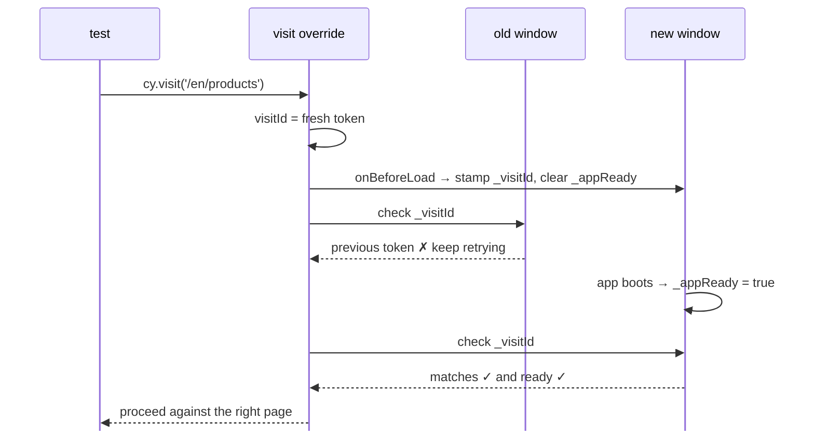

# Visual regression: determinism and baselines

Part of [Visual Regression Testing](./visual-regression.md): what must be pinned, how to read an outcome, how to update a baseline.

## Determinism: the five things that must be pinned

A screenshot is only useful if an unchanged app produces identical pixels twice. Five things break that, and the last one is the one nobody expects:

1. **Viewport and window** — the viewport is pinned to 1280×800 in `cypress.config.ts` (the `desktop` entry of `scripts/e2e/viewports.ts`), in a browser window sized from the same matrix. Image size is part of the diff. See [The browser window](#the-browser-window).
2. **Clock** — frozen by `cy.freezeForVisual()`. Anything rendering a date or a relative time changes by the minute.
3. **Animations** — killed by the same command, via an injected stylesheet that zeroes every `transition` and `animation`. A screenshot caught mid-transition differs from itself between runs.
4. **Data** — the demo profile, whose backend puts the same dataset back on every restore. `cy.restore()` in the `beforeEach` guarantees identical data and a signed-out session; the navigation gains a whole column (Cart, Orders, the account email, Logout) when signed in, so auth state changes the layout, not just the content.
5. **The page actually being the page.** See below — this one was a real bug.

### The browser window

A headless browser opens a 1280×720 window, and `cy.screenshot({ capture: 'viewport' })` clips to it. So every baseline was 1280×720 while the configured viewport said 1280×800, and a phone viewport (taller than 720) would have been clipped the same way.

- **One launch handler.** `cypress.config.ts` registers a single `before:browser:launch`, because Cypress keeps only the last one registered. It calls `withWindowSize` from `scripts/e2e/browser-launch.ts` with `windowFor(VIEWPORTS)`: the widest width and the tallest height of the matrix, taken independently (today 1280×844).
- **Headless only.** `cypress open` keeps the developer's window; Firefox has no visual run.
- **The guard.** `compareSnapshot` hands the task the page's own `innerWidth × innerHeight`. `shotSizeProblem` (`scripts/e2e/shot-size.ts`) runs before any baseline logic, update mode included: a clamped shot, or a double-density one, fails with its own message and can never be recorded as a baseline. It is a different failure from "size changed vs the baseline".
- **The real path.** The PNG's path comes from `cy.screenshot`'s `onAfterScreenshot`, not from a rebuilt string, so a single-spec run (`test:e2e:serial`) finds its file too.

Touch emulation (`tests/support/e2e/touch.ts`, switched by `applyViewport`) is a separate seam that the next lanes document.

### Scrollbars

The two visual scripts set `ELECTRON_EXTRA_LAUNCH_ARGS=--hide-scrollbars`, so a page that scrolls lays out at the viewport's full width. Without it a phone shot would lay out at 375 px under a 15 px bar: a layout no phone shows. The flag is scoped to the visual process, so the layout sweeps keep real scrollbars. A sentinel test at the end of `tests/e2e/visual/visual.cy.ts` checks `clientWidth` equals the viewport width on a scrolling page.

### The bug this suite found in the test harness

`cy.visit()` is overridden in `tests/support/e2e/commands.ts` to wait for the app to finish bootstrapping. The original wait was:

```ts
cy.window().should('have.property', '_appReady', true);
```

`_appReady` is set on `window` by the app once it has booted — and the **outgoing** `window` object survives right up to the moment the new document commits. So on the second `cy.visit()` inside a test, that assertion could look at the page being navigated _away from_, see a flag it set long ago, and resolve immediately. Every command afterwards ran against the previous screen.

In an ordinary spec this is almost invisible, because `cy.get()` retries: the page swaps underneath it and the assertion passes a beat later. It is entirely visible to anything that reads the page **once** — a screenshot, `cy.document()`, `location.href`.

It surfaced as a baseline for `/en/this-route-does-not-exist` that was a photograph of the home page, and as an accessibility suite that had been auditing the previous route for most of its cases.

The fix is a per-visit token, because the flag has to be something the old window can never satisfy:



The lesson generalises: **a readiness flag that persists across navigations is not a readiness flag.** It has to be scoped to the navigation it describes.

## The outcomes of a comparison

### No baseline yet → **fail**, and write nothing

A comparison that records its own missing baseline passes vacuously: in CI the written file is discarded, so every night would be green with nothing checked. Only update mode (`update-baselines`, `npm run test:e2e:visual:update`) writes into `__snapshots__`, in the pinned image — a host run would record a host baseline. The shot of the failed comparison goes to `reports/visual-diff/<name>.new.png`, which CI already uploads, so the reviewer sees what is missing; the baseline PNG is then reviewed in the diff of the update commit.

### Different dimensions → **fail immediately**

Comparing images of different sizes pixel by pixel is meaningless, and a size change is itself a layout regression. The message says both sizes rather than a percentage.

### Same size → compare

Over budget writes a diff image to `reports/visual-diff/` — red pixels mark what moved — and the failure message names the file and the update command.

## Updating a baseline

When a change to the design is intended:

```bash
npm run test:e2e:visual:update
```

One viewport at a time goes through the tag filter, not a new script. Tags are namespaced `@visual-*` (`@visual-desktop`, `@visual-phone`, `@visual-tablet`, `@visual-dark`), so no other spec can match them statically; the grep plugin then always takes its run-everything-and-filter path.

```bash
E2E_GREP_TAGS=@visual-phone npm run test:e2e:visual:update
```

The workflow's `tags` input does the same: `update-baselines` with `@visual-phone` re-records only the phone images, and empty means everything.

Then **look at the resulting image diff in the pull request**. That review is the entire point of the layer; skipping it turns the baselines into rubber stamps and the suite into decoration.

## Proving the suite actually works

A visual suite that is silently photographing blank pages passes forever and catches nothing. This one has been falsified — the check that it can fail:

```bash
# inject a layout shift
#   LayoutDefault.vue's own <v-main style="padding-top:120px" …>
npm run test:e2e:visual
#   home: 45043 of 921600 pixels differ (4.887%, budget 0.200%)  ← 1 failing
#   the other screens still pass    ← proves run-to-run stability at the same time
```

That is the check to repeat after touching anything in `freezeForVisual`, the viewport, or the visit override. It caught the blank-baseline problem: an early version recorded images with 19 distinct colours, and `home.png` was byte-identical to `not-found.png`.

A quick sanity signal, when a baseline looks suspicious — a real screenshot of this app has a few thousand distinct colours:

```bash
node -e "const {PNG}=require('pngjs'),fs=require('fs');
for (const f of fs.readdirSync('src/modules/<name>/tests/e2e/__snapshots__').filter(x=>x.endsWith('.png'))) {
  const i=PNG.sync.read(fs.readFileSync('src/modules/<name>/tests/e2e/__snapshots__/'+f)), c=new Set();
  for (let n=0;n<i.data.length;n+=4) c.add(i.data.readUInt32BE(n));
  console.log(f, c.size);
}"
```

## Read next

- [Visual Regression Testing](./visual-regression.md)
