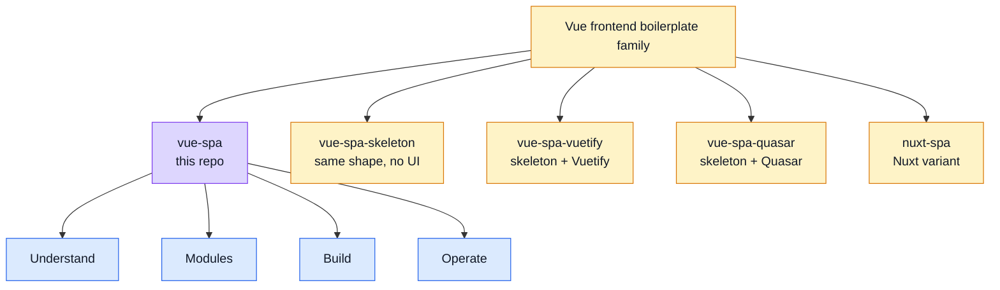
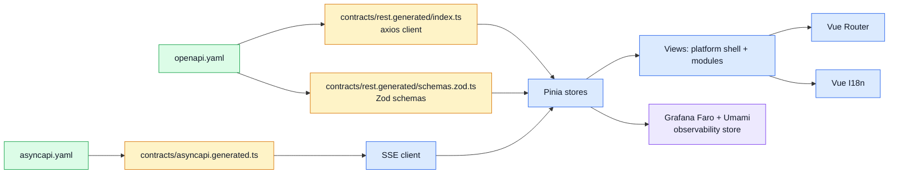

## I want to…

| I want to…                                  | Go to                                                                                                                                         |
| ------------------------------------------- | --------------------------------------------------------------------------------------------------------------------------------------------- |
| Use the demo shop, or explain it to someone | [the shop manual](https://github.com/Guebbit/boilerplate-node-backend/blob/main/docs/use-the-shop/start.md) (in the paired backend, optional) |
| Understand how and why it is built          | [Understand](./understand/start.md)                                                                                                           |
| Run it, change it, test it                  | [Build](./build/start.md)                                                                                                                     |
| Read how one domain works                   | [Modules](./modules/start.md)                                                                                                                 |
| Configure it and watch it                   | [Operate](./operate/start.md)                                                                                                                 |
| Look up an endpoint, a script, a file       | [Reference](./reference/start.md)                                                                                                             |

## What this docs site is for

This docs site stays short, visual, and practical.
Use it to understand **what this boilerplate is**, **how the app layers fit together**, and **which tools already exist in the repo**.

> Think of the repo as **an example frontend blueprint**, not a finished product with product-specific business rules.

## Family map

## Read this repo as

- **SPA**: Vue 3 + Pinia + Vue Router, compiled by Vite.
- **API client**: [OpenAPI-generated axios client](./build/openapi-workflow.md) — types and functions come from `openapi.yaml`, never written by hand.
- **Realtime**: [SSE clients](./understand/realtime.md) driven by [`asyncapi.yaml`](./build/asyncapi-workflow.md).
- **State**: [Pinia stores](./understand/state-and-routing.md) own data; views stay thin.
- **Observability**: [Grafana Faro + Umami](./operate/observability.md) wired into a single store.
- **Dev backend**: [the demo profile](./build/demo-profile.md) — the real API, in-memory and seeded, one command.
- **Contracts**: [`openapi.yaml`](./build/openapi-workflow.md) + [`asyncapi.yaml`](./build/asyncapi-workflow.md).
- **Shape**: layered code explained in [Understand](./understand/start.md) and the dedicated [Layers](./understand/layers.md) page.

## Five sections, five jobs

- [Understand](./understand/start.md) — architecture, layers, request flow, sitemap, and the tools in plain English.
- [Build](./build/start.md) — run it, the API contract workflow, adding a module, every kind of test.
- [Modules](./modules/start.md) — one page per domain: what it owns, who depends on it, its store, screens and endpoints.
- [Operate](./operate/start.md) — environment variables, observability, analytics.
- [Reference](./reference/start.md) — the lookup surface: every folder, script, package and endpoint.

## Quick visual of the current repo

## Good starting points

- Never run it? [Getting Started](./build/run-locally.md).
- Want the app shape? [Understand](./understand/start.md) and [Layers](./understand/layers.md).
- Want to know what one domain does? [Modules](./modules/start.md).
- Want the `package.json` map? [Package Dependencies](./reference/package-dependencies.md) and [Package Scripts](./reference/package-scripts.md).
- Want the sitemap and route guards? [Sitemap & Access Control](./understand/sitemap.md).
- Want to change payloads or add endpoints? [API](./build/api-contracts.md).
