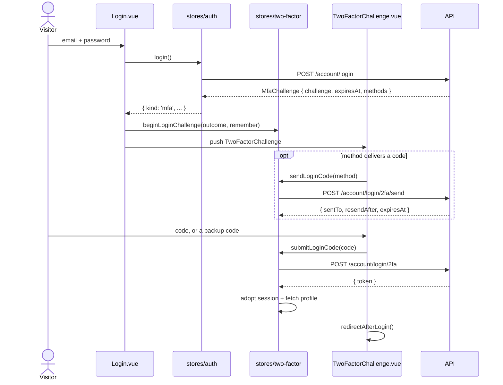
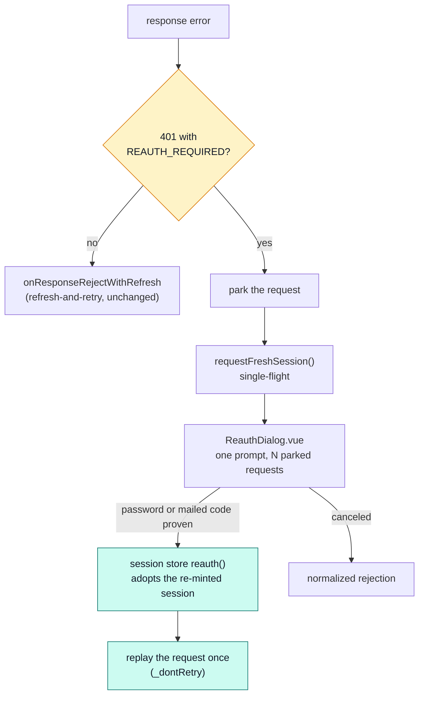

# account

::: tip At a glance
**Owns** — the visitor's own account: login (password, social, second factor), signup, profile,
password reset, scheduled deletion and its restore.
**Depends on** — [`users`](./users.md), and only for its field rules.
**Breaks if you change** — nothing outside this folder. The step-up prompt lives with the session:
`infrastructure/http/step-up.ts` parks a `REAUTH_REQUIRED` 401 and waits for
`app/components/ReauthDialog.vue`, which calls the session store's `reauth()`. Every flow behind the
backend's freshness gate — email change, account delete, session revoke, checkout, payments, 2FA
management — is answered through that one prompt.
:::

| Fact          | This module                                                                                                                                                                           |
| ------------- | ------------------------------------------------------------------------------------------------------------------------------------------------------------------------------------- |
| **Subdomain** | `generic` — A solved problem. Modelling effort here would be waste.                                                                                                                   |
| **Stores**    | `account-auth` · `account-profile` · `account-sessions` · `account-addresses` · `account-oauth-providers` · `account-oauth-links` · `account-two-factor` · `account-deletion-restore` |
| **Publishes** | `AddressPicker` · `PurchaseHoldNotice`                                                                                                                                                |

## Its neighbourhood

The context map is drawn once, in [the whole map](./index.md#the-whole-map).

- `cart` → **published-language** — Mounts `AddressPicker`, twice (shipping and billing), and `PurchaseHoldNotice`; the checkout never reads an account store.
- → `users` **published-language** — Validates every form against `usersSchema`/`usersPasswordSchema` — shared field rules, not a shared store.

## The story

Many screens, several stores, and the widest API surface of any module here — which makes it a
misleadingly ordinary-looking domain. Five things about it are worth knowing before you edit it.

**The session is not in here.** The credential (an access token in `jwt` mode, a held-cookie flag in `cookie` mode: the backend's `NODE_SESSION_MODE`, read from `GET /config`) lives in `infrastructure/session`, because
`infrastructure/http` has to read it on every request and the router guards read `isAuth` and the
caller's own rules before any domain code runs. A module cannot sit below the layer that needs it. This module owns the
_editable record_, not the credential.

**One domain, one store per lifecycle.** They split by lifecycle, not by screen: `account-auth` establishes and
ends a session, `account-profile` owns the editable record once one exists, and `account-sessions`,
`account-addresses`, `account-oauth-links`, `account-two-factor` and `account-deletion-restore` each own a panel's own
slice, and `account-oauth-providers` holds the deployment's provider list — a public fact, not the visitor's.
A store that outlives its panel would be a cache nobody invalidates.

**Connecting a provider is a signed-in step.** A sign-in with a provider whose email matches an
account links nothing (`/oauth/callback?error=account_exists`): the owner signs in the usual way and
presses _Connect_ in the profile's connected-accounts panel. That calls
`POST /account/oauth/links/{provider}` (a fresh session), navigates to the consent URL it answers,
and the callback lands on `OAuthCallback` with `?linked=<provider>`: a toast, then back to where the
visitor was. No session is minted for it.

**The data export is a link, not a download.** The profile card reads the export's status on
load (`fetchAccountExport`: building, ready until a date, failed, or none; polled while it builds).
Its button asks (`requestAccountExport`, `202`); the API builds the file in the background and mails
a link to `account-export`. That page reads the status first and offers the one button (`downloadAccountExport`, which saves
the file as JSON) only when it is ready. A button rather than a download on arrival, so a mail
scanner that prefetches the link triggers nothing. The request and the download need a fresh
session, which the step-up interceptor asks for in place; the status read does not. See the
backend's [data export](https://github.com/Guebbit/boilerplate-node-backend/blob/main/docs/modules/account.md#data-export).

**The one dependency is validation, not screens.** Every form here validates against
`usersSchema`/`usersPasswordSchema` from the [`users`](./users.md) barrel, so _what makes a valid
username_ is answered once — for the person editing their own record and for the admin editing
someone else's. A build with `account` but not `users` would validate nothing.

::: tip That edge is `published-language`, and the backend's equivalent is not
On the server, `account → users` is `shared-kernel`: both modules write the same User record. Here
the same pair shares only the validation vocabulary, and the server remains the single writer.

**The divergence is the finding.** Two context maps over one product, disagreeing about an edge
because the two sides genuinely have different relationships to the same data.
:::

The `index.ts` next to the manifest publishes two components and no store: `AddressPicker` and
`PurchaseHoldNotice`, both mounted by `cart`'s checkout. A component is the narrowest thing a
sibling can be handed — the checkout renders an address choice and a purchase hold without
learning what an address book or a hold record is.

## State

State, getters and actions are exactly what the setup function of each store returns: `src/modules/account/stores/`.

## Screens

Paths, route names, access and permission per screen: `src/modules/account/routes.ts`; every module's together are in the generated [sitemap](../theory/sitemap.md).

`VerifyEmailConfirm`, `EmailChangeConfirm`, `EmailChangeUndo` and `AccountRestore` render `components/LinkTokenConfirmCard.vue`; `PasswordResetConfirm` is its own form (three fields, a cross-field rule, field-level server errors). It also serves `account-setup`, the link in the mail staff trigger when they create an account, in `setup` mode: there it always shows the unticked Terms box (`components/TermsAcceptanceCheckbox.vue`, shared with `Signup`). On `password-reset/confirm` the box appears only once the API answers 422 naming `termsAccepted`, an account that never accepted. The tick is the holder's own and is sent only while the box is shown.

## Wiring

#### Endpoints called

Method, path pattern, response schema and owning module of every operation: `contracts/rest/routes.ts` (rows with `module: "account"` or `"addresses"`). Auth is in the backend contract.

#### Navigation entries

Entries are declared in `src/modules/account/module.ts`.

#### Analytics events

None. Both logout routes are real requests the API answers, so `user_logged_out` is emitted there —
counting the logout that succeeded rather than the one that was attempted. See
[Observability](../tools/observability.md#event-taxonomy).

## Files

The folder is `src/modules/account/`; each file's own `@module` header says what it is.

## Working on it

```bash
# this module's vitest suites
npm run test:unit -- account

# this module's cypress suites
npm run test:e2e -- --spec 'src/modules/account/tests/e2e/*.cy.ts'

# after the backend changes an endpoint this module calls
npm run regenerate
```

## Deeper in

Two flows here are not readable from any one file, because both are split across the http tier and
this module on purpose.

### The login challenge

An account with a second factor armed does not get a session from `POST /account/login`. It gets a
**challenge**: a short-lived signed claim check meaning _"someone passed the password step for
account X, moments ago"_. It is not a code and nothing is mailed to obtain it — the _code_ is the
separate secret, and where it comes from is what a **method** decides. `totp` derives it from a
shared secret and the clock, so there is nothing to deliver; `email` mints six digits and mails
them.

`login()` therefore resolves with a discriminated `LoginOutcome` (`session` | `mfa`) rather than
leaving the caller to infer which happened from whichever fields are present.



An account in the grace of its own deletion takes a third branch at the same two places (the password
step, and the second step once the code passed): no session, a `DeletionPending` claim check instead.
`stores/deletion-restore.ts` holds it, `views/AccountRestoreChallenge.vue` offers "Restore my account"
or "Leave it deleted", and `POST /account/login/restore` redeems it. An OAuth sign-in lands on
`?deletionPending=1&purgeAt&expiresAt` and the claim check stays in a cookie the backend reads.

Three rules fall out of that shape and are easy to break:

- **`remember` has to be carried by hand.** An `MfaChallenge` response has nowhere to hold the
  login form's "remember me" choice, so `beginLoginChallenge` takes it as a second argument and
  `submitLoginCode` applies it. Nothing else remembers it across the two steps.
- **The credential-taking doors are excluded from refresh-and-retry** — the operations the contract marks
  `x-no-refresh`, listed as `noRefresh: true` in `contracts/rest/routes.ts` (login and its 2FA steps,
  restore, signup, password reset). A
  wrong or expired code answers 401 like any other business outcome. Without the exclusion, a
  visitor still holding a valid refresh cookie from an earlier session gets a silent
  refresh-and-replay instead of "wrong code".
- **Every countdown comes from the server.** The challenge's `expiresAt`, a delivered code's own,
  and the resend cooldown's `resendAfter` all tick through `composables/use-countdown.ts` — so does the
  profile page's pending-email Resend button, which also counts down a 429's `retryAfter`. A
  client-invented duration can disagree with the rate limiter; a server-sent one cannot.

Nothing in the UI branches on a method by name. `delivers` says which half of the enrollment
dialog to render, `enrollable` says whether to offer an "Add" button, and an unrecognised method
string falls back to itself as its own label — so a method a deployment adds later needs no code
change here.

### Step-up re-authentication

The backend gates its most dangerous routes behind **freshness**, not just authentication: a valid
token that was issued too long ago answers `401 REAUTH_REQUIRED`. That is a 401 the refresh flow
must not touch — the refresh cookie is perfectly valid, so refreshing succeeds, the request
replays, and answers `REAUTH_REQUIRED` again with nothing left to try. (In `cookie` mode there is no
refresh at all: a plain 401 ends the session. See [Security](../tools/security.md#two-session-modes).)

So the step-up interceptor is layered _outside_ the refresh one and reads the error **code** before
the refresh branch can ever run.



**Which proof the dialog asks for is the server's answer, not the client's guess.** On open it calls
`GET /account/reauth` (`reauthMethods()` in `infrastructure/reauth.ts`) and shows the first method listed:

- `password` — the password field.
- `email` — an account with no password (it signed up through a provider): a "send code" button
  (`sendReauthCode()`, locked for the server's own `resendAfter`, or a 429's `retryAfter`) and a
  field for the mailed code. The body sent is tagged, `{ method: 'email', code }`.
- empty — no password and no way to mail: a dead end told as one, not a form nobody can pass.

For an account with a second factor armed, the identity routes (email, password, delete) answer the
same `401 REAUTH_REQUIRED` with `details.methods: ['otp']`. The interceptor hands that list to the
prompt (`requiredMethods`), and the dialog adds a second-factor code field beside the first proof;
both go in one `reauth()` call, `{ method: 'password', password, otp }`. The field appears only when
the server asked for it, never from a guess about the profile.

A wrong answer is a 422 and the dialog says "code" or "password" by the method on show (with a code
field on show it shows the server's own sentence, which says which proof was wrong); it stays
open either way. See the backend's
[step-up for an account with no password](https://github.com/Guebbit/boilerplate-node-backend/blob/main/docs/modules/account-sessions.md#step-up-for-an-account-with-no-password).

Both this and the token refresh de-duplicate through the same `infrastructure/http/single-flight.ts`
helper: several requests failing in the same tick must join one attempt, never start one each. For
the dialog that is the difference between one prompt and five stacked on top of each other.

`ReauthDialog.vue` lives in `app/` and the call it makes lives in the session store (`infrastructure/session.ts`),
so the shell never imports this module — nor does the "resend verification" banner, which reads the
session viewer's `verified` flag and calls `resendEmailVerification()` from `infrastructure/email-verification.ts`. The
store holding the dialog's open/closed state lives in
`infrastructure/http/` rather than `ui/` — the interceptor reads it directly, and the
infrastructure tier may not import `ui`. See [Layers](../theory/layers.md) for the rule.

## Libraries

`@zxcvbn-ts/core` (plus `@zxcvbn-ts/language-common` and `@zxcvbn-ts/language-en`) drives
`components/PasswordStrengthMeter.vue`'s local strength bar — the maintained TypeScript fork of the
original `zxcvbn`, which is unmaintained since 2022. English dictionary only, since this is
advisory feedback rather than an enforced rule; the actual gate stays `usersPasswordSchema` plus
the server's own breach check. See `composables/use-password-strength.ts`.

## Related pages

- [`users`](./users.md) — where the field rules come from
- [Security](../tools/security.md) — the token, the guards, and what the client never stores
- [Sitemap & Access Control](../theory/sitemap.md) — the guest-only and auth-only routes
- [Domain Layer](../theory/domain-layer.md) — why `shared-kernel` does not appear on this map
- [State & Routing](../tools/state-and-routing.md) — how a guard reads the session
