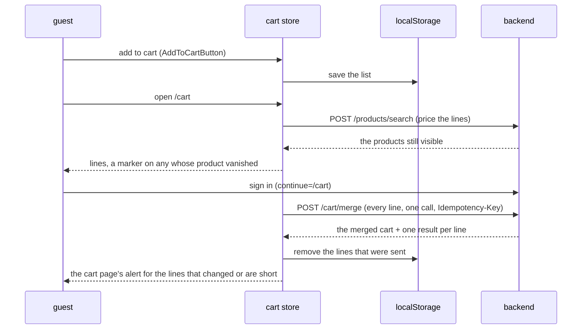
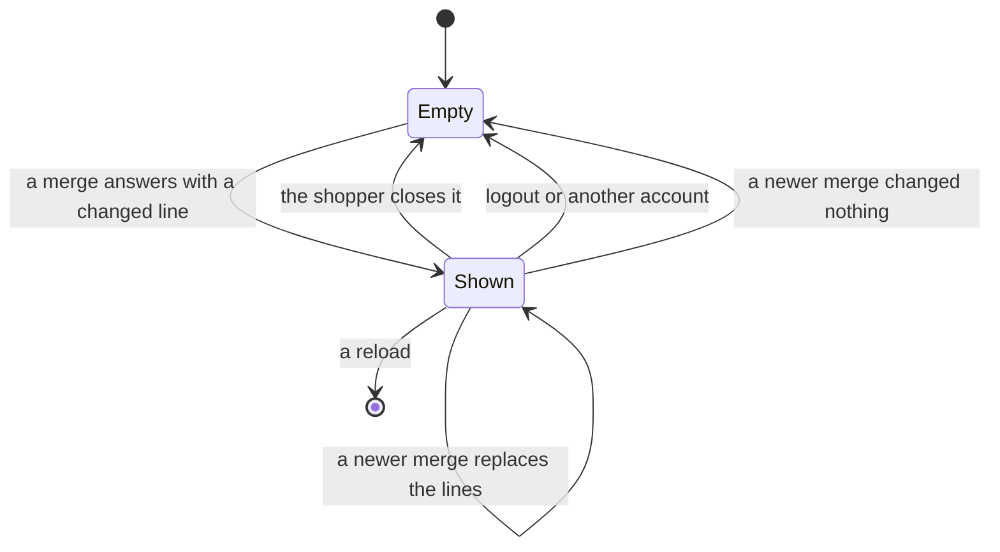
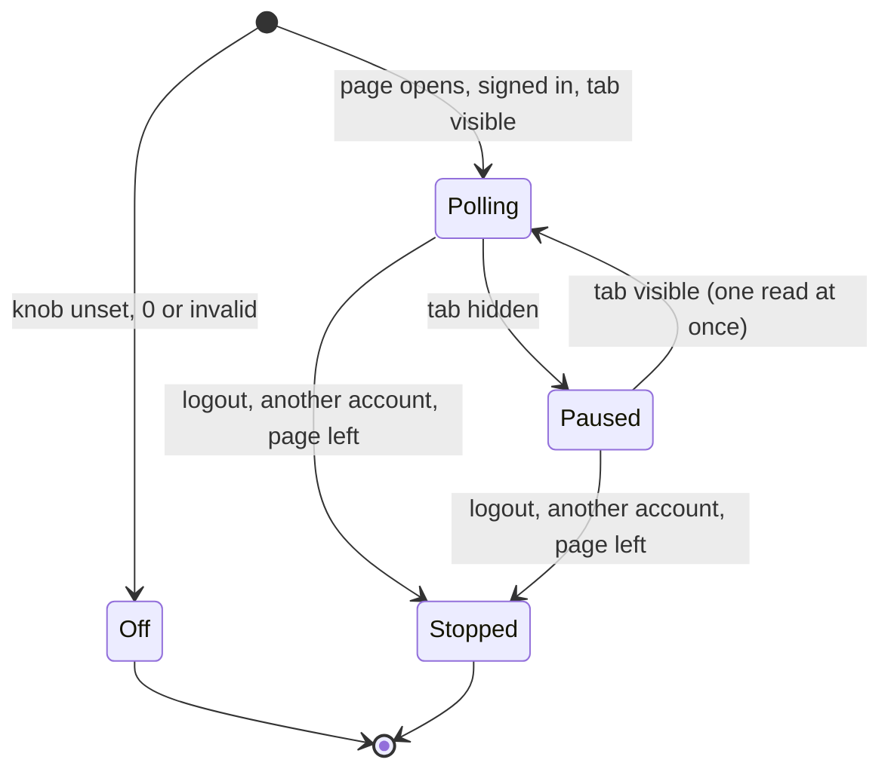

# The guest cart and the page that follows the server

A visitor can fill a cart without an account; sign-in is asked for at checkout, not at "add to
cart". The cart is a plain list of `{ productId, quantity }` in this browser's `localStorage`, and the
server never sees it until the visitor signs in.

The pieces are the files of `src/modules/cart/`: the guest-cart rules in `domain/guest-cart.ts`, its
`localStorage` keys in `guest-cart-storage.ts`, the composable the store sends from in
`composables/use-guest-cart.ts`, and `GuestCart` / `SignedInCart` behind the one `views/Cart.vue`.

The route is `access: 'open'` and asks no permission: a guest passes, and so does every signed-in
account, staff included, since every account shops.

## The merge

When a signed-in session appears, the shell's badge accessor calls `seedAfterSignIn`. With a
guest cart it sends every line in one `POST /cart/merge`, which adds each by the rule of
`POST /cart/items`: a product already in the cart **grows** by the line's quantity. The answer is the
merged cart and **one result per submitted line**:
`{ productId, requested, resulting, reason? }`, and the answer's `warnings[]` names each line stock held back. `reason` is absent when the line
landed as chosen, and otherwise one of `summed`, `capped`, `removed` or `cart_full` (the product is new and the cart has no line
left for it). The same limit refuses a plain
`POST /cart/items` with 409 `CART_LINE_LIMIT_REACHED`. A line the cart cannot
take is not a failure: the call still answers 200, and for the lines that were `removed` or `cart_full` the
server also writes one `shop-tasks.cart-merge-refused` notification, which the
[bell](./notifications.md) shows. Without a guest cart it reads the summary for the badge, as before.

**Stock clamps, loudly.** A line the shelf does not cover is added up to what can be bought, and the
answer's `warnings[]` carries one entry per such line (`MERCHANDISE_NOT_ENOUGH_STOCK`, or
`MERCHANDISE_OUT_OF_STOCK` when nothing could be added: sold out, or off sale), as Shopify's cart
warnings. The merge alert shows each. Checkout is still where a basket is refused
(`CART_INSUFFICIENT_STOCK`).

- Exactly the lines that were **sent** leave the guest list once the server has answered. A product
  added while the call was out stays, and a line grown meanwhile keeps only its extra units, so
  nothing is merged twice and nothing the guest did is lost.
- A failed call leaves the list exactly as it was, shows one toast, and tries again when the page
  next loads, for as long as the same person stays signed in. The badge's summary is still read, so the header is not blank. The exception is a 400,
  413 or 422: the stored list itself is what the server refused, so retrying would only refuse
  again. Those lines are dropped, with a toast saying so.
- A sign-out or an account switch clears the guest list and the pending merge key, so a shared
  browser never hands one account's unmerged lines to the next. A reload's session restore is not
  one, so the lines are kept and retried. Same as Medusa's signout and WooCommerce's `wp_logout`,
  which end the session's cart with it.
- Two asks in the same breath (the shell seeding twice) join one call: the guest cart is sent once.
- The first full `GET /cart` waits for the merge, so a read answered from before it cannot overwrite
  the merged cart.

### The key makes a retry the same call

The request carries an `Idempotency-Key`. A merge that never got a conclusive answer (the connection
dropped, a 5xx) may have been applied, so the retry must be the _same_ call to the server, which then
replays its answer instead of adding the quantities again.

| Rule                                     | Why                                                                                                                                                                                                             |
| ---------------------------------------- | --------------------------------------------------------------------------------------------------------------------------------------------------------------------------------------------------------------- |
| Kept after no answer or a 5xx            | The server may have applied it: the retry has to be recognised.                                                                                                                                                 |
| Dropped after an answer or any other 4xx | The next attempt is a different call.                                                                                                                                                                           |
| Replayed first when the lines changed    | A lost call may have been applied: it is sent again under its own key and body (the server answers from its record), the units it carried leave the list, and only what was added since goes under a fresh key. |
| Saved in `localStorage` beside the list  | The usual retry is after a reload, and a key held in memory would not survive it.                                                                                                                               |

Two tabs restoring a session at the same moment, with no attempt saved yet, each mint a key and merge once: rare, and the alert shows the sum when it happens. Nothing guards against it.

## The merge alert

What the merge changed is told **once, on the cart page**, in an inline closable alert above the
lines (`components/MergeReportAlert.vue`). It is neither a toast (it must outlive a few seconds) nor
a bell notification (it is tied to this screen and goes with it).

It lists four kinds of line (`mergeReportKind`):

| Kind       | When                                          | What it says                                                                         |
| ---------- | --------------------------------------------- | ------------------------------------------------------------------------------------ |
| `changed`  | a `reason` of `summed` or `capped`            | the quantities, and the reason in plain words                                        |
| `short`    | the warning is `MERCHANDISE_NOT_ENOUGH_STOCK` | the quantities, a "Not enough in stock" marker, "Only that many could be added"      |
| `sold-out` | the warning is `MERCHANDISE_OUT_OF_STOCK`     | the quantities, a "Sold out" or "Not available right now" marker, "it was not added" |
| `gone`     | a `reason` of `removed` or `cart_full`        | the quantities, and "no longer available, so it was not added"                       |

Each line names the product in the reader's language, the quantity the guest chose and the quantity
the cart holds now. The title comes from the same product lookup the lines use; a product that
cannot be read (it left the catalogue) is called "A product". A line that landed as chosen and fits
the stock is not listed. The alert stays visible over an _empty_ cart, which is when a merge that
added nothing most needs explaining.

- The report is `mergeReport` in the store: memory only. It survives navigating away and back, and a
  reload drops it, since the server keeps no record of what the guest asked for.
- A later `GET /cart` never sets or touches it: only an answer to a merge does.
- It is one live region (`role="status"`, polite) for the whole alert, not one per line; the
  page's quantities and total are live regions already, and the alert adds exactly one more.
- A short line is marked in words, never by colour alone.

## A line's availability on the cart page

Every cart answer (`GET /cart` and every write) carries the product's own stock answer on each line
(`availability`, `availabilityDate`, `quantityAvailable`, `quantityBackordered`, the same words and
numbers as `GET /products/{id}/availability`), and the page prints one marker beside the quantity
of any line that needs one. Which marker comes from `lineStatusOf` in the products domain, ranked
top to bottom; the server reads removed, off sale and sold out all as `out_of_stock`, so the
product details the page already holds tell them apart:

| The line is                                                | Marker                                          |
| ---------------------------------------------------------- | ----------------------------------------------- |
| removed (the product left the read, or is `active: false`) | "No longer available"                           |
| off sale (`purchasable: false`)                            | "Not available right now"                       |
| `out_of_stock`                                             | "Sold out"                                      |
| `quantity` above `quantityAvailable`                       | "Only {n} available"                            |
| `preorder`                                                 | "Preorder · ships {date}" (blue, not a warning) |
| units past the shelf (`quantityBackordered`)               | "Backorder · ships by {date}" (blue)            |

The marker is text, and it sits inside the quantity's own live region, so a line turning short is
announced without a live region per row. The quantity on screen is never changed for it: lowering
the line, or removing it, is the shopper's call. "Place order" stays disabled while any line is not
buyable by the server's word (`checkoutable` on the cart), matching checkout, which refuses the
short, sold-out, off-sale and removed lines: a preorder is bought now and ships from its release
date. A line's "+" stops at the shop's ceiling and at `quantityAvailable` (the stepper never goes
above the number; a line already above it can only be lowered).

**The cap is loud.** A write that asks for more than can be bought succeeds at the most that can
be, and the answer's `warnings[]` is shown beside the line ("Only 20 available, so the line was
set to 20 instead of 25") until that line is written again, never only as a toast. The store keeps
it in `lineWarnings`, apart from `cart`, so a background read does not wipe it.

**The guest cart clamps from the same numbers.** It lives in this browser, so it reads
`quantityAvailable` from the availability store (`@/kernel/availability`, filled by the
`availability-watch` slot the page renders) and applies the same rule: a raise stops at the number,
a line above it is never raised, and the same warning shows. Nothing is clamped for a product whose
availability has not loaded.

## The stock poll

A flag only helps if it follows the shelf. With `VITE_CART_STOCK_POLL_SECONDS` set, the cart page
re-reads `GET /cart` on a plain interval (not long polling: nothing is held open).

| Knob value                                 | Result                                                   |
| ------------------------------------------ | -------------------------------------------------------- |
| unset, empty, `0`, negative                | No polling: no timer, no listener                        |
| not a whole number (`2.5`, `often`)        | No polling                                               |
| more than a timer can hold (about 24 days) | No polling: it would fire at once                        |
| a positive whole number `N`                | A read every `N` seconds while the conditions below hold |

The knob is read like every deployment value: a container's `config.js` first, the build's `.env`
second. See [Environment](../operate/environment.md).

- **Where**: the cart page. Checkout is the same page, so one place covers both. A guest cart has
  no server copy and is never polled.
- **Who**: stops for good on logout or when another account takes the tab. It does not resume when
  the old account signs back in; reopen the page.
- **Hidden tab**: paused, with one read as soon as the tab is visible again.
- **Never over a fresher answer.** This is the one background read in the store, `pollCart`, and it
  yields to anything newer. It skips its tick while any call that replaces the cart is on the wire
  (or another poll is). Its answer is dropped if such a call started, or the viewer changed, after
  it left. It does not toggle `loading` (that would disable the page's buttons every tick), and it
  never touches the merge report.
- **A failed read** is only logged at debug level: the next tick tries again.

The poll does not need to be on for the page to catch up: see
[Coming back to the page](#coming-back-to-the-page).

## Coming back to the page

The server's cart can change behind an open screen (another tab, the wishlist, a price or a stock
change). When the window gets focus or the tab becomes visible, the page reads the cart once more
(`composables/use-cart-focus-refresh.ts`, through the same `pollCart`, so it yields to any write in
flight). It is event-driven, costs nothing while the page is left alone, and needs no knob. It
narrows the gap; the shopper who never leaves the page is covered by
[the total the buyer was shown](./cart.md#the-total-the-buyer-was-shown).

## Read next

- [`cart`](./cart.md) — the store, answers in order, the checkout key
- [The checkout flow](./cart-checkout.md) — the screen and what the server decides
