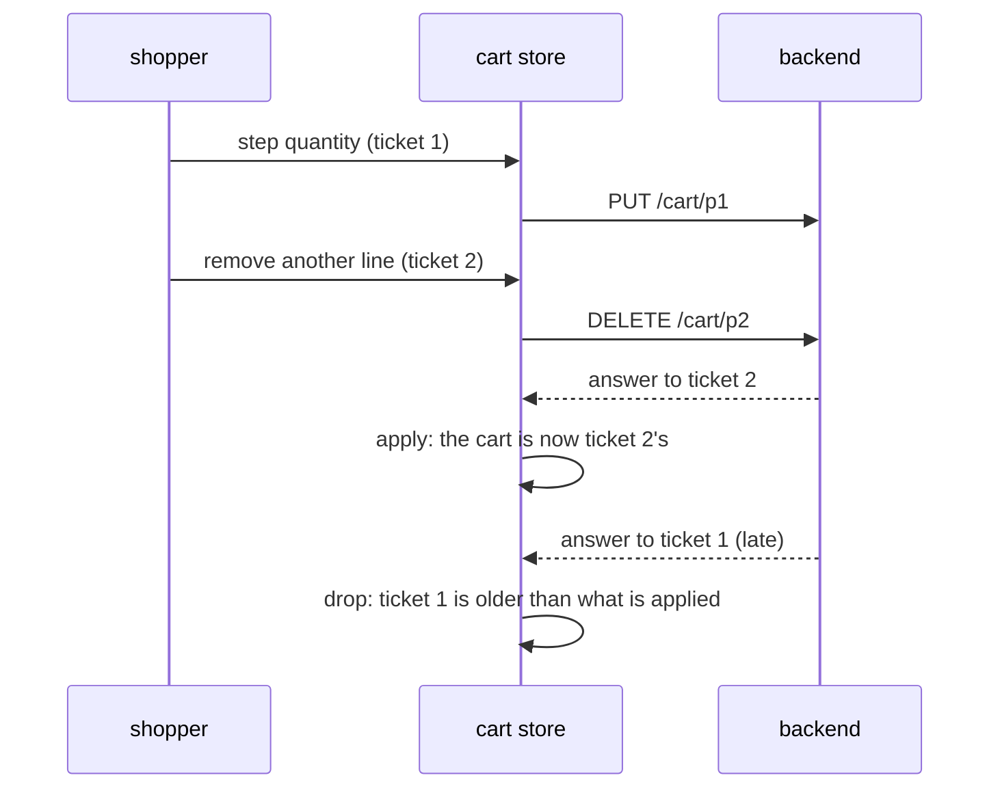
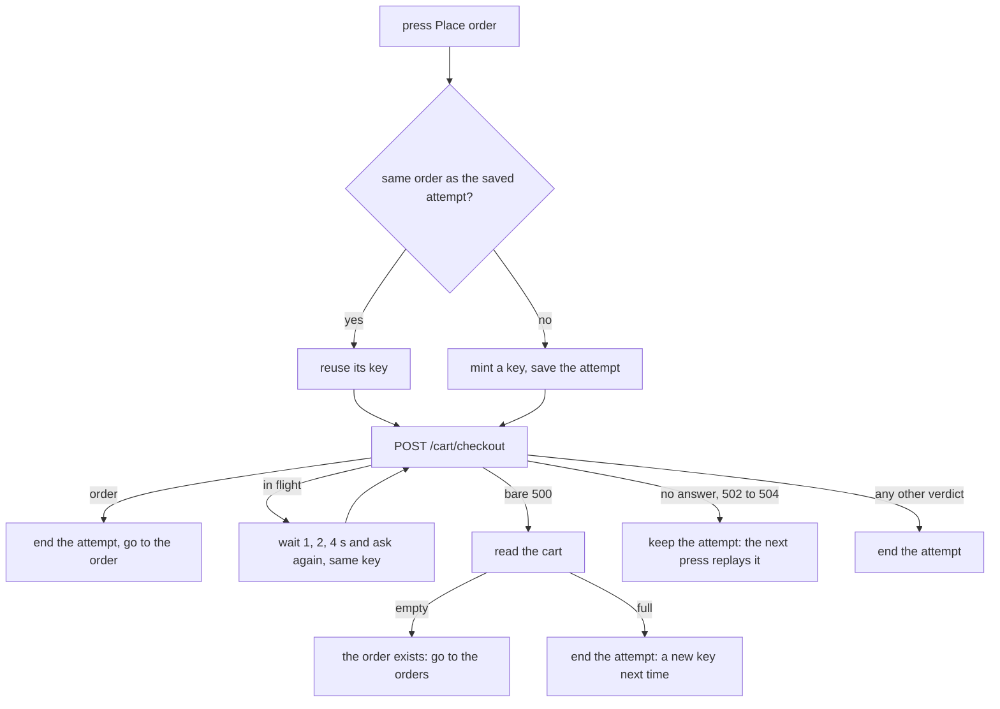

# cart

::: tip At a glance
**Owns** — the cart screen, the cart store, the guest cart that precedes it, and the checkout flow that ends them.
**Depends on** — [`delivery`](./delivery.md), [`payments`](./payments.md) and [`account`](./account.md) for components it mounts, and [`products`](./products.md) for its cached catalogue and line titles.
**Breaks if you change** — `badgeQuantity`. The shell's header reads it through the manifest.
:::

| Fact             | This module                                                                             |
| ---------------- | --------------------------------------------------------------------------------------- |
| **Subdomain**    | `core` — The reason the product exists. Worth its own client-side rules.                |
| **Shared parts** | `CartLineCard` (one line, both carts) · `CartEmptyState` (the empty basket, both carts) |
| **Publishes**    | `useCartStore`                                                                          |

## Its neighbourhood

The context map is drawn once, in [the whole map](./start.md#the-whole-map).

- `orders` → **customer-supplier** — The reorder button asks the cart store to refill itself from a past order.
- `wishlist` → **customer-supplier** — Move-to-cart calls a wishlist endpoint and then asks the cart store to refetch itself; the cart is never asked to write.
- → `products` **customer-supplier** — Asks the products store to drop its cached catalogue after each cart write (`invalidateProductsCache`), and reads its lines' title and price from the products dictionary in one batched read (`useProductLines`).
- → `delivery` **published-language** — Mounts `ShippingSelector`, a self-contained component that renders shipping without this module learning what a rate is.
- → `payments` **published-language** — Mounts `PaymentMethodSelector`; the checkout learns which method ids exist, never what one costs to offer.
- → `account` **published-language** — Mounts `AddressPicker` (shipping and billing) and `PurchaseHoldNotice`; the address book and the hold record stay the account's.

## The story

[`orders`](./orders.md) reaches the barrel for the reorder button and [`wishlist`](./wishlist.md)
for its move-to-cart exit (kinds are in the neighbourhood above): `orders` asks this store to write a line,
while the move itself is a wishlist endpoint and this store is only asked to refetch.

The product page's "add to cart" arrives the other way round. This module's manifest contributes
`components/AddToCartButton.vue` to the `product-actions` slot that [`products`](./products.md)
owns (see `src/kernel/slots.ts`), so `products` never imports the cart and the graph stays a DAG.

[`delivery`](./delivery.md): the checkout mounts `ShippingSelector` and never learns what a
shipping rate is. [`products`](./products.md): the page holds lines as ids only and joins them to their product records in one `POST /products/search`
per hundred ids, through `useProductLines` — the same records the product page reads.

::: tip The badge and its total are the only reactive things this module lends the shell
`badgeQuantity` (every unit in the cart) is handed to the main navigation as a **badge accessor**,
and `badgeTotal` — formatted through `detail`, with `badgeCurrency` alongside it — as a **detail
accessor**. Both are refs; the shell calls each once inside its own setup and renders whatever the
ref holds, without ever learning whose store it is reading. The entry is `pinned`, so both sit on
the bar beside the account menu at every width rather than inside the account dropdown.

It seeds from `GET /cart/summary` whenever a session appears — the whole point of that endpoint is a
count that does not cost the cart — and every later mutation keeps it fresh through the store, since
each action replaces the local cart with the authoritative payload the API answered.
:::

Checkout lives in this store and not in the orders store, even though it answers with an order. It is
`POST /cart/checkout`, the contract files it under `Cart`, and it is the one call that empties the
cart this store is responsible for. Owned from anywhere else, the local cart survives a completed
order and the header keeps showing items the server has already turned into one.

The store keeps every write to `cart` and its ordering rules (tickets, epoch, seeding, the reset barrier)
in one file, so "can a poll land over a merge?" is answered by reading one place. What touches no store
state — the key header, the in-flight retry ladder, the empty-cart shape — lives in
`idempotent-calls.ts` and `domain/empty-cart.ts`.

Stepping a line's quantity does not call the store directly. `composables/use-line-quantity.ts`
debounces per-product clicks into one trailing request each — three quick clicks on `+` would put
three requests in flight, and the cart would end up showing whichever one the server answered LAST.
A step still inside its debounce when the page goes away (a reload, a closed tab) is not lost: on
`pagehide` the view hands it to `sendKeepalive` (`src/infrastructure/http/keepalive.ts`), a `fetch` with
`keepalive`, because axios's request is cancelled with the page and `sendBeacon` can send neither a
`PUT` nor the bearer header.
What only the browser knows at checkout — the note, the payment choice and a picked address — lives
in `sessionStorage` under the signed-in user's id (`composables/use-checkout-draft.ts`). A reload
puts it back; checkout and the end of a session drop it. The delivery method is the server cart's.
Classifying a checkout rejection is pure, too: `domain/checkout-errors.ts` reads the problem's
first error and returns a verdict (`cart-changed`, `insufficient-stock`, `address-not-found`,
`cart-empty`, `in-flight`, `server-error`, `other`, and the rest) — the view decides what each one
says and does. See [the checkout flow](./cart-checkout.md) for the refusals in full.

Two rules keep the store honest when the network does not behave: answers are applied in the order
the requests left ([Answers in order](#answers-in-order)), and a checkout that may or may not have
reached the server is retried as the same call ([The checkout key](#the-checkout-key)).

The guest cart, the merge at sign-in, and how the page keeps up with the server (availability, the
stock poll, coming back to the tab) are on [the guest cart](./cart-guest.md).

### Answers in order

Every call that writes the cart takes a **ticket** when it leaves, and its answer is applied only
if no fresher answer was applied first (`infrastructure/utils/request-ticket.ts`). A slow, older
answer therefore never overwrites a newer one, whatever order the network delivers them in.



A change of viewer is a **barrier**: it kills every ticket taken before it, so an answer still on the
wire for the previous person lands nowhere, and neither does their merge report. The badge's
summary read has its own ordering, kept apart so a summary answered first can never make a write's
answer stale. The wishlist store uses the same helper.

The cart page adds two guards of its own. A `placing` flag, set synchronously on the first press of
"Place order", shuts out a second press in the same task and disables the steppers, so no step can
fire against a basket the order already consumed. On success the page forgets every pending step
for the same reason. The shipping radio follows `cart.shipping.selected` whenever it changes, so
a late read can neither wipe a pick nor leave a method the server dropped.

### The checkout key

`POST /cart/checkout` carries an `Idempotency-Key`. What the server does with a key (it binds it to
the body, answers 409 while the first attempt runs, replays a recorded outcome) is the server's, and
the contract's `Idempotency-Key` parameter describes it. The consequence for this client is that a key
may travel again only with the same order.

Checkout and the merge keep their own key logic here. Add-to-cart and reorder take one key per intent
through the shared helper `src/infrastructure/http/idempotency.ts`, which order and task notes,
address create and product create use too: one key while an attempt may still be running, a fresh
one after any answer.

The key follows a **fingerprint** of the order and the person: the request body (the shown total
included), the cart's lines
and the selected shipping method (`domain/checkout-attempt.ts`). The same order asked again is the
same call; anything else gets a fresh key, whoever changed it (the wishlist, the stock poll, a
merge, a reorder), without any of them having to remember to say so. The attempt is saved in
`sessionStorage` (`checkout-attempt-storage.ts`), so a reload in the middle of an
unanswered checkout still replays the order instead of placing a second one.

What each answer does to the key (kept or ended) is the last paragraph of the refusals table in
[the checkout flow](./cart-checkout.md#the-refusals-and-why-they-are-shaped-differently).



### The total the buyer was shown

`POST /cart/checkout` requires `expectedTotal`: the total on screen right before "Place order"
(`summary.totalPrice`, shipping included, with its currency), as the decimal text the server wrote
(`{ amount: "71.00", currency: "EUR" }`). The store echoes the summary's own `totalPrice` and
`currency` from the cart it holds, never from the page, converts nothing, and refuses to run before
a cart was read. The server compares by minor units, so `"71"` and `"71.00"` are the same total.

If the server would charge anything else (a price moved, shipping changed, the basket changed) it
answers 409 `CART_TOTAL_CHANGED` with `details.expected` and `details.actual`, and writes nothing.
The store ends the attempt and reads the cart again, so the page shows the new total. The page says
"The total changed from X to Y" in the visitor's locale, stays on the cart and keeps the button
live: the next press names the new total, and places the order at it. The total is part of the
fingerprint, so that press is a new call under a new key.

### Money on the wire

Every amount is a decimal string at its currency's own places: `"19.90"` in EUR, `"1000"` in JPY,
`"1.500"` in KWD. The text carries its scale, so this client keeps no table of currencies.

- **Showing:** `formatCurrency` gives `Intl.NumberFormat` the text and the places it carries. The
  places never come from `Intl`'s own table (it rounds a HUF `"19.90"` to `"20"`) and never from
  the shop's currency (a frozen order may be in an older one).
- **Adding:** a line total and the guest cart's items total are summed in whole minor units
  (`BigInt`) and written back at the same scale (`infrastructure/utils/money.ts`). A float never
  touches an amount, so `0.1 × 3` is `"0.30"`.
- **Typing:** a money input is a text field; the typed text is padded to the currency's places on
  the way out (`"12.5"` becomes `"12.50"`). The shop's places come from `GET /shop` `minorUnits`;
  an existing product's from its own price text. More places than the currency has is the
  server's 422.
- **Charts:** `Number()` at the chart boundary only; nothing is summed after it.

### A product that is gone

The page prices its lines with one batched read. A product that does not come back (hidden or
deleted) keeps its line, marked "No longer available" beside its Remove button: only the shopper
drops a line, and a hidden product that comes back is still in the cart. A failed read marks
nothing, and neither does a read that a language switch cancelled: neither is evidence that a
product is gone. At sign-in the merge reports such a line as `removed`.

## State

State, getters and actions are exactly what the setup function of each store returns: `src/modules/cart/store.ts`.

## Screens

Paths, route names, access and permission per screen: `src/modules/cart/routes.ts`; every module's together are in the generated [sitemap](../understand/sitemap.md).

## Wiring

#### Endpoints called

Method, path pattern, response schema and owning module of every operation: `contracts/rest.generated/routes.ts` (rows with `module: "cart"`). Auth is in the backend contract.

#### Navigation entries

Entries are declared in `src/modules/cart/module.ts`. Badges: `Cart` — unit count and total.

#### Analytics events

None. Every checkout outcome — the order created, the checkout refused — is emitted by the backend
from the handler that decided it, and a request that never reached the API is already a failed span
in Faro. See [Observability](../operate/observability.md#event-taxonomy).

## Files

The folder is `src/modules/cart/`; each file's own `@module` header says what it is.

## Working on it

```bash
# this module's vitest suites
npm run test:unit -- cart

# this module's cypress suites
npm run test:e2e -- --spec 'src/modules/cart/tests/e2e/*.cy.ts'

# after the backend changes an endpoint this module calls
npm run regenerate
```

## Deeper in

- [The checkout flow](./cart-checkout.md)
- [The guest cart and the page that follows the server](./cart-guest.md)

## Related pages

- [The checkout flow](./cart-checkout.md) — the screen, the errors, and what the server decides
- [`wishlist`](./wishlist.md) · [`orders`](./orders.md) — the modules that write here; [`products`](./products.md) — where the product page's button is hosted
- [State & Routing](../understand/state-and-routing.md) — stores, and where the header reads this one
- [Layers](../understand/layers.md) — why a view holds no fetching logic
- [Product Analytics](../operate/umami.md) — why every cart and checkout event is the backend's to report, not this module's
