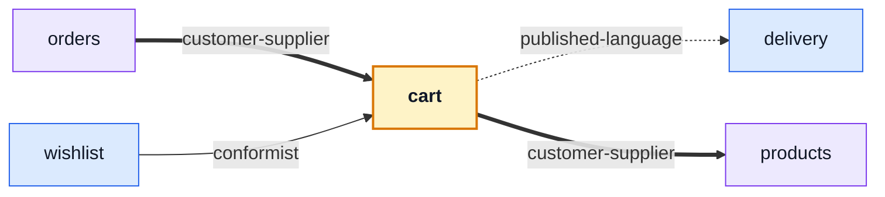
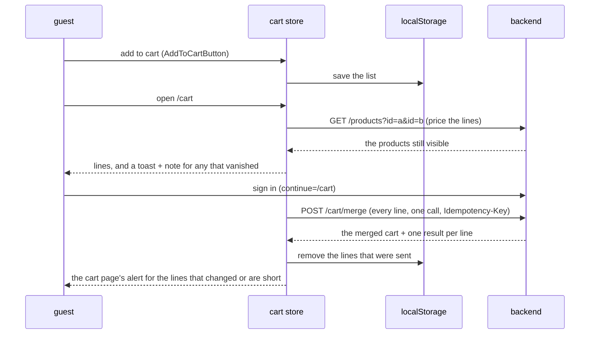
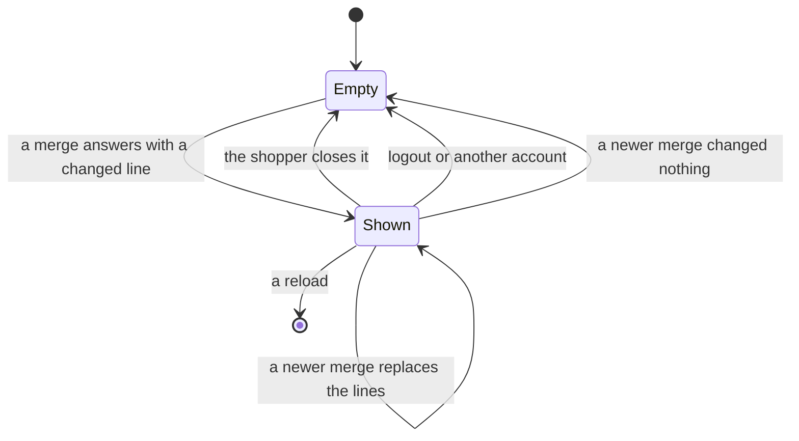
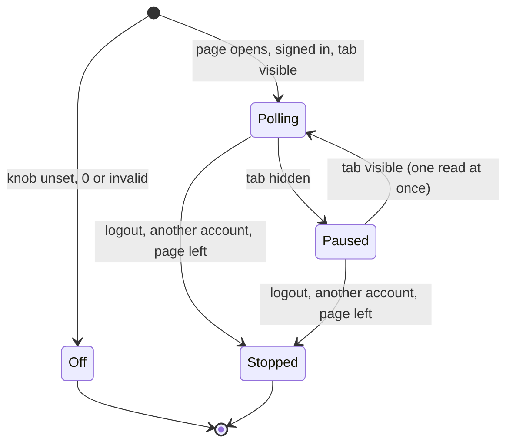
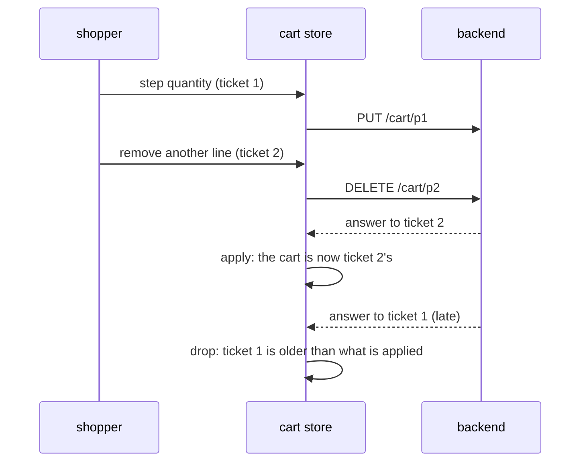
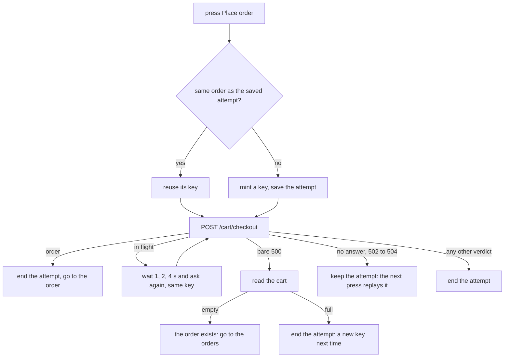

# cart

::: tip At a glance
**Owns** — the cart screen, the cart store, the guest cart that precedes it, and the checkout flow that ends them.
**Depends on** — [`delivery`](./delivery.md), and only for a component it mounts.
**Breaks if you change** — `badgeQuantity`. The shell's header reads it through the manifest.
:::

| Fact                    | This module                                                                |
| ----------------------- | -------------------------------------------------------------------------- |
| **Subdomain**           | `core` — The reason the product exists. Worth its own client-side rules.   |
| **Screens**             | 1 — `Cart`, which shows a guest `GuestCart` and a signed-in visitor `Cart` |
| **Store**               | `cart`                                                                     |
| **Menu entries**        | `Cart` (pinned beside the account menu, with its unit count and total)     |
| **API calls**           | 10                                                                         |
| **Depends on**          | [`delivery`](./delivery.md) · [`products`](./products.md)                  |
| **Depended on by**      | [`orders`](./orders.md) · [`wishlist`](./wishlist.md)                      |
| **Languages**           | `en` · `it`                                                                |
| **Publishes**           | `useCartStore`                                                             |
| **Backend counterpart** | `cart` in `boilerplate-node-backend`                                       |

## The map



- `orders` → **customer-supplier** — The reorder button asks the cart store to refill itself from a past order.
- `wishlist` → **conformist** — Move-to-cart calls a wishlist endpoint and then asks the cart store to refetch itself; the cart is never asked to write.
- → `products` **customer-supplier** — Reads its lines' title and price from the products dictionary in one batched read (`useProductLines`).
- → `delivery` **published-language** — Mounts `ShippingSelector`, a self-contained component that renders shipping without this module learning what a rate is.

## The story

[`orders`](./orders.md) reaches the barrel for the reorder button and [`wishlist`](./wishlist.md)
for its move-to-cart exit. `orders` is `customer-supplier` — it asks this store to write a line —
and `wishlist` is `conformist`: the move itself is a wishlist endpoint, and this store is only
asked to refetch.

The product page's "add to cart" arrives the other way round. This module's manifest contributes
`components/AddToCartButton.vue` to the `product-actions` slot that [`products`](./products.md)
owns (see `src/kernel/slots.ts`), so `products` never imports the cart and the graph stays a DAG.

[`delivery`](./delivery.md) is `published-language`: the checkout mounts `ShippingSelector` and
never learns what a shipping rate is. [`products`](./products.md) is `customer-supplier`: the page
holds lines as ids only and joins them to their product records in one `POST /products/search`
per hundred ids, through `useProductLines` — the same records the product page reads.

::: tip The badge and its total are the only reactive things this module lends the shell
`badgeQuantity` (every unit in the cart) is handed to the main navigation as a **badge accessor**,
and `badgeTotal` — formatted through `detail`, with `badgeCurrency` alongside it — as a **detail
accessor**. Both are refs; the shell calls each once inside its own setup and renders whatever the
ref holds, without ever learning whose store it is reading. The entry is `pinned`, so both sit on
the bar beside the account menu at every width rather than inside the account dropdown.

It seeds from `GET /cart/summary` whenever a session appears — the whole point of that endpoint is a
count that does not cost the cart — and every later mutation keeps it fresh through the store, since
each action replaces the local cart with the authoritative payload the API answered.
:::

Checkout lives in this store and not in the orders store, even though it answers with an order. It is
`POST /cart/checkout`, the contract files it under `Cart`, and it is the one call that empties the
cart this store is responsible for. Owned from anywhere else, the local cart survives a completed
order and the header keeps showing items the server has already turned into one.

Stepping a line's quantity does not call the store directly. `composables/use-line-quantity.ts`
debounces per-product clicks into one trailing request each — three quick clicks on `+` used to put
three requests in flight, and the cart ended up showing whichever one the server answered LAST.
A step still inside its debounce when the page goes away (a reload, a closed tab) is not lost: on
`pagehide` the view hands it to `sendKeepalive` (`src/infrastructure/http/keepalive.ts`), a `fetch` with
`keepalive`, because axios's request is cancelled with the page and `sendBeacon` can send neither a
`PUT` nor the bearer header.
What only the browser knows at checkout — the note, the payment choice and a picked address — lives
in `sessionStorage` under the signed-in user's id (`composables/use-checkout-draft.ts`). A reload
puts it back; checkout and the end of a session drop it. The delivery method is the server cart's.
Classifying a checkout rejection is pure, too: `domain/checkout-errors.ts` reads the envelope's
first error and returns a verdict (`cart-changed`, `insufficient-stock`, `address-not-found`,
`cart-empty`, `in-flight`, `server-error`, `other`, and the rest) — the view decides what each one
says and does. See [the checkout flow](./cart-checkout.md) for the refusals in full.

Two rules keep the store honest when the network does not behave: answers are applied in the order
the requests left ([Answers in order](#answers-in-order)), and a checkout that may or may not have
reached the server is retried as the same call ([The checkout key](#the-checkout-key)).

## The guest cart

A visitor can fill a cart without an account; sign-in is asked for at checkout, not at "add to
cart". The cart is a plain list of `{ productId, quantity }` in this browser's `localStorage`, and the
server never sees it until the visitor signs in.



| Piece                               | What it does                                                                                                                                                                              |
| ----------------------------------- | ----------------------------------------------------------------------------------------------------------------------------------------------------------------------------------------- |
| `domain/guest-cart.ts`              | The rules: a line already there grows (the `POST /cart` rule), a line stops at 999, a cart holds at most 100 products, storage is never trusted.                                          |
| `composables/guest-cart-storage.ts` | Reads and writes the two `localStorage` keys (the list and the pending merge), guarded: blocked or full storage costs the next visit, never this one.                                     |
| `composables/use-guest-cart.ts`     | `guestLines` and its actions, saved on every change and re-read when another tab changes the key; the cart store sends it (`mergeGuestCart`) and `badgeQuantity` falls back to its total. |
| `components/MergeReportAlert.vue`   | The cart page's merge alert: reads the store's report, renders nothing while it is empty.                                                                                                 |
| `components/GuestCart.vue`          | The guest's page: priced lines, steppers, "Sign in to check out". No shipping, address or payment: checkout needs an account.                                                             |
| `views/CartEntry.vue`               | The route's screen: `GuestCart` for a guest, `Cart` for a signed-in visitor.                                                                                                              |

The route is `access: 'open'`: a guest passes, and `meta.can` (`update Cart`) is asked of signed-in
visitors only, so staff, who hold no basket, are still turned away.

### The merge

When a session that may shop appears, the shell's badge accessor calls `seedAfterSignIn`. With a
guest cart it sends every line in one `POST /cart/merge`, which adds each by the rule of
`POST /cart`: a product already in the cart **grows** by the line's quantity. The answer is the
merged cart and **one result per submitted line**:
`{ productId, requested, resulting, reason?, insufficientStock }`. `reason` is absent when the line
landed as chosen, and otherwise one of `summed`, `capped` or `unavailable`. A line the cart cannot
take is not a failure: the call still answers 200, and for the lines that were `unavailable` the
server also writes one `notifications.cart-merge-refused` notification, which the
[bell](./notifications.md) shows. Without a guest cart it reads the summary for the badge, as before.

**Stock is checked, never enforced, and never revealed.** A line the shelf does not cover is still
added, at the summed quantity, and carries `insufficientStock: true`. The merge does not lower it,
and no answer says how many are for sale: the client never needs that number and never has it.
Checkout is where a short line is refused (`CART_INSUFFICIENT_STOCK`).

- Exactly the lines that were **sent** leave the guest list once the server has answered. A product
  added while the call was out stays, and a line grown meanwhile keeps only its extra units, so
  nothing is merged twice and nothing the guest did is lost.
- A failed call leaves the list exactly as it was, shows one toast, and tries again at the next
  sign-in. The badge's summary is still read, so the header is not blank. The exception is a 400,
  413 or 422: the stored list itself is what the server refused, so retrying would only refuse
  again. Those lines are dropped, with a toast saying so.
- Two asks in the same breath (the shell seeding twice) join one call: the guest cart is sent once.
- The first full `GET /cart` waits for the merge, so a read answered from before it cannot overwrite
  the merged cart.

#### The key makes a retry the same call

The request carries an `Idempotency-Key`. A merge that never got a conclusive answer (the connection
dropped, a 5xx) may have been applied, so the retry must be the _same_ call to the server, which then
replays its answer instead of adding the quantities again.

| Rule                                     | Why                                                                                                                                                                                                             |
| ---------------------------------------- | --------------------------------------------------------------------------------------------------------------------------------------------------------------------------------------------------------------- |
| Kept after no answer or a 5xx            | The server may have applied it: the retry has to be recognised.                                                                                                                                                 |
| Dropped after an answer or any other 4xx | The next attempt is a different call.                                                                                                                                                                           |
| Replayed first when the lines changed    | A lost call may have been applied: it is sent again under its own key and body (the server answers from its record), the units it carried leave the list, and only what was added since goes under a fresh key. |
| Saved in `localStorage` beside the list  | The usual retry is after a reload, and a key held in memory would not survive it.                                                                                                                               |

Two tabs restoring a session at the same moment, with no attempt saved yet, each mint a key and merge once: rare, and the alert shows the sum when it happens. Nothing guards against it.

### The merge alert

What the merge changed is told **once, on the cart page**, in an inline closable alert above the
lines (`components/MergeReportAlert.vue`). It is neither a toast (it must outlive a few seconds) nor
a bell notification (it is tied to this screen and goes with it).

It lists three kinds of line (`mergeReportKind`):

| Kind      | When                                               | What it says                                                                         |
| --------- | -------------------------------------------------- | ------------------------------------------------------------------------------------ |
| `changed` | a `reason` of `summed` or `capped`                 | the quantities, and the reason in plain words                                        |
| `short`   | `insufficientStock`, and the product is still sold | the quantities, a "Not enough in stock" marker, "Lower the quantity before checkout" |
| `gone`    | a `reason` of `unavailable`                        | the quantities, and "no longer available, so it was not added"                       |

Each line names the product in the reader's language, the quantity the guest chose and the quantity
the cart holds now. The title comes from the same product lookup the lines use; a product that
cannot be read (it left the catalogue) is called "A product". A line that landed as chosen and fits
the stock is not listed. The alert stays visible over an _empty_ cart, which is when a merge that
added nothing most needs explaining.



- The report is `mergeReport` in the store: memory only. It survives navigating away and back, and a
  reload drops it, since the server keeps no record of what the guest asked for.
- A later `GET /cart` never sets or touches it: only an answer to a merge does.
- It is one live region (`role="status"`, polite) for the whole alert, not one per line; the
  page's quantities and total are live regions already, and the alert adds exactly one more.
- A short line is marked in words, never by colour alone, and never prints a stock number.

### A short line on the cart page

Every cart answer (`GET /cart` and every write) carries `insufficientStock` on each line. The page
shows a small "Not enough in stock" marker beside the quantity of a flagged line. The marker is
text, and it sits inside the quantity's own live region, so a line turning short is announced
without a live region per row. The quantity on screen is never changed for it: lowering the line,
or removing it, is the shopper's call. It is a flag, never the number left.

### The stock poll

A flag only helps if it follows the shelf. With `VITE_CART_STOCK_POLL_SECONDS` set, the cart page
re-reads `GET /cart` on a plain interval (not long polling: nothing is held open).

| Knob value                                 | Result                                                   |
| ------------------------------------------ | -------------------------------------------------------- |
| unset, empty, `0`, negative                | No polling: no timer, no listener                        |
| not a whole number (`2.5`, `often`)        | No polling                                               |
| more than a timer can hold (about 24 days) | No polling: it would fire at once                        |
| a positive whole number `N`                | A read every `N` seconds while the conditions below hold |

The knob is read like every deployment value: a container's `config.js` first, the build's `.env`
second. See [Environment](../tools/environment.md).



- **Where**: the cart page. Checkout is the same page, so one place covers both. A guest cart has
  no server copy and is never polled.
- **Who**: stops for good on logout or when another account takes the tab. It does not resume when
  the old account signs back in; reopen the page.
- **Hidden tab**: paused, with one read as soon as the tab is visible again.
- **Never over a fresher answer.** This is the one background read in the store, `pollCart`, and it
  yields to anything newer. It skips its tick while any call that replaces the cart is on the wire
  (or another poll is). Its answer is dropped if such a call started, or the viewer changed, after
  it left. It does not toggle `loading` (that would disable the page's buttons every tick), and it
  never touches the merge report.
- **A failed read** is only logged at debug level: the next tick tries again.

The poll does not need to be on for the page to catch up: see
[Coming back to the page](#coming-back-to-the-page).

### Coming back to the page

The server's cart can change behind an open screen (another tab, the wishlist, a price or a stock
change). When the window gets focus or the tab becomes visible, the page reads the cart once more
(`composables/use-cart-focus-refresh.ts`, through the same `pollCart`, so it yields to any write in
flight). It is event-driven, costs nothing while the page is left alone, and needs no knob. It
narrows the gap; the shopper who never leaves the page is covered by
[the total the buyer was shown](#the-total-the-buyer-was-shown).

### Answers in order

Every call that writes the cart takes a **ticket** when it leaves, and its answer is applied only
if no fresher answer was applied first (`infrastructure/utils/request-ticket.ts`). A slow, older
answer therefore never overwrites a newer one, whatever order the network delivers them in.



A change of viewer is a **barrier**: it kills every ticket taken before it, so an answer still on the
wire for the previous person lands nowhere, and neither does their merge report. The badge's
summary read has its own ordering, kept apart so a summary answered first can never make a write's
answer stale. The wishlist store uses the same helper.

The cart page adds two guards of its own. A `placing` flag, set synchronously on the first press of
"Place order", shuts out a second press in the same task and disables the steppers, so no step can
fire against a basket the order already consumed. On success the page forgets every pending step
for the same reason. The shipping radio follows `cart.shipping.selected` whenever it changes, so
a late read can neither wipe a pick nor leave a method the server dropped.

### The checkout key

`POST /cart/checkout` carries an `Idempotency-Key`. The server binds a key to the request body,
answers 409 `IDEMPOTENCY_IN_FLIGHT` while the first attempt still runs, and replays a recorded
outcome (a 5xx too) for as long as it keeps the key. So a key may travel again only with the same
order.

The key follows a **fingerprint** of the order and the person: the request body (the shown total
included), the cart's lines
and the selected shipping method (`domain/checkout-attempt.ts`). The same order asked again is the
same call; anything else gets a fresh key, whoever changed it (the wishlist, the stock poll, a
merge, a reorder), without any of them having to remember to say so. The attempt is saved in
`sessionStorage` (`composables/checkout-attempt-storage.ts`), so a reload in the middle of an
unanswered checkout still replays the order instead of placing a second one.

| What came back              | The key                           | What the page does                                                                        |
| --------------------------- | --------------------------------- | ----------------------------------------------------------------------------------------- |
| no answer, 502, 503, 504    | kept                              | the next press is the same call and replays whatever the server did                       |
| 409 `IDEMPOTENCY_IN_FLIGHT` | kept                              | the store asks again itself after 1, 2 and 4 s; if still running, a message and a re-read |
| a bare 500                  | kept until the cart is read again | empty cart: the order exists, the page goes to the orders; still full: a new key          |
| 409 `CART_EMPTY`            | ended                             | a message and a re-read, so the page stops offering a basket that is gone                 |
| any other refusal           | ended                             | the refusal's own handling ([the checkout flow](./cart-checkout.md))                      |
| success                     | ended                             | clear the draft, go to the order                                                          |



### The total the buyer was shown

`POST /cart/checkout` requires `expectedTotal`: the total on screen right before "Place order"
(`summary.totalPrice`, shipping included, with its currency), in integer minor units. The store
builds it from the cart it holds, never the page (`domain/expected-total.ts`; the decimals come from
the currency, so JPY has none and KWD has three), and refuses to run before a cart was read.

If the server would charge anything else (a price moved, shipping changed, the basket changed) it
answers 409 `CART_TOTAL_CHANGED` with `details.expected` and `details.actual`, and writes nothing.
The store ends the attempt and reads the cart again, so the page shows the new total. The page says
"The total changed from X to Y" in the visitor's locale, stays on the cart and keeps the button
live: the next press names the new total, and places the order at it. The total is part of the
fingerprint, so that press is a new call under a new key.

### A product that is gone

The page prices its lines with one batched read. A product that does not come back (deleted,
deactivated) leaves the cart with a toast, and a note on the page says so for the rest of the visit.
A failed read removes nothing, and neither does a read that a language switch cancelled: neither is
evidence that a product is gone.

## State

Store `cart`, from `store.ts`. Only what the setup function returns is listed — an internal ref is not part of the surface.

| Kind        | Members                                                                                                                                                                                                                                                                           | What it is                                                       |
| ----------- | --------------------------------------------------------------------------------------------------------------------------------------------------------------------------------------------------------------------------------------------------------------------------------- | ---------------------------------------------------------------- |
| **State**   | `cart` · `guestLines` · `mergeReport`                                                                                                                                                                                                                                             | The refs the setup function returns — the only writable surface. |
| **Getters** | `cartItems` · `cartSummary` · `badgeQuantity` · `badgeTotal` · `badgeCurrency` · `guestQuantity` · `hasGuestLines` · `loading`                                                                                                                                                    | Computed, derived from state. Read-only by construction.         |
| **Actions** | `fetchSummary` · `fetchCart` · `pollCart` · `checkout` · `reorder` · `addCartItem` · `updateCartItem` · `removeCartItem` · `clearCart` · `addGuestItem` · `updateGuestItem` · `removeGuestItems` · `clearGuestCart` · `mergeGuestCart` · `dismissMergeReport` · `seedAfterSignIn` | Everything that changes state or calls the API.                  |

## Screens

| Path   | Route name | Access | Permission    | View                  |
| ------ | ---------- | ------ | ------------- | --------------------- |
| `cart` | `Cart`     | `open` | `update Cart` | `views/CartEntry.vue` |

Paths are relative to the localised root, so `cart` is served at `/:locale/cart`. **Access** is the route’s own `meta.access` (the standing it needs) and **Permission** its `meta.can` — the `[action, subject]` rule checked against the caller's own rules from `GET /account/abilities`. A menu entry restates neither, which is what keeps the menu and the router from disagreeing. See [Security](../tools/security.md#route-guards).

## Wiring

#### Endpoints called

| Call                      | Response envelope              |
| ------------------------- | ------------------------------ |
| `DELETE /cart`            | `RemoveCartItemByBodyResponse` |
| `GET /cart`               | `GetCartResponse`              |
| `POST /cart`              | `AddCartItemResponse`          |
| `DELETE /cart/all`        | `ClearCartResponse`            |
| `POST /cart/checkout`     | `CheckoutResponse`             |
| `POST /cart/merge`        | `MergeCartResponse`            |
| `POST /cart/reorder/{id}` | `ReorderResponse`              |
| `GET /cart/summary`       | `GetCartSummaryResponse`       |
| `DELETE /cart/{id}`       | `RemoveCartItemResponse`       |
| `PUT /cart/{id}`          | `UpdateCartItemByIdResponse`   |

Each row registers one Zod envelope through the manifest, so enabling the domain turns its contract validation on and deleting the folder turns it off.

`DELETE /cart` (`removeCartItemByBody`, a body-addressed alternative to `DELETE /cart/{id}`) is
registered for contract validation but not called from any store action — a generated operation
this module has not adopted, not a hidden second removal path.

#### Navigation entries

| Route | Label key | Section | Order | Icon | Badge |
| ------ | ----------------------- | --- | --- | --- | --- | --- |
| `Cart` | `navigation.label-cart` | `account` | 80 | yes | yes |

#### Analytics events

None. Every checkout outcome — the order created, the checkout refused — is emitted by the backend
from the handler that decided it, and a request that never reached the API is already a failed span
in Faro. See [Observability](../tools/observability.md#event-taxonomy).

## Files

| File                                        | What it is                                                                                                                                                                          | Explained in                          |
| ------------------------------------------- | ----------------------------------------------------------------------------------------------------------------------------------------------------------------------------------- | ------------------------------------- |
| `composables/guest-cart-storage.ts`         | Reads and writes the guest cart's `localStorage` key, and the pending merge's, guarded against blocked or full storage.                                                             | [read](../theory/layers.md)           |
| `composables/use-cart-stock-poll.ts`        | Starts the opt-in stock poll for the lifetime of the page's setup: the interval, the visibility pause, the stop on logout. Registers nothing when the knob is off.                  | [read](../theory/layers.md)           |
| `composables/use-cart-focus-refresh.ts`     | Reads the cart again when the shopper comes back to the page: the window gets focus or the tab becomes visible.                                                                     | [read](../theory/layers.md)           |
| `composables/use-guest-cart.ts`             | The guest cart as a composable: the list, its actions, the copy-taking from another tab and the merge key rules.                                                                    | [read](../theory/layers.md)           |
| `composables/checkout-attempt-storage.ts`   | Where the checkout attempt in progress is remembered: its key, its person and its fingerprint, in `sessionStorage`, guarded.                                                        | [read](../theory/layers.md)           |
| `composables/use-line-quantity.ts`          | Debounces per-product stepper clicks into one trailing API call each, answering the visitor's own last click locally so the UI never waits on the round trip.                       | [read](../theory/layers.md)           |
| `domain/checkout-errors.ts`                 | Pure rules over plain data — no store, no component, no axios. Classifies a checkout rejection into one of its verdicts.                                                            | [read](../theory/domain-layer.md)     |
| `domain/guest-cart.ts`                      | Pure rules over plain data — no store, no component, no axios. The guest cart's lines, caps and read-back.                                                                          | [read](../theory/domain-layer.md)     |
| `domain/merge-report.ts`                    | Pure rules over plain data — no store, no component, no axios. Which lines of a merge answer are worth telling the shopper about.                                                   |
| `domain/expected-total.ts`                  | Pure rules over plain data. The shown total as minor units and its currency, the shape `POST /cart/checkout` requires.                                                              | [read](../theory/domain-layer.md)     |
| `domain/checkout-attempt.ts`                | Pure rules over plain data — no store, no component, no axios. The fingerprint that decides whether a checkout is the same call as the last one.                                    | [read](../theory/domain-layer.md)     |
| `domain/stock-poll.ts`                      | Pure rules over plain data — no store, no component, no axios. What the configured poll interval means: a positive whole number of seconds, else off.                               | [read](../theory/domain-layer.md)     |
| `domain/index.ts`                           | The domain barrel.                                                                                                                                                                  | [read](../theory/domain-layer.md)     |
| `domain/quantity.ts`                        | Pure client-side rules over plain data — no store, no component, no axios.                                                                                                          | [read](../theory/domain-layer.md)     |
| `index.ts`                                  | The public barrel: the only surface a sibling module may import.                                                                                                                    | [read](../theory/strategic-ddd.md)    |
| `locales/en.json`                           | This domain’s translation dictionary for one language, loaded as its own chunk.                                                                                                     | [read](../tools/i18n.md)              |
| `locales/it.json`                           | This domain’s translation dictionary for one language, loaded as its own chunk.                                                                                                     | [read](../tools/i18n.md)              |
| `module.ts`                                 | The manifest — the only file the application loads directly. Declares the name, routes, navigation entries, response schemas and locales, plus the optional loading keys and slots. | [read](../theory/modules.md)          |
| `response-schemas.ts`                       | One row per endpoint this domain calls, pairing a method and path pattern with the Zod envelope its response is validated against.                                                  | [read](../api/openapi-workflow.md)    |
| `components/AddToCartButton.vue`            | A component this domain owns. Published through the barrel when a sibling mounts it, internal otherwise.                                                                            | [read](../theory/layers.md)           |
| `components/GuestCart.vue`                  | A component this domain owns. Published through the barrel when a sibling mounts it, internal otherwise.                                                                            | [read](../theory/layers.md)           |
| `routes.ts`                                 | The domain’s route records, spliced into the localised route tree. Each carries its own `meta.access`.                                                                              | [read](../theory/sitemap.md)          |
| `store.ts`                                  | The Pinia store: this domain’s state, and every call it makes to the generated client.                                                                                              | [read](../tools/state-and-routing.md) |
| `tests/e2e/__snapshots__/cart.png`          | A committed visual-regression baseline.                                                                                                                                             | [read](../tools/visual-regression.md) |
| `tests/e2e/a11y.cy.ts`                      | Cypress accessibility sweep — an axe run over this domain's routes, at each authentication level.                                                                                   | [read](../tools/component-testing.md) |
| `tests/e2e/analytics.cy.ts`                 | Cypress suite — the `analytics` screens, in a browser.                                                                                                                              | [read](../tools/component-testing.md) |
| `tests/e2e/cart.cy.ts`                      | Cypress suite — the `cart` screens, in a browser.                                                                                                                                   | [read](../tools/component-testing.md) |
| `tests/e2e/cart.visual.cy.ts`               | Cypress visual suite — pixel diffs against the committed baselines.                                                                                                                 | [read](../tools/component-testing.md) |
| `tests/cart-view.spec.ts`                   | Vitest suite — `cart-view`, in isolation.                                                                                                                                           | [read](../tools/unit-testing.md)      |
| `tests/checkout-errors.spec.ts`             | Vitest suite — `checkout-errors`, in isolation.                                                                                                                                     | [read](../tools/unit-testing.md)      |
| `tests/add-to-cart-button.spec.ts`          | Vitest suite — `add-to-cart-button`, in isolation.                                                                                                                                  | [read](../tools/unit-testing.md)      |
| `tests/quantity.spec.ts`                    | Vitest suite — `quantity`, in isolation.                                                                                                                                            | [read](../tools/unit-testing.md)      |
| `tests/routes.spec.ts`                      | Vitest suite — the route records and the `meta.access` each one declares.                                                                                                           | [read](../tools/unit-testing.md)      |
| `tests/store.spec.ts`                       | Vitest suite — this domain's store, with the transport mocked.                                                                                                                      | [read](../tools/unit-testing.md)      |
| `tests/use-line-quantity.spec.ts`           | Vitest suite — the `useLineQuantity` composable, in isolation.                                                                                                                      | [read](../tools/unit-testing.md)      |
| `tests/cart-entry-view.spec.ts`             | Vitest suite — `cart-entry-view`, in isolation.                                                                                                                                     | [read](../tools/unit-testing.md)      |
| `tests/guest-cart-storage.spec.ts`          | Vitest suite — `guest-cart-storage`, in isolation.                                                                                                                                  | [read](../tools/unit-testing.md)      |
| `tests/guest-cart-store.spec.ts`            | Vitest suite — `guest-cart-store`, in isolation.                                                                                                                                    | [read](../tools/unit-testing.md)      |
| `tests/guest-cart-view.spec.ts`             | Vitest suite — `guest-cart-view`, in isolation.                                                                                                                                     | [read](../tools/unit-testing.md)      |
| `tests/guest-cart.spec.ts`                  | Vitest suite — `guest-cart`, in isolation.                                                                                                                                          |
| `tests/merge-report.spec.ts`                | Vitest suite — which merge lines reach the shopper.                                                                                                                                 |
| `tests/stock-poll-interval.spec.ts`         | Vitest suite — what each value of the poll knob means.                                                                                                                              | [read](../tools/unit-testing.md)      |
| `tests/store-stock-poll.spec.ts`            | Vitest suite — the store's background read yields to anything fresher.                                                                                                              | [read](../tools/unit-testing.md)      |
| `tests/use-cart-stock-poll.spec.ts`         | Vitest suite — the poll under fake timers: knob, sign-in, hidden tab, writes in flight, stop.                                                                                       | [read](../tools/unit-testing.md)      |
| `tests/use-cart-focus-refresh.spec.ts`      | Vitest suite — the refresh on return: focus, visibility, hidden, a write in flight, cleanup.                                                                                        | [read](../tools/unit-testing.md)      |
| `tests/store-stale-answer.spec.ts`          | Vitest suite — answers out of order never overwrite a fresher cart, for any delivery order.                                                                                         | [read](../tools/unit-testing.md)      |
| `tests/store-late-answer.spec.ts`           | Vitest suite — an answer for the previous person never lands in the next one's store.                                                                                               | [read](../tools/unit-testing.md)      |
| `tests/store-checkout-key.spec.ts`          | Vitest suite — the checkout key: same order, same key; reload, person, verdict, 500, in flight.                                                                                     | [read](../tools/unit-testing.md)      |
| `tests/store-double-seed.spec.ts`           | Vitest suite — two sign-in seeds send the guest cart once.                                                                                                                          | [read](../tools/unit-testing.md)      |
| `tests/module-badge-account-switch.spec.ts` | Vitest suite — another account taking the tab over is seeded for.                                                                                                                   | [read](../tools/unit-testing.md)      |
| `tests/cart-view-shipping-radio.spec.ts`    | Vitest suite — the shipping radio follows the cart whatever order the answers arrive in.                                                                                            | [read](../tools/unit-testing.md)      |
| `tests/cart-view-stale-refusal.spec.ts`     | Vitest suite — a lost order answer: empty cart, in flight, bare 500.                                                                                                                | [read](../tools/unit-testing.md)      |
| `tests/cart-view-double-submit.spec.ts`     | Vitest suite — the page is shut while an order is placed.                                                                                                                           | [read](../tools/unit-testing.md)      |
| `tests/guest-cart-input-validation.spec.ts` | Vitest suite — the guest cart's rules over every number, NaN included.                                                                                                              | [read](../tools/unit-testing.md)      |
| `tests/merge-report-alert.spec.ts`          | Vitest suite — the merge alert: content per kind (changed, short, gone), language, dismiss, live region, axe.                                                                       | [read](../tools/unit-testing.md)      |
| `views/Cart.vue`                            | A routed screen. Reads its store, renders, and holds no fetching logic of its own.                                                                                                  | [read](../theory/layers.md)           |
| `views/CartEntry.vue`                       | A routed screen. Reads its store, renders, and holds no fetching logic of its own.                                                                                                  | [read](../theory/layers.md)           |

## Working on it

| Suite            | Files | Where                                       |
| ---------------- | ----- | ------------------------------------------- |
| Vitest           | 23    | `src/modules/cart/tests/`                   |
| Cypress          | 4     | `src/modules/cart/tests/e2e/`               |
| Visual baselines | 1     | `src/modules/cart/tests/e2e/__snapshots__/` |

```bash
# this module's vitest suites
npm run test:unit -- cart

# this module's cypress suites
npm run test:e2e -- --spec 'src/modules/cart/tests/e2e/*.cy.ts'

# after the backend changes an endpoint this module calls
npm run regenerate
```

## Deeper in

- [The checkout flow](./cart-checkout.md)

## Related pages

- [The checkout flow](./cart-checkout.md) — the screen, the errors, and what the server decides
- [`wishlist`](./wishlist.md) · [`orders`](./orders.md) — the modules that write here; [`products`](./products.md) — where the product page's button is hosted
- [State & Routing](../tools/state-and-routing.md) — stores, and where the header reads this one
- [Layers](../theory/layers.md) — why a view holds no fetching logic
- [Product Analytics](../tools/umami.md) — why every cart and checkout event is the backend's to report, not this module's
