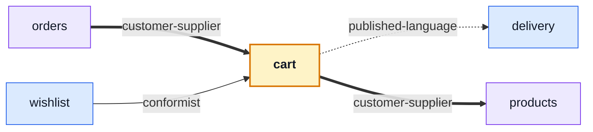
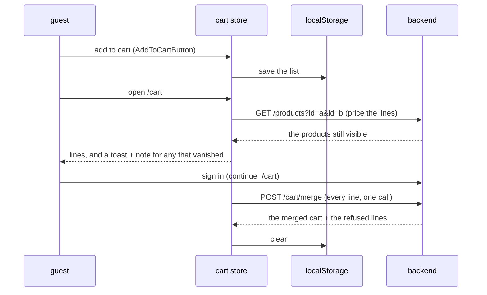

# cart

::: tip At a glance
**Owns** — the cart screen, the cart store, the guest cart that precedes it, and the checkout flow that ends them.
**Depends on** — [`delivery`](./delivery.md), and only for a component it mounts.
**Breaks if you change** — `badgeQuantity`. The shell's header reads it through the manifest.
:::

| Fact                    | This module                                                                |
| ----------------------- | -------------------------------------------------------------------------- |
| **Subdomain**           | `core` — The reason the product exists. Worth its own client-side rules.   |
| **Screens**             | 1 — `Cart`, which shows a guest `GuestCart` and a signed-in visitor `Cart` |
| **Store**               | `cart`                                                                     |
| **Menu entries**        | `Cart` (pinned beside the account menu, with its unit count and total)     |
| **API calls**           | 10                                                                         |
| **Depends on**          | [`delivery`](./delivery.md) · [`products`](./products.md)                  |
| **Depended on by**      | [`orders`](./orders.md) · [`wishlist`](./wishlist.md)                      |
| **Languages**           | `en` · `it`                                                                |
| **Publishes**           | `useCartStore`                                                             |
| **Backend counterpart** | `cart` in `boilerplate-node-backend`                                       |

## The map



- `orders` → **customer-supplier** — The reorder button asks the cart store to refill itself from a past order.
- `wishlist` → **conformist** — Move-to-cart calls a wishlist endpoint and then asks the cart store to refetch itself; the cart is never asked to write.
- → `products` **customer-supplier** — Reads its lines' title and price from the products dictionary in one batched read (`useProductLines`).
- → `delivery` **published-language** — Mounts `ShippingSelector`, a self-contained component that renders shipping without this module learning what a rate is.

## The story

[`orders`](./orders.md) reaches the barrel for the reorder button and [`wishlist`](./wishlist.md)
for its move-to-cart exit. `orders` is `customer-supplier` — it asks this store to write a line —
and `wishlist` is `conformist`: the move itself is a wishlist endpoint, and this store is only
asked to refetch.

The product page's "add to cart" arrives the other way round. This module's manifest contributes
`components/AddToCartButton.vue` to the `product-actions` slot that [`products`](./products.md)
owns (see `src/kernel/slots.ts`), so `products` never imports the cart and the graph stays a DAG.

[`delivery`](./delivery.md) is `published-language`: the checkout mounts `ShippingSelector` and
never learns what a shipping rate is. [`products`](./products.md) is `customer-supplier`: the page
holds lines as ids only and joins them to their product records in one `POST /products/search`
per hundred ids, through `useProductLines` — the same records the product page reads.

::: tip The badge and its total are the only reactive things this module lends the shell
`badgeQuantity` (every unit in the cart) is handed to the main navigation as a **badge accessor**,
and `badgeTotal` — formatted through `detail`, with `badgeCurrency` alongside it — as a **detail
accessor**. Both are refs; the shell calls each once inside its own setup and renders whatever the
ref holds, without ever learning whose store it is reading. The entry is `pinned`, so both sit on
the bar beside the account menu at every width rather than inside the account dropdown.

It seeds from `GET /cart/summary` whenever a session appears — the whole point of that endpoint is a
count that does not cost the cart — and every later mutation keeps it fresh through the store, since
each action replaces the local cart with the authoritative payload the API answered.
:::

Checkout lives in this store and not in the orders store, even though it answers with an order. It is
`POST /cart/checkout`, the contract files it under `Cart`, and it is the one call that empties the
cart this store is responsible for. Owned from anywhere else, the local cart survives a completed
order and the header keeps showing items the server has already turned into one.

Stepping a line's quantity does not call the store directly. `composables/use-line-quantity.ts`
debounces per-product clicks into one trailing request each — three quick clicks on `+` used to put
three requests in flight, and the cart ended up showing whichever one the server answered LAST.
A step still inside its debounce when the page goes away (a reload, a closed tab) is not lost: on
`pagehide` the view hands it to `sendKeepalive` (`src/infrastructure/http/keepalive.ts`), a `fetch` with
`keepalive`, because axios's request is cancelled with the page and `sendBeacon` can send neither a
`PUT` nor the bearer header.
What only the browser knows at checkout — the note, the payment choice and a picked address — lives
in `sessionStorage` under the signed-in user's id (`composables/use-checkout-draft.ts`). A reload
puts it back; checkout and the end of a session drop it. The delivery method is the server cart's.
Classifying a checkout rejection is pure, too: `domain/checkout-errors.ts` reads the envelope's
first error and returns a verdict (`cart-changed`, `insufficient-stock`, `address-not-found`,
`other`) — the view decides what each one says and does. See
[the checkout flow](./cart-checkout.md) for the refusals in full.

## The guest cart

A visitor can fill a cart without an account; sign-in is asked for at checkout, not at "add to
cart". The cart is a plain list of `{ productId, quantity }` in this browser's `localStorage`, and the
server never sees it until the visitor signs in.



| Piece                               | What it does                                                                                                                                     |
| ----------------------------------- | ------------------------------------------------------------------------------------------------------------------------------------------------ |
| `domain/guest-cart.ts`              | The rules: a line already there grows (the `POST /cart` rule), a line stops at 999, a cart holds at most 100 products, storage is never trusted. |
| `composables/guest-cart-storage.ts` | Reads and writes the one `localStorage` key, guarded: blocked or full storage costs the next visit, never this one.                              |
| `store.ts`                          | `guestLines` and its actions, saved on every change and re-read when another tab changes the key. `badgeQuantity` falls back to the guest total. |
| `components/GuestCart.vue`          | The guest's page: priced lines, steppers, "Sign in to check out". No shipping, address or payment: checkout needs an account.                    |
| `views/CartEntry.vue`               | The route's screen: `GuestCart` for a guest, `Cart` for a signed-in visitor.                                                                     |

The route is `access: 'open'`: a guest passes, and `meta.can` (`update Cart`) is asked of signed-in
visitors only, so staff, who hold no basket, are still turned away.

### The merge

When a session that may shop appears, the shell's badge accessor calls `seedAfterSignIn`. With a
guest cart it sends every line in one `POST /cart/merge`, which adds each by the rule of
`POST /cart`: a product already in the cart **grows** by the line's quantity. A line the cart cannot
take (no longer visible, or past the per-line cap) is **refused**, not failed: the call still answers
200, and the server writes one `notifications.cart-merge-refused` notification listing them, which
the [bell](./notifications.md) shows. Without a guest cart it reads the summary for the badge, as before.

- The guest cart is emptied once the server has answered, refused lines included: the notification is
  what remembers them.
- A failed call leaves the list exactly as it was, shows one toast, and tries again at the next
  sign-in. The badge's summary is still read, so the header is not blank.
- The first full `GET /cart` waits for the merge, so a read answered from before it cannot overwrite
  the merged cart.

### A product that is gone

The page prices its lines with one batched read. A product that does not come back (deleted,
deactivated) leaves the cart with a toast, and a note on the page says so for the rest of the visit.
A failed read removes nothing, and neither does a read that a language switch cancelled: neither is
evidence that a product is gone.

## State

Store `cart`, from `store.ts`. Only what the setup function returns is listed — an internal ref is not part of the surface.

| Kind        | Members                                                                                                                                                                                                                                       | What it is                                                       |
| ----------- | --------------------------------------------------------------------------------------------------------------------------------------------------------------------------------------------------------------------------------------------- | ---------------------------------------------------------------- |
| **State**   | `cart` · `guestLines`                                                                                                                                                                                                                         | The refs the setup function returns — the only writable surface. |
| **Getters** | `cartItems` · `cartSummary` · `badgeQuantity` · `badgeTotal` · `badgeCurrency` · `guestQuantity` · `hasGuestLines` · `loading`                                                                                                                | Computed, derived from state. Read-only by construction.         |
| **Actions** | `fetchSummary` · `fetchCart` · `checkout` · `reorder` · `addCartItem` · `updateCartItem` · `removeCartItem` · `clearCart` · `addGuestItem` · `updateGuestItem` · `removeGuestItems` · `clearGuestCart` · `mergeGuestCart` · `seedAfterSignIn` | Everything that changes state or calls the API.                  |

## Screens

| Path   | Route name | Access | Permission    | View                  |
| ------ | ---------- | ------ | ------------- | --------------------- |
| `cart` | `Cart`     | `open` | `update Cart` | `views/CartEntry.vue` |

Paths are relative to the localised root, so `cart` is served at `/:locale/cart`. **Access** is the route’s own `meta.access` (the standing it needs) and **Permission** its `meta.can` — the `[action, subject]` rule checked against the caller's own rules from `GET /account/abilities`. A menu entry restates neither, which is what keeps the menu and the router from disagreeing. See [Security](../tools/security.md#route-guards).

## Wiring

#### Endpoints called

| Call                      | Response envelope              |
| ------------------------- | ------------------------------ |
| `DELETE /cart`            | `RemoveCartItemByBodyResponse` |
| `GET /cart`               | `GetCartResponse`              |
| `POST /cart`              | `AddCartItemResponse`          |
| `DELETE /cart/all`        | `ClearCartResponse`            |
| `POST /cart/checkout`     | `CheckoutResponse`             |
| `POST /cart/merge`        | `MergeCartResponse`            |
| `POST /cart/reorder/{id}` | `ReorderResponse`              |
| `GET /cart/summary`       | `GetCartSummaryResponse`       |
| `DELETE /cart/{id}`       | `RemoveCartItemResponse`       |
| `PUT /cart/{id}`          | `UpdateCartItemByIdResponse`   |

Each row registers one Zod envelope through the manifest, so enabling the domain turns its contract validation on and deleting the folder turns it off.

`DELETE /cart` (`removeCartItemByBody`, a body-addressed alternative to `DELETE /cart/{id}`) is
registered for contract validation but not called from any store action — a generated operation
this module has not adopted, not a hidden second removal path.

#### Navigation entries

| Route | Label key | Section | Order | Icon | Badge |
| ------ | ----------------------- | --- | --- | --- | --- | --- |
| `Cart` | `navigation.label-cart` | `account` | 80 | yes | yes |

#### Analytics events

None. Every checkout outcome — the order created, the checkout refused — is emitted by the backend
from the handler that decided it, and a request that never reached the API is already a failed span
in Faro. See [Observability](../tools/observability.md#event-taxonomy).

## Files

| File                                | What it is                                                                                                                                                                          | Explained in                          |
| ----------------------------------- | ----------------------------------------------------------------------------------------------------------------------------------------------------------------------------------- | ------------------------------------- |
| `composables/guest-cart-storage.ts` | Reads and writes the guest cart's one `localStorage` key, guarded against blocked or full storage.                                                                                  | [read](../theory/layers.md)           |
| `composables/use-line-quantity.ts`  | Debounces per-product stepper clicks into one trailing API call each, answering the visitor's own last click locally so the UI never waits on the round trip.                       | [read](../theory/layers.md)           |
| `domain/checkout-errors.ts`         | Pure rules over plain data — no store, no component, no axios. Classifies a checkout rejection into one of four verdicts.                                                           | [read](../theory/domain-layer.md)     |
| `domain/guest-cart.ts`              | Pure rules over plain data — no store, no component, no axios. The guest cart's lines, caps and read-back.                                                                          | [read](../theory/domain-layer.md)     |
| `domain/index.ts`                   | The domain barrel.                                                                                                                                                                  | [read](../theory/domain-layer.md)     |
| `domain/quantity.ts`                | Pure client-side rules over plain data — no store, no component, no axios.                                                                                                          | [read](../theory/domain-layer.md)     |
| `index.ts`                          | The public barrel: the only surface a sibling module may import.                                                                                                                    | [read](../theory/strategic-ddd.md)    |
| `locales/en.json`                   | This domain’s translation dictionary for one language, loaded as its own chunk.                                                                                                     | [read](../tools/i18n.md)              |
| `locales/it.json`                   | This domain’s translation dictionary for one language, loaded as its own chunk.                                                                                                     | [read](../tools/i18n.md)              |
| `module.ts`                         | The manifest — the only file the application loads directly. Declares the name, routes, navigation entries, response schemas and locales, plus the optional loading keys and slots. | [read](../theory/modules.md)          |
| `response-schemas.ts`               | One row per endpoint this domain calls, pairing a method and path pattern with the Zod envelope its response is validated against.                                                  | [read](../api/openapi-workflow.md)    |
| `components/AddToCartButton.vue`    | A component this domain owns. Published through the barrel when a sibling mounts it, internal otherwise.                                                                            | [read](../theory/layers.md)           |
| `components/GuestCart.vue`          | A component this domain owns. Published through the barrel when a sibling mounts it, internal otherwise.                                                                            | [read](../theory/layers.md)           |
| `routes.ts`                         | The domain’s route records, spliced into the localised route tree. Each carries its own `meta.access`.                                                                              | [read](../theory/sitemap.md)          |
| `store.ts`                          | The Pinia store: this domain’s state, and every call it makes to the generated client.                                                                                              | [read](../tools/state-and-routing.md) |
| `tests/e2e/__snapshots__/cart.png`  | A committed visual-regression baseline.                                                                                                                                             | [read](../tools/visual-regression.md) |
| `tests/e2e/a11y.cy.ts`              | Cypress accessibility sweep — an axe run over this domain's routes, at each authentication level.                                                                                   | [read](../tools/component-testing.md) |
| `tests/e2e/analytics.cy.ts`         | Cypress suite — the `analytics` screens, in a browser.                                                                                                                              | [read](../tools/component-testing.md) |
| `tests/e2e/cart.cy.ts`              | Cypress suite — the `cart` screens, in a browser.                                                                                                                                   | [read](../tools/component-testing.md) |
| `tests/e2e/cart.visual.cy.ts`       | Cypress visual suite — pixel diffs against the committed baselines.                                                                                                                 | [read](../tools/component-testing.md) |
| `tests/cart-view.spec.ts`           | Vitest suite — `cart-view`, in isolation.                                                                                                                                           | [read](../tools/unit-testing.md)      |
| `tests/checkout-errors.spec.ts`     | Vitest suite — `checkout-errors`, in isolation.                                                                                                                                     | [read](../tools/unit-testing.md)      |
| `tests/add-to-cart-button.spec.ts`  | Vitest suite — `add-to-cart-button`, in isolation.                                                                                                                                  | [read](../tools/unit-testing.md)      |
| `tests/quantity.spec.ts`            | Vitest suite — `quantity`, in isolation.                                                                                                                                            | [read](../tools/unit-testing.md)      |
| `tests/routes.spec.ts`              | Vitest suite — the route records and the `meta.access` each one declares.                                                                                                           | [read](../tools/unit-testing.md)      |
| `tests/store.spec.ts`               | Vitest suite — this domain's store, with the transport mocked.                                                                                                                      | [read](../tools/unit-testing.md)      |
| `tests/use-line-quantity.spec.ts`   | Vitest suite — the `useLineQuantity` composable, in isolation.                                                                                                                      | [read](../tools/unit-testing.md)      |
| `tests/cart-entry-view.spec.ts`     | Vitest suite — `cart-entry-view`, in isolation.                                                                                                                                     | [read](../tools/unit-testing.md)      |
| `tests/guest-cart-storage.spec.ts`  | Vitest suite — `guest-cart-storage`, in isolation.                                                                                                                                  | [read](../tools/unit-testing.md)      |
| `tests/guest-cart-store.spec.ts`    | Vitest suite — `guest-cart-store`, in isolation.                                                                                                                                    | [read](../tools/unit-testing.md)      |
| `tests/guest-cart-view.spec.ts`     | Vitest suite — `guest-cart-view`, in isolation.                                                                                                                                     | [read](../tools/unit-testing.md)      |
| `tests/guest-cart.spec.ts`          | Vitest suite — `guest-cart`, in isolation.                                                                                                                                          | [read](../tools/unit-testing.md)      |
| `views/Cart.vue`                    | A routed screen. Reads its store, renders, and holds no fetching logic of its own.                                                                                                  | [read](../theory/layers.md)           |
| `views/CartEntry.vue`               | A routed screen. Reads its store, renders, and holds no fetching logic of its own.                                                                                                  | [read](../theory/layers.md)           |

## Working on it

| Suite            | Files | Where                                       |
| ---------------- | ----- | ------------------------------------------- |
| Vitest           | 15    | `src/modules/cart/tests/`                   |
| Cypress          | 4     | `src/modules/cart/tests/e2e/`               |
| Visual baselines | 1     | `src/modules/cart/tests/e2e/__snapshots__/` |

```bash
# this module's vitest suites
npm run test:unit -- cart

# this module's cypress suites
npm run test:e2e -- --spec 'src/modules/cart/tests/e2e/*.cy.ts'

# after the backend changes an endpoint this module calls
npm run regenerate
```

## Deeper in

- [The checkout flow](./cart-checkout.md)

## Related pages

- [The checkout flow](./cart-checkout.md) — the screen, the errors, and what the server decides
- [`wishlist`](./wishlist.md) · [`orders`](./orders.md) — the modules that write here; [`products`](./products.md) — where the product page's button is hosted
- [State & Routing](../tools/state-and-routing.md) — stores, and where the header reads this one
- [Layers](../theory/layers.md) — why a view holds no fetching logic
- [Product Analytics](../tools/umami.md) — why every cart and checkout event is the backend's to report, not this module's
