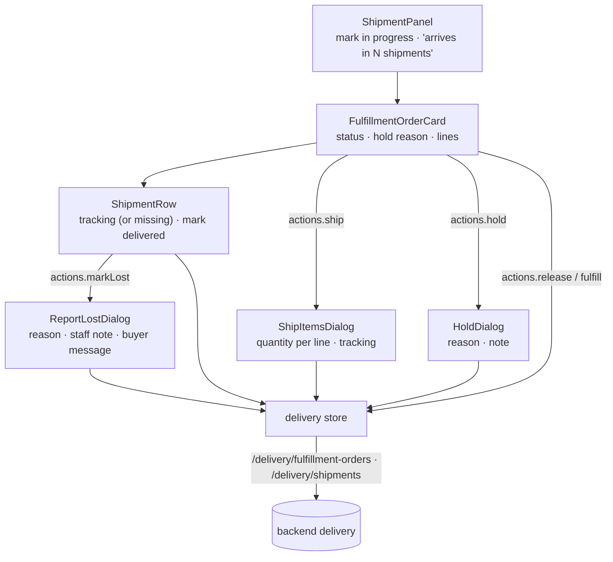

# delivery

::: tip At a glance
**Owns** — `ShippingSelector`, `ShipmentPanel`, `ShippingMethodName` and `PreorderFulfillmentTable`: shipping as components, not pages. `ShipmentPanel` lists an order's fulfillment orders and shipments; the table is the second tab of the preorder board.
**Depends on** — nothing. Three modules mount it; it mounts nothing.
**Breaks if you change** — a component's props, or `usePreorderSummaries`. [`cart`](./cart.md), [`orders`](./orders.md) and [`inventory`](./inventory.md) use them.
:::

| Fact          | This module                                                                                                       |
| ------------- | ----------------------------------------------------------------------------------------------------------------- |
| **Subdomain** | `supporting` — Specific to this business but not a differentiator. Kept plain.                                    |
| **Publishes** | `PreorderFulfillmentTable` · `ShipmentPanel` · `ShippingMethodName` · `ShippingSelector` · `usePreorderSummaries` |

## The map

The context map is drawn once, in [the whole map](./index.md#the-whole-map).

- `cart` → **published-language** — Mounts `ShippingSelector`, a self-contained component that renders shipping without this module learning what a rate is.
- `orders` → **published-language** — Mounts `ShipmentPanel`; the parcel renders itself and this module never touches a shipment.
- `inventory` → **published-language** — Mounts `PreorderFulfillmentTable` and reads `usePreorderSummaries` for the preorder board; the fulfillment orders stay this module's, and `inventory` learns nothing of a shipment.

## The story

**No routes and no navigation entries**, and three modules pointing at it — shared only with
`notifications`.

| Surface                    | Used by                       | On                        |
| -------------------------- | ----------------------------- | ------------------------- |
| `ShippingSelector`         | [`cart`](./cart.md)           | the checkout              |
| `ShipmentPanel`            | [`orders`](./orders.md)       | the order detail          |
| `PreorderFulfillmentTable` | [`inventory`](./inventory.md) | the preorder board, tab 2 |
| `usePreorderSummaries`     | [`inventory`](./inventory.md) | the preorder board, tab 1 |

Each edge is declared by the using module rather than here. None learns what a shipping rate or a tracking code is: the components render their own concern
and fetch their own data.

::: tip What deleting this module costs, precisely
The selector and the panels go. **Checkouts simply stop carrying shipping** — the state the shop
was in before this module existed.

That is the test [Adding & Removing a Module](../theory/module-lifecycle.md) describes, and this is
one of the two modules where it is cleanest, because nothing here is anyone else's state.
:::

Read this page and [`payments`](./payments.md) together. They are the same architectural move — a
domain whose entire published surface is a self-contained component — applied to two different
concerns.

## Fulfillment orders and shipments

An order is not one parcel. When it is paid the backend splits it into **fulfillment orders** (lines
that leave together), and each one is shipped in one or more **shipments** (what actually left, with
its own tracking code). `GET /orders/{id}/fulfillment-orders` and `GET /orders/{id}/shipments` answer the two lists, each
record with its own `actions` (the store reads both at once); the panel is a card per fulfillment order and the shipments inside it.



**Every button comes from the record's own `actions`.** The order's `actions` no longer carry ship,
deliver or fulfill; a card offers ship, fulfil (digital), hold and release from the fulfillment
order's flags, and a shipment row offers mark-delivered, edit-tracking and report-lost from the
shipment's. The one
order-level control left is the optional "Mark in progress" (`Order.actions.process`): shipping a `paid`
order starts it by itself. A shipment has one arrival button (`actions.deliver`); there is no forced
variant. Ship and fulfil each keep one `Idempotency-Key` per fulfillment order: a lost connection or an
in-flight 409 resends it, any other answer spends it and re-reads the order. A row shows a "Tracking code missing" chip while the server says
`awaitingTracking`, and "Sent to: …" when its `destination` differs from where the order ships now
(the page hands the order's address line down).

**What the pure helpers do** (`domain/ship-lines.ts`): turn the ship dialog's quantity fields into the
lines to send (never more than `remaining`, at least one unit) and count "arrives in N shipments"
(physical groups still to ship, or shipments already cut, whichever is larger). Nothing else is
counted here — what has shipped and what remains come off each line.

**A parcel can be lost.** A shipment's `actions.markLost` opens `ReportLostDialog`: a reason
(`damaged` means damaged in transit, never handed over), a note only colleagues read, and the
message the buyer reads and is mailed. The dialog owns its call (`POST /delivery/shipments/{id}/mark-lost`)
and the owning page re-reads the order; a `lost` row then shows the buyer's message, and to staff the
note.

**A hold waits for stock or for staff.** `awaiting_stock` is set and lifted only by the allocation of
stock, so that card says "waits for stock" and has no release; the three staff reasons
(`incorrect_address`, `high_risk`, `other`) can be released by hand.

**The buyer reads a notice, not the reason.** `holdReason` and `holdNote` are staff's; everyone gets
`holdNotice` (`awaiting_stock`, `check_address`, `delayed`) and the optional `holdMessage` staff wrote
for them. A buyer's card therefore says "Delayed", an address warning or a neutral line, and shows the
shop's message; staff keep "On hold" and the reason chip. `HoldDialog` has a second text, "message for
the buyer", beside the staff-only note. When the address is wrong, staff correct it on the order's edit
page ([orders](./orders.md)).

## A late preorder

A preorder's fulfillment order carries the dates it was promised and is expected on, and when its
buyer was last told. The card shows it; the server decides everything (the shop only tells the buyer
about a late date and never asks or cancels: that rule lives in the backend's `delivery`).

| On the card                 | Source                                              |
| --------------------------- | --------------------------------------------------- |
| "Promised for {date}"       | `agreedAt`, shown once `expectedAt` differs from it |
| "Last notice sent {date}"   | `lastNoticeAt`                                      |
| who cancelled what was left | `cancelReason`: `buyer` · `staff` · `order`         |

The buyer cancels on their own order page (the same card sits beside the order's cancel), and the
notice in the bell links there. There is no question to answer and no button for it: doing nothing
keeps them waiting.

## State

State, getters and actions are exactly what the setup function of each store returns: `src/modules/delivery/store.ts`.

## Screens

This module routes to nothing. It contributes components, schemas or a store to the modules that depend on it.

## Wiring

#### Endpoints called

Method, path pattern, response schema and owning module of every operation: `contracts/rest/routes.ts` (rows with `module: 'delivery'`). Auth is in the backend contract.

## Files

The folder is `src/modules/delivery/`; each file's own `@module` header says what it is.

## Working on it

```bash
# this module's vitest suites
npm run test:unit -- delivery

# after the backend changes an endpoint this module calls
npm run regenerate
```

## Deeper in

Nothing in this domain needs a page of its own — the story above is the whole of it.

## Related pages

- [`cart`](./cart.md) · [`orders`](./orders.md) · [`inventory`](./inventory.md) — the three modules that mount these components
- [`payments`](./payments.md) — the other component-only module
- [Strategic DDD](../theory/strategic-ddd.md) — reading a `published-language` edge
- [Adding & Removing a Module](../theory/module-lifecycle.md) — the deletability procedure
