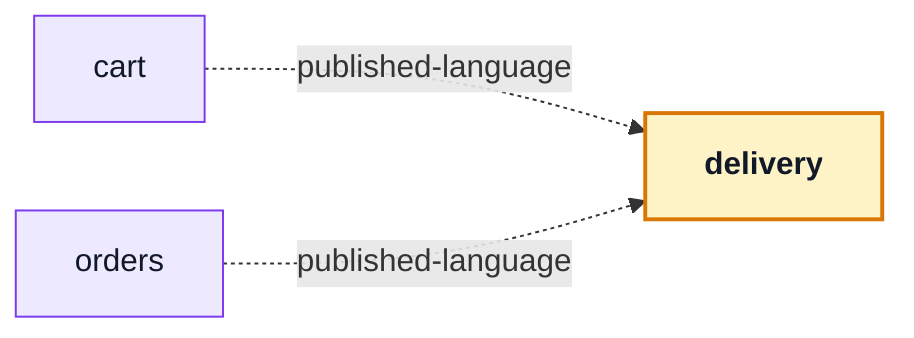
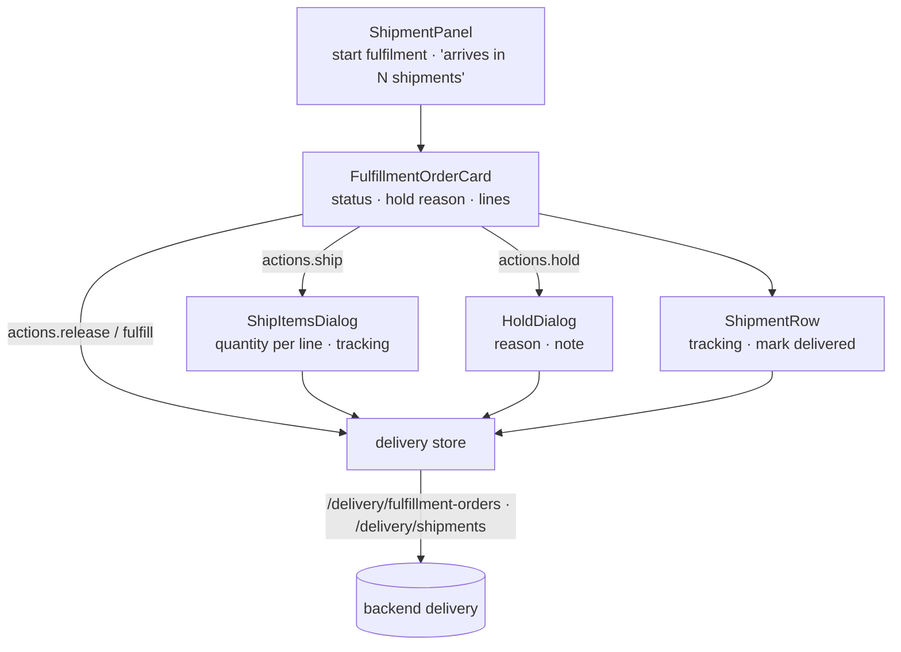

# delivery

::: tip At a glance
**Owns** — `ShippingSelector`, `ShipmentPanel` and `ShippingMethodName`: shipping as components, not pages. `ShipmentPanel` lists an order's fulfillment orders and shipments.
**Depends on** — nothing. Two modules mount it; it mounts nothing.
**Breaks if you change** — either component's props. [`cart`](./cart.md) and [`orders`](./orders.md) mount them.
:::

| Fact                    | This module                                                                    |
| ----------------------- | ------------------------------------------------------------------------------ |
| **Subdomain**           | `supporting` — Specific to this business but not a differentiator. Kept plain. |
| **Screens**             | _none_ — this module routes to nothing                                         |
| **Store**               | `delivery`                                                                     |
| **Menu entries**        | _none_                                                                         |
| **API calls**           | 9                                                                              |
| **Depends on**          | _nothing_                                                                      |
| **Depended on by**      | [`cart`](./cart.md) · [`orders`](./orders.md)                                  |
| **Languages**           | `en` · `it`                                                                    |
| **Publishes**           | `ShipmentPanel` · `ShippingMethodName` · `ShippingSelector`                    |
| **Backend counterpart** | `delivery` in `boilerplate-node-backend`                                       |

## The map



- `cart` → **published-language** — Mounts `ShippingSelector`, a self-contained component that renders shipping without this module learning what a rate is.
- `orders` → **published-language** — Mounts `ShipmentPanel`; the parcel renders itself and this module never touches a shipment.

## The story

**No routes and no navigation entries**, and two modules pointing at it — the only module here with
that shape.

| Component          | Mounted by              | On               |
| ------------------ | ----------------------- | ---------------- |
| `ShippingSelector` | [`cart`](./cart.md)     | the checkout     |
| `ShipmentPanel`    | [`orders`](./orders.md) | the order detail |

Both edges are `published-language`, and both are declared by the mounting module rather than here.
Neither learns what a shipping rate or a tracking code is: the components render their own concern
and fetch their own data.

::: tip What deleting this module costs, precisely
The selector and the panels go. **Checkouts simply stop carrying shipping** — the state the shop
was in before this module existed.

That is the test [Adding & Removing a Module](../theory/module-lifecycle.md) describes, and this is
one of the two modules where it is cleanest, because nothing here is anyone else's state.
:::

Read this page and [`payments`](./payments.md) together. They are the same architectural move — a
domain whose entire published surface is a self-contained component — applied to two different
concerns, and between them they cover four of the client's nine context edges.

## Fulfillment orders and shipments

An order is not one parcel. When it is paid the backend splits it into **fulfillment orders** (lines
that leave together), and each one is shipped in one or more **shipments** (what actually left, with
its own tracking code). `GET /delivery/order/{id}` answers both lists, each record with its own
`actions`; the panel is a card per fulfillment order and the shipments inside it.



**Every button comes from the record's own `actions`.** The order's `actions` no longer carry ship,
deliver or fulfill; a card offers ship, fulfil (digital), hold and release from the fulfillment
order's flags, and a shipment row offers mark-delivered and edit-tracking from the shipment's. The one
order-level control left is "Start fulfilment" (`Order.actions.start`). The single exception is the
forced door: while the ordinary one is closed, a caller whose `Order.actions.override` lists `shipped`
(or `delivered`) is offered it with a reason, and the server refuses what does not apply.

**What the pure helpers do** (`domain/ship-lines.ts`): turn the ship dialog's quantity fields into the
lines to send (never more than `remaining`, at least one unit) and count "arrives in N shipments"
(physical groups still to ship, or shipments already cut, whichever is larger). Nothing else is
counted here — what has shipped and what remains come off each line.

**A hold waits for stock or for staff.** `awaiting_stock` is set and lifted only by the allocation of
stock, so that card says "waits for stock" and has no release; the three staff reasons
(`incorrect_address`, `high_risk`, `other`) can be released by hand.

## State

Store `delivery`, from `store.ts`. Only what the setup function returns is listed — an internal ref is not part of the surface.

| Kind        | Members                                                                                                                      | What it is                                                                                            |
| ----------- | ---------------------------------------------------------------------------------------------------------------------------- | ----------------------------------------------------------------------------------------------------- |
| **State**   | `methods` · `shipToCountries` · `fulfillmentOrders` · `shipments`                                                            | The refs the setup function returns — the only writable surface.                                      |
| **Getters** | `loading`                                                                                                                    | Computed, derived from state. Read-only by construction.                                              |
| **Actions** | `fetchMethods` · `fetchFulfillmentForOrder` · `start` · `ship` · `fulfill` · `hold` · `release` · `deliver` · `editTracking` | Everything that changes state or calls the API. Each write ends by re-reading the order's fulfilment. |

## Screens

This module routes to nothing. It contributes components, schemas or a store to the modules that depend on it.

## Wiring

#### Endpoints called

| Call                                               | Response envelope                 |
| -------------------------------------------------- | --------------------------------- |
| `POST /delivery/order/{id}/start`                  | `StartFulfilmentResponse`         |
| `GET /delivery/order/{id}`                         | `GetFulfillmentByOrderResponse`   |
| `POST /delivery/fulfillment-orders/{id}/shipments` | `ShipFulfillmentOrderResponse`    |
| `POST /delivery/fulfillment-orders/{id}/fulfill`   | `FulfillFulfillmentOrderResponse` |
| `POST /delivery/fulfillment-orders/{id}/hold`      | `HoldFulfillmentOrderResponse`    |
| `POST /delivery/fulfillment-orders/{id}/release`   | `ReleaseFulfillmentOrderResponse` |
| `PATCH /delivery/shipments/{id}`                   | `UpdateShipmentResponse`          |
| `POST /delivery/shipments/{id}/deliver`            | `DeliverShipmentResponse`         |
| `GET /delivery/methods`                            | `ListShippingMethodsResponse`     |

Each row registers one Zod envelope through the manifest, so enabling the domain turns its contract validation on and deleting the folder turns it off.

## Files

| File                                  | What it is                                                                                                                                                                          | Explained in                          |
| ------------------------------------- | ----------------------------------------------------------------------------------------------------------------------------------------------------------------------------------- | ------------------------------------- |
| `components/FulfillmentOrderCard.vue` | One card per fulfillment order: status, hold reason, lines, its shipments, and the staff buttons its `actions` offer.                                                               | [read](../theory/layers.md)           |
| `components/HoldDialog.vue`           | Staff hold a fulfillment order back: a reason and an optional note.                                                                                                                 | [read](../theory/layers.md)           |
| `components/ShipItemsDialog.vue`      | Staff cut a shipment: a quantity per remaining line, a tracking code, and the forced door.                                                                                          | [read](../theory/layers.md)           |
| `components/ShipmentPanel.vue`        | The order page's shipping corner: the cards, "arrives in N shipments" and "Start fulfilment". Published through the barrel.                                                         | [read](../theory/layers.md)           |
| `components/ShipmentRow.vue`          | One shipment: lines, tracking, dates, mark delivered, edit tracking.                                                                                                                | [read](../theory/layers.md)           |
| `components/ShippingSelector.vue`     | A component this domain owns. Published through the barrel when a sibling mounts it, internal otherwise.                                                                            | [read](../theory/layers.md)           |
| `domain/ship-lines.ts`                | Pure helpers: the ship dialog's quantities as lines to send, and the shipment count.                                                                                                | [read](../theory/domain-layer.md)     |
| `index.ts`                            | The public barrel: the only surface a sibling module may import.                                                                                                                    | [read](../theory/strategic-ddd.md)    |
| `locales/en.json`                     | This domain’s translation dictionary for one language, loaded as its own chunk.                                                                                                     | [read](../tools/i18n.md)              |
| `locales/it.json`                     | This domain’s translation dictionary for one language, loaded as its own chunk.                                                                                                     | [read](../tools/i18n.md)              |
| `module.ts`                           | The manifest — the only file the application loads directly. Declares the name, routes, navigation entries, response schemas and locales, plus the optional loading keys and slots. | [read](../theory/modules.md)          |
| `response-schemas.ts`                 | One row per endpoint this domain calls, pairing a method and path pattern with the Zod envelope its response is validated against.                                                  | [read](../api/openapi-workflow.md)    |
| `store.ts`                            | The Pinia store: this domain’s state, and every call it makes to the generated client.                                                                                              | [read](../tools/state-and-routing.md) |
| `tests/`                              | Vitest suites — the store with the transport mocked, and each component and the pure helpers.                                                                                       | [read](../tools/unit-testing.md)      |

## Working on it

| Suite  | Files | Where                         |
| ------ | ----- | ----------------------------- |
| Vitest | 8     | `src/modules/delivery/tests/` |

```bash
# this module's vitest suites
npm run test:unit -- delivery

# after the backend changes an endpoint this module calls
npm run regenerate
```

## Deeper in

Nothing in this domain needs a page of its own — the story above is the whole of it.

## Related pages

- [`cart`](./cart.md) · [`orders`](./orders.md) — the two modules that mount these components
- [`payments`](./payments.md) — the other component-only module
- [Strategic DDD](../theory/strategic-ddd.md) — reading a `published-language` edge
- [Adding & Removing a Module](../theory/module-lifecycle.md) — the deletability procedure
