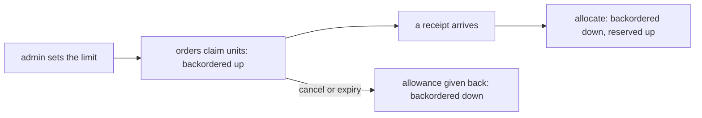
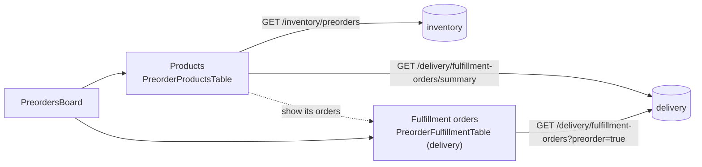

# inventory

::: tip At a glance
**Owns** — the admin stock board and the ledger behind it, the preorder limit, and the staff preorder board.
**Depends on** — [`products`](./products.md), read as-is, to put names on rows; [`delivery`](./delivery.md), for the board's fulfillment-order tab and per-product counts.
**Breaks if you change** — nothing outside this folder. No module depends on it.
:::

| Fact          | This module                                                                    |
| ------------- | ------------------------------------------------------------------------------ |
| **Subdomain** | `supporting` — Specific to this business but not a differentiator. Kept plain. |

## The map

The context map is drawn once, in [the whole map](./index.md#the-whole-map).

- → `products` **customer-supplier** — Asks the products store to drop its cached catalogue after a recorded movement (`invalidateProductsCache`), and reads the ledger's titles through `useProductLines`.
- → `delivery` **published-language** — Mounts `PreorderFulfillmentTable` and reads `usePreorderSummaries` on the preorder board; the fulfillment orders stay `delivery`'s.

## The story

One admin screen over two backend collections: the board that shows both counters and their derived
availability, and the ledger that explains every move.

The dependency is as thin as a dependency gets. The page names products — the receipt select, the
title lookup — by reading `useProductsStore` **as it is**, with no translation and no say in its
shape. It is the same one-way arrow the backend's `inventory` module declares against its own
`products`.

::: tip What deleting this module costs, precisely
The board and the ledger view go. **Every shelf count stays correct** — the counters and the
movements live server-side and keep being written — but every _why_ goes unrecorded as far as anyone
in this app can see.

That is a clean removal: the data is not this module's, only the window onto it.
:::

Both reads page, and neither is bounded client-side. The ledger is the record an audit works
through, so a view showing only the newest rows would misreport history as complete. The board sorts
on availability, which is derived rather than stored, so the server does that sort in an aggregation
rather than this client loading the catalogue to sort in memory.

The ledger stores product ids, so its titles are joined the way the cart's are: the ids a page
names and the products dictionary does not hold yet go out in one batched `POST /products/search`
(`useProductLines`). A product the search will not return keeps showing its id.

## Preorder allowance

A preorder claims units that do not exist yet, so it is counted against its own allowance, not the
shelf. Two numbers per product, both on the board: the **preorder limit** (how many may be
backordered at once; `0` closes preordering) and **backordered** (outstanding units, unpaid or paid,
until stock arrives and is allocated to them, oldest payment first).



- The limit is set from a dialog on the board row (`PATCH /inventory/levels/{id}`),
  offered only to a holder of `update:StockLevel`. It is absolute and
  idempotent, may sit below what is outstanding (only new orders are refused), and is **not** a
  movement: it leaves no ledger row.
- The ledger has a "Backordered" column for the third counter, and two reasons: `preorder` (units
  claimed) and `allocate` (stock arrived for a paid preorder).

## The preorder board

`/sales/preorders`, in the Sales menu group, for anyone holding `display:Order` (the same audience
as the orders it lists). Two tabs, kept in `?tab=`; the product the second tab is narrowed to in
`?productId=`.



- **Products** (needs `read:StockLevel`, so a viewer without it has only the second tab): one
  row per product from the union of the two reads, the worst first (most late, then most
  outstanding). Limit, outstanding (with its unpaid/paid split), left to order, lifetime ordered;
  the units by state (waiting, awaiting an answer, allocated, shipped, cancelled, late), only the
  non-zero ones. A product with sales and no allowance row (or the reverse) still shows, with dashes
  for the missing half. "Move release date" links to the product's edit form, for a holder of the
  product write: there is no preview of what a later date does to buyers who already paid.
- **Fulfillment orders**: server-paged. Filters are the server's own rules, passed through: **Late**
  (the expected date has passed and units remain, including allocated-but-unshipped ones the daily
  sweep leaves alone) and **Due soon** (still waiting for stock, expected within 7 days, so a slip can
  be moved before the date passes), plus state and product. Each row shows the order (linked), buyer,
  lines, paid date, promised and expected dates (and the slip), the state, the answer deadline when an
  answer is owed, who cancelled, and the last notice.

## State

State, getters and actions are exactly what the setup function of each store returns: `src/modules/inventory/store.ts`.

## Screens

Paths, route names, access and permission per screen: `src/modules/inventory/routes.ts`; every module's together are in the generated [sitemap](../theory/sitemap.md).

## Wiring

#### Endpoints called

Method, path pattern, response schema and owning module of every operation: `contracts/rest/routes.ts` (rows with `module: "inventory"`). Auth is in the backend contract.

#### Navigation entries

Entries are declared in `src/modules/inventory/module.ts`. Badges: `InventoryLedger` — `inventory`: levels at or under the low-stock threshold; `PreordersBoard` — `salesPreorders`: late fulfillment orders.

## Files

The folder is `src/modules/inventory/`; each file's own `@module` header says what it is.

## Working on it

```bash
# this module's vitest suites
npm run test:unit -- inventory

# this module's cypress suites
npm run test:e2e -- --spec 'src/modules/inventory/tests/e2e/*.cy.ts'

# after the backend changes an endpoint this module calls
npm run regenerate
```

## Deeper in

Nothing in this domain needs a page of its own — the story above is the whole of it.

## Related pages

- [`products`](./products.md) — the store this module reads
- [Sitemap & Access Control](../theory/sitemap.md) — the `admin` gate
- [State & Routing](../tools/state-and-routing.md) — paging through a store
- [Modules overview](./index.md) — the whole context map
