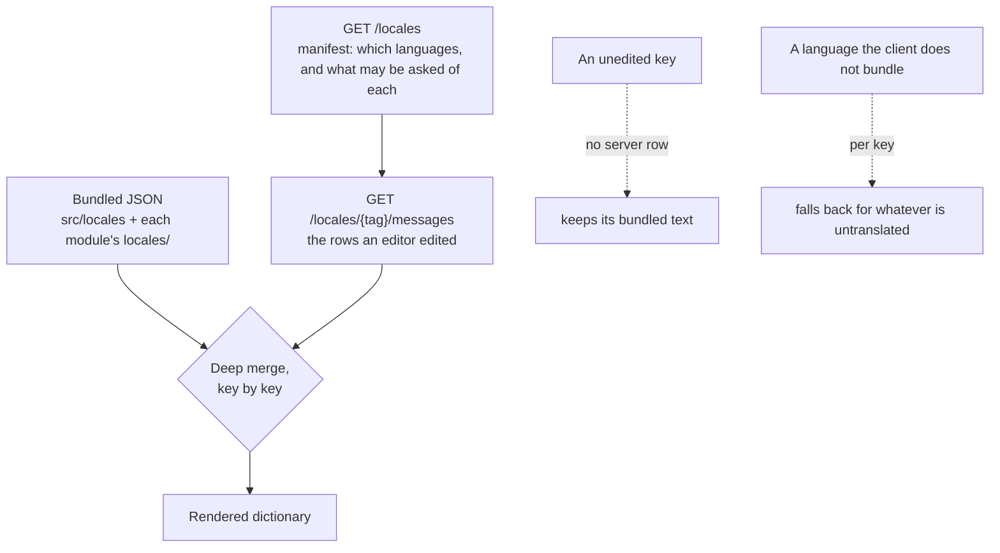

# locales

::: tip At a glance
**Owns** — the translation admin: which languages exist, and what has been edited into them.
**Depends on** — nothing. It talks only to `/locales/*`.
**Breaks if you change** — nothing outside this folder through an import. `products`' `ProductEdit`
checks `router.hasRoute('EntityTranslations')` before offering a link to it, guarded rather than
assumed, so removing the route degrades that one link instead of breaking the build.
:::

| Fact          | This module                                                         |
| ------------- | ------------------------------------------------------------------- |
| **Subdomain** | `generic` — A solved problem. Modelling effort here would be waste. |

::: info Almost stands alone
No module imports this one and it imports none. `products`' `ProductEdit` still names its
`EntityTranslations` route to guard a link, so deleting the folder and its line in `src/modules.ts`
costs that one guarded link, checked rather than assumed.
:::

## Its neighbourhood

`locales` sits on no import edge of the context map — nothing imports it and it imports nothing;
`products` reaches it only by route name, guarded through `router.hasRoute`.

## The story

This module is the **author** half of a two-half feature, and reading it without that split is how
you misunderstand it.

The **consumer** half lives in `infrastructure/locale-overrides.ts` and needs no module at all:
every visitor's locale switch reads it, on every page, whether or not anyone can edit a translation.
This module is the screens an editor edits the dictionary _through_.

::: tip What deleting this module costs, precisely
The four admin screens. **Every language already translated keeps rendering**, because rendering never
depended on this folder.

The two reads it shares with the boot path — `GET /locales` and `GET /locales/{tag}/messages` — stay
registered by `infrastructure` precisely so this folder can be `rm -rf`ed without touching them. That
is not a coincidence in the layering; it is the layering doing its job.
:::

`dictionaries.ts` is this module's one-off: the merge that layers server rows over what the app
bundles, key by key. An unedited key keeps its bundled text, and a language the client does not ship
at all falls back per key for whatever nobody has translated yet.



Every step resolves rather than rejects. The app is fully usable when the manifest and the override
read both answer nothing — that is the offline floor the bundled files exist to be, and it is why a
locale switch can never be blocked by an API that is slow, old or absent.

The trap worth carrying over from the server: a language existing in the database does **not** mean
the API can answer in it. `GET /locales` reports scopes per language rather than a bare list of tags,
so _may I request this language_ and _may I download a dictionary for it_ stay two questions.

**A stale save says so.** A language's record, its entries and a translation set
are versioned writes: when someone saved first, the server answers `412`, the screen shows a warning
(not an error) and offers "reload latest" instead of resending (`useStaleRecord`, see
[Request Flow](../theory/request-flow.md#conditional-writes)).

**An import warns instead of fencing.** A whole-dictionary tag cannot say which key a colleague
changed, so the entries import (merge or replace) sends no `If-Match`. The dialog asks one
confirmation first: a replace deletes every key not in the file, a merge overwrites current values,
and either one loses a colleague's recent edits. The API still accepts an optional `If-Match` from
other clients.

## State

State, getters and actions are exactly what the setup function of each store returns: `src/modules/locales/store.ts`.

## Screens

Paths, route names, access and permission per screen: `src/modules/locales/routes.ts`; every module's together are in the generated [sitemap](../theory/sitemap.md).

`EntityTranslations` is the generic translation door: any domain with translatable content links to
it by route name (`ProductEdit.vue`'s own "Translations" button does, guarded by
`router.hasRoute('EntityTranslations')` first — a build with this module disabled carries no such
route to resolve). Gated on `translations.read` rather than that other domain's own permission, on
purpose — see the route table's own comment in `routes.ts`.

## Wiring

#### Endpoints called

Method, path pattern, response schema and owning module of every operation: `contracts/rest/routes.ts` (rows with `module: "locales"`). Auth is in the backend contract.

#### Navigation entries

Entries are declared in `src/modules/locales/module.ts`.

## Files

The folder is `src/modules/locales/`; each file's own `@module` header says what it is.

## Working on it

```bash
# this module's vitest suites
npm run test:unit -- locales

# this module's cypress suites
npm run test:e2e -- --spec 'src/modules/locales/tests/e2e/*.cy.ts'

# after the backend changes an endpoint this module calls
npm run regenerate
```

## Deeper in

- [Runtime overrides](./locales-overrides.md)

## Related pages

- [Runtime overrides](./locales-overrides.md) — the two tiers and how they merge
- [Internationalisation](../tools/i18n.md) — the mechanism both halves run on
- [Modules overview](./index.md) — the whole context map
- [Sitemap & Access Control](../theory/sitemap.md) — the `auth` gate and per-route permission on all four screens
