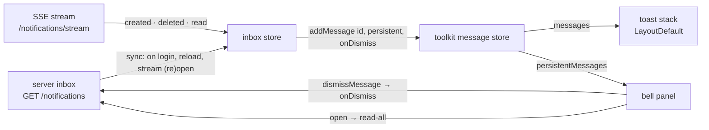

# notifications

::: tip At a glance
**Owns** — the signed-in visitor's inbox: the bell in the app bar, its panel, the live stream that keeps it current, and the wording of its five foundation codes.
**Depends on** — nothing. The server writes the notifications; this module only reads and renders them. Every other code is worded and linked by the module that owns it, through `AppModule.notices`.
**Breaks if you change** — the shape of `AppNotice` / `NoticeTarget` (`src/kernel/registry.ts`) and the five foundation codes. A code no enabled module declares reads as a generic message.
:::

| Fact                    | This module                                                                    |
| ----------------------- | ------------------------------------------------------------------------------ |
| **Subdomain**           | `supporting` — Specific to this business but not a differentiator. Kept plain. |
| **Screens**             | 0 — a bell the app bar hosts                                                   |
| **Store**               | `inbox`                                                                        |
| **Menu entries**        | —                                                                              |
| **API calls**           | 4, plus the `GET /notifications/stream` event stream                           |
| **Depends on**          | —                                                                              |
| **Depended on by**      | —                                                                              |
| **Languages**           | `en` · `it`                                                                    |
| **Publishes**           | —                                                                              |
| **Backend counterpart** | `notifications` in `boilerplate-node-backend`                                  |

## The story

A notification is a message the server keeps for one person until they delete it. The foundation
writes five kinds (a task opened, overdue or assigned; a webhook switched off; an event parked
after every retry). Everything else, the shop's buyer notices and its staff summaries included, is
written by a project's own module under its own prefix (here `shop-tasks.*`, see
[`shop-tasks`](./shop-tasks.md)).

The server stores a `code` and the facts that sentence needs, never text. This module turns them
into the reader's language from its own locale files, like every other API code.



### One store, two kinds of message

The toolkit's `useNotificationsStore` holds both. A **toast** lives in the page's memory and
disappears by itself; a **notification** is a toolkit message flagged `persistent`, with the
server's id, and it is what the bell lists. This module's own store (`inbox`) keeps no list of
its own: it is the translation between a server row and a toolkit message, plus every write the
bell makes. The server row is kept in the message's `meta`, so a language switch can rebuild the
text and `readAt` is where the unread state lives.

The toolkit's three verbs each have one meaning here:

| Verb                 | In this module                                                                                    |
| -------------------- | ------------------------------------------------------------------------------------------------- |
| `hideMessage(id)`    | A toast closing. The notification stays in the bell.                                              |
| `dismissMessage(id)` | The reader deletes one. `onDismiss` is the `DELETE`; a failure puts it back and toasts the error. |
| `removeMessage(id)`  | The app drops a row the server no longer has. Silent: nothing is sent back.                       |

### When something is shown as a toast

- A notification that **arrives on the stream** is shown once as a toast (8 seconds), then lives
  only in the bell.
- What was **already waiting** when a read lands (login, reload, reconnect) is added quietly: it
  is in the bell with a badge, not thrown at the reader as a stack of toasts.
- Re-adding a known id **updates in place** and keeps whether its toast is showing, so a refetch
  never brings back a toast the reader already closed.

### Keeping it current

The stream carries only what is written while it is open, so every open of it, the first and each
reconnect, is followed by a fresh `GET /notifications`. A row the read does not return is removed
silently. A read may have been answered just before something else happened, so each read in
flight remembers what landed meanwhile and wins over its own answer: a row the stream pushed is not
dropped, a row deleted (by a frame, the owner or "Clear all") is not brought back, and a row read
meanwhile stays read. A read that answers after the person changed, or after a fresher read, writes
nothing (the same ticket rule as [the cart](./cart.md#answers-in-order)). A failed read is reported by
the store itself, as a toast.

The stream authenticates with the refresh cookie (an `EventSource` cannot send a header), so the
URL is derived from the REST base the same way the observability stream's fallback is. If the
browser gives up on the stream for good (a refused handshake), `createSseClient` opens a new one
after 1, 2, 4 ... seconds (capped at 30), and every open is followed by a fresh read.

### The text

`Notification` is a union on `code`, and each variant carries its own typed `params` (`@types`).
The foundation never names a project's code. Each module declares the codes it owns in
`AppModule.notices`: a map from code to `{ describe, target? }`, collected like `navigation` and
installed once at boot (`registerNotices`). The inbox store asks the registry for the sentence and
the link of every row (`noticeOf`), so a build without a module simply words its codes as a generic
notification.

| Code                                   | `params`                             | Links to                                |
| -------------------------------------- | ------------------------------------ | --------------------------------------- |
| `notifications.staff.task-opened`      | `{ taskId, kind, category?, work? }` | the `work` path, else `TaskDetail`      |
| `notifications.staff.task-overdue`     | `{ taskId, kind, work? }`            | the `work` path, else `TaskDetail`      |
| `notifications.staff.task-assigned`    | `{ taskId, kind }`                   | `TaskDetail`                            |
| `notifications.staff.webhook-disabled` | `{ subscriptionId }`                 | `WebhookTarget`                         |
| `notifications.staff.outbox-dead`      | `{ eventName, aggregateId }`         | `UserTarget`, for a `user.*` event only |

A task notice reads "{kind}" (a contact message adds its category). Kind and category are closed
codes the server sends; their words are the co-owned `task-kind.*` and `task-category.*`
dictionary namespaces, which the tasks screens read too (see [`tasks`](./tasks.md)).

**Work notices.** Every row also carries `audience`: `own`, or `staff` for a work notice the backend
sent because the reader's role does that work (the backend decides who sees what, at read time: its `notifications` page,
"Work notices for staff"). A staff row carries ids only, so the sentence is short.

**Links.** A notice's `target` is one of two shapes (`NoticeTarget`):

| Shape                | Resolved by                                                                                                             |
| -------------------- | ----------------------------------------------------------------------------------------------------------------------- |
| `{ route, params? }` | `linkIfRouted`: the link exists only if this build ships a route by that name.                                          |
| `{ path }`           | `router.resolve` on the STRING (a `{ path }` object drops the query); refused when nothing or only a catch-all matches. |

Both go through `useNotificationLink`, the one resolver, and both keep the route's own `meta.can`:
a row never links where the reader would be refused, and an unopenable link shows the row with no
link at all. The `path` form is how a server-named `work` screen (`payments?tab=disputes`) is
followed without this module knowing the screen.

The code is its own dictionary key: `notifications.staff.webhook-disabled` is the entry
`staff.webhook-disabled` inside the `notifications` group of `locales/*.json`; a module's codes live
in its own group. The store hands each entry the reader's languages (current, then the shop's main
one) so a name stored per locale can be picked; the product-name rule is
[`shop-tasks`](./shop-tasks.md#the-text)'s.

A language switch rebuilds every message in place, so the text follows. Severity maps `info` →
`primary`; `success`, `warning` and `error` are unchanged. A notification the server writes for a
code this build does not know (a newer backend) reads as "You have a new notification."

### The end of a session

Logging out, or a different account taking over the tab, closes the stream and removes every
notification message, so the next person never sees them.

## The bell

The bell is contributed to the `app-bar` slot the shell owns (`src/kernel/slots.ts`); the shell
renders whatever arrives and never imports this module. It renders nothing for a guest or for a
session without `read:Notification`.

| Behaviour       | Detail                                                                                                                                                                                                                                                                                                                                                        |
| --------------- | ------------------------------------------------------------------------------------------------------------------------------------------------------------------------------------------------------------------------------------------------------------------------------------------------------------------------------------------------------------- |
| Badge           | The unread count: notifications with no `readAt`.                                                                                                                                                                                                                                                                                                             |
| Accessible name | "Notifications", or "Notifications: 3 unread" — the badge alone is a bare number.                                                                                                                                                                                                                                                                             |
| Opening         | `POST /notifications/read-all`, so the badge clears everywhere (the stream tells other tabs). Nothing is sent when nothing is unread. Rows that were new stay marked "New" while the panel is open.                                                                                                                                                           |
| Panel           | A `dialog`, newest first: text, date, an "Open it" link on a notice that has a target, a delete button named after its message, and "Clear all".                                                                                                                                                                                                              |
| Tabs            | Only while the inbox holds a work notice (`audience: 'staff'`): "Mine" (`own` rows) and "Work" (`staff` rows). The panel always opens on Mine. The bell badge stays the total unread; the Work tab wears its own count (unread plus those that were new when the panel opened) and names it in its accessible label. Without a work notice there are no tabs. |
| Clear all       | With tabs: `DELETE /notifications?audience=` (`own` or `staff`), the tab in view, one call; the server filters. Without tabs: the unfiltered bulk call.                                                                                                                                                                                                       |
| Focus           | Moves into the panel on open; Escape closes it and returns focus to the bell.                                                                                                                                                                                                                                                                                 |

Staff badges: see `nav-badges-open-work`.

## Screens

None. The module has no routes.

## Wiring

#### Endpoints called

| Call                           | Response schema                   |
| ------------------------------ | --------------------------------- |
| `GET /notifications`           | `ListNotificationsResponse`       |
| `POST /notifications/read-all` | `ReadAllNotificationsResponse`    |
| `DELETE /notifications`        | `DismissAllNotificationsResponse` |
| `DELETE /notifications/{id}`   | `DeleteNotificationByIdResponse`  |

Each row registers one Zod schema through the manifest, so enabling the domain turns its contract
validation on and deleting the folder turns it off. The stream's frames are validated against the
AsyncAPI schemas by `createSseClient` while validation is on.

#### Stream events

| Event                   | What the inbox does                                |
| ----------------------- | -------------------------------------------------- |
| `notifications.created` | Adds the row, shown once as a toast.               |
| `notifications.deleted` | Removes the ids, or everything when `all` is true. |
| `notifications.read`    | Marks every unread row read.                       |

## Files

| File                                   | What it is                                                                          | Explained in                          |
| -------------------------------------- | ----------------------------------------------------------------------------------- | ------------------------------------- |
| `module.ts`                            | The manifest. No routes; contributes the bell to the `app-bar` slot.                | [read](../theory/modules.md)          |
| `store.ts`                             | The `inbox` store: server rows to toolkit messages, and every write the bell makes. | [read](../tools/state-and-routing.md) |
| `composables/use-inbox-lifecycle.ts`   | Starts the read and the stream for the signed-in person and ends them with them.    | [read](../theory/layers.md)           |
| `components/NotificationsBell.vue`     | The bell, its badge and its panel.                                                  | [read](../theory/layers.md)           |
| `composables/use-notification-link.ts` | A notice's target as a link, if it exists here and the reader may open it.          | [read](../theory/layers.md)           |
| `notices.ts`                           | The five foundation codes as `AppModule.notices` entries: sentence and target.      | [read](../theory/modules.md)          |
| `types.ts`                             | The row the panel renders.                                                          | [read](../theory/layers.md)           |
| `response-schemas.ts`                  | One Zod schema per endpoint called.                                                 | [read](../api/openapi-workflow.md)    |
| `locales/en.json` · `locales/it.json`  | The sentences, keyed by code, and the bell's labels.                                | [read](../tools/i18n.md)              |

## Libraries

No library of its own. The stream is the shell's `createSseClient`, the messages are
`@guebbit/vue-toolkit`'s notifications store. The `params` are the contract's own typed union: no
parsing library is involved.

## Working on it

```bash
# this module's vitest suites
npm run test:unit -- notifications

# after the backend changes an endpoint, a code or an event
npm run regenerate
```

## Related pages

- [`shop-tasks`](./shop-tasks.md) — the shop's notice codes, worded and linked through the registry
- [`tasks`](./tasks.md) — the to-do inbox the task notices open
- [Modules](../theory/modules.md) — slots, and why the shell never imports its contributors
- [Observability](./observability.md) — the other SSE stream, and the shared `createSseClient`
