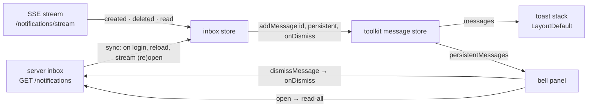

# notifications

::: tip At a glance
**Owns** — the signed-in visitor's inbox: the bell in the app bar, its panel, and the live stream that keeps it current.
**Depends on** — nothing. The server writes the notifications; this module only reads and renders them.
**Breaks if you change** — the `code` values and the `params` shape per code. The contract types them as a union on `code`, and a code this client does not know reads as a generic message.
:::

| Fact                    | This module                                                                    |
| ----------------------- | ------------------------------------------------------------------------------ |
| **Subdomain**           | `supporting` — Specific to this business but not a differentiator. Kept plain. |
| **Screens**             | 0 — a bell the app bar hosts                                                   |
| **Store**               | `inbox`                                                                        |
| **Menu entries**        | —                                                                              |
| **API calls**           | 4, plus the `GET /notifications/stream` event stream                           |
| **Depends on**          | —                                                                              |
| **Depended on by**      | —                                                                              |
| **Languages**           | `en` · `it`                                                                    |
| **Publishes**           | —                                                                              |
| **Backend counterpart** | `notifications` in `boilerplate-node-backend`                                  |

## The story

A notification is a message the server keeps for one person until they delete it. Today the
backend writes one in three cases: a product left the catalogue and so left their **cart**, left
their **wishlist**, or a guest cart merged at login had lines whose product is no longer available.
(A merge line whose _quantity_ changed is not a notification: the [cart page](./cart.md#the-merge-alert)
tells it once, in an alert.)

The server stores a `code` and the facts that sentence needs, never text. This module turns them
into the reader's language from its own locale files, like every other API code.



### One store, two kinds of message

The toolkit's `useNotificationsStore` holds both. A **toast** lives in the page's memory and
disappears by itself; a **notification** is a toolkit message flagged `persistent`, with the
server's id, and it is what the bell lists. This module's own store (`inbox`) keeps no list of
its own: it is the translation between a server row and a toolkit message, plus every write the
bell makes. The server row is kept in the message's `meta`, so a language switch can rebuild the
text and `readAt` is where the unread state lives.

The toolkit's three verbs each have one meaning here:

| Verb                 | In this module                                                                                    |
| -------------------- | ------------------------------------------------------------------------------------------------- |
| `hideMessage(id)`    | A toast closing. The notification stays in the bell.                                              |
| `dismissMessage(id)` | The reader deletes one. `onDismiss` is the `DELETE`; a failure puts it back and toasts the error. |
| `removeMessage(id)`  | The app drops a row the server no longer has. Silent: nothing is sent back.                       |

### When something is shown as a toast

- A notification that **arrives on the stream** is shown once as a toast (8 seconds), then lives
  only in the bell.
- What was **already waiting** when a read lands (login, reload, reconnect) is added quietly: it
  is in the bell with a badge, not thrown at the reader as a stack of toasts.
- Re-adding a known id **updates in place** and keeps whether its toast is showing, so a refetch
  never brings back a toast the reader already closed.

### Keeping it current

The stream carries only what is written while it is open, so every open of it, the first and each
reconnect, is followed by a fresh `GET /notifications`. A row the read does not return is removed
silently. A read may have been answered just before something else happened, so each read in
flight remembers what landed meanwhile and wins over its own answer: a row the stream pushed is not
dropped, a row deleted (by a frame, the owner or "Clear all") is not brought back, and a row read
meanwhile stays read. A read that answers after the person changed, or after a fresher read, writes
nothing (the same ticket rule as [the cart](./cart.md#answers-in-order)). A failed read is reported by
the store itself, as a toast.

The stream authenticates with the refresh cookie (an `EventSource` cannot send a header), so the
URL is derived from the REST base the same way the observability stream's fallback is. If the
browser gives up on the stream for good (a refused handshake), `createSseClient` opens a new one
after 1, 2, 4 ... seconds (capped at 30), and every open is followed by a fresh read.

### The text

`Notification` is a union on `code`, and each variant carries its own typed `params`
(`@types`), so the sentence builder narrows them with a plain `switch` and parses nothing:

| Code                                  | `params`                                        |
| ------------------------------------- | ----------------------------------------------- |
| `notifications.cart-line-removed`     | `{ productId, titles }`                         |
| `notifications.wishlist-item-removed` | `{ productId, titles }`                         |
| `notifications.cart-merge-refused`    | `{ lines: [{ productId, requested, titles }] }` |

The refused-merge sentence lists each line as "name × quantity the guest held": every line in it
is a product that is no longer available, so the sentence says that once and the lines carry no
reason of their own.

The code is its own dictionary key: the code `notifications.cart-line-removed` is the entry
`cart-line-removed` inside the `notifications` group of `locales/*.json`. A product's name comes from
`params.titles`, a map of locale to name copied in when the notification was written, because the
notification outlives the product:

| Order | Name used                                             |
| ----- | ----------------------------------------------------- |
| 1     | The reader's current language                         |
| 2     | The shop's main language (vue-i18n's fallback locale) |
| 3     | Any name there is                                     |
| 4     | "a product", when `titles` is empty                   |

A language switch rebuilds every message in place, so the text follows. Severity maps `info` →
`primary`; `success`, `warning` and `error` are unchanged. A notification the server writes for a
code this build does not know (a newer backend) reads as "You have a new notification."

### The end of a session

Logging out, or a different account taking over the tab, closes the stream and removes every
notification message, so the next person never sees them.

## The bell

The bell is contributed to the `app-bar` slot the shell owns (`src/kernel/slots.ts`); the shell
renders whatever arrives and never imports this module. It renders nothing for a guest or for a
session without `notifications.self.read`.

| Behaviour       | Detail                                                                                                                                                                                              |
| --------------- | --------------------------------------------------------------------------------------------------------------------------------------------------------------------------------------------------- |
| Badge           | The unread count: notifications with no `readAt`.                                                                                                                                                   |
| Accessible name | "Notifications", or "Notifications: 3 unread" — the badge alone is a bare number.                                                                                                                   |
| Opening         | `POST /notifications/read-all`, so the badge clears everywhere (the stream tells other tabs). Nothing is sent when nothing is unread. Rows that were new stay marked "New" while the panel is open. |
| Panel           | A `dialog`, newest first: text, date, a delete button named after its message, and "Clear all".                                                                                                     |
| Focus           | Moves into the panel on open; Escape closes it and returns focus to the bell.                                                                                                                       |

## Screens

None. The module has no routes.

## Wiring

#### Endpoints called

| Call                              | Response envelope                 |
| --------------------------------- | --------------------------------- |
| `GET /notifications`              | `ListNotificationsResponse`       |
| `POST /notifications/read-all`    | `ReadAllNotificationsResponse`    |
| `POST /notifications/dismiss-all` | `DismissAllNotificationsResponse` |
| `DELETE /notifications/{id}`      | `DeleteNotificationByIdResponse`  |

Each row registers one Zod envelope through the manifest, so enabling the domain turns its contract
validation on and deleting the folder turns it off. The stream's frames are validated against the
AsyncAPI schemas by `createSseClient` while validation is on.

#### Stream events

| Event                   | What the inbox does                                |
| ----------------------- | -------------------------------------------------- |
| `notifications.created` | Adds the row, shown once as a toast.               |
| `notifications.deleted` | Removes the ids, or everything when `all` is true. |
| `notifications.read`    | Marks every unread row read.                       |

## Files

| File                                  | What it is                                                                          | Explained in                          |
| ------------------------------------- | ----------------------------------------------------------------------------------- | ------------------------------------- |
| `module.ts`                           | The manifest. No routes; contributes the bell to the `app-bar` slot.                | [read](../theory/modules.md)          |
| `store.ts`                            | The `inbox` store: server rows to toolkit messages, and every write the bell makes. | [read](../tools/state-and-routing.md) |
| `composables/use-inbox-lifecycle.ts`  | Starts the read and the stream for the signed-in person and ends them with them.    | [read](../theory/layers.md)           |
| `components/NotificationsBell.vue`    | The bell, its badge and its panel.                                                  | [read](../theory/layers.md)           |
| `domain/describe.ts`                  | Pure: a `code` and its typed `params` to a sentence.                                | [read](../theory/domain-layer.md)     |
| `types.ts`                            | The row the panel renders.                                                          | [read](../theory/layers.md)           |
| `response-schemas.ts`                 | One Zod envelope per endpoint called.                                               | [read](../api/openapi-workflow.md)    |
| `locales/en.json` · `locales/it.json` | The sentences, keyed by code, and the bell's labels.                                | [read](../tools/i18n.md)              |

## Libraries

No library of its own. The stream is the shell's `createSseClient`, the messages are
`@guebbit/vue-toolkit`'s notifications store. The `params` are the contract's own typed union: no
parsing library is involved.

## Working on it

```bash
# this module's vitest suites
npm run test:unit -- notifications

# after the backend changes an endpoint, a code or an event
npm run regenerate
```

## Related pages

- [`cart`](./cart.md) and [`wishlist`](./wishlist.md) — the lists a removed product leaves; the server writes the notification, this module shows it
- [Modules](../theory/modules.md) — slots, and why the shell never imports its contributors
- [Observability](./observability.md) — the other SSE stream, and the shared `createSseClient`
