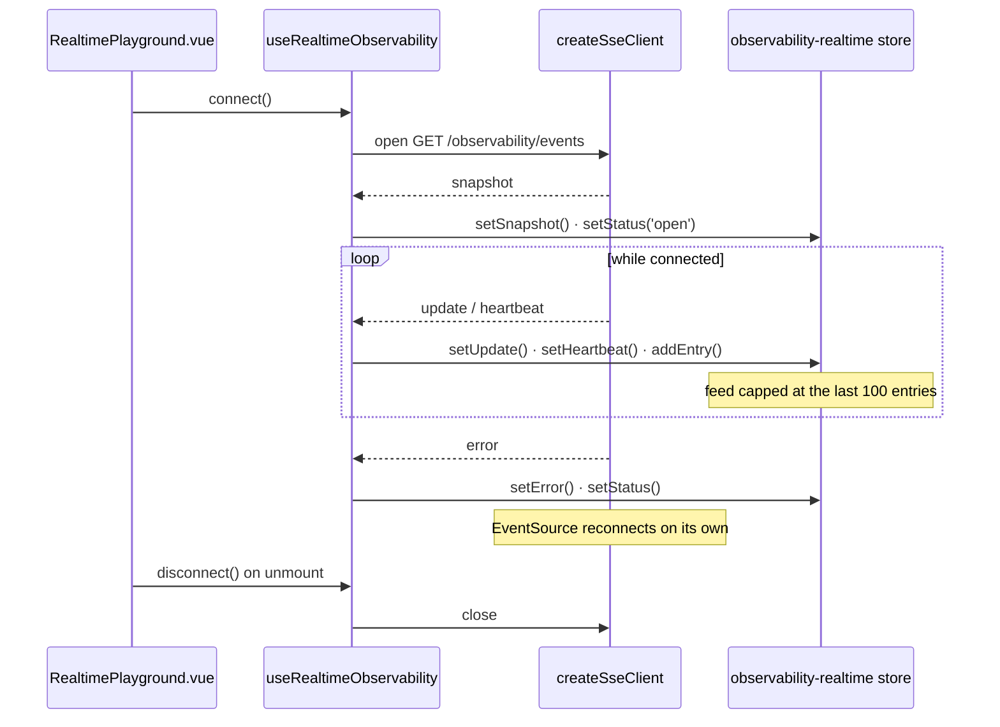

# observability

::: tip At a glance
**Owns** — the observability console (service health, KPIs, the platform's own audit log), the
shop's own audit trail, and the realtime SSE playground over the same metrics stream.
**Depends on** — nothing. It reads the observability endpoints directly.
**Breaks if you change** — nothing outside this folder. It is designed to be deleted.
:::

| Fact          | This module                                                         |
| ------------- | ------------------------------------------------------------------- |
| **Subdomain** | `generic` — A solved problem. Modelling effort here would be waste. |

::: info Stands alone
No module depends on this one and it depends on none. Deleting the folder and its line in `src/modules.ts` costs nothing else.
:::

## The map

`observability` sits on no edge of the context map — nothing imports it and it imports nothing.

## The story

Three screens over **two backend modules**, which is the clearest asymmetry in the pairing
table: `observability` serves health, the metrics overview and the SSE stream, and `audit-logs`
owns the trail behind the audit table. Neither has a frontend module of its own beyond this one,
and this one has no backend module of its own.

It depends on nothing, and reads the observability endpoints directly rather than through any
other domain's store.

::: tip That is deliberate, and the reason is blunt
**This is the first thing a downstream project without an ops dashboard deletes.** So it was built to
cost nothing on the way out: `rm -rf` the folder, drop one line of `src/modules.ts`, and nothing else
in the client notices.

A console that reached into three domains' stores to render its KPIs would not have that property.
:::

`types.ts` exists here and in no other module: the dashboard and the playground assemble shapes
that no single endpoint answers with, and those live beside the composable/store that build them
rather than in the generated types, which only describe what the API actually returns.

The audit table is a read of somebody else's collection, and this client never writes to it. Every
row it shows was written server-side by a module that had no idea a dashboard existed.

**Two of the five registered endpoints are never called through the response-schema map.**
`GET /observability/events` is validated at the SSE layer instead — it feeds the realtime
playground below, not a JSON read. `GET /observability/metrics` is different in kind: its
own contract description says to use `.../metrics/overview` for a JSON summary, and it answers in
Prometheus text format — it is Prometheus's own scrape target
(`boilerplate-node-backend/docker/observability/prometheus.config.yaml`), not an endpoint any
browser client should ever call. Both stay registered in `response-schemas.ts` regardless: the row
costs nothing sitting unused.

### The realtime playground

One screen, one composable and one store — `RealtimePlayground.vue`,
`use-realtime-observability.ts` and `store.ts`. The screen renders the feed itself; there is no
dedicated `components/` entry for it.

The split between the composable and the store is the thing worth understanding. The **composable
owns the connection** — a module-level `activeClient` singleton, so re-mounting the screen never
opens a second stream — and it owns the routing: each typed event is dispatched to one store
action. The **store owns the state** and nothing else: status, the two latest payload shapes kept
apart, the last heartbeat, the last error, and a feed capped at the last 100 entries so a
long-lived stream cannot grow without bound. Pure refs plus setters, with no fetching of its own.



**The transport is not part of this module.** `createSseClient` is a typed wrapper over
`EventSource` that knows no domain, so it lives in `infrastructure`. What is here is the screen,
the typed subscription and the feed.

::: tip The types come from a contract, not from a hand-written interface
`asyncapi.yaml` describes the event names and payload shapes, and
`contracts/asyncapi.generated.ts` is generated from it. A payload this module misreads is a build
error rather than an empty panel.
:::

The playground route needs `['read', 'ObservabilitySnapshot']` — a PLATFORM key, so a shop's own
unrestricted role cannot reach it and a platform operator can. A live metrics feed is an
operator's tool, and the route's `meta.can` is the only place that is declared.

## State

State, getters and actions are exactly what the setup function of each store returns: `src/modules/observability/store.ts`.

Store `observability-realtime`, from `store.ts` — the playground's only. The console and the
audit trail hold no store of their own; whatever else these screens read belongs to a module they
depend on, or to the app-wide stores in `src/infrastructure/`.

## Screens

Paths, route names, access and permission per screen: `src/modules/observability/routes.ts`; every module's together are in the generated [sitemap](../theory/sitemap.md).

## Wiring

#### Endpoints called

Method, path pattern, response schema and owning module of every operation: `contracts/rest/routes.ts` (rows with `module: 'observability'`). Auth is in the backend contract.

#### Navigation entries

Entries are declared in `src/modules/observability/module.ts`.

## Files

The folder is `src/modules/observability/`; each file's own `@module` header says what it is.

## Working on it

```bash
# this module's vitest suites
npm run test:unit -- observability

# this module's cypress suites
npm run test:e2e -- --spec 'src/modules/observability/tests/e2e/*.cy.ts'

# after the backend changes an endpoint this module calls
npm run regenerate
```

## Deeper in

- [The dashboard](./observability-dashboard.md)

## Related pages

- [The dashboard](./observability-dashboard.md) — what the console assembles, and from where
- [Admin Dashboard](../tools/admin-dashboard.md) — the mechanism behind the panels
- [Realtime](../tools/realtime.md) — the SSE client and its reconnection behaviour
- [Observability](../tools/observability.md) — what is measured, and by whom
- [Observability endpoints](https://github.com/Guebbit/boilerplate-node-backend/blob/main/docs/api/observability.md) — the backend's page for the reads
- [AsyncAPI Workflow](../api/asyncapi-workflow.md) — where the event types come from
- [Sitemap & Access Control](../theory/sitemap.md) — the `admin` gate on these screens
