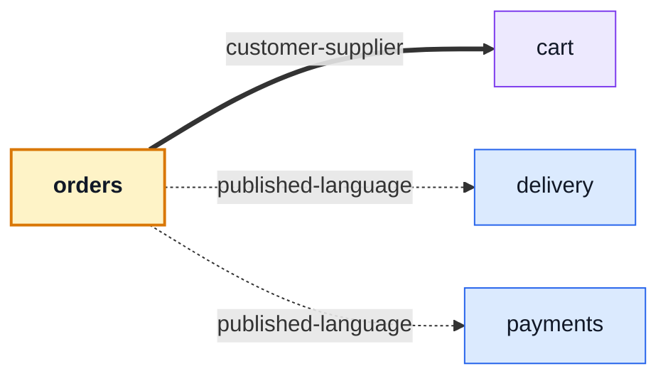
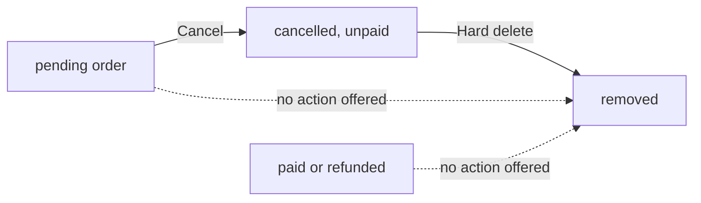
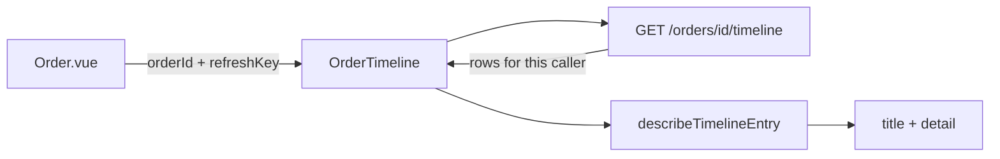

# orders

::: tip At a glance
**Owns** — a customer's order history, the staff's page over every order, the detail screen, and the admin status edit.
**Depends on** — four modules, and three of those are components it mounts rather than state it reads.
**Breaks if you change** — nothing outside this folder. No module depends on it.
:::

| Fact                    | This module                                                                                                 |
| ----------------------- | ----------------------------------------------------------------------------------------------------------- |
| **Subdomain**           | `core` — The reason the product exists. Worth its own client-side rules.                                    |
| **Screens**             | 4 — `OrdersList` · `SalesOrders` · `OrderTarget` · `OrderEdit`                                              |
| **Store**               | `orders`                                                                                                    |
| **Menu entries**        | `OrdersList` · `SalesOrders`                                                                                |
| **API calls**           | 11                                                                                                          |
| **Depends on**          | [`cart`](./cart.md) · [`delivery`](./delivery.md) · [`payments`](./payments.md) · [`returns`](./returns.md) |
| **Depended on by**      | _nothing_                                                                                                   |
| **Languages**           | `en` · `it`                                                                                                 |
| **Publishes**           | _nothing_ — no barrel, so no sibling may import it                                                          |
| **Backend counterpart** | `orders` in `boilerplate-node-backend`                                                                      |

## The map



- → `cart` **customer-supplier** — The reorder button asks the cart store to refill itself from a past order.
- → `delivery` **published-language** — Mounts `ShipmentPanel`; the parcel renders itself and this module never touches a shipment.
- → `payments` **published-language** — Mounts `PaymentPanel`; paying happens on the order page without this module knowing a provider exists.

## The story

The order page is the most composed screen in the application, and it is composed out of other
people's components. Two of its three edges are `published-language`:

| Mounted         | From                        | What this module learns                                  |
| --------------- | --------------------------- | -------------------------------------------------------- |
| `PaymentPanel`  | [`payments`](./payments.md) | nothing — not that a provider exists, not what a card is |
| `ShipmentPanel` | [`delivery`](./delivery.md) | nothing — not what a tracking code is                    |

That is the strongest kind of edge on the map: neither side touches the other's store. The panels
render their own concern, fetch their own data, and this module holds the layout around them.

::: tip The third edge runs against the server's arrow, deliberately
Reaching into `cart` is the **reorder button** — the order page refills the visitor's cart through
the cart barrel. On the server the arrow points the other way, because a checkout creates an order.

Both are correct. A module's imports are what it depends on, and the import here is
order-page → cart store.
:::

Reads are scoped: a customer sees only their own orders, an admin reaches all of them through the
write screens. That scoping is enforced server-side — this client renders whatever the endpoint
answers, which is what [Domain layer](../theory/domain-layer.md) means by the domain living behind
the API.

## Two lists, one component

`OrdersList.vue` serves two routes, and the route says which through its `scope` prop:

| Route         | Scope  | Who it is for                 | What it lists                                                            |
| ------------- | ------ | ----------------------------- | ------------------------------------------------------------------------ |
| `OrdersList`  | `mine` | everyone signed in            | the viewer's own orders — the owner is **pinned** in the search, always  |
| `SalesOrders` | `all`  | whoever holds `display:Order` | every order, with the id/user/product/email boxes and the transfer queue |

The split is the A2 decision of the sales plan, and it fixes a real bug: the account page used to send
`userId` only when set, so a staff account saw the whole shop under "My orders". Now the account
page pins the viewer's id (`pinOwner`, re-applied after Reset, kept out of the URL), and the staff
page drops an owner left behind by it. `SalesOrders` asks `can: ['display', 'Order']`, because `['read',
'Order']` would admit a customer holding `read:Order`; it sits in the admin menu's
"Sales" group.

Both pages narrow by status, fulfilment, payment state, return state and two date ranges (placed,
paid), and show when each order was paid. The four dates are calendar days in the store and are sent
as inclusive instants (`src/infrastructure/utils/day-range.ts`), in the browser's zone.

## Permanent delete: cancel first

The list offers **Hard delete** on a row only when the order is `cancelled` and its
`paymentStatus` is `unpaid` (`src/modules/orders/domain/hard-delete.ts`). That mirrors the API: an open order answers
`409 ORDER_NOT_CANCELLED`, a paid one `409 ORDER_INVOICED`. Cancelling is what releases the stock
and cancels the open payment intent, so the delete is pure cleanup. A refusal that slips through
(the order changed under the viewer) shows the API's own sentence in the row-action alert; the
copy is the API's, in the viewer's language, so this app holds none for it.



## The timeline

`src/modules/orders/components/OrderTimeline.vue` sits under the order's details and lists what happened to it, oldest first
(`GET /orders/{id}/timeline`). **The server decides who sees what**: staff (`display:Order`) get
every row with the acting account and any note, the buyer only the buyer-visible rows and never an
actor. The component filters nothing; it only flags, for staff, the rows the buyer cannot see
(`TIMELINE_AUDIENCE` in `src/modules/orders/domain/timeline.ts` mirrors the API's table, and is checked against the
contract's type enum at compile time).

Each line is `describeTimelineEntry`'s: a title per type, and a detail built from the row's ids and
codes (an amount, a parcel number, a reason code through its own dictionary). A code the dictionary
does not know is shown raw, so a newer API never leaves a blank. The page re-reads the timeline when
the order's status, payment, fulfilment or return state changes.



## The CSV export

The staff list (`/sales/orders`) offers **Export CSV** to whoever holds `export:Order`
(manager, admin). It sends the filters on screen through the same mapping as the search
(`criteriaOf` in `store.ts`), so the file is the list the viewer was looking at, minus paging. The
key is step-up gated: the HTTP layer's prompt asks for the password and replays the request. Two
refusals have their own words: `422 ORDER_EXPORT_TOO_LARGE` (narrow the filters) and `429` (the
per-account budget is spent); anything else shows the server's sentence.

## The statuses beside `status`, and the withdrawal button

The detail page shows three read-only words next to the order's own status, each straight from the
server: `paymentStatus` (`unpaid` · `paid` · `partially_refunded` · `refunded`), `fulfillmentStatus`
(`unfulfilled` · `in_progress` · `on_hold` · `partially_fulfilled` · `shipped` · `fulfilled`) and
`returnStatus`. None is derived here. The list shows `fulfillmentStatus` as a chip beside the
status and filters by it (`GET /orders` search), so a held or part-shipped order can be found. The withdrawal control is [`returns`](./returns.md)'
`WithdrawalPanel`, handed `actions.withdraw` and `actions.withdrawUntil` untouched; a line whose
product carries `noWithdrawal` says so on the page. The operator's "Refund payment" button takes an
optional amount for a partial refund — empty still means everything still refundable.

A line sold before its release date (`product.preorder`, frozen at checkout) reads "Preorder: ships
from {date}". When that preorder runs late, the buyer answers on this same page: the
`ShipmentPanel`'s card shows the new date and a "Keep waiting" button (see
[delivery](./delivery.md#a-late-preorder)), and the order's own cancel is the other answer.

## State

Store `orders`, from `store.ts`. Only what the setup function returns is listed — an internal ref is not part of the surface.

| Kind        | Members                                                                                                                                                                                                                                                | What it is                                                       |
| ----------- | ------------------------------------------------------------------------------------------------------------------------------------------------------------------------------------------------------------------------------------------------------ | ---------------------------------------------------------------- |
| **State**   | `orders` · `selectedOrderId` · `filters` · `pageCurrent` · `pageSize`                                                                                                                                                                                  | The refs the setup function returns — the only writable surface. |
| **Getters** | `ordersList` · `currentOrder` · `loading` · `pageTotal` · `pageItemList`                                                                                                                                                                               | Computed, derived from state. Read-only by construction.         |
| **Actions** | `addOrder` · `fetchOrders` · `fetchPaginationOrders` · `watchSearchOrders` · `fetchOrder` · `watchOrder` · `createOrder` · `updateOrder` · `deleteOrder` · `cancelOrder` · `hardDeleteOrder` · `fetchInvoice` · `fetchCreditNotes` · `fetchCreditNote` | Everything that changes state or calls the API.                  |

## Screens

| Path              | Route name    | Access | Permission      | View                   |
| ----------------- | ------------- | ------ | --------------- | ---------------------- |
| `orders`          | `OrdersList`  | `auth` | —               | `views/OrdersList.vue` |
| `sales/orders`    | `SalesOrders` | `auth` | `display Order` | `views/OrdersList.vue` |
| `orders/:id`      | `OrderTarget` | `auth` | —               | `views/Order.vue`      |
| `orders/:id/edit` | `OrderEdit`   | `auth` | `update Order`  | `views/OrderEdit.vue`  |

Paths are relative to the localised root, so `cart` is served at `/:locale/cart`. **Access** is the route’s own `meta.access` (the standing it needs) and **Permission** its `meta.can` — the `[action, subject]` rule checked against the caller's own rules from `GET /account/abilities`. A menu entry restates neither, which is what keeps the menu and the router from disagreeing. See [Security](../tools/security.md#route-guards).

## Wiring

#### Endpoints called

| Call                                | Response envelope              |
| ----------------------------------- | ------------------------------ |
| `DELETE /orders`                    | `DeleteOrderResponse`          |
| `GET /orders`                       | `ListOrdersResponse`           |
| `POST /orders`                      | `CreateOrderResponse`          |
| `DELETE /orders/{id}`               | `DeleteOrderByIdResponse`      |
| `GET /orders/{id}`                  | `GetOrderByIdResponse`         |
| `PUT /orders/{id}`                  | `ReplaceOrderByIdResponse`     |
| `PATCH /orders/{id}`                | `UpdateOrderByIdResponse`      |
| `POST /orders/{id}/cancel`          | `CancelOrderByIdResponse`      |
| `POST /orders/{id}/restore`         | `RestoreOrderByIdResponse`     |
| `POST /orders/{id}/status-override` | `OverrideOrderStatusResponse`  |
| `DELETE /orders/{id}/hard`          | `HardDeleteOrderByIdResponse`  |
| `GET /orders/{id}/invoice`          | `GetOrderInvoiceResponse`      |
| `GET /orders/{id}/credit-notes`     | `ListOrderCreditNotesResponse` |
| `POST /orders/search`               | `SearchOrdersResponse`         |
| `GET /orders/export`                | `ExportOrdersResponse`         |
| `GET /orders/{id}/timeline`         | `GetOrderTimelineResponse`     |

Each row registers one Zod envelope through the manifest, so enabling the domain turns its contract validation on and deleting the folder turns it off.

#### Navigation entries

| Route | Label key | Section | Order | Icon | Badge |
| ------------ | ------------------------- | --- | --- | --- | --- | --- |
| `OrdersList` | `navigation.label-orders` | `account` | 90 | yes | — |
| `SalesOrders` | `navigation.label-sales-orders` | `admin` | 55 | yes | — |

## Files

| File                                      | What it is                                                                                                                                                                                                                                       | Explained in                          |
| ----------------------------------------- | ------------------------------------------------------------------------------------------------------------------------------------------------------------------------------------------------------------------------------------------------ | ------------------------------------- |
| `locales/en.json`                         | This domain’s translation dictionary for one language, loaded as its own chunk.                                                                                                                                                                  | [read](../tools/i18n.md)              |
| `locales/it.json`                         | This domain’s translation dictionary for one language, loaded as its own chunk.                                                                                                                                                                  | [read](../tools/i18n.md)              |
| `module.ts`                               | The manifest — the only file the application loads directly. Declares the name, routes, navigation entries, response schemas and locales, plus the optional loading keys and slots.                                                              | [read](../theory/modules.md)          |
| `response-schemas.ts`                     | One row per endpoint this domain calls, pairing a method and path pattern with the Zod envelope its response is validated against.                                                                                                               | [read](../api/openapi-workflow.md)    |
| `routes.ts`                               | The domain’s route records, spliced into the localised route tree. Each carries its own `meta.access`.                                                                                                                                           | [read](../theory/sitemap.md)          |
| `schemas.ts`                              | Form schemas for this domain. Hand-written: only the contract's numeric constraints (minimums) are read from `@api/schemas`, so the rest of a rule can drift from the request body — `VITE_VALIDATE_REQUESTS` checks the real body at send time. | [read](../api/openapi-workflow.md)    |
| `store.ts`                                | The Pinia store: this domain’s state, and every call it makes to the generated client.                                                                                                                                                           | [read](../tools/state-and-routing.md) |
| `tests/cancel.spec.ts`                    | Vitest suite — `cancel`, in isolation.                                                                                                                                                                                                           | [read](../tools/unit-testing.md)      |
| `tests/e2e/__snapshots__/orders-list.png` | A committed visual-regression baseline.                                                                                                                                                                                                          | [read](../tools/visual-regression.md) |
| `tests/e2e/a11y.cy.ts`                    | Cypress accessibility sweep — an axe run over this domain's routes, at each authentication level.                                                                                                                                                | [read](../tools/component-testing.md) |
| `tests/e2e/orders.cy.ts`                  | Cypress suite — the `orders` screens, in a browser.                                                                                                                                                                                              | [read](../tools/component-testing.md) |
| `tests/e2e/orders.visual.cy.ts`           | Cypress visual suite — pixel diffs against the committed baselines.                                                                                                                                                                              | [read](../tools/component-testing.md) |
| `tests/routes.spec.ts`                    | Vitest suite — the route records and the `meta.access` each one declares.                                                                                                                                                                        | [read](../tools/unit-testing.md)      |
| `tests/schemas-i18n.spec.ts`              | Vitest suite — the `schemas-i18n` validation rules.                                                                                                                                                                                              | [read](../tools/unit-testing.md)      |
| `tests/store.spec.ts`                     | Vitest suite — this domain's store, with the transport mocked.                                                                                                                                                                                   | [read](../tools/unit-testing.md)      |
| `views/Order.vue`                         | A routed screen. Reads its store, renders, and holds no fetching logic of its own.                                                                                                                                                               | [read](../theory/layers.md)           |
| `views/OrderEdit.vue`                     | A routed screen. Reads its store, renders, and holds no fetching logic of its own.                                                                                                                                                               | [read](../theory/layers.md)           |
| `views/OrdersList.vue`                    | A routed screen. Reads its store, renders, and holds no fetching logic of its own.                                                                                                                                                               | [read](../theory/layers.md)           |

## Working on it

| Suite            | Files | Where                                         |
| ---------------- | ----- | --------------------------------------------- |
| Vitest           | 4     | `src/modules/orders/tests/`                   |
| Cypress          | 3     | `src/modules/orders/tests/e2e/`               |
| Visual baselines | 1     | `src/modules/orders/tests/e2e/__snapshots__/` |

```bash
# this module's vitest suites
npm run test:unit -- orders

# this module's cypress suites
npm run test:e2e -- --spec 'src/modules/orders/tests/e2e/*.cy.ts'

# after the backend changes an endpoint this module calls
npm run regenerate
```

## Deeper in

Nothing in this domain needs a page of its own — the story above is the whole of it.

## Related pages

- [`payments`](./payments.md) · [`delivery`](./delivery.md) — the two panels this page mounts
- [`cart`](./cart.md) — where the reorder button writes
- [Domain Layer](../theory/domain-layer.md) — why the rules are not in this repository
- [Strategic DDD](../theory/strategic-ddd.md) — what `published-language` buys
- [Sitemap & Access Control](../theory/sitemap.md) — the admin/customer split on these routes
