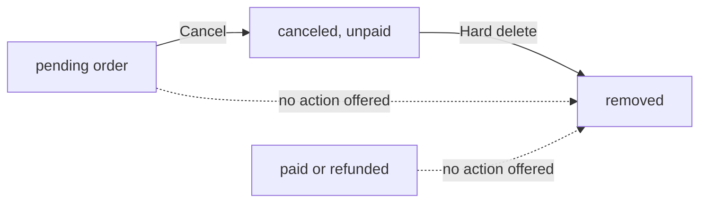
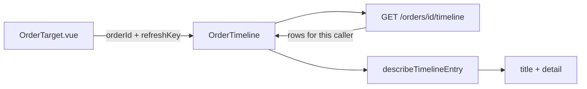

# orders

::: tip At a glance
**Owns** — a customer's order history, the staff's page over every order, the detail screen, and the admin status edit.
**Depends on** — four modules: two only for components it mounts, two for a call that makes something happen (the cart's refill, a payment's refund).
**Breaks if you change** — nothing outside this folder. No module depends on it.
:::

| Fact          | This module                                                              |
| ------------- | ------------------------------------------------------------------------ |
| **Subdomain** | `core` — The reason the product exists. Worth its own client-side rules. |

## Its neighbourhood

The context map is drawn once, in [the whole map](./index.md#the-whole-map).

- → `cart` **customer-supplier** — The reorder button asks the cart store to refill itself from a past order.
- → `delivery` **published-language** — Mounts `ShipmentPanel`; the parcel renders itself and this module never touches a shipment.
- → `payments` **customer-supplier** — Calls `useOrderRefund` to refund an order from the staff edit screen; also mounts `PaymentPanel`, `RecordOfflinePaymentForm` and `OrderReferenceSearch`, which on their own would be `published-language`.
- → `returns` **published-language** — Mounts `WithdrawalPanel`; the withdrawal and the order's returns list are the component's own business.

## The story

The order page is the most composed screen in the application, and it is composed out of other
people's components. Most of its edges are components:

| Mounted           | From                        | What this module learns                                  |
| ----------------- | --------------------------- | -------------------------------------------------------- |
| `PaymentPanel`    | [`payments`](./payments.md) | nothing — not that a provider exists, not what a card is |
| `ShipmentPanel`   | [`delivery`](./delivery.md) | nothing — not what a tracking code is                    |
| `WithdrawalPanel` | [`returns`](./returns.md)   | nothing — not what a return record holds                 |

That is the strongest kind of edge: neither side touches the other's store. The panels
render their own concern, fetch their own data, and this module holds the layout around them.

The `payments` edge is not only components, because of one import: the staff edit screen
refunds through `useOrderRefund`. That composable answers one question (is a refund open?) and
performs one action, so the edge stays narrow, but it is a call, not vocabulary.

::: tip The cart edge runs against the server's arrow, deliberately
Reaching into `cart` is the **reorder button** — the order page refills the visitor's cart through
the cart barrel. On the server the arrow points the other way, because a checkout creates an order.

Both are correct. A module's imports are what it depends on, and the import here is
order-page → cart store.
:::

Reads are scoped: a customer sees only their own orders, an admin reaches all of them through the
write screens. That scoping is enforced server-side — this client renders whatever the endpoint
answers, which is what [Domain layer](../theory/domain-layer.md) means by the domain living behind
the API.

## Two lists, one component

`OrdersList.vue` serves two routes, and the route says which through its `scope` prop:

| Route         | Scope  | Who it is for                 | What it lists                                                            |
| ------------- | ------ | ----------------------------- | ------------------------------------------------------------------------ |
| `OrdersList`  | `mine` | everyone signed in            | the viewer's own orders — the owner is **pinned** in the search, always  |
| `SalesOrders` | `all`  | whoever holds `display:Order` | every order, with the id/user/product/email boxes and the transfer queue |

The split is the A2 decision of the sales plan, and it prevents a real bug: an account page that sends
`userId` only when set shows a staff account the whole shop under "My orders". So the account
page pins the viewer's id (`pinOwner`, re-applied after Reset, kept out of the URL), and the staff
page drops an owner left behind by it. `SalesOrders` asks `can: ['display', 'Order']`, because `['read',
'Order']` would admit a customer holding `read:Order`; it sits in the admin menu's
"Sales" group.

Both pages narrow by status, fulfilment, payment state, return state and two date ranges (placed,
paid), and show when each order was paid. The four dates are calendar days in the store and are sent
as inclusive instants (`src/infrastructure/utils/day-range.ts`), in the browser's zone.

## Permanent delete: cancel first

The list offers **Delete**, **Hard delete** and **Restore** from `actions.delete`, `actions.hardDelete`
and `actions.restore` (list rows carry them); the server decides, from the caller's `delete:Order` key
and the order's state. A refused one would answer `409 ORDER_NOT_CANCELED` for an open order,
`409 ORDER_INVOICED` for a paid one, `409 ORDER_HAS_MONEY_HISTORY` for one handed money after its cancel. Cancelling is what releases the stock
and cancels the open payment intent, so the delete is pure cleanup. A refusal that slips through
(the order changed under the viewer) shows the API's own sentence in the row-action alert; the
copy is the API's, in the viewer's language, so this app holds none for it.



## Correcting the shipping address

`OrderEdit` shows `ShippingAddressForm` while the order's own `actions.correctAddress` is true: the
server says staff hold `update:Order`, the order has a shipping address and nothing has shipped. It
sends `PUT /orders/{id}/shipping-address` with the whole address, so a held `incorrect_address`
group has a way out. A refusal that slipped through (it shipped meanwhile) blocks the form in place
with the server's `ORDER_ADDRESS_LOCKED` message; the form decides nothing about when it may run.

## The timeline

`src/modules/orders/components/OrderTimeline.vue` sits under the order's details and lists what happened to it, newest first, a
page at a time (`GET /orders/{id}/timeline?page=`); a "show older" button reads the next page. **The server decides who sees what**: staff (`display:Order`) get
every row with the acting account and any note, the buyer only the buyer-visible rows and never an
actor. The component filters nothing; it only flags, for staff, the rows the buyer cannot see
(each row carries the server's own `audience`, `buyer` or `staff`; the client keeps no table).

Each line is `describeTimelineEntry`'s: a title per type, and a detail built from the row's ids and
codes (an amount, a parcel number, a reason code through its own dictionary). A code the dictionary
does not know is shown raw, so a newer API never leaves a blank. The page re-reads the timeline when
the order's status, payment, fulfilment or return state changes.

A row is a union keyed by `type` (`OrderTimelineEntry`), so each type's detail reads the `data` shape
the contract gives that type: the table of details is a mapped type over the types, and a field
renamed in the contract fails to compile there. `text` exists only on the variants that carry it
(`status_overridden` and `note_added`).

**Staff notes.** A holder of `update:Order` also gets a box above the history to leave a note
(`POST /orders/{id}/timeline/notes`, `useOrdersStore().addNote`). It says what the server does with
it: customers do not see the note on their order, but it is included if they request their data, so
no phone numbers, addresses or health details. On success the box clears and the history reads
again; a refusal (a 429, say) shows beside the box and keeps the text. The row comes back as
`note_added`, flagged for staff like any other staff-only row.

**Withdrawing a note.** A `note_added` row that still has text shows a "Remove text" button to the
same holders (`DELETE .../notes/{eventId}`, `useOrdersStore().deleteNote`). The server unsets the
text and keeps the row, so the history still shows that a note was written and withdrawn; the
history reads again and the row shows without its text and without the button. A refusal shows
beside that row.



## The CSV export

The staff list (`/sales/orders`) offers **Export CSV** to whoever holds `export:Order`
(manager, admin). It sends the filters on screen through the same mapping as the search
(`criteriaOf` in `store.ts`), so the file is the list the viewer was looking at, minus paging. The
key is step-up gated: the HTTP layer's prompt asks for the password and replays the request. Two
refusals have their own words: `422 ORDER_EXPORT_TOO_LARGE` (narrow the filters) and `429` (the
per-account budget is spent); anything else shows the server's sentence.

## The statuses beside `status`, and the withdrawal button

The detail page shows three read-only words next to the order's own status, each straight from the
server: `paymentStatus` (`unpaid` · `paid` · `partially_refunded` · `refunded`), `fulfillmentStatus`
(`unfulfilled` · `in_progress` · `on_hold` · `partially_fulfilled` · `shipped` · `fulfilled`) and
`returnStatus`. None is derived here. The list shows `fulfillmentStatus` as a chip beside the
status and filters by it (`GET /orders` search), so a held or part-shipped order can be found. The withdrawal control is [`returns`](./returns.md)'
`WithdrawalPanel`, handed `actions.withdraw` and `Order.withdrawUntil` untouched; a line whose
product carries `noWithdrawal` says so on the page. The operator's "Refund payment" button takes an
optional amount for a partial refund — empty still means everything still refundable.

A line sold before its release date (`product.preorder`, frozen at checkout) reads "Preorder: ships
from {date}". When that preorder runs late, the buyer reads it on this same page: the
`ShipmentPanel`'s card shows the new date (see [delivery](./delivery.md#a-late-preorder)), and the
order's own cancel is there if they do not want to wait. Nothing is asked of them.

## State

State, getters and actions are exactly what the setup function of each store returns: `src/modules/orders/store.ts`.

The list answers a `OrderListItem`, not the whole order: the table's fields, and the full record comes
from the audited detail read. The list view reads with `partial: true`, so a row merges over a full
order the store already holds instead of replacing it, and the detail page still reads the whole
record.

## Screens

Paths, route names, access and permission per screen: `src/modules/orders/routes.ts`; every module's together are in the generated [sitemap](../theory/sitemap.md).

## Wiring

#### Endpoints called

Method, path pattern, response schema and owning module of every operation: `contracts/rest/routes.ts` (rows with `module: "orders"` or `"invoicing"`). Auth is in the backend contract.

#### Navigation entries

Entries are declared in `src/modules/orders/module.ts`. Badges: `SalesOrders` — `salesOrders`: orders paid and not yet with a carrier.

## Files

The folder is `src/modules/orders/`; each file's own `@module` header says what it is.

## Working on it

```bash
# this module's vitest suites
npm run test:unit -- orders

# this module's cypress suites
npm run test:e2e -- --spec 'src/modules/orders/tests/e2e/*.cy.ts'

# after the backend changes an endpoint this module calls
npm run regenerate
```

## Deeper in

Nothing in this domain needs a page of its own — the story above is the whole of it.

## Related pages

- [`payments`](./payments.md) · [`delivery`](./delivery.md) — the two panels this page mounts
- [`cart`](./cart.md) — where the reorder button writes
- [Domain Layer](../theory/domain-layer.md) — why the rules are not in this repository
- [Strategic DDD](../theory/strategic-ddd.md) — what `published-language` buys
- [Sitemap & Access Control](../theory/sitemap.md) — the admin/customer split on these routes
