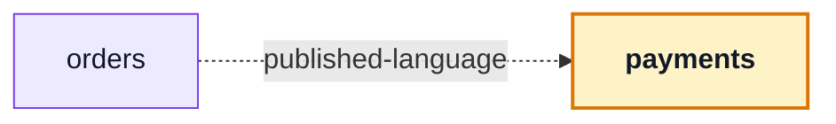
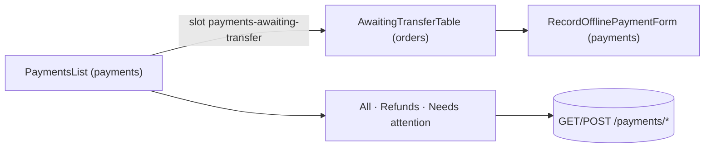

# payments

::: tip At a glance
**Owns** — the staff payments page (four tabs and a drawer), and the payment behind an order, as components: `PaymentPanel`, `PaymentMethodSelector`, `TransferInstructionsPanel`, `RecordOfflinePaymentForm`, `OrderReferenceSearch`, and the `useOrderRefund` composable.
**Depends on** — nothing. It is mounted, it does not mount.
**Breaks if you change** — those components' props. [`orders`](./orders.md) mounts the panel and the staff forms; [`cart`](./cart.md) mounts `PaymentMethodSelector`.
:::

| Fact                    | This module                                                                                                                                     |
| ----------------------- | ----------------------------------------------------------------------------------------------------------------------------------------------- |
| **Subdomain**           | `supporting` — Specific to this business but not a differentiator. Kept plain.                                                                  |
| **Screens**             | 1 — `PaymentsList`                                                                                                                              |
| **Store**               | `payments`                                                                                                                                      |
| **Menu entries**        | `PaymentsList`                                                                                                                                  |
| **API calls**           | 11                                                                                                                                              |
| **Depends on**          | _nothing_                                                                                                                                       |
| **Depended on by**      | [`orders`](./orders.md) · [`cart`](./cart.md)                                                                                                   |
| **Languages**           | `en` · `it`                                                                                                                                     |
| **Publishes**           | `PaymentPanel` · `PaymentMethodSelector` · `TransferInstructionsPanel` · `RecordOfflinePaymentForm` · `OrderReferenceSearch` · `useOrderRefund` |
| **Backend counterpart** | `payments` in `boilerplate-node-backend`                                                                                                        |

## The map



- `orders` → **published-language** — Mounts `PaymentPanel`; paying happens on the order page without this module knowing a provider exists.

## The story

**Paying has no route.** Paying happens _on_ the order, so this module contributes a component
through its barrel and [`orders`](./orders.md) mounts it. That arrow is declared over there, as
`published-language`, because the order page learns nothing about payments by rendering one. The
module's one route, `PaymentsList`, is for staff and is described [below](#the-staff-payments-page).

::: tip What deleting this module costs, precisely
The panel, the pay flow and the mock provider go in one `rm -rf` plus one registry line. Orders go
back to being paid nowhere — the state the shop was in before this module existed.

Nothing else in the client notices, because nothing else imports it.
:::

The store is here rather than in the panel because a component that owns its own fetching cannot be
mounted twice on one page without duplicating the request. The panel is a view; the store is the
domain's state, exactly as everywhere else.

### There is no card field, and that is the design

A live provider tokenises the card inside an iframe **it** owns, and hands the browser an opaque
reference (`pm_…`). A card number reaching this application — let alone its API — is the difference
between the light PCI bracket and the heavy one, so the panel never collects one.

**The panel shows a card form only when `GET /payments/methods` lists `card`**, which the backend does
only once a card provider is configured — a production deployment with none shows a short note
instead. Where a provider's widget mounts, a development or e2e build mounts `TestCardPicker`: the
fake provider's four test references. That file is loaded through a dynamic import behind
`import.meta.env.DEV || VITE_TEST_CARDS === 'true'`, which a production build folds to `false`, so
the chunk — and every `pm_card_*` reference and label in it — is not in the bundle. `build:e2e` sets
`VITE_TEST_CARDS=true`; nothing else does. A real provider brings its own widget in its place.

### The answer is not always immediate

The confirm can come back three ways, and only one of them is finished:

| Answer            | What it means                                   | The panel's next move                             |
| ----------------- | ----------------------------------------------- | ------------------------------------------------- |
| `succeeded`       | The money landed and the order is `paid`.       | Notify, tell the order page to re-read itself.    |
| `requires_action` | The bank wants a 3-D Secure challenge answered. | Show the challenge step, then `finishAtProvider`. |
| `processing`      | The provider is settling asynchronously.        | Say so, offer a re-check.                         |

A decline is a rejection with its own message, not an error toast. The two in-flight answers are
**successes** on the wire: a 4xx would tell the browser to stop, and the browser is the only thing
that can finish. The server's webhook settles all of these eventually whatever the browser does —
`finishAtProvider` only makes the happy path feel immediate.

## The staff payments page

`/sales/payments`, in the admin menu's "Sales" group, for whoever holds `display:Payment`. The
route asks `['display', 'Payment']`, because `read:Payment` answers a plain `can` for a customer.

Four tabs, saved views over what the backend already holds (the active one is `?tab=`):

| Tab               | Reads                                                  | Notes                                                                                                                    |
| ----------------- | ------------------------------------------------------ | ------------------------------------------------------------------------------------------------------------------------ |
| All               | `POST /payments/search`                                | Filters (status, method, provider, dates, amounts, order, reference) and sort by date or amount; a row opens the drawer. |
| Awaiting transfer | **orders**: pending `bank_transfer`, sorted by `payBy` | No payment exists until the money is recorded, so this tab is `orders`' component, in a slot.                            |
| Refunds           | `GET /payments/refunds`                                | One row per refund across every payment; read-only.                                                                      |
| Needs attention   | `GET /payments/attention`                              | Only problems still recorded on a document: a fixed one disappears. Repairs nothing.                                     |



**Why a slot.** `orders` already depends on `payments` (it mounts the panel), and the tab needs
orders, so `payments` importing `orders` would be a cycle. The page owns the slot, `orders`
contributes the table, and a build with no `orders` module simply has three tabs.

**The drawer** shows what a row has no room for: refunds, the card's last digits, and the provider
references. `Payment.providerRef`, a refund's `providerRefundRef` and its `failureReason` are sent
only to a caller holding `display:Payment`; the page renders them when present and never asks who
is looking. `failureReason` is a closed set (declined, insufficient funds, expired or cancelled
card, lost or stolen card, provider unavailable, unknown), each worded in the locale files — the
raw provider text stays in the server's logs. The drawer's refund button is the existing
`POST /payments/order/{orderId}/refund`, shown only while `actions.refund` is true; a partial refund
and recording an offline payment stay on the order's page.

**What the page does not show** is an amount mismatch: the order is cancelled and refunded
automatically and the only trace is an audit row, so the tab points at the audit log.

## State

Store `payments`, from `store.ts`. Only what the setup function returns is listed — an internal ref is not part of the surface.

| Kind        | Members                                                                                                                                      | What it is                                                       |
| ----------- | -------------------------------------------------------------------------------------------------------------------------------------------- | ---------------------------------------------------------------- |
| **State**   | `payment` · `paymentsPage` · `paymentsTotal` · `refundsPage` · `refundsTotal` · `attention`                                                  | The refs the setup function returns — the only writable surface. |
| **Getters** | `loading`                                                                                                                                    | Computed, derived from state. Read-only by construction.         |
| **Actions** | `fetchPaymentForOrder` · `payForOrder` · `finishAtProvider` · `refundForOrder` · `fetchPaymentsPage` · `fetchRefundsPage` · `fetchAttention` | Everything that changes state or calls the API.                  |

## Screens

| Path             | Route name     | Access | Permission        | View                     |
| ---------------- | -------------- | ------ | ----------------- | ------------------------ |
| `sales/payments` | `PaymentsList` | `auth` | `display Payment` | `views/PaymentsList.vue` |

Paths are relative to the localised root. **Access** is the route's own `meta.access` and **Permission** its `meta.can`, staff screens naming the staff action `display`. See [Security](../tools/security.md#route-guards).

The rest of the module is components, schemas and a store contributed to the modules that depend on it.

## Wiring

#### Endpoints called

| Call                               | Response envelope              |
| ---------------------------------- | ------------------------------ |
| `POST /payments/{id}/confirm`      | `ConfirmPaymentResponse`       |
| `POST /payments/{id}/sync`         | `SyncPaymentResponse`          |
| `POST /payments/intent`            | `CreatePaymentIntentResponse`  |
| `GET /payments/order/{id}`         | `GetPaymentByOrderResponse`    |
| `POST /payments/order/{id}/refund` | `RefundPaymentByOrderResponse` |
| `POST /payments/search`            | `SearchPaymentsResponse`       |
| `GET /payments/refunds`            | `ListRefundsResponse`          |
| `GET /payments/attention`          | `ListPaymentAttentionResponse` |

#### Navigation entries

| Route          | Label key                   | Section | Order | Icon | Badge |
| -------------- | --------------------------- | ------- | ----- | ---- | ----- |
| `PaymentsList` | `navigation.label-payments` | `admin` | 56    | yes  | —     |

Each row registers one Zod envelope through the manifest, so enabling the domain turns its contract validation on and deleting the folder turns it off.

## Files

| File                               | What it is                                                                                                                                                                          | Explained in                          |
| ---------------------------------- | ----------------------------------------------------------------------------------------------------------------------------------------------------------------------------------- | ------------------------------------- |
| `components/PaymentPanel.vue`      | A component this domain owns. Published through the barrel when a sibling mounts it, internal otherwise.                                                                            | [read](../theory/layers.md)           |
| `components/TestCardPicker.vue`    | The fake provider's test cards, as a picker. Dev and e2e builds only; a production bundle does not contain it.                                                                      | [read](../theory/layers.md)           |
| `components/PaymentDrawer.vue`     | A component this domain owns. Published through the barrel when a sibling mounts it, internal otherwise.                                                                            | [read](../theory/layers.md)           |
| `components/PaymentsTable.vue`     | A component this domain owns. Published through the barrel when a sibling mounts it, internal otherwise.                                                                            | [read](../theory/layers.md)           |
| `components/RefundsTable.vue`      | A component this domain owns. Published through the barrel when a sibling mounts it, internal otherwise.                                                                            | [read](../theory/layers.md)           |
| `components/AttentionList.vue`     | A component this domain owns. Published through the barrel when a sibling mounts it, internal otherwise.                                                                            | [read](../theory/layers.md)           |
| `components/PaymentStatusChip.vue` | A component this domain owns. Published through the barrel when a sibling mounts it, internal otherwise.                                                                            | [read](../theory/layers.md)           |
| `composables/use-order-refund.ts`  | Reusable reactive logic for this domain — the tier between a store and a component.                                                                                                 | [read](../theory/layers.md)           |
| `index.ts`                         | The public barrel: the only surface a sibling module may import.                                                                                                                    | [read](../theory/strategic-ddd.md)    |
| `locales/en.json`                  | This domain’s translation dictionary for one language, loaded as its own chunk.                                                                                                     | [read](../tools/i18n.md)              |
| `locales/it.json`                  | This domain’s translation dictionary for one language, loaded as its own chunk.                                                                                                     | [read](../tools/i18n.md)              |
| `module.ts`                        | The manifest — the only file the application loads directly. Declares the name, routes, navigation entries, response schemas and locales, plus the optional loading keys and slots. | [read](../theory/modules.md)          |
| `response-schemas.ts`              | One row per endpoint this domain calls, pairing a method and path pattern with the Zod envelope its response is validated against.                                                  | [read](../api/openapi-workflow.md)    |
| `routes.ts`                        | The domain’s route records, spliced into the localised route tree. Each carries its own `meta.access`.                                                                              | [read](../theory/sitemap.md)          |
| `views/PaymentsList.vue`           | A routed screen. Reads its store, renders, and holds no fetching logic of its own.                                                                                                  | [read](../theory/layers.md)           |
| `store.ts`                         | The Pinia store: this domain’s state, and every call it makes to the generated client.                                                                                              | [read](../tools/state-and-routing.md) |
| `tests/store.spec.ts`              | Vitest suite — this domain's store, with the transport mocked.                                                                                                                      | [read](../tools/unit-testing.md)      |
| `tests/use-order-refund.spec.ts`   | Vitest suite — the `useOrderRefund` composable, in isolation.                                                                                                                       | [read](../tools/unit-testing.md)      |

## Working on it

| Suite  | Files | Where                         |
| ------ | ----- | ----------------------------- |
| Vitest | 2     | `src/modules/payments/tests/` |

```bash
# this module's vitest suites
npm run test:unit -- payments

# after the backend changes an endpoint this module calls
npm run regenerate
```

## Deeper in

Nothing in this domain needs a page of its own — the story above is the whole of it.

## Related pages

- [`orders`](./orders.md) — the page that mounts the panel
- [`delivery`](./delivery.md) — the other component-only module
- [Strategic DDD](../theory/strategic-ddd.md) — what `published-language` buys
- [Layers](../theory/layers.md) — why the store is not inside the component
