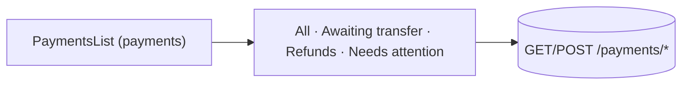

# payments

::: tip At a glance
**Owns** — the staff payments page (four tabs and a drawer), and the payment behind an order, as components: `PaymentPanel`, `PaymentMethodSelector`, `TransferInstructionsPanel`, `RecordOfflinePaymentForm`, `OrderReferenceSearch`, and the `useOrderRefund` composable.
**Depends on** — nothing. It is mounted, it does not mount.
**Breaks if you change** — those components' props. [`orders`](./orders.md) mounts the panel and the staff forms; [`cart`](./cart.md) mounts `PaymentMethodSelector`.
:::

| Fact          | This module                                                                                                       |
| ------------- | ----------------------------------------------------------------------------------------------------------------- |
| **Subdomain** | `supporting` — Specific to this business but not a differentiator. Kept plain.                                    |
| **Publishes** | `PaymentPanel` · `PaymentMethodSelector` · `RecordOfflinePaymentForm` · `OrderReferenceSearch` · `useOrderRefund` |

## The map

The context map is drawn once, in [the whole map](./index.md#the-whole-map).

- `orders` → **customer-supplier** — Calls `useOrderRefund` to refund an order from the staff edit screen, and mounts `PaymentPanel`, which on its own would be `published-language`: paying happens on the order page without this module knowing a provider exists.
- `cart` → **published-language** — Mounts `PaymentMethodSelector`; the checkout learns which method ids exist, never what one costs to offer.

## The story

**Paying has no route.** Paying happens _on_ the order, so this module contributes a component
through its barrel and [`orders`](./orders.md) mounts it. The map above says how each
sibling depends on this module; the order page learns nothing about payments by rendering one. The
module's one route, `PaymentsList`, is for staff and is described [below](#the-staff-payments-page).

::: tip What deleting this module costs, precisely
The panel, the pay flow and the mock provider go in one `rm -rf` plus one registry line. Orders go
back to being paid nowhere — the state the shop was in before this module existed.

Nothing else in the client notices, because nothing else imports it.
:::

The store is here rather than in the panel because a component that owns its own fetching cannot be
mounted twice on one page without duplicating the request. The panel is a view; the store is the
domain's state, exactly as everywhere else.

### There is no card field, and that is the design

A live provider tokenises the card inside an iframe **it** owns, and hands the browser an opaque
reference (`pm_…`). A card number reaching this application — let alone its API — is the difference
between the light PCI bracket and the heavy one, so the panel never collects one.

**The panel shows a card form only when `GET /payments/methods` lists `card`**, which the backend does
only once a card provider is configured — a production deployment with none shows a short note
instead. Where a provider's widget mounts, a development or e2e build mounts `TestCardPicker`: the
fake provider's four test references. That file is loaded through a dynamic import behind
`import.meta.env.DEV || VITE_TEST_CARDS === 'true'`, which a production build folds to `false`, so
the chunk — and every `pm_card_*` reference and label in it — is not in the bundle. `build:e2e` sets
`VITE_TEST_CARDS=true`; nothing else does. A real provider brings its own widget in its place.

### The answer is not always immediate

The confirm can come back three ways, and only one of them is finished:

| Answer            | What it means                                   | The panel's next move                             |
| ----------------- | ----------------------------------------------- | ------------------------------------------------- |
| `succeeded`       | The money landed and the order is `paid`.       | Notify, tell the order page to re-read itself.    |
| `requires_action` | The bank wants a 3-D Secure challenge answered. | Show the challenge step, then `finishAtProvider`. |
| `processing`      | The provider is settling asynchronously.        | Say so, offer a re-check.                         |

Every answer carries the payment's `actions`, so the panel never decides the next step itself:
`actions.pay` is the card form, `actions.sync` the "finish at your bank" button (the payer's, never
staff's, and never a hand-paid transfer's). A decline or a payment that was never confirmable on
the sync re-reads the payment, so a stale "finish" does not stay on screen.

A decline is a rejection with its own message, not an error toast. The two in-flight answers are
**successes** on the wire: a 4xx would tell the browser to stop, and the browser is the only thing
that can finish. The server's webhook settles all of these eventually whatever the browser does —
`finishAtProvider` only makes the happy path feel immediate.

## The staff payments page

`/sales/payments`, in the admin menu's "Sales" group, for whoever holds `display:Payment`. The
route asks `['display', 'Payment']`, because `read:Payment` answers a plain `can` for a customer.

Four tabs, saved views over what the backend already holds (the active one is `?tab=`):

| Tab               | Reads                                                                    | Notes                                                                                                                                  |
| ----------------- | ------------------------------------------------------------------------ | -------------------------------------------------------------------------------------------------------------------------------------- |
| All               | `POST /payments/search`                                                  | Filters (status, method, provider, dates, amounts, order, reference, open dispute) and sort by date or amount; a row opens the drawer. |
| Awaiting transfer | `GET /payments?method=bank_transfer&displayStatus=incomplete&sort=payBy` | Soonest deadline first: `payBy`, the RF reference and the amount; a row opens the drawer, which links to the order's offline form.     |
| Refunds           | `GET /payments/refunds`                                                  | One row per refund across every payment; read-only.                                                                                    |
| Needs attention   | `GET /payments/attention`                                                | Only problems still recorded on a document: a fixed one disappears. Repairs nothing.                                                   |



**The drawer** shows what a row has no room for: refunds, the card's last digits, and the provider
references. `Payment.providerRef`, a refund's `providerRefundRef` and its `failureReason` are sent
only to a caller holding `display:Payment`; the page renders them when present and never asks who
is looking. `failureReason` is a closed set (declined, insufficient funds, expired or cancelled
card, lost or stolen card, provider unavailable, unknown), each worded in the locale files — the
raw provider text stays in the server's logs. The drawer's refund button is the existing
`POST /payments/{id}/refunds`, shown only while `actions.refund` is true; a partial refund
and recording an offline payment stay on the order's page.

**Hand-paid refunds are confirmed, not guessed.** Cash and transfers have no provider to ask, so a
refund on them only opens a `pending` record (the panel says an operator has to hand the money back).
`actions.settleRefundByHand` names the records the caller may confirm; the drawer and the order's edit page
show one "Mark returned" button per id, after a question naming the amount — nothing is sent anywhere,
the click is the operator's word (`POST /payments/{id}/refunds/{refundId}/settle`). A refund another
operator confirmed first answers 409 and the payment is re-read. The needs-attention list opens the
drawer from a refund owed by hand.

**Refunds that must never be paid are voided, not settled.** `actions.cancelRefund` names the records
staff may cancel (the same set as `settleRefundByHand`: the money provably did not move). The drawer
shows a "Cancel refund" button per id; it opens a note field (required, the audit says why) and sends
`POST /payments/{id}/refunds/{refundId}/cancel`. No question is asked: writing the note is the
deliberate step. Nothing is sent to the provider and nobody is mailed. Like the hand settle, a lost
race re-reads the payment before the error shows.

**The legal clock is visible.** A refused refund that pays a withdrawal or a return carries
`refundDueBy` (creation plus 14 days, Consumer Rights Directive Art. 13); the needs-attention list
turns it into the days left, or how late the refund is. Any other refund shows its age only.

**A buyer's dispute is shown, not fought.** When the bank disputes a card payment the server sends
`Payment.disputes` to staff only. The drawer and the order's edit page (`OrderDisputes`, which reads the payment
`useOrderRefund` already fetched) show a `DisputeBanner` per dispute: its kind, where it stands, the
reason, the amount, the days left to send evidence and a link to the provider's dashboard (only an
`https` address; the shop answers there, this page sends no evidence). While a chargeback is open the
banner says refunds are paused; the refund button itself is already gone because `actions.refund` is
false, so the page decides nothing. Needs attention gets a `dispute_needs_response` row with the
evidence deadline and, when part of the payment was already refunded, how much (that refund is the
evidence). The All tab filters to payments with an open dispute, and the order's timeline gets two
staff-only rows, `dispute_opened` and `dispute_closed`.

**What the page does not show** is an amount mismatch: the order is cancelled and refunded
automatically and the only trace is an audit row, so the tab points at the audit log.

## State

State, getters and actions are exactly what the setup function of each store returns: `src/modules/payments/store.ts`.

## Screens

Paths, route names, access and permission per screen: `src/modules/payments/routes.ts`; every module's together are in the generated [sitemap](../theory/sitemap.md).

The rest of the module is components, schemas and a store contributed to the modules that depend on it.

## Wiring

#### Endpoints called

Method, path and auth of every operation: `contracts/rest/routes.ts`. The calls this module makes, each with the schema its answer is checked against: `src/modules/payments/response-schemas.ts`.

#### Navigation entries

Entries are declared in `src/modules/payments/module.ts`. Badges: `PaymentsList` — `salesPayments`: the rows needing a person.

## Files

The folder is `src/modules/payments/`; each file's own `@module` header says what it is.

## Working on it

```bash
# this module's vitest suites
npm run test:unit -- payments

# after the backend changes an endpoint this module calls
npm run regenerate
```

## Deeper in

Nothing in this domain needs a page of its own — the story above is the whole of it.

## Related pages

- [`orders`](./orders.md) — the page that mounts the panel
- [`delivery`](./delivery.md) — the other component-only module
- [Strategic DDD](../theory/strategic-ddd.md) — what `published-language` buys
- [Layers](../theory/layers.md) — why the store is not inside the component
