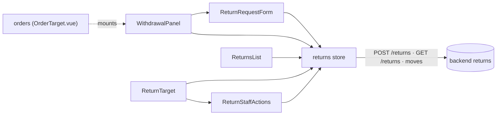
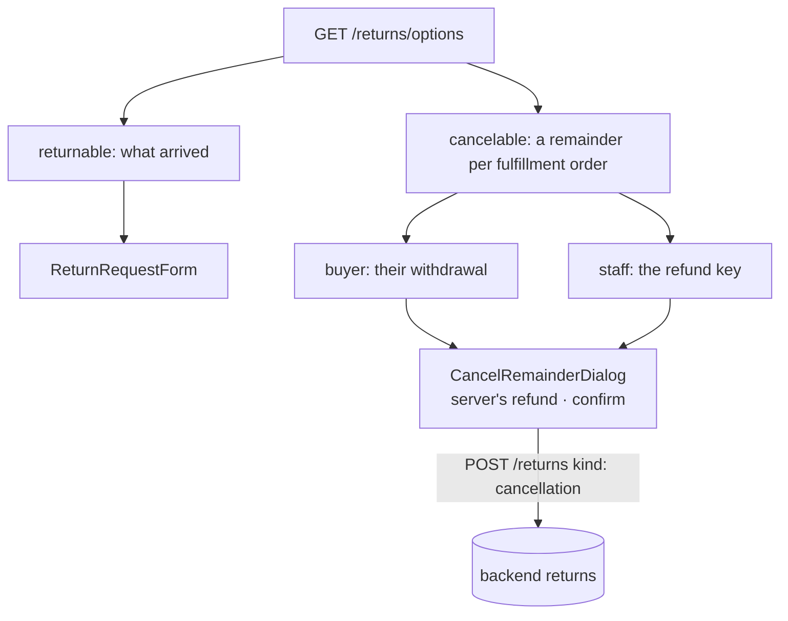
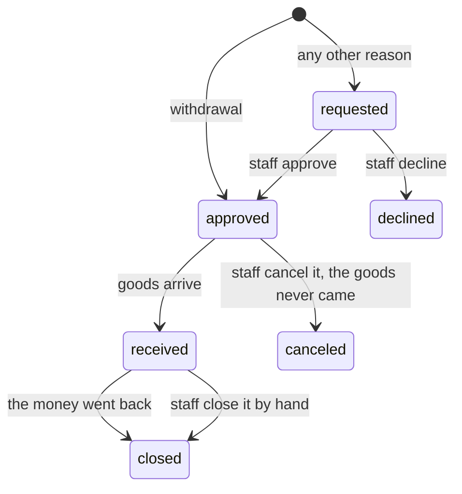

# returns

::: tip At a glance
**Owns** — the customer's own returns (a returns form for faulty or wrong goods and part-orders),
the staff queue that approves and receives them, cancelling what has not shipped, and the EU
"withdraw from contract here" button.
**Depends on** — nothing. [`orders`](./orders.md) mounts its `WithdrawalPanel`.
**Breaks if you change** — the order page's withdrawal control and returns form.
:::

| Fact                    | This module                                         |
| ----------------------- | --------------------------------------------------- |
| **Subdomain**           | `supporting`                                        |
| **Screens**             | 3 — `ReturnsList` · `SalesReturns` · `ReturnTarget` |
| **Store**               | `returns`                                           |
| **Menu entries**        | `ReturnsList` (account) · `SalesReturns` (admin)    |
| **API calls**           | 7                                                   |
| **Depends on**          | _nothing_                                           |
| **Depended on by**      | [`orders`](./orders.md)                             |
| **Languages**           | `en` · `it`                                         |
| **Publishes**           | `WithdrawalPanel`                                   |
| **Backend counterpart** | `returns` in `boilerplate-node-backend`             |

## The map

`orders` reaches this module through one `published-language` edge: its page mounts
`WithdrawalPanel`, so the order never calls a returns operation itself. A return links back to its
order by route name, guarded by `linkIfRouted`, so no edge points the other way.

The context map is drawn once, in [the whole map](./index.md#the-whole-map).

- `orders` → **published-language** — Mounts `WithdrawalPanel`; the withdrawal and the order's returns list are the component's own business.

Inside the module, the pieces connect like this:



## The story

A withdrawal is a return whose reason is `withdrawal`, so there is no separate endpoint: the button
is `POST /returns`, which always answers 201 and a `Return` (one endpoint, one resource, so the
route table's one-schema-per-route rule holds). `openReturn` resolves with that `Return`; where the
goods are only changes what it looks like:

| Order was       | The `Return`                                                                          |
| --------------- | ------------------------------------------------------------------------------------- |
| shipped         | `approved`, with the lines coming back                                                |
| before dispatch | `closed` at birth, no `lines`: the backend cancelled and refunded the order meanwhile |

After a withdrawal the panel emits `opened`, the order page re-reads the order (now cancelled), and
the panel lists the new `Return` like any other. The return page says "no goods are expected back"
where its lines would be.

**The button is server-driven.** `WithdrawalPanel` shows it when `Order.actions.withdraw` is true and
prints `Order.actions.withdrawUntil` as a UTC date only ("until the end of 5 December", no time of day; the shop accepts one more day, which the client never shows); it never counts the withdrawal period. Clicking asks once more —
the directive wants a confirmation step — and the backend mails the acknowledgement with the date and
time. A withdrawal takes no reason and covers the whole order. The panel also lists the returns
already opened on that order, so a customer sees what became of a withdrawal.

**What can still be done comes from `GET /returns/options`.** The panel reads it once per order and
counts nothing itself: `returnable` is what has shipped and not yet come back, `cancelable` is each
fulfillment order that still has a remainder, with the refund cancelling it would owe (the delivery
included when it takes the last unit). Both doors below are fed by it, and it is re-read after
each move.



**Cancelling what has not shipped** is its own door once part of an order has left. Each remainder
shows the server's refund and opens `CancelRemainderDialog`, which sends `POST /returns` with
`kind: cancellation` and the fulfillment order's id. The buyer's cancellation is part of their
withdrawal (`reason: withdrawal`, no note); a staff member holding the refund key
(`create:Refund`) cancels with reason `other` and an optional note, and the http layer prompts
for the password first — the key is step-up gated. The record is born `closed`, its lines are the
remainder, and the panel lists it like any other return. Rank, window and who may refuse are the
server's.

**The returns form is for everything else.** Once something has shipped, `ReturnRequestForm` lets the
customer tick the lines that come back, set a quantity for each (up to the server's `returnable`
quantity), pick a reason (defective, wrong item or other — `withdrawal` is the button, not a choice
here) and add a note. The reasons on offer are the server's `reasons`: after the withdrawal period
only the two guarantee reasons are left (two years from delivery), and a made-to-order line
(`withdrawable: false`) is shut for `other`. It sends only the ticked lines, so part of an order can go back; the same
product can be returned again until nothing is left. The server re-checks all of it (too many, an
excluded line, a closed window) and its message shows in the form. Staff then approve or decline the
return like any other.

**Staff moves come from `Return.actions`.** `ReturnStaffActions` renders approve, decline (a reason picked from a list, plus a message to the buyer that "Other" requires), the proof of sending (the carrier's date, name and reference, recorded once; the button says "Record proof and refund" on a withdrawal, whose refund it opens, and "Record proof" on a faulty item, and the recorded proof is shown under the form), receive (with a restock count per line and an optional handling deduction), close and cancel (each with an
optional note) from the six booleans, and re-implements none of the lifecycle. Receiving and
closing are step-up gated: the http layer prompts for the password when the server answers
`REAUTH_REQUIRED`. Close is for a received return whose refund was canceled or paid outside the app:
it moves no money and no stock, and the customer is not told their money is back. The receive form lists every
returned line with a number field prefilled with its quantity: lower it for a broken unit (0 keeps
it off the shelf, so it is never handed to a waiting backorder buyer; the refund does not change).
Only a lowered line is sent, and after receipt the staff part shows "restocked n of m", never the
buyer. Cancel is for an
approved return whose goods never came: it is not a close, moves nothing, mails nobody, and frees the
same items to be returned again.



**Staff acting for the buyer.** A caller holding `update:Return` who is not the buyer gets, on the
order page, **Open a return for the buyer** (the same `ReturnRequestForm`, plus an optional "day the
buyer asked", and a reason already past its deadline is labelled as an exception the return will
record; made-to-order lines stay open for them) and **Record a withdrawal**
(`RecordWithdrawalDialog`: the day the buyer sent it, never in the future, and the channel; both
required). A partly shipped order's "cancel what has not shipped" dialog gets the same two fields
behind a tick for staff. The shop asks for the password first (the server fails closed whenever the
body carries `statedVia`), and judges the window on the day given. The return page shows when the
buyer asked or stated it, and to staff what was waived. `StatedAtFields` is the one pair of fields
the three forms share; the server owns every rule.

**Goods with no right of withdrawal** (EU Art. 16) carry `noWithdrawal` on their order line; the order
page says so on the line, and the product form has the switch. The refusal itself is the backend's.

## Not built here

The return address the shop asks goods to be sent to is read from `GET /delivery/methods` and named in
the acknowledgement email; this module does not show it on the return page.

## State

Store `returns`, from `store.ts`. Only what the setup function returns is listed.

| Kind        | Members                                                                                                                                                                                              |
| ----------- | ---------------------------------------------------------------------------------------------------------------------------------------------------------------------------------------------------- |
| **State**   | `returns` · `filters` · `pageCurrent` · `pageSize`                                                                                                                                                   |
| **Getters** | `returnsList` · `currentReturn` · `loading` · `pageTotal` · `pageItemList`                                                                                                                           |
| **Actions** | `fetchPaginationReturns` · `watchSearchReturns` · `fetchReturn` · `watchReturn` · `openReturn` · `fetchOrderReturns` · `fetchReturnOptions` · `approve` · `decline` · `receive` · `close` · `cancel` |

## Screens

| Path            | Route name     | Access | Permission    | View                     |
| --------------- | -------------- | ------ | ------------- | ------------------------ |
| `returns`       | `ReturnsList`  | `auth` | —             | `views/ReturnsList.vue`  |
| `sales/returns` | `SalesReturns` | `auth` | `read Return` | `views/ReturnsList.vue`  |
| `returns/:id`   | `ReturnTarget` | `auth` | —             | `views/ReturnTarget.vue` |

Paths are relative to the localised root, so `cart` is served at `/:locale/cart`. **Access** is the route's own `meta.access` (the standing it needs) and **Permission** its `meta.can`.

`ReturnsList` and `SalesReturns` are one view on two routes: the server decides whether the rows are
the caller's own or everyone's.

## Wiring

#### Endpoints called

| Call                         | Response schema            |
| ---------------------------- | -------------------------- |
| `GET /returns/options`       | `GetReturnOptionsResponse` |
| `GET /returns`               | `ListReturnsResponse`      |
| `POST /returns`              | `CreateReturnResponse`     |
| `GET /returns/{id}`          | `GetReturnByIdResponse`    |
| `POST /returns/{id}/approve` | `ApproveReturnResponse`    |
| `POST /returns/{id}/decline` | `DeclineReturnResponse`    |
| `POST /returns/{id}/receive` | `ReceiveReturnResponse`    |
| `POST /returns/{id}/close`   | `CloseReturnResponse`      |
| `POST /returns/{id}/cancel`  | `CancelReturnResponse`     |

Each row registers one Zod schema through the manifest, so enabling the domain turns its contract validation on and deleting the folder turns it off.

#### Navigation entries

| Route          | Label key                        | Section   | Order | Icon | Badge                                     |
| -------------- | -------------------------------- | --------- | ----- | ---- | ----------------------------------------- |
| `ReturnsList`  | `navigation.label-returns`       | `account` | 92    | yes  | —                                         |
| `SalesReturns` | `navigation.label-sales-returns` | `admin`   | 59    | yes  | `returns`: returns waiting for a decision |

## Files

| File                                             | What it is                                                                                         | Explained in                          |
| ------------------------------------------------ | -------------------------------------------------------------------------------------------------- | ------------------------------------- |
| `components/CancelRemainderDialog.vue`           | Cancels what has not shipped yet, behind a confirm step that shows the server's own refund.        | [read](../theory/layers.md)           |
| `components/RecordWithdrawalDialog.vue`          | Staff recording a withdrawal the buyer stated by phone, email or letter.                           | [read](../theory/layers.md)           |
| `components/ReturnRequestForm.vue`               | The customer's returns form: which lines come back, why, and an optional note.                     | [read](../theory/layers.md)           |
| `components/ReturnStaffActions.vue`              | The staff's six moves on a return: approve, decline, proof of sending, receive, close, cancel.     | [read](../theory/layers.md)           |
| `components/StatedAtFields.vue`                  | The day and channel staff record for what the buyer said, shared by the three staff forms.         | [read](../theory/layers.md)           |
| `components/WithdrawalPanel.vue`                 | The order page's returns corner: the withdrawal button and what became of earlier returns.         | [read](../theory/layers.md)           |
| `domain/remedy.ts`                               | The remedies a faulty or wrong item can be given, so the forms offer only what the server accepts. | [read](../theory/domain-layer.md)     |
| `domain/statement.ts`                            | The day and channel a buyer stated a request or withdrawal, converted both ways.                   | [read](../theory/domain-layer.md)     |
| `index.ts`                                       | The public barrel: `WithdrawalPanel`, the only surface a sibling may import.                       | [read](../theory/modules.md)          |
| `locales/en.json · locales/it.json`              | This domain's translation dictionary for one language, loaded as its own chunk.                    | [read](../tools/i18n.md)              |
| `module.ts`                                      | The manifest: routes, navigation entries, response schemas and locales.                            | [read](../theory/modules.md)          |
| `response-schemas.ts`                            | One row per endpoint this domain calls, with the Zod schema its response is validated against.     | [read](../api/openapi-workflow.md)    |
| `routes.ts`                                      | The domain's route records, each carrying its own `meta.access`.                                   | [read](../theory/modules.md)          |
| `schemas.ts`                                     | Zod field schemas for the returns forms, with length caps read from the contract.                  | [read](../theory/modules.md)          |
| `store.ts`                                       | The Pinia store: a paginated search, a by-id read and the moves on a return.                       | [read](../tools/state-and-routing.md) |
| `tests/*.spec.ts`                                | Vitest suites: the store, the routes, the schemas, the domain rules and each component.            | [read](../tools/unit-testing.md)      |
| `tests/e2e/a11y.cy.ts · tests/e2e/actions.cy.ts` | Cypress: an axe sweep over the routes, and the moves in a browser.                                 | [read](../tools/component-testing.md) |
| `views/ReturnsList.vue`                          | A routed screen: the filtered, paged list, for a customer or for staff.                            | [read](../theory/layers.md)           |
| `views/ReturnTarget.vue`                         | A routed screen: one return, with the staff's open moves.                                          | [read](../theory/layers.md)           |

## Working on it

| Suite   | Files | Where                            |
| ------- | ----- | -------------------------------- |
| Vitest  | 9     | `src/modules/returns/tests/`     |
| Cypress | 2     | `src/modules/returns/tests/e2e/` |

```bash
# this module's vitest suites
npm run test:unit -- returns

# this module's cypress suites
npm run test:e2e -- --spec 'src/modules/returns/tests/e2e/*.cy.ts'

# after the backend changes an endpoint this module calls
npm run regenerate
```

## Deeper in

Nothing in this domain needs a page of its own: the story above is the whole of it.

## Related pages

- [`orders`](./orders.md) — mounts `WithdrawalPanel` on the order page
- [`delivery`](./delivery.md) — the return address this module does not show
- [Domain Layer](../theory/domain-layer.md) — why `remedy.ts` and `statement.ts` are pure rules
- [Sitemap & Access Control](../theory/sitemap.md) — the customer/staff split on these routes
