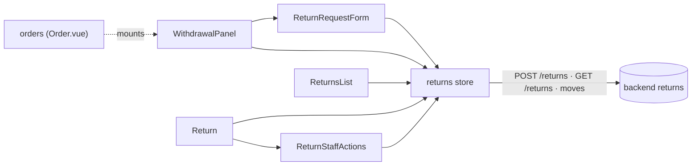
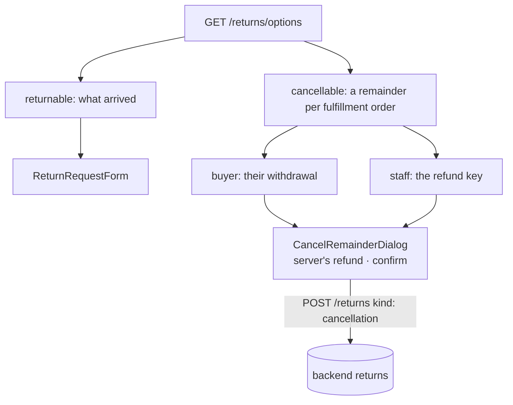
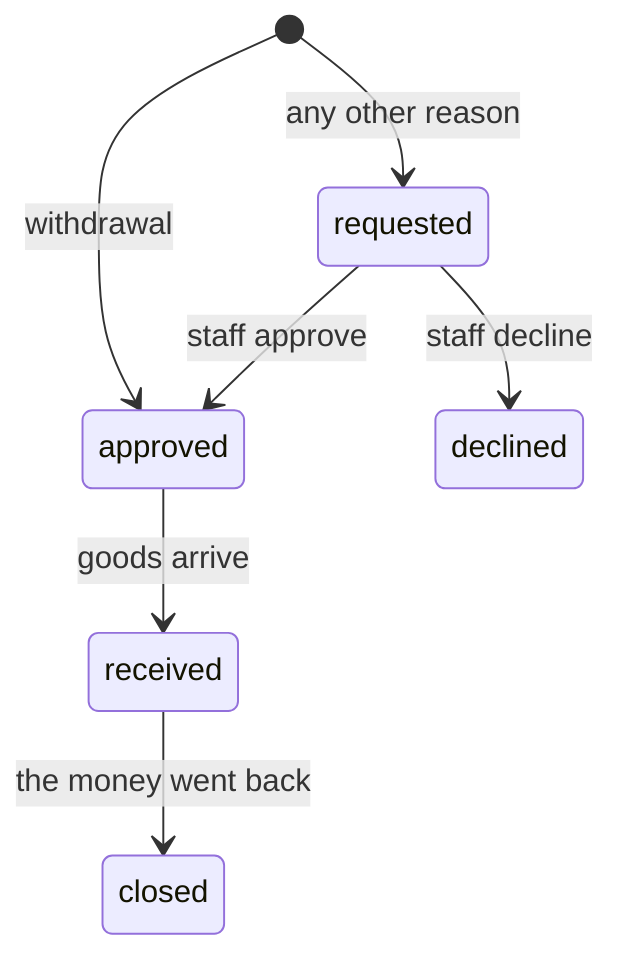

# returns

::: tip At a glance
**Owns** — the customer's own returns (a returns form for faulty or wrong goods and part-orders),
the staff queue that approves and receives them, cancelling what has not shipped, and the EU
"withdraw from contract here" button.
**Depends on** — nothing. [`orders`](./orders.md) mounts its `WithdrawalPanel`.
**Breaks if you change** — the order page's withdrawal control and returns form.
:::

| Fact                    | This module                             |
| ----------------------- | --------------------------------------- |
| **Subdomain**           | `supporting`                            |
| **Screens**             | 2 — `ReturnsList` · `ReturnTarget`      |
| **Store**               | `returns`                               |
| **Menu entries**        | `ReturnsList`                           |
| **API calls**           | 7                                       |
| **Depends on**          | _nothing_                               |
| **Depended on by**      | [`orders`](./orders.md)                 |
| **Languages**           | `en` · `it`                             |
| **Publishes**           | `WithdrawalPanel`                       |
| **Backend counterpart** | `returns` in `boilerplate-node-backend` |

## The map

`orders` reaches this module through one `published-language` edge: its page mounts
`WithdrawalPanel`, so the order never calls a returns operation itself. A return links back to its
order by route name, guarded by `linkIfRouted`, so no edge points the other way.

## The story

A withdrawal is a return whose reason is `withdrawal`, so there is no separate endpoint: the button
is `POST /returns`, which always answers 201 and a `Return` (one endpoint, one resource, so the
route table's one-schema-per-route rule holds). `openReturn` resolves with that `Return`; where the
goods are only changes what it looks like:

| Order was       | The `Return`                                                                          |
| --------------- | ------------------------------------------------------------------------------------- |
| shipped         | `approved`, with the lines coming back                                                |
| before dispatch | `closed` at birth, no `lines`: the backend cancelled and refunded the order meanwhile |

After a withdrawal the panel emits `opened`, the order page re-reads the order (now cancelled), and
the panel lists the new `Return` like any other. The return page says "no goods are expected back"
where its lines would be.

**The button is server-driven.** `WithdrawalPanel` shows it when `Order.actions.withdraw` is true and
prints `Order.actions.withdrawUntil`; it never counts the withdrawal period. Clicking asks once more —
the directive wants a confirmation step — and the backend mails the acknowledgement with the date and
time. A withdrawal takes no reason and covers the whole order. The panel also lists the returns
already opened on that order, so a customer sees what became of a withdrawal.

**What can still be done comes from `GET /returns/options`.** The panel reads it once per order and
counts nothing itself: `returnable` is what has shipped and not yet come back, `cancellable` is each
fulfillment order that still has a remainder, with the refund cancelling it would owe (the delivery
included when it takes the last unit). Both doors below are fed by it, and it is re-read after
each move.

**Cancelling what has not shipped** is its own door once part of an order has left. Each remainder
shows the server's refund and opens `CancelRemainderDialog`, which sends `POST /returns` with
`kind: cancellation` and the fulfillment order's id. The buyer's cancellation is part of their
withdrawal (`reason: withdrawal`, no note); a staff member holding the refund key
(`create:Refund`) cancels with reason `other` and an optional note, and the http layer prompts
for the password first — the key is step-up gated. The record is born `closed`, its lines are the
remainder, and the panel lists it like any other return. Rank, window and who may refuse are the
server's.

**The returns form is for everything else.** Once something has shipped, `ReturnRequestForm` lets the
customer tick the lines that come back, set a quantity for each (up to the server's `returnable`
quantity), pick a reason (defective, wrong item or other — `withdrawal` is the button, not a choice
here) and add a note. It sends only the ticked lines, so part of an order can go back; the same
product can be returned again until nothing is left. The server re-checks all of it (too many, an
excluded line, a closed window) and its message shows in the form. Staff then approve or decline the
return like any other.

**Staff moves come from `Return.actions`.** `ReturnStaffActions` renders approve, decline (with the
reason the customer is told) and receive (with an optional handling deduction) from the three
booleans, and re-implements none of the lifecycle. Receiving is step-up gated: the http layer prompts
for the password when the server answers `REAUTH_REQUIRED`.

**Goods with no right of withdrawal** (EU Art. 16) carry `noWithdrawal` on their order line; the order
page says so on the line, and the product form has the switch. The refusal itself is the backend's.

## Not built here

The return address the shop asks goods to be sent to is read from `GET /delivery/methods` and named in
the acknowledgement email; this module does not show it on the return page.
